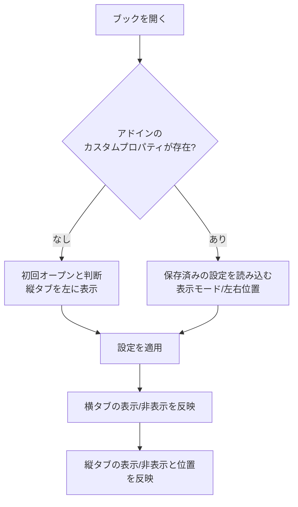
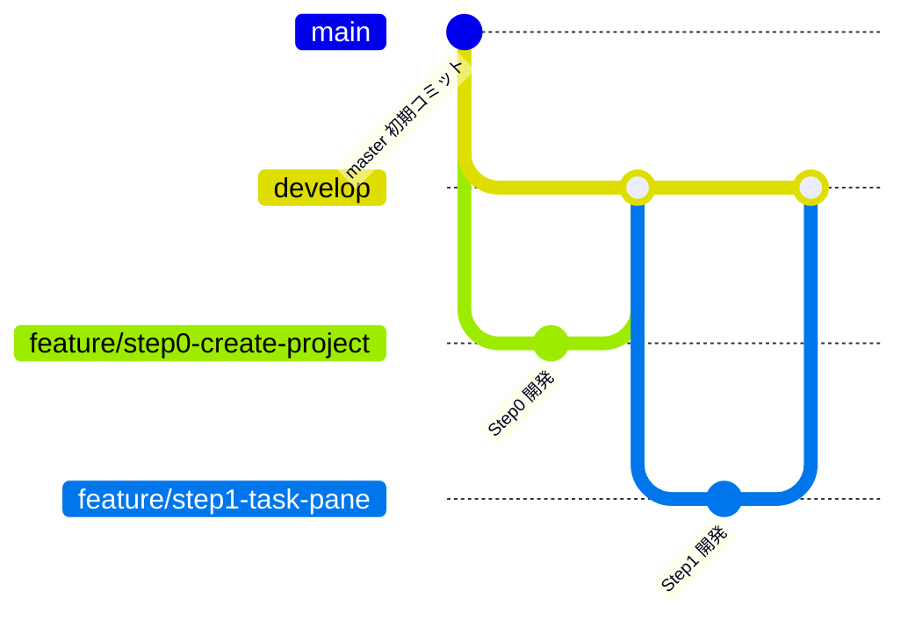

# Agents.md - 縦並びシートタブ Excelアドイン 開発方針

最終更新: 2026-10-22 (v1.1.24 の時点。随時更新)

## 0. 現在の状態 (v1.1.24) と、この文書の読み方

この文書は、相談と開発の経緯を、時系列で記録したものです。**後の章 (特に12章) の変更が、前の章の記述より優先**されます。前の章で、のちに変わった記述には、「(→ 12.x で変更)」の注記を付けています。利用者向けの説明は `README.md`、開発者向けの手順は `DEVELOPMENT.md` にあります。

### 0.1 現在の状態

| 項目 | 内容 |
|---|---|
| 最新版 | v1.1.24 (`develop`、`master`、タグ `v1.1.24` は、同じコミット)。v1.1.4 は、`master` に反映せず、タグも無い (内容は v1.1.5 に含まれる) |
| 開発ステップ | Step0 から Step8 (フォルダ機能) まで完了。以降は、ユーザーの要望と不具合の修正を、`fix/...`、`feature/...` ブランチで行い、リリースごとにインストーラと配布用zipを作る (13章) |
| 配布 | ClickOnce のインストーラ + 配布用zip (`配布用zip\VerticalSheetTabs_v1.1.24.zip`)。自己署名の証明書 |
| 実機の確認環境 | Windows 11、拡大率125%、Excel 365 (64bit、カラフルのテーマ)。ほかの拡大率、暗い配色は、未確認 (11.3) |

### 0.2 現在の仕様の要約 (最新の決定)

| 項目 | 現在の仕様 | 経緯 |
|---|---|---|
| 縦タブの初回の幅 | 半角12文字分 | 2章、11.5、12.40 |
| ペインのタイトル | 「縦タブ」 | 10.3、11.6 |
| ブック保存設定 | `VTab.Mode`、`VTab.Side`、`VTab.Width`、`VTab.Outline`、`VTab.OutlineLevel`、`VTab.NameRule` (2.2) | 12.50、12.56 |
| フォルダの保存 | ブックのカスタムXMLパート。シートの識別は、隠しカスタムプロパティ `VTab.Id` (`CodeName` は使わない) | 12.8 |
| フォルダの選択 | フォルダの行のクリックで、フォルダだけを選択 / 解除する。中のシートは、Excelで選択されない | 12.19 |
| フォルダの色 | フォルダの行全体に付ける (左端の帯ではない)。シートには反映しない | 12.19 |
| フォルダの一括操作 | 名前の変更 / すべて非選択 / すべて選択 / すべて非表示 / すべて再表示 / フォルダの色 / フォルダと中のシートの色 / 中の全てを選択中シートと同一色に変更 / 中の全てをフォルダと同一色に変更 (ON/OFF、チェックマーク) / フォルダの削除 / フォルダと中のシートを削除。「保護」と「移動またはコピー」は、削除した | 12.12、12.28 から 12.31、12.39、12.65、12.66 |
| 開いたフォルダ | 点線で囲む (右上と左下が欠ける)。表示 / 非表示と色の段階 (1から9) は、設定画面で選ぶ | 12.42、12.47、12.48、12.50 |
| 「+」ボタン | 縦タブの下端に常に固定。選択が閉じたフォルダの中だけのときは、一番下に追加 | 12.17、12.50 |
| シート名のルール | `フォルダ名 \| シート名`。ブックごとに、使う / 使わないを選ぶ (初期値: 使わない) | 12.56 |
| 縦タブの「挿入」 | アドインの処理。フォルダ内のシートで選ぶと、そのフォルダに入る | 12.73 |
| キー入力 | シートを選んだ直後のキー入力は、セルに入る。セルの入力中にシートを選ぶと、入力を確定してから切り替える | 12.58、12.60 |
| 保存の確認 | 開いただけ、同期しただけでは、ブックを「変更あり」にしない。フォルダの開閉、色、名前などの操作は、「変更あり」にする | 12.14、12.25 |
| 縦タブでのショートカット | Ctrl+S、F12 のみ、Excelの保存を実行する | 12.21 |
| 設定画面の表示 | 左下に、バージョン、著作権、ライセンス (BSD 3条項) | 12.62、12.63、12.69 |

### 0.3 章の案内

| 章 | 内容 |
|---|---|
| 1から5 | 目的、確定事項、処理フロー、実装方針、未決定事項 |
| 6、7 | 開発ステップ、ブランチ運用 |
| 8 | Step0 から Step5 の開発メモ |
| 9 | Step6 見た目の再現 (採寸結果、テーマ、DPI) |
| 10、11 | Step7 仕上げ、完了状況と残課題 |
| 12 | Step8 フォルダ機能の設計と、その後の改善、不具合の修正、リリースの記録 (12.1 から 12.74) |
| 13 | リリースの定型作業 |

## 1. 目的

Excelのシートタブは標準で横並びだが、シート数が増えると操作しづらく見づらい。
そこで、シートタブを縦並びで表示するExcelアドインを開発する。

## 2. 確定事項

| 項目 | 決定内容 |
|---|---|
| 対象 | Windows版 Excel (Microsoft 365) のみ |
| 方式 | VSTO アドイン (独自GUI描画のため) |
| 機能 | 縦並びでも、横並びタブと全く同一の機能が実行できる |
| タブ色 | 横並びと全く同じ色分けができる |
| 見た目 | 縦並びでも、横並びと同じグラフィック描画の外観にする |
| 見た目の再現度 | 可能な限り完全同一を目標とする (方針は2.3) |
| 機能の範囲 | 横タブの全機能 (切替、追加、削除、名前変更、ドラッグ移動、Ctrl+ドラッグコピー、複数選択、右クリックメニュー、タブ色変更、非表示/再表示 など) |
| 対象シート | ワークシートとグラフシートは表示。非表示とVeryHiddenのシートは縦タブにも表示しない |
| 縦タブが多い場合 | 縦スクロールバーで対応 |
| 幅の保存タイミング | ブック保存時のみ記録。保存せず閉じた場合は変更前の幅のまま |
| ビット数 | 64bit (x64)。このPCのExcel (Microsoft 365, ビルド16.0.20430) と同じ |
| 開発環境 | Visual Studio Community 2026 (18.x)。.NET SDK 10.0.401 も導入済み |
| 縦タブの幅 | 初回は半角12文字分 (当初は16文字、のち8文字。11.5、12.40で変更)。ユーザーがドラッグで変更可能 |
| 幅の保存/復元 | ブック保存時に直前の幅を保存し、再オープン時に復元 |
| 設定変更の入口 | (1) リボンのボタン (2) タブ右クリックメニューの先頭に「タブ表示の設定」を追加。どちらも同じ設定画面を開く |
| 縦タブのUI形式 | カスタムタスクペイン (CustomTaskPane + UserControl)。内部は自前描画。左右ドッキングと幅変更はペイン機能を利用 |
| ワークロード | VS 2026に「Office/SharePoint開発」を導入済み |
| シート名の最大長 | 横タブと同一 (Excel仕様の31文字) |
| 長いシート名の表示 | 幅に収まらない分は末尾を「…」で省略し、ホバー時にフルネームをツールチップ表示 |
| 設定画面 | 表示モード (ラジオ3択: 横のみ/縦のみ/両方)、縦タブの位置 (ラジオ2択: 左/右)、OK/キャンセル。のちに、シート名のルール (12.56)、フォルダを囲む点線 (12.50) を追加 |
| 複数ブック | ブック/ウィンドウごとに専用ペインを持ち、設定は完全に独立 |
| 初回オープン時の表示 | 表示モードはC (横タブと縦タブの両方を表示)、縦タブは左側 |
| 初回表示位置 | ブックの初回オープン時は左側に縦タブを表示 |
| 表示位置の設定 | ユーザー設定で左/右を選択可能 |
| 設定の保存 | Excelのカスタムドキュメントプロパティにブック単位で保存し、オープン時に復元 |
| 初回判定 | 本アドインのカスタムプロパティがブックに無ければ初回オープンと判断 |
| タブ表示モード | 下記3パターンからユーザー設定で選択 |

### 2.1 タブ表示モード (ブック単位の設定)

| モード | 横タブ (標準) | 縦タブ (本アドイン) |
|---|---|---|
| A: 横のみ | 表示 | 非表示 |
| B: 縦のみ | 非表示 | 表示 |
| C: 両方 | 表示 | 表示 |

### 2.2 ブック保存設定 (カスタムドキュメントプロパティ)

| 設定項目 | 値 |
|---|---|
| 表示モード | A / B / C |
| 縦タブの位置 | 左 / 右 |
| 縦タブの幅 | 保存時の幅 (初回は半角12文字分) |
| フォルダを囲む点線 | 表示 / 非表示、色の段階 (12.50) |
| シート名のルール | 使う / 使わない (12.56) |

項目ごとに別のカスタムドキュメントプロパティとして保存する。

| プロパティ名 | 型 | 値 |
|---|---|---|
| `VTab.Mode` | 文字列 | `A` (横のみ) / `B` (縦のみ) / `C` (両方) |
| `VTab.Side` | 文字列 | `Left` / `Right` |
| `VTab.Width` | 数値 (整数) | ペイン内容部の幅。DPI非依存のピクセル値 (96dpi換算)。復元時は実際のDPIで実ピクセルに戻す (→ 9.5 で、`DeviceDpi` から実際のDPIに変更) |
| `VTab.Outline` | 文字列 | `On` / `Off` (開いたフォルダを囲む点線。12.50)。無いブックは `On` |
| `VTab.OutlineLevel` | 数値 (整数) | 点線の色の段階 1から9 (12.50)。無いブックは 5 |
| `VTab.NameRule` | 文字列 | `On` / `Off` (シート名のルール。12.56)。無いブックは `Off` |

`VTab.Mode` 等のプロパティが存在しないブックは初回オープンと判断する (`VTab.Outline`、`VTab.OutlineLevel`、`VTab.NameRule` は、判断に使わない)。

### 2.3 見た目の再現方針

Excel標準タブの描画を取得するAPIは無いため、自前描画 (GDI+/WinForms等) で再現する。

- 実機のExcel標準タブをスクリーンショットで採寸し、寸法・色・フォント・余白を合わせる
- 再現対象の状態: 通常 / 選択中 / グループ選択 / マウスホバー / タブ色あり
- 再現対象の環境: Officeテーマ (カラフル/白/黒/ダークグレー)、DPI (100%-200%以上)、Windows 11の見た目
- 横タブとの差分は「縦に並ぶ」点のみとする (文字は横書きのまま)
- 完全同一が技術的に不可能な箇所は、その都度相談して許容差を決める

## 3. 処理フロー (ブックオープン時)

## 4. 実装方針 (相談で合意済み)

| 項目 | 方針 |
|---|---|
| VSTOのターゲット | .NET Framework 4.8 |
| 幅の換算 (半角12文字) | 数字「0」の幅x12+タブの余白で換算 (当初は16文字、のち8文字。11.5、12.40で変更) |
| タスクペイン方式の制約 | ペイン幅の変更検知、ウィンドウとの紐付け、枠の見た目は、試作段階で確認 |

## 5. 未決定事項

- 幅の最小値/最大値
- 「縦のみ」で保存したブックを、アドインの無いExcelで開いたユーザーへの案内 (実装しないことに決定。7-3)
  - アドインが無い環境では、アドインのコードが動かないため、ダイアログは出せない
  - 案: 設定画面で「縦のみ」を選んだとき、戻し方 (「ファイル > オプション > 詳細設定 > シート見出しを表示する」) を注意文として表示する。ブックの作成者に事前に知らせる目的

## 6. 開発ステップ

リスクの高い技術要素を先に小さく検証し、見た目の完全再現は最後に回す。

| Step | 内容 | 完了条件 | 主なリスク |
|---|---|---|---|
| 0 | VSTOプロジェクト作成、ビルドしてExcelで読み込み | アドインがExcelに読み込まれる | VS 2026とVSTOの相性 |
| 1 | ウィンドウごとにカスタムタスクペインを出す (左右切替、幅変更の検知) | 複数ブックで各自のペインが出る | 最大の技術リスク。ペイン幅の検知やウィンドウとの紐付け |
| 2 | シート名一覧を縦に表示し、クリックで切替。非表示/VeryHiddenは除外、グラフシートは表示 | 一覧と実際のシートが一致する | シート増減や名前変更への追従 |
| 3 | カスタムドキュメントプロパティ(`VTab.*`)の読み書き、初回判定、保存時の幅記録 | 保存して開き直すと設定と幅が復元される | 保存イベントのタイミング |
| 4 | 表示モードA/B/Cと設定画面、リボンボタン | 3パターンが切り替わる | 横タブの表示切替がブック単位でできるか |
| 5 | 全操作の実装 (追加、削除、名前変更、ドラッグ移動、Ctrl+ドラッグコピー、複数選択、右クリックメニュー、タブ色変更、非表示/再表示、「タブ表示の設定」項目) | 横タブと同じ操作ができる | 右クリックメニューの差し込み、ドラッグ操作、保護ブック時の挙動 |
| 6 | 見た目の完全再現 (実機の採寸、各状態、テーマ、DPI、省略表示、ツールチップ) | 横タブと並べて比較して差が許容内 | 時間がかかる。許容差を相談 |
| 7 | 仕上げ (例外処理、重いブックでの確認、インストーラ、署名) | 配布可能 | 配布方法の決定 |

## 7. Gitブランチ運用

- `master`: 初期コミットのみ。リリース時などに使う (→ v1.1.0 以降は、リリースした版を反映し、タグ `vX.Y.Z` を付ける。13章)
- `develop`: 統合ブランチ。各Stepの開発が完了したものだけをマージする
- `feature/stepN-内容`: Stepごとに`develop`から作成する。Step8 以降の改善は `feature/...`、不具合の修正は `fix/...` を、`develop` から作成し、マージ後に削除する (13章)。ステップ番号と内容が一目で分かる名前にする (文字化け防止のため英小文字のkebab-case)

| Step | ブランチ名 |
|---|---|
| 0 | `feature/step0-create-project` |
| 1 | `feature/step1-task-pane` |
| 2 | `feature/step2-sheet-list` |
| 3 | `feature/step3-persist-settings` |
| 4 | `feature/step4-display-mode` |
| 5 | `feature/step5-tab-operations` |
| 6 | `feature/step6-visual-fidelity` |
| 7 | `feature/step7-finishing` |

- 流れ: featureブランチで開発 -> 完了条件を確認 -> `develop`へマージ (`--no-ff`) -> 次のStepのfeatureブランチを`develop`から作成
- 各Stepの完了時に結果を報告し、マージと次Stepへの着手はその都度確認する
- コミットメッセージは日本語で書く

## 8. 開発メモ

### Step0 (プロジェクト作成) の結果

- VS 2026のExcel VSTOアドイン(C#)テンプレートの内容を元に、手作業でプロジェクトを作成した
  - `VerticalSheetTabs.sln` / `VerticalSheetTabs/VerticalSheetTabs.csproj` (.NET Framework 4.8、AnyCPU)
  - Resources/Settings は不要なため省略した
- ビルド: VS 2026付属のMSBuild (`MSBuild\Current\Bin\MSBuild.exe`) でビルド成功
- マニフェスト署名: 自己署名証明書 `VerticalSheetTabs_TemporaryKey.pfx` (パスワードなし) を使用。`.gitignore`済みのためリポジトリには含めない
  - 別PCで開発する場合は、VS 2026で「署名」タブから新しい証明書を作成し、`.csproj`の`ManifestCertificateThumbprint`を更新する
- 読み込み確認: ビルドでHKCUにアドインが登録され、Excelを通常起動すると`COMAddIns`に`VerticalSheetTabs`が`Connect=True`で表示された
  - COM自動化 (`New-Object -ComObject Excel.Application`) で起動したExcelでは、VSTOアドインは読み込まれなかった。動作確認はExcelの通常起動で行う

### Step1 (タスクペイン表示) の結果

実装: `PaneManager.cs` (ウィンドウごとにペインを管理)、`TabPaneControl.cs` (試作用の中身)、`ThisAddIn.cs` (イベント接続)。

| 確認項目 | 結果 |
|---|---|
| ウィンドウごとのペイン | OK。複数ブックを開くと、各ウィンドウに独立したペインが表示された |
| 左右のドッキング | OK。`DockPosition`で左/右の切替ができた。初期表示は左 |
| 幅変更の検知 | OK。ペインの端をドラッグすると、`UserControl.Resize`で新しい幅を検知できた |
| ブックを閉じたとき | OK。`WorkbookBeforeClose`でペインを削除し、他のウィンドウのペインは残った |
| 新規ブック作成 | OK。`WindowActivate`でペインが作られた |

分かったこと・制約:

- Excel 365はブックごとに別のトップレベルウィンドウ (SDI) になる。ペインの管理キーにはウィンドウハンドル (`Window.Hwnd`) を使えた
- ペインには、タイトルバー (タイトル、メニュー、閉じるボタン) が付く。タブ領域だけの見た目にはできない。「完全同一の見た目」の許容差として、Step6までに相談する
- ユーザーがペインの閉じるボタンで閉じた場合の扱い (再表示の方法) を、Step3/4で決める
- `CustomTaskPane.Width`に150を設定したとき、中身のコントロール幅は134pxだった。幅の単位とDPIの関係は、Step3で`VTab.Width`を決めるときに確認する
- `WorkbookBeforeClose`で保存確認がキャンセルされた場合は、ペインが消えたままになる可能性がある。Step2以降で対策する (`WindowActivate`での再作成など)
- 動作確認は、Excelを通常起動して、UI Automation (`System.Windows.Automation`) とキー送信で行った

### Step2 (シート名の縦一覧と切替) の結果

実装: `PaneManager.cs` (シート一覧の読み取りと同期、シートの切替)、`TabPaneControl.cs` (試作用の`ListBox`で一覧表示)。

| 確認項目 | 結果 |
|---|---|
| 一覧の内容 | OK。ワークシートとグラフシートを表示。非表示とVeryHiddenは除外 |
| シートの切替 | OK。一覧のクリックで、ワークシート、グラフシートとも切り替わった |
| 名前変更への追従 | OK |
| 追加・削除への追従 | OK |
| 並べ替え (移動) への追従 | OK |
| 非表示/再表示への追従 | OK。非表示にするとアクティブシートが別のシートに移り、一覧もそれに追従した |
| アクティブシートの強調 | OK。一覧の選択状態がアクティブシートと一致した |

方式:

- Excelには、シート名変更、並べ替え、非表示/再表示のイベントが無い。そのため、300ms間隔のタイマーで、シート名・表示状態・アクティブシートを読み直す
  - 一覧は、内容が変わったときだけ更新する (ちらつきやスクロール位置の消失を防ぐ)
  - `SheetActivate`イベントでも即時に同期する
- セル編集中などでExcelがビジー状態のときのCOM例外は握りつぶし、次回のタイマーで再試行する (実機での確認は未実施)

未確認・今後の課題:

- セル編集中のタイマー動作
- 保護されたブック、構造保護時の挙動 (Step5で確認)
- シートが非常に多いブックでの負荷 (Step7で確認)
- タブ色の取得 (Step6で実装)
- 試験用ボタン「Dock Left/Right」は、Step4で設定画面に置き換えるまで残す

確認時の注意: PowerShellからの画面キャプチャは`PrintWindow`でExcelのウィンドウだけを撮る。画面全体のコピーでは、他のウィンドウが写り込む。

### Step3 (設定の保存と復元) の結果

実装: `WorkbookSettings.cs` (プロパティの読み書き)、`PaneManager.cs` (読み込み、幅の適用、保存時の書き込み)、`ThisAddIn.cs` (`WorkbookBeforeSave`の接続)。

| 確認項目 | 結果 |
|---|---|
| 初回判定 | OK。`VTab.*`が無いブックでは初回と判断し、縦タブを左に表示した |
| 初回の幅 | OK。半角16文字分 (数字「0」16文字の幅 + 左右の余白) で表示された |
| 保存 | OK。ブックの保存時に`VTab.Mode`/`VTab.Side`/`VTab.Width`が書き込まれた (保存したxlsxの`docProps/custom.xml`で確認) |
| 復元 | OK。再オープンで、保存した左右位置と幅に復元された |
| 保存せず閉じた場合 | OK。ブックの保存時のみ記録するため、変更は残らない |

仕様の確定内容:

- `VTab.Width`は、ペイン内容部 (コントロール) の幅を、96dpi換算のピクセル値で保存する。ペインの枠 (実測16px) は復元時に加算する
- ペインの幅は、表示直後は確定しないため、250ms後に内容幅を測って適用する
- 書き込みの対象は、そのブックの1つのウィンドウの状態 (1ブックに複数ウィンドウがある場合は先頭のウィンドウ)
- 読み書きの失敗 (読み取り専用ブックなど) は握りつぶし、既定値で動作する
- 初回オープン時の既定の表示モードは「C: 両方」で確定 (ユーザー確認済み)

未確認・今後の課題:

- 100%以外のDPIでの幅の換算 (このPCは96dpiのみ。Step7で複数DPIを確認する)
- 1ブックに複数ウィンドウがある場合の保存内容
- OneDriveの自動保存時の書き込み (`WorkbookBeforeSave`が呼ばれるか)
- 幅の最小値/最大値 (復元時に極端な値が入っていた場合の補正)
- C# 7.3の制約: `ref`付きラムダなどは使えない (VS 2026のVSTOプロジェクトの既定の言語バージョン)

### Step4 (表示モードと設定画面、リボンボタン) の結果

実装: `SettingsForm.cs` (設定画面)、`RibbonController.cs` (リボンボタン)、`PaneManager.cs` (モードの適用)、`WorkbookSettings.cs` (Step3から利用)。試験用の「Dock Left/Right」ボタンと情報ラベルは削除した。

| 確認項目 | 結果 |
|---|---|
| リボンボタン | OK。「表示」タブの「縦タブ」グループに「タブ表示の設定」を追加。押すと設定画面が開く |
| 設定画面 | OK。表示モード3択、縦タブの位置2択、OK/キャンセル。現在の設定が初期選択される。横のみのときは位置の選択が無効になる |
| モードA (横のみ) | OK。横タブ表示、縦タブのペインは非表示 |
| モードB (縦のみ) | OK。横タブ非表示、縦タブのペインを表示 |
| モードC (両方) | OK。両方表示 |
| 左右の切替 | OK。ダイアログで選んだ側にペインが移動した |
| 保存と復元 | OK。モードB・右を保存して再オープンすると、同じ状態で復元された |
| 初回オープン | OK。両方表示、縦タブは左 |

仕様の確定内容:

- 横タブの表示/非表示は、`Window.DisplayWorkbookTabs` で切り替える (ウィンドウ単位)
- 縦タブは、ペインの表示/非表示 (`Visible`) で切り替える
- ユーザーがペインの閉じるボタンで閉じた場合は、モードAに切り替え、横タブを再表示する (縦のみのブックでタブが無くなるのを防ぐ)。ペインを再表示するには、設定画面でモードを変える
- 設定画面の変更は、そのブックにだけ適用する。ブックの保存時に`VTab.*`へ書き込む (保存しないと残らない)

横タブ非表示のままファイルに残る件 (確定: 現状の動作のままとする):

- 原因: 横タブの表示/非表示は、Excelのブックごとの設定 (`xl/workbook.xml`の`showSheetTabs`) としてファイルに保存される。本アドインは、「縦のみ」のときにこの設定をオフにして横タブを隠すため、保存するとファイルに非表示の状態が残る
- 影響: 「縦のみ」で保存したブックを、本アドインの無いExcelで開くと、横タブが表示されない。「横のみ」「両方」のブックには影響しない
- 戻し方: 「ファイル > オプション > 詳細設定 > このブックで作業するための表示設定 > シート見出しを表示する」にチェックを入れる。ブックのデータには影響しない
- 検討して採用しなかった方法 (いずれも複雑さに対して効果が限定的なため):
  - 保存直前 (`WorkbookBeforeSave`) に`DisplayWorkbookTabs`を戻す: Excelが保存イベント中の変更を無視するため不可
  - 保存直後に横タブを表示してもう一度保存する: 保存が2回になるため不可
  - 保存を中断して横タブを表示し、同じ保存を再実行する: 保存と名前を付けて保存では動作したが、閉じるときの保存確認の経路では効かず、マクロの`Save`直後の終了で変更を失うおそれがある
  - 保存後のファイル (xlsx) を直接書き換える: Excelがファイルをロックしているため不可
- 将来、必要になった場合は、「保存を中断して再実行」を土台に、閉じる経路 (`WorkbookBeforeClose`) の対応を足す方法を再検討する

その他の注意点:

- 設定画面の見た目 (グループ枠の余白など) は暫定。Step7で整える
- コンテキストメニューの「タブ表示の設定」はStep5で追加する

確認時の注意:

- WinFormsの設定画面のコントロールは、UI Automationでは見つからなかった。ボタン操作は、子ウィンドウに`BM_CLICK`を送って行った
- 確認用のPowerShellスクリプトにWindows PowerShell 5.1で日本語を含める場合は、UTF-8 BOM付きで保存する

### Step5 (タブ操作の全機能) の進捗

実装は小さな段階に分けて進める。各段階の終わりに`feature/step5-tab-operations`へコミットし、Step5全体の完了後に`develop`へマージする。

| 段階 | 内容 | 状態 |
|---|---|---|
| 5-1 | 右クリックメニューの土台、先頭に「タブ表示の設定」 | 完了 |
| 5-2 | 追加、削除、名前変更 (ダブルクリック、31文字制限)、非表示、再表示 | 完了 |
| 5-3 | 移動とコピー (ドラッグ、Ctrl+ドラッグ) | 完了 |
| 5-4 | 複数選択 (Shift/Ctrlクリック)、グループ選択、一括操作 | 完了 |
| 5-5 | タブ色の変更、保護ブック/構造保護時の挙動 | 完了 |
| 5-6 | Excel標準の横タブの右クリックメニューにも「タブ表示の設定」を追加 | 完了 |

メニュー項目は、Excel標準のシートタブのメニューに合わせる。各項目は、Excelの既存機能を呼び出して実行する。

#### 5-1 右クリックメニューの結果

- `TabPaneControl`に`ContextMenuStrip`を追加。先頭の項目「タブ表示の設定」から、リボンのボタンと同じ設定画面を開く
- Excel標準のタブと同様に、右クリックしたシートを先にアクティブにしてからメニューを表示する
- 実機で、右クリックでシートが切り替わり、メニューの先頭項目から設定画面が開くことを確認した
- 標準項目 (挿入、削除、名前の変更、移動またはコピー、シートの保護、タブの色、非表示、再表示など) は、5-2以降で順に追加する

#### 5-2 追加・挿入・削除・名前変更・非表示・再表示の結果

- 追加: 一覧の下の「+」ボタン。アクティブシートの後ろに新しいワークシートを追加する (Excelの「+」と同じ)
- 右クリックメニュー (Excelの並びに合わせた): タブ表示の設定 / 挿入 / 削除 / 名前の変更 / 非表示 / 再表示
  - 挿入、削除、非表示、再表示は、Excelの標準コマンド (`CommandBars.ExecuteMso`: `SheetInsert`、`SheetDelete`、`SheetHide`、`SheetUnhide`) を呼び出す。確認ダイアログやエラーメッセージも、Excel標準のものになる
  - 「再表示」は、非表示のシートがあるときだけ有効。VeryHiddenは対象外
- 名前の変更: ダブルクリックまたはメニューから、その場で編集する。Enterまたはフォーカスを外すと確定、Escで取り消し。入力は31文字まで
  - 使えない文字 (`: \ / ? * [ ]`)、前後のアポストロフィ、空白のみ、重複 (非表示シートを含む) は、Excelに近い文面のメッセージで知らせる。メッセージ文は独自 (Excelの文面と完全には一致しない)
  - グラフシートも名前を変更できる
- 実機で確認: 追加、名前変更、不正な名前のメッセージ、非表示、削除、再表示 (Excelのダイアログ)、挿入 (Excelのダイアログ)
- 未確認: ブックの構造が保護されているときの動作 (5-5で確認する)、「+」ボタンの見た目 (Step6で整える)

注意:

- 確認用スクリプトは、Excelの標準ダイアログを`SendKeys`で操作した。Windows PowerShell 5.1の別セッションをまたいで型定義が残らないため、定義は毎回同じスクリプト内に置く

#### 5-3 移動とコピーの結果

- ドラッグで、シートの順序を移動する。ドラッグ中は、挿入位置に線を表示する。Ctrlを押しながらドラッグすると、コピーする (コピーしたシートの名前は、Excelの規則で付く。例: 「Sheet3 (2)」)
- 挿入位置は、行の上半分なら、その行の前、下半分なら、その行の後ろ。最後の行より下は、表示中のシートの末尾
- 非表示のシートは、元の位置のまま。表示中のシートの前後に移動またはコピーする
- 右クリックメニューに「移動またはコピー」を追加した (Excel標準のダイアログ `SheetMoveOrCopy`)
- 一覧の端の近くにドラッグすると、自動でスクロールする (実機では未確認)
- 同じ位置へのドロップは、何もしない
- ブックの構造が保護されているときは、メッセージを表示する (5-5で確認する)
- 実機で確認: 先頭への移動、末尾への移動 (非表示のシートの位置は変わらない)、Ctrl+ドラッグのコピー、メニューからのExcel標準ダイアログ、クリックでのシート切替

実装上の注意:

- Excelはシートをアクティブにすると、フォーカスをExcel側に移す。左クリックの場合に、マウスを押した時点でシートを切り替えると、始まったばかりのドラッグが取り消される。そのため、左クリックでのシート切替は、ボタンを離した時点に行う (ドラッグしたときは切り替えない)。右クリックは、メニューの対象にするため、押した時点で切り替える
- 確認用スクリプトでドラッグを再現するときは、`mouse_event`の絶対座標移動 (`MOUSEEVENTF_ABSOLUTE`) を使う。`SetCursorPos`だけでは、ボタンを押している間の`MouseMove`が届かない

#### 5-4 複数選択とグループ選択の結果

- 一覧の選択は、`ListBox`の標準の選択ではなく、独自に管理する (`SelectionMode.None` + オーナー描画)。Excelのタブと同じ規則にするため
  - クリック: そのシートだけを選択。ただし、グループの内側のシートをクリックしたときは、グループを保ったまま、そのシートをアクティブにする (全シートを選択しているときは解除する)
  - Ctrl+クリック: シートをグループに追加/解除。追加したシートがアクティブになる
  - Shift+クリック: アクティブなシートからクリックしたシートまでを選択。アクティブなシートは変わらない
  - 右クリック: グループの外のシートなら、そのシートだけを選択してアクティブにする。グループの内側なら、グループを保ったままアクティブにする
  - 上下キー: アクティブなシートを移動する (単一選択)
- グループ中のアクティブなシートは、太字で描画する (選択中のシートは、強調色で描画)。タブのグラフィックはStep6で整える
- Excelへの反映: `Worksheet.Select(Replace)`を使う。アクティブなシートを最初に選択し (置き換え)、残りを追加する (追加の`Select(false)`では、アクティブなシートは変わらないため)
- Excel側の選択の変更も、タイマーの同期で一覧に反映する (`Window.SelectedSheets`)。マウスのボタンを押している間は、同期で選択を上書きしない
- 右クリックメニューに「すべてのシートを選択」と、グループ中だけ表示する「シートのグループ解除」を追加した。名前の変更は、グループ中は無効
- ドラッグ: グループのシートをドラッグすると、グループ全体を移動する。Ctrl+ドラッグで、グループ全体をコピーする (`Sheets.Move/Copy`)。グループに含まれないシートをドラッグしたときは、そのシートだけを動かす
- 削除と非表示は、Excel標準コマンドに任せるため、グループ全体が対象になる
- 実機で確認: クリック、Ctrl+クリック、Shift+クリック、グループ内のクリック、グループ外のクリック、すべてのシートを選択、グループ解除、グループのドラッグ移動、グループのCtrl+ドラッグコピー、グループの非表示
- 未確認: グループの削除 (Excelの確認ダイアログ)、キーボードの上下キーの動作、グラフシートを含むグループの移動

#### 5-5 タブ色と保護の結果

- 右クリックメニューの並び (Excelに合わせた): タブ表示の設定 / 挿入 / 削除 / 名前の変更 / 移動またはコピー / コードの表示 / シートの保護 / シート見出しの色 ▸ / 非表示 / 再表示 / すべてのシートを選択 / シートのグループ解除 (グループ中のみ)
- タブ色: 「シート見出しの色」のサブメニューに、Excelと同じ構成のパレット (`TabColorPalette.cs`) を表示する
  - テーマの色 (10色 x 6行。ブックのテーマの色を、`Workbook.Theme.ThemeColorScheme`から取得。行ごとの明るさの調整は、Excelと同じ値)、標準の色 (10色)、色なし、その他の色 (Windows標準のカラーダイアログ。Excel自身のダイアログではない)
  - テーマの色は、`Tab.ThemeColor` + `Tab.TintAndShade`で設定するため、Excelと同じく、ブックのテーマに追従する。標準の色とその他の色は、`Tab.Color` (RGB)、色なしは、`Tab.ColorIndex = xlColorIndexNone`
  - グループ中は、選択している全シートに適用する (Excelと同じ)
  - 縦タブの表示: 色が付いたシートは、左端に色の帯を表示する (暫定。標準タブに合わせたグラフィックはStep6)。色は、タイマーで`Tab.ColorIndex`/`Tab.Color`を読んで反映する
- シートの保護: Excel標準コマンド (`SheetProtect`) を呼び出す。保護中は、メニューの文言が「シート保護の解除」に変わる (保護の状態は`ProtectContents`で判定)
- コードの表示: Excel標準コマンド (`ViewCode`)
- ブックの構造が保護されているとき: 挿入、削除、名前の変更、移動またはコピー、非表示、再表示のメニュー項目と、「+」ボタンを無効にし、ドラッグでの移動と、ダブルクリックでの名前の変更も行わない (`Workbook.ProtectStructure`で判定)
- 実機で確認: 標準の色、テーマの色 (基本色、明るさの異なる行)、グループへの色の適用、色なし、シートの保護 (ダイアログと文言の切替)、構造保護時のメニューの無効化
- 未確認: 「その他の色」のカラーダイアログ、テーマが変わったときのパレットの色、保護されたシートでの色の変更

性能に関する注意 (Step7で確認する):

- タイマー (300ms) の同期で、全シートの名前、表示状態、タブ色を、COM経由で読む。シートが非常に多いブックでは、負荷が大きくなる可能性がある。必要なら、間隔を延ばす、または、イベントで更新する範囲を増やす

#### 5-6 横タブのメニューへの追加の結果

- Excel標準の横タブを右クリックしたときのメニューにも、先頭に「タブ表示の設定」を追加した。リボンのボタンと同じ設定画面を開く
- 実装: リボンのカスタムUI (`RibbonController.cs`) の`contextMenus`で、`ContextMenuWorkbookPly`のメニューに、`insertBeforeMso="SheetInsertPage"` (= 先頭の「挿入」) のボタンを挿入する
  - 「挿入」の`idMso`は`SheetInsertPage`。ExcelBabyの`idMso`一覧 (Windows版) から候補を選び、メニューに挿入して位置を確かめて特定した。`SheetInsert`などは、このメニューの項目ではない
  - 同じ方法で確認できたこのメニューの`idMso`: `SheetDelete`、`SheetMoveOrCopy`、`SheetTabColorGallery` (シート見出しの色)、`SelectAllSheets`
- `CommandBars["Ply"]`に従来方式 (`Controls.Add`) で追加すると、メニューの末尾に付くため、この方式は使わない
- 区切り線を足そうとして`separator`を挿入すると、カスタムUI全体が読み込まれず、項目が出なくなる (確認済み)。区切り線は付けていない
- アイコンは付けていない
- 縦タブのメニューでも、「タブ表示の設定」が先頭にある (5-1)
- 実機で確認: 横タブを右クリックして、先頭の項目をクリックすると、設定画面が開く

## 9. Step6 見た目の再現

### 9.1 段階

| 段階 | 内容 | 状態 |
|---|---|---|
| 6-1 | 実機のExcelの横タブを撮影して採寸する | 完了 |
| 6-2 | 一覧を自前描画のコントロールに置き換え、1つのタブをExcelの横タブと同じ見た目で描く | 完了 |
| 6-3 | 「+」ボタン、ドラッグ中の表示、ホバーとフォーカスの見た目を、Excelに合わせる | 完了 |
| 6-4 | Officeテーマ (カラフル/白/黒/ダークグレー) とDPI (100%から200%以上) に対応する | 完了 (一部未確認) |
| 6-5 | 省略表示、ツールチップ、スクロール、ペインの余白を整え、横タブと並べて比較する | 完了 |

### 9.2 採寸結果 (6-1)

測定環境: Windows 11、画面の拡大率125% (物理5120x2160)、Excel 365 (Officeテーマ: カラフル)、日本語UI。値は物理ピクセル (125%) で測り、DIP (96dpi換算 = 物理 / 1.25) を併記する。画像は、`PrintWindow`でExcelのウィンドウを撮影して、ピクセル値を読み取った。

#### 色

| 要素 | 色 |
|---|---|
| タブバーの背景 | #EDEBED (237,235,237) |
| タブバーの上の線 (1px) | #E0E0E0 (224,224,224) |
| タブバーの下の線 (1px) | #FFFFFF。その下はステータスバー #F5F5F5 |
| 選択中のタブ (色なし) の塗り | #FFFFFF |
| 選択中のタブの外枠 (左右と下、1px) | #E0E0E0 |
| 選択中のタブの下線 | #107C41 (16,124,65)、2px |
| 文字 (色なしのタブ) | #242424 (36,36,36) |
| 区切り線 (1px) | #D1D1D1 (209,209,209) |
| 色付きの非選択タブの文字 | 白 (#FFFFFF)。背景が明るい色のときの色は未確認 |

#### 寸法 (物理px / DIP)

| 要素 | 値 |
|---|---|
| タブバーの高さ (上の線から下の線の手前まで) | 40px / 32DIP |
| タブの幅 (1つ分の区画) | 文字の幅 + 約37px (30DIP)。「Sheet1」(文字の幅約59px) で96px、「Chart1」で93px |
| 選択中のタブ | 区画の左4px、右5px内側。上端はタブバーの上の線の直下 (シートの領域とつながる)、下端は区画の下から5px上。下の2つの角を丸める (半径 約5px / 4DIP) |
| 選択中のタブの下線 | 太さ2px、タブの下端から3px上。左右とも、タブの内側から10px (8DIP) 内側 |
| 色付きの非選択タブ | 区画の左右5px内側、上5px、下5px内側 (高さ約30px / 24DIP)。4つの角を丸める (半径 約5px) |
| 区切り線 | 1px、高さ24px (19DIP)、タブバーの上下の中央。各区画の右端 (最後のタブの右にもある) |
| 文字の位置 | 色なしの選択中のタブは、非選択のタブより、約4px上 (下線のための余白) |

#### 状態ごとの見た目

| 状態 | 見た目 |
|---|---|
| 色なし・非選択 | 背景なし (タブバーの色)、文字#242424、右端に区切り線 |
| 色なし・選択中 | 白い塗り、外枠、下線 (緑)、文字#242424 |
| 色なし・グループの一員 (非アクティブ) | 白い塗り。下線は付かない |
| 色付き・非選択 | タブの色の塗り (丸い四角)、文字は背景に応じて白 |
| 色付き・選択中 | 上から下へのグラデーション。上端は白、下端はタブの色の約45% (白との混合。混合の割合は上端から下端へ0から約0.45まで直線的に増える)。外側に白の枠1pxと外枠#E0E0E0、下線 (緑)、文字#242424 |
| ホバー | 撮影ではホバーの変化が確認できなかった (Excelの横タブには、目に見えるホバー効果が無い可能性が高い)。この点は、実機で最終確認する |

フォント: 文字の幅から、「Yu Gothic UI」系の11から12pt相当。6-2で、候補のフォントを描画して、幅を比較して決める。

#### 追加で分かったこと (対応が必要)

- Excelは、拡大率125%で、DPI対応 (高DPI) の状態で描画している。一方、タスクペイン内のWinFormsコントロールは、`Control.DeviceDpi`が96を返す (拡大率を認識しない)。ペインの描画は、実際のDPIを`GetDpiForWindow`などで取得して、自前で拡大する。6-4で対応する
- Step3で保存する`VTab.Width`は、`DeviceDpi` (= 96) で96dpi換算している。実際のDPIが100%以外のPCでは、幅の換算が正しくない。実際のDPIで換算するように、6-4で修正する
- 縦タブでは、1つのタブの区画の高さを、横タブの高さと同じ32DIPにすることを、仮の方針とする (見た目を同一にするため)

### 9.3 6-2 自前描画のコントロールの結果

実装: `TabStrip.cs` (縦に並ぶタブの描画、選択、ドラッグ、名前の変更、スクロール)、`DpiHelper.cs` (DPIの取得)。`TabPaneControl.cs`は、`TabStrip`、「+」ボタン、右クリックメニューを載せるだけにした。`ListBox`は使わない。

- 描画: 9.2の採寸結果どおりに、1つのタブを1行 (高さ32DIP) として描く
  - 選択中 (白、外枠、緑の下線)、グループの一員 (白、下線なし)、色付き・非選択 (丸い四角、文字は背景に応じて白/濃い色)、色付き・選択中 (白から色への縦のグラデーション)、区切り線 (各行の下に、横向きに短く引く)
  - 文字は左寄せ。選択中のタブの文字は、下線の分だけ上に寄せる
  - 実機の横タブと並べて撮影して比較し、色、形、文字の幅 (「Sheet1」で58px) が一致することを確認した
- フォント: 「Yu Gothic」(游ゴシック)、96dpiで15.5px相当 (拡大率125%で約19.4px)。文字の幅が、Excelの横タブと一致するように、実測で決めた。`FontFamily("Yu Gothic")`で取得する (`FontFamily.Families`の名前は、日本語名「游ゴシック」のため、英語名では見つからない)
- DPI: ペイン内の描画は、Excel本体のウィンドウのDPI (`GetDpiForWindow`) で拡大する (`DpiHelper`)。拡大率125%の実機で、行の高さが40px (= 32DIP x 1.25) になることを確認した
- Step5の機能は、すべて新しいコントロールで動作することを確認した (クリック、Ctrl/Shiftクリック、グループ内/外のクリック、ドラッグ、グループのドラッグ、名前の変更 (ダブルクリックとメニュー)、「+」ボタン、右クリックメニュー、タブ色)
- スクロール: シートが多いときは、右端に縦スクロールバーを出し、マウスのホイールでスクロールする (40枚のシートで確認)。長いシート名は、末尾を「…」で省略する
- 既にExcelが選択しているシートの選択は、Excelに送らない。これにより、アクティブなタブのクリックで、フォーカスがExcelのグリッドに移らず、ダブルクリックでの名前の変更が妨げられない

重要な教訓 (タスクペインの実装):

- 描画や配置のコードで例外が出ると、タスクペインのコントロールが、Excelのウィンドウの階層に組み込まれない。ペインは表示されるが、マウス入力が一切届かず、`IsWindowVisible`も偽になる。今回は、スクロールバーの`Value`が範囲外で例外になっていた。ペイン内のコードでは、例外を出さないように、値を検証する
- 確認用スクリプト (PowerShell) では、変数名の大文字小文字が区別されない。関数の引数`$row`と変数`$ROW`が同じになり、クリック位置がずれた
- Excelのタスクペインに対する、マウス入力の再現は、物理座標 (`SetProcessDPIAware`後の`mouse_event`の絶対座標) で行う

未対応 (6-3以降):

- 「+」ボタンの見た目 (標準のボタンのまま)
- ドラッグ中の表示 (挿入位置の線のみ)
- ホバー時の表示、キーボード操作の見た目
- 100%以外の拡大率での確認 (このPCは125%のみ)
- Officeテーマ (黒、ダークグレー、白) への対応

### 9.4 6-3 「+」ボタンとドラッグ中の表示の結果

実機のExcelの横タブで、「+」、ドラッグ中、ホバー時の見た目を撮影して測り、`TabStrip.cs`に反映した。

#### Excelの「+」ボタン (測定結果)

| 要素 | 値 |
|---|---|
| 記号 | 縦13px x 横14px (約10.5DIP)、線の太さ2px (約1.6DIP)、色 #393938 |
| ホバー時 | 記号の背後に、薄い丸い四角を表示する。大きさ 約30x29px (24DIP)、色 #FAFAFA、角の丸み 約4px (3.2DIP)。タブバーの背景 (#EDEBED) より明るい |
| 位置 | 最後のタブの次の区画の中央 |

縦タブでの再現: 最後のタブの次に、「+」の行 (高さ32DIP) を置く。記号は、行の中央。クリックの範囲は、ホバー時の丸い四角の範囲。タブが多くて、ウィンドウに収まらないときは、「+」の行を、一覧の下に固定する (一覧は、その上でスクロールする)。ブックの構造が保護されているときは、記号をグレーにして、ホバーとクリックを無効にする。

#### ドラッグ中の表示 (測定結果)

- Excelの横タブをドラッグすると、挿入位置の上に、小さな黒い三角形 (下向き、約10x5px = 8x4DIP) が出る。ほかの表示 (線や、ドラッグ中のタブの複製) は出ない
- 縦タブでの再現: 挿入位置の境界の、左端に、黒い三角形 (右向き、幅4DIP x 高さ8DIP) を表示する。以前の、青い線は廃止した

#### ホバーとフォーカス

- タブ自体のホバー: 実機の横タブで、色なし/色付きのタブにポインターを乗せて撮影したが、見た目の変化は無かった。縦タブも、ホバー効果は付けない
- フォーカスの枠: Excelの横タブには、フォーカスの点線の枠が無いため、縦タブにも付けない
- 実機で確認: 「+」の通常/ホバー/クリックでのシートの追加、ドラッグ中の三角形、シートが40枚のときの「+」の固定と、スクロールバー (「+」の行の上で止まる)

未対応 (6-4以降):

- 「+」の押下時 (マウスを押している間) の見た目は、未確認
- 100%以外の拡大率、Officeテーマ (黒、ダークグレー、白)

### 9.5 6-4 Officeテーマとの対応、DPIの結果

#### Officeテーマごとのタブバーの色 (実機で測定)

測定は、Excelのウィンドウを撮影して、ピクセルの値を読み取った。カラフルとダークグレーは、テスト用のExcelを起動して撮影し、白もそうした。黒は、環境の都合で、保存値が保存されなかったため、ユーザーのExcelを開いたままにしてもらい、シートタブの帯だけを撮影した (ほかの部分は、画面に出さず、保存もしていない)。

| 要素 | カラフル / 白 | ダークグレー | 黒 |
|---|---|---|---|
| タブバーの背景 | #EDEBED | #565656 | #0A0A0A |
| 上の線 / 選択中のタブの外枠 | #E0E0E0 | #474747 | #424242 |
| 区切り線 | #D1D1D1 | #8A8A8A | #666666 |
| 非選択のタブの文字 | #242424 | 白 | 白 |
| 「+」の記号 | #393938 | #D4D4D4 | #D4D4D4 |
| 「+」のホバー背景 | #FAFAFA | #3D3D3D | 未測定 (#242424を仮に使用) |
| ドラッグ中の三角形 | 黒 | 未確認 (白を仮に使用) | 未確認 (白を仮に使用) |

- 選択中のタブ (白、文字 #242424)、色付きのタブ、緑の下線 (#107C41) は、どのテーマでも同じ
- 白のテーマは、タブバーの色が、カラフルと同じ (ウィンドウ上部のタイトルバーの色だけが違う)

#### テーマの検出

- `TabTheme.cs`が、レジストリの `HKCU\Software\Microsoft\Office\16.0\Common` の `UI Theme` (DWORD) を、2秒ごとに読んで、配色を切り替える
  - 0 = カラフル、3 = ダークグレー、4 = 黒、5 = 白、6 または値なし = システム設定に従う (Windowsのアプリのテーマ `AppsUseLightTheme` が0なら、暗い配色)
- 重要な制約: この値は、Excelの起動時に、アカウントのローミング設定 (`...\Common\Roaming\Identities\...\Settings	86`) から書き込まれる。Excelの実行中にテーマを切り替えても、値は、次にExcelを起動するまで、更新されない。レジストリの値を直接書き換えても、Excelが、起動時に、ローミング設定で上書きする (実機で確認)
  - そのため、テーマの切り替えは、Excelを再起動したときに、アドインに反映される (実行中の切り替えへの追従は、未対応)
- 黒のテーマは、この環境では、ユーザーが選んでも、保存値に反映されない時期があった。原因は、特定できていない (ほかのテーマは反映された)

#### DPI

- `VTab.Width`の換算を、実際のDPI (`DpiHelper`) で行うように修正した (以前は、`Control.DeviceDpi` = 96を使用)
- 実機 (拡大率125%) で確認: 初回の幅 = 半角16文字分、ドラッグで広げる、保存、再オープンで、同じ幅に復元された (`VTab.Width` は96dpi換算 (DIP) で保存)
- 以前のStep3の確認で保存したブックの`VTab.Width`は、96dpi扱いで換算した値 (実際のDPI 125%では、実ピクセル値) になっている。開発中のテスト用ブックのみで、移行処理は行わない

#### 確認の手順に関する注意 (自動テスト)

- テスト用スクリプトは、自分が起動したExcelのプロセスだけを終了する。ほかのExcelが動いているときは、起動を中止する
  - 以前のスクリプトは、実行前に、動いているExcelをすべて強制終了していた。このため、ユーザーが、Officeテーマの切り替えに使ったExcelも、終了させてしまった。同じことを繰り返さない

#### 未確認

- 暗い配色 (ダークグレー、黒) でのペインの描画 (実機の表示)
- 100%、150%、200%などの拡大率 (このPCは125%のみ)
- 実行中のテーマの切り替えへの追従

### 9.6 6-5 仕上げと、横タブとの比較

#### 追加した機能

- ツールチップ: シート名が長くて、タブに収まらない (末尾が「…」になる) ときに、そのタブにマウスを乗せると、フルネームを表示する (0.5秒後、4秒間)。収まっている名前では、表示しない。Excelの横タブは、名前の長さに合わせて広がるため、ツールチップは持たない (縦タブ独自の機能)
- 選択中のタブの下線の位置を、2px上げた (Excelの横タブは、下線の下に、白い行が3px残る)

#### 横タブと縦タブの比較 (実機、拡大率125%、明るい配色で、同じ状態を撮影して、ピクセルを測定)

| 項目 | 横タブ | 縦タブ | 判定 |
|---|---|---|---|
| タブバー/ペインの背景色 | #EDEBED | #EDEBED | 一致 |
| 色付きタブの高さ | 30px | 29から30px (縁の淡い画素を除く) | 一致 |
| 下線の太さと色 | 2px、#107C41 | 2px、#107C41 | 一致 |
| 下線の左右の余白 | タブの内側から10px | 10px | 一致 |
| 下線の下の余白 | 白い行が3px | 3px (調整後) | 一致 |
| 文字の高さ | 14px | 14px | 一致 |
| 文字の幅 (「Sheet1」) | 58px | 58px | 一致 |
| 区切り線の色、「+」の記号、ホバー背景 | 測定値のとおり | 同じ値 | 一致 |
| 文字の位置 | タブの中央 | 左寄せ (左の余白12DIP) | 差あり (縦に積むため、左寄せにした) |
| タブの幅 | 文字の幅 + 約30DIP | ペインの幅いっぱい | 差あり (縦に積むため) |
| 区切り線の向き | 縦 (高さ24px) | 横 (長さ約24px、タブの下) | 差あり (縦に積むため、向きを回転した) |
| 文字の描画 | Excel (DirectWrite) | GDI+ | 差あり (縦タブの字は、わずかに細く見える) |
| 多数のタブ | スクロールの矢印 | 縦のスクロールバー、「+」は下に固定 | 差あり |
| 長い名前 | 広がる | 「…」で省略、ツールチップで全体を表示 | 差あり |
| タスクペインの枠 | なし | タイトルバー (「縦タブ」、メニュー、閉じるボタン) が付く (当初は「Sheet Tabs」。→ 10.3、11.6) | 差あり (Excelの仕様で、消せない) |

#### 許容する差 (まとめ)

上の「差あり」の項目は、縦に積むために必要な違い、または、Excelのタスクペインの仕様による制約として、許容する。それ以外の、色、形、余白、文字の大きさは、一致した。

#### 未確認

- 暗い配色 (ダークグレー、黒) での、縦タブの実機の表示 (配色の値は、測定値を使用。検出は、レジストリの`UI Theme`)
- 100%、150%、200%の拡大率 (このPCは125%のみ。描画は、DPIに比例して拡大する設計)
- 「+」を押している間の見た目、ホバー時のタブの見た目 (Excelの横タブには無いため、付けていない)
- ペインのタイトルは、7-3で、「シートタブ」に変更し、その後、「縦タブ」に変更した (11.6)

## 10. Step7 仕上げ

| 段階 | 内容 | 状態 |
|---|---|---|
| 7-1 | 例外処理と堅牢性 | 完了 |
| 7-2 | 性能 (シートが数百枚のブック) | 完了 |
| 7-3 | 設定画面の整形、ペインのタイトルの日本語化 | 完了 |
| 7-4 | 配布 (インストーラ、署名、アンインストール) | 完了 (インストールの実機確認は未実施) |
| 7-5 | 最終確認とドキュメントの整理 | 完了 |

### 10.1 7-1 例外処理と堅牢性の結果

実装した内容:

- すべてのイベント処理 (`ThisAddIn.cs`) を、例外を握りつぶすガードで囲んだ。Excelがビジー、ウィンドウやブックが閉じる途中などの例外で、Excelのエラー画面が出たり、アドインが止まったりしない。保存時の処理は、保存そのものを妨げない
- 保存確認で「キャンセル」しても、縦タブのペインが残る。以前は、閉じる直前にペインを削除していたため、キャンセルしても消えたままになった。また、保存確認の表示中にペインを作り直すと、ペインが、作られても表示されない状態になる (Excelが、ダイアログの表示中は、ペインのレイアウトを処理しない)。そのため、閉じる直前の削除はやめ、ウィンドウが本当に無くなったら (同期が20回続けて失敗)、そのウィンドウのペインの管理情報を削除する
- ペインがないウィンドウが開いている場合は、3秒に1回、ペインを作り直す (ペインの作成に失敗した場合の回復)
- アドインを無効にしたとき (またはExcelの終了時) は、「縦のみ」のブックで、Excelの横タブを元に戻して、ペインを削除する
- 横タブの表示を変えると、ブックが、変更あり、になるため、「保存しますか?」と聞かれてしまう。値が実際に変わるときだけ設定し、変更前に未変更 (`Saved`) なら、未変更に戻す。ブックを開いて、何もせずに閉じるときに、確認が出ない (実機で確認)
- 同期の周期を、1回の処理時間に応じて、0.3秒から3秒の間で調整する (処理時間の8倍。シートが多いブックで、Excelを忙しくしない)

実機で確認 (拡大率125%):

| 項目 | 結果 |
|---|---|
| ブックを変更して、Ctrl+Wで閉じ、保存確認で「キャンセル」 | OK。ペインが残る |
| 「縦のみ」のブックで、アドインを無効にする | OK。横タブが戻り、ペインが消える。有効にすると、ペインが戻る |
| 同じブックの新しいウィンドウ | OK。それぞれに、ペインが付く |
| 2つのブックを開いて、片方を閉じる | OK。残りのブックのペインは、そのまま |
| 何も変更せずに、ブックを開いて、閉じる/Excelを終了する | OK。保存確認は出ず、Excelのプロセスも正常に終了する |

確認の手順の注意:

- COM経由でExcelを操作したスクリプトは、`Quit()`のあとも、スクリプトがCOMの参照を持っている間は、Excelのプロセスが残る。終了の確認は、参照を解放して (`FinalReleaseComObject`、GC) から行う
- Excelが、ほかに動いていると、テストを中止する。ヘルパーが起動した隠れたExcelのプロセスが、終了するまで、待つ

### 10.2 7-2 性能の結果

測定環境: Excel 365 (64bit)、拡大率125%。シートの名前、非表示の状態、タブ色を、タイマーで読む処理 (同期) の時間を測った。7枚に1枚は、タブ色付き。

| シート数 | 同期1回の時間 (最小 / 平均 / 最大) | 周期 |
|---|---|---|
| 100枚 | 1 / 2 / 32 ms | 300ms (調整なし) |
| 300枚 | 5 / 5 / 32 ms | 300ms |
| 1000枚 | 23 / 27 / 48 ms | 300ms |

- 1000枚でも、同期1回は、30ms程度で、300msの周期のうち、約1割。1000枚のブックで、外部からのCOM呼び出し (簡単な呼び出し20回 = 8ms、シートの切り替え = 34ms) も、重くならなかった
- 周期の自動調整 (処理時間の8倍、0.3秒から3秒) は、このPCでは、実際には、働かなかった (どの条件でも、処理時間 x 8 < 300ms)。処理が遅いPCやブックの保険として残す
- ペインの描画は、表示中の行だけを描くため、シート数に依存しない (40枚で確認済み)

改善した点:

- 多数のシートを、まとめて選択する処理が遅かった。シートを1つずつ選択すると、300枚で3.5秒かかる (1枚あたり約12ms)。次のように変えた
  - 右クリックメニューの「すべてのシートを選択」は、Excel自身のコマンド (`SelectAllSheets`) を使う。300枚で、約120ms
  - 13枚以上のグループは、シートの配列を渡して、1回の呼び出しで選択する (アクティブなシートは、配列の先頭に置く)。実機で、14枚のグループの選択と、アクティブなシートが保たれることを確認した

未確認:

- 大きなブック (1000枚以上、または、ファイルサイズが大きい) を開く時間への影響
- 多数のシートが選択された状態での、削除/非表示 (Excel標準コマンドに任せているため、Excelの速度に依存する)
- 同期処理が遅いPCでの、周期の自動調整の動作

### 10.3 7-3 設定画面の整形とペインのタイトルの結果

- ペインのタイトルを、「Sheet Tabs」から「シートタブ」に変更した (`PaneManager.PaneTitle`。のちに「縦タブ」に変更、11.6)。確認用スクリプトが、タイトルでペインを探している場合は、この名前に合わせる
- 設定画面 (`SettingsForm.cs`) の見た目を整えた
  - 「表示モード」と「縦タブの位置」の2つのグループ枠を、同じ幅にそろえた
  - グループ枠は、中身の大きさに合わせて、大きさを計算する (`AutoSize`は、右と下に、広い余白が残るため使わない)
  - ボタン (OK、キャンセル) は、右寄せ。ウィンドウの余白を広げた
  - 「横タブのみ表示」を選ぶと、「縦タブの位置」が無効 (灰色) になる
- 実機で確認: 設定画面の表示 (通常/縦タブの位置が無効)、ペインのタイトルの表示
- 設定画面に、「縦のみ」を選んだときの注意文を出す案 (保留中の案C) は、実装しない (ユーザーの判断)。9章の未決定事項にある、この案の項目は、「実装しない」に変更した

### 10.4 7-4 配布 (ClickOnce) の結果

方式: ClickOnce (VSTO標準)。ユーザーの選択 (案A)。

- `VerticalSheetTabs.csproj`に、ClickOnceの公開用の設定を追加した (製品名、発行元、表示名「縦並びシートタブ」、説明、バージョン1.0.0.0、ディスクからのインストール、自動更新なし)
- 公開: `MSBuild.exe VerticalSheetTabs\VerticalSheetTabs.csproj -t:Publish -p:Configuration=Release`。成果物は、`VerticalSheetTabs\bin\Release\app.publish\` (約1.2MB): `setup.exe`、`VerticalSheetTabs.vsto`、`Application Files\VerticalSheetTabs_1_0_0_0\` (DLL、マニフェスト)。`bin\`は`.gitignore`済みのため、成果物はリポジトリに含めない
- マニフェストは、自己署名の証明書 (`CN=VerticalSheetTabs`) で署名されていることを確認した
- 手順書: `README.md` (インストール、署名の証明書の信頼、アンインストール、既知の制約)
- 署名: 現在は、自己署名の証明書。他のPCに入れるには、公開部分 (`.cer`) を、そのPCの「信頼された発行元」と「信頼されたルート証明機関」に、登録する (README参照)。正式な配布には、コード署名証明書が必要
- アンインストール: Windowsの「アプリ」から。ブックの`VTab.*`は、残る (データには影響しない)

注意:

- 公開時の警告 (MSB3696): VSTOランタイム (インストーラが導入するもの) が、.NET Frameworkの各バージョンを要求するが、`setup.exe`には含めない、という内容。Windows 11には、.NET Framework 4.8が標準で入っているため、問題にならない (古いWindowsでは、別途 .NET Framework 4.8 の導入が必要)

未実施:

- `setup.exe`によるインストール、Excelでの動作、アンインストールの実機確認。この開発PCには、開発用 (Debugビルド) の登録が、すでにある。ClickOnceのインストールは、この登録を置き換える (同じ名前のため) ので、実施の前に、ユーザーの了承を取る

#### 7-4 インストールの実機確認 (ユーザーの了承のうえ実施)

- `setup.exe`: 確認画面なしで、数秒でインストールできた。アドインの登録が、ClickOnceのインストール先に置き換わり、Windowsの「アプリ」の一覧に、「VerticalSheetTabs」が追加された
- Excelの起動: アドインが接続され (表示名「縦並びシートタブ」)、縦タブのペイン (タイトル「シートタブ」) が表示された
- アンインストール: `VSTOInstaller.exe /Uninstall <.vsto> /S` (終了コード0) で、アドインの登録と、「アプリ」の一覧の項目が、削除された
- 開発用の登録は、Debugビルドで元に戻した。Excelでの動作も確認した

## 11. 完了状況と残課題 (7-5 最終確認)

### 11.1 開発ステップの状況

| Step | 内容 | 状態 |
|---|---|---|
| 0 | プロジェクト作成 | 完了 |
| 1 | タスクペインの表示 | 完了 |
| 2 | シート名の縦一覧と切替 | 完了 |
| 3 | 設定の保存と復元 | 完了 |
| 4 | 表示モードと設定画面 | 完了 |
| 5 | タブ操作の全機能 (5-1から5-6) | 完了 |
| 6 | 見た目の再現 (6-1から6-5) | 完了 |
| 7 | 仕上げ (7-1から7-5) | 完了 |
| 8 | フォルダ機能 (8-1から8-6。12章) | 完了 (v1.1.0)。以降の改善は12章に記録 |

### 11.2 最終の動作確認 (Debugビルド、実機、拡大率125%)

- クリック、Ctrl+クリック、Shift+クリック、グループ内/外のクリック、グループのドラッグ移動、先頭への移動、名前の変更 (ダブルクリック) が、動作する。ペインのタイトルは「シートタブ」 (→ 11.6 で「縦タブ」に変更)
- ClickOnceのインストール、Excelでの動作、アンインストールを確認した (10.4)

### 11.3 残課題 (未確認または未対応)

(v1.1.24 の時点でも、この表の内容は、そのまま有効。フォルダ機能以降の制約は、12.13、12.56、12.73 にある。)

| 項目 | 内容 |
|---|---|
| 暗い配色の実機表示 | ダークグレー、黒の配色の値は、測定値を使用している。縦タブの表示は、実機で未確認。黒のテーマの「+」のホバー背景と、ドラッグ中の三角形の色は、仮の値 |
| 拡大率 | 125%のみ確認。100%、150%、200%は、未確認 (描画は、DPIに比例して拡大する設計) |
| テーマの切り替え | Excelの再起動後に反映される (実行中の切り替えには、追従しない) |
| 「縦のみ」で保存したブック | アドインの無いExcelでは、横タブが表示されない。ユーザーの判断で、現状の動作のままとし、注意文も、出さない (戻し方は、READMEに記載) |
| 大きなブック | 1000枚以上のブックを開く時間への影響は、未測定 (同期の処理は、1000枚で約30ms) |
| 配布 | 自己署名の証明書。他のPCに入れるには、証明書の信頼が必要。正式な配布には、コード署名証明書が必要 |
| 横タブのメニュー | 区切り線なし、アイコンなし (カスタムUIの制約) |
| 幅の最小値/最大値 | 未設定 (ペインの幅は、Excel標準の範囲) |

### 11.4 ブランチの状況

- Step7 完了時の記録: `feature/step7-finishing` の内容を `develop` にマージすると、全機能が `develop` に入る。`master` は初期コミットのままで、リリースのときに `develop` からマージする
- (→ v1.1.24 の時点) リリースは、`develop` > `master` へのマージ、配布用zipのコミット、タグ `vX.Y.Z` の手順で行う (13章)。`develop` と `master` は、リリース後は同じコミット

### 11.5 見直し: 縦タブの既定の幅を、半角16文字から8文字に変更

- (→ 12.40 で、半角12文字分に再変更) ユーザーの見直しにより、初回オープン時の縦タブの幅を、半角8文字分に変更した (`TabStrip.DefaultContentWidth`、数字「0」8文字の幅 + タブの余白)
- 実機 (拡大率125%) で確認: 初回の幅は、ペインの幅で、222pxから134pxになった (保存される`VTab.Width`は、107 (96dpi換算))。ドラッグで広げられる。保存、再オープンで復元される
- すでに保存されている`VTab.Width`は、そのまま使う (幅を保存済みのブックは、変わらない)。変わるのは、`VTab.*`が無い、初回オープンのブックだけ
- 「Sheet1」から「Sheet9」程度のシート名は、収まる。それより長い名前は、「…」で省略され、ツールチップで全体を表示する

### 11.6 見直し: ペインのタイトルを「縦タブ」に変更

- ペインのタイトルを、「シートタブ」から「縦タブ」に変更した (`PaneManager.PaneTitle`)。リボンのグループ名「縦タブ」と、そろえた
- タイトルバーの右の、メニューボタン (∨) と閉じるボタン (×) は、Excelが描く標準のタスクペインの枠で、アドインのAPIには、隠す手段が無い。ユーザーと相談して、現状のまま (Excel標準の枠) とした。閉じるボタンを押すと、横タブのみのモードに戻る (6-5、4章)
- 確認用スクリプトが、タイトルでペインを探している場合は、この名前に合わせる

### 11.7 配布用インストーラの更新 (バージョン1.0.1.0)

- 見直し (既定の幅を8文字、ペインのタイトルを「縦タブ」) の反映のため、バージョンを、1.0.0.0から1.0.1.0に上げて、ClickOnceのインストーラを、作り直した (`ApplicationVersion`、`AssemblyVersion`、`AssemblyFileVersion`)
- 成果物: `VerticalSheetTabs\bin\Release\app.publish\` (`setup.exe`、`VerticalSheetTabs.vsto`、`Application Files\VerticalSheetTabs_1_0_1_0\`)。新しいタイトルの文字列が、DLLに含まれ、古いタイトルが無いことを確認した
- すでに1.0.0.0を入れたPCへの反映: 自動更新は、無効 (`UpdateEnabled=false`) のため、新しい`setup.exe`を、もう一度実行する (上書きされる)。未実機確認 (この開発PCでの、インストールの確認は、1.0.0.0で実施済み)

## 12. フォルダ機能 (Step8) の設計

縦タブに、シートを分類する「フォルダ」を追加する。ユーザーの要望 (v1.0.1のあと) による機能追加。

### 12.1 決定事項 (ユーザー確認済み)

| 項目 | 決定内容 |
|---|---|
| フォルダの階層 | 1段のみ (フォルダの中に、フォルダは作れない) |
| シートの順序 | Excelのシートの実際の並びに反映する。フォルダに入っている縦タブのシートの順が、横タブにも反映される (案2) |
| フォルダの色 | フォルダにも色を付けられる。色の選択は、タブと同じパレット (テーマの色、標準の色、色なし、その他の色) |
| フォルダ名の最大長 | シート名と同じ (31文字)。使えない文字などの規則も、シート名に準じる |
| フォルダごとの一括操作 | 必要 (12.4。決定) |
| 横タブ | 表示は、これまでどおり1列。ただし、並び順は、フォルダの内容を反映する |

### 12.2 方針 (案)

- 保存先: ブックの「カスタムXMLパーツ」 (`Workbook.CustomXMLParts`)。フォルダの構成 (フォルダ名、色、開閉の状態、フォルダの並び、所属するシート) を保存する
  - 理由: カスタムプロパティは文字数に限りがあり、シートが多いと収まらないため。このアドインの無いExcelでは無視され、ブックのデータには影響しない
- シートとの対応づけ: シートの固有の識別名 (`CodeName`) で結びつける (→ 12.8 で、隠しカスタムプロパティ `VTab.Id` に変更。`CodeName` はVBAのないブックで空になるため)。シート名を変えても、所属が保たれる。コピーしたシートは、元のシートと同じフォルダに入れる
- Excelのシートの並びと、縦タブの並びを一致させる (案2)
  - 縦タブの表示は、上から、「フォルダ (中のシート) と、フォルダに入っていないシート」が、混在して並ぶ
  - Excelのシートの順序は、この表示の順に、そろえる。フォルダ内のシートは、連続して並ぶ
  - 横タブで、シートを移動したときは、移動先の位置から、所属を決める (両隣が、同じフォルダなら、そのフォルダに入る。そうでなければ、フォルダの外)
- フォルダを閉じると、縦タブでは、中のシートが隠れる (横タブには、影響しない)
- ブックの構造が保護されているときは、シートの移動を伴うフォルダ操作を、無効にする

### 12.3 開発の進め方 (案)

| 段階 | 内容 |
|---|---|
| 8-1 | データの保存と読み込み (カスタムXMLパーツ)。シートの追加、削除、名前の変更、並べ替えとの照合 |
| 8-2 | フォルダの表示 (フォルダの行、開閉、インデント、色)。右クリックメニュー |
| 8-3 | フォルダの作成、名前の変更、削除。シートのフォルダへの移動 (ドラッグ、メニュー)。Excelのシートの順序への反映 |
| 8-4 | 横タブでの移動、シートのコピー、「+」での追加との整合 |
| 8-5 | フォルダごとの一括操作、フォルダの色 |
| 8-6 | 仕上げ (性能、例外処理、実機確認)、ドキュメント、v1.1.0のリリース |

### 12.4 フォルダごとの一括操作 (決定)

(最新のメニューは、12.54 と、0.2 を参照。以下は、当初の決定。)

右クリックメニュー (フォルダの行) に、次の項目を用意する。

| 項目 | 内容 |
|---|---|
| フォルダ内のシートをすべて選択 | フォルダ内のシートを、グループ選択する |
| すべて非表示 / すべて再表示 | フォルダ内のシートを、まとめて、非表示/再表示にする |
| タブ色を、フォルダ内のシートに適用 | パレットで選んだ色を、フォルダ内の、すべてのシートのタブ色にする (→ 12.28、12.31 で名称と動作を変更) |
| 一括保護 | (→ 12.39 で削除) フォルダ内のシートを、まとめて保護する |
| 移動またはコピー | (→ 12.39 で削除) フォルダ内のシートを、まとめて、移動またはコピーする |
| フォルダの削除 | フォルダだけ削除する。中のシートは、フォルダの外に出て、残る |
| フォルダ内のシートをすべて削除 | フォルダと、中のシートを、削除する (確認つき) |
| フォルダ名の変更、フォルダの色 | フォルダ自体の設定 |

### 12.5 追加の決定事項 (ユーザー確認済み)

| 項目 | 決定内容 |
|---|---|
| フォルダに入っていないシート | フォルダの間に、混在させてよい。縦タブの表示は、上から、「フォルダ」と「フォルダに入っていないシート」が、混在して並ぶ |
| フォルダの移動 | ドラッグで、フォルダの位置を、移動できる。中のシートは、まとめて動く (Excelのシートの並びも、そろえる) |
| シートをフォルダの外に出す | シートのタブを、ドラッグして、フォルダの外に移動する |
| Delキーでの削除 | フォルダを選んで、Delキーを押すと、フォルダと、中のシートを、削除する (外には出さない)。誤操作を防ぐため、削除の前に、確認を出す (実装時に、確認の内容を決める)。シートを残して、フォルダだけ削除するときは、右クリックメニューの「フォルダの削除」を使う |
| フォルダの色 | フォルダの行の表示だけ。中のシートのタブの色には、反映しない。反映したいときは、一括操作の「フォルダと中のシートの色」を使う (旧名「タブ色を、フォルダ内のシートに適用」。12.28) |
| 一括操作の項目 | 12.4の、とおり |

### 12.6 追加の決定事項 (2回目、ユーザー確認済み)

| 項目 | 決定内容 |
|---|---|
| Delキーでの削除の確認文面 | 「フォルダと中のシートを削除しますが、よろしいですか？」 |
| フォルダの行の開閉の記号 | フォルダが閉じているときは、行の先頭に「＞」(右向き) を表示する。開いているときは、「＞」を下向きにした記号 (「∨」) を表示する |
| 複数選択 | 複数のフォルダと、シートを、同時に選択して、ドラッグ移動と削除ができる |

複数選択の扱い (実装時の方針。→ 12.19 で見直し: フォルダを選択しても中のシートは選択されず、フォルダとシートを同時に選んでの、1回のドラッグは、できなくなった):

- フォルダを選択するとは、フォルダの行を選択すること。フォルダを選択すると、そのフォルダの中のシートも、操作の対象になる (ドラッグ移動、削除、Excelでのグループ選択)
- フォルダと、フォルダの外のシートを、同時に選択して、ドラッグすると、選択したものが、ドロップした位置に、まとめて移動する (選択したものの、相対的な順序は、保つ)
- フォルダの中のシートと、フォルダの外のシートを、同時に選択して、ドラッグすると、ドロップした位置の所属 (フォルダの中か外か) に、まとめて入る
- Delキーは、選択したフォルダ (中のシートを含む) と、シートを、まとめて削除する。確認の文面は、フォルダが含まれるときに、上の文面を使う。フォルダを含まず、シートだけのときは、Excel標準の削除の確認を、そのまま使う

### 12.7 未決定事項

- (なし。フォルダの行の見た目は、8-2 で決定、12.9)

### 12.8 Step8-1 の結果 (データの保存と読み込み)

- 追加: `FolderModel.cs` (フォルダ構造のモデル、XMLの読み書き、Excelのシート順との突き合わせ `Reconcile`)、`FolderStore.cs` (ブックの `CustomXMLParts` への保存と読み込み、シートの識別)。画面への接続は、8-2 以降
- 保存先: ブックのカスタムXMLパート (名前空間 `urn:VerticalSheetTabs:folders:1`)。フォルダ (id、名前、色、開閉、中のシート) と、フォルダ外のシートを、表示順に並べる。フォルダが1つもないときは、パートを作らない (削除する)。XMLが同じときは書き込まない (ブックを変更済みにしない)
- 確認: 実機のExcelで、パートの追加、保存、再読み込み、削除ができること、読み込むだけではブックが変更済みにならないことを、確認した
- **シートの識別を変更**: 当初案の `CodeName` は、VBAプロジェクトのないブックで、Excelが空文字を返すため、使えなかった (実機で確認)。代わりに、ワークシートの隠しカスタムプロパティ `VTab.Id` (GUID) を使う。シートの名前変更や移動で変わらない。シートをコピーしたときは、プロパティはコピーされないので、新しいidが付く。グラフシートは、カスタムプロパティを持てないため、名前 (`n:` + 名前) で識別する (グラフシートをExcel側で名前変更すると、フォルダの所属が外れる。ペインからの名前変更は、モデルも更新する予定)
- idは、フォルダを使うブックだけに付ける (使わないブックは、変更しない)
- `Reconcile` の規則 (単体テストで確認):
  - なくなったシートは外す
  - モデルが知らないシート (追加、コピー) が、同じフォルダの2つのシートの間にあるときは、そのフォルダに入る。それ以外は、フォルダの外
  - モデルがフォルダ外と知っているシートは、フォルダの間に挟まれても、フォルダの外のまま
  - Excelの順序が正。フォルダは連続した範囲とし、分断されたときは、最長の範囲を残す (同じ長さなら先頭)
  - 空のフォルダは、元の位置 (次の要素の前) に残す

### 12.9 Step8-2 の結果 (フォルダの表示)

- `PaneManager` が、ブックのフォルダ構成 (`FolderModel`) を読み込み、縦タブの行 (`StripRow`: フォルダの行、またはシートの行) を作って、`TabStrip` に渡す。フォルダが1つもないブックでは、従来どおり、シート1つにつき1行
- フォルダの構成は、メモリ上で持ち、ブックの保存時 (`WorkbookBeforeSave`) に、カスタムXMLパートへ書き込む (開閉の操作だけで、ブックを変更済みにしないため)。シートのid (`VTab.Id`) は、フォルダのあるブックで、同期のときに、未設定のシートへ付ける。シート名の並びが変わったときだけ、読み直して、`Reconcile` をかける
- フォルダの行の見た目 (12.7の案を、実機で確認して決定):
  - 先頭に、開閉の記号を線で描く (閉じている: `>` 右向き、開いている: `∨` 下向き)。文字ではなく線で描くため、フォントに依存しない
  - フォルダ名は、太字。区切り線は、シートと同じ
  - フォルダの色は、行の左端に、色の細い帯 (幅4DIP、丸い端) で表示する (→ 12.19 で、行全体の色に変更)。色なしのときは、帯なし。色は、シートのタブ色と同じ形式 (RGB、テーマの色 + 明るさ) で、テーマの色は、ブックのテーマから求める
  - フォルダ内のシートは、14DIP、右にインデントする。タブの色、選択の見た目は、フォルダ外のシートと同じ
  - フォルダを閉じると、中のシートの行は、出さない (横タブは変わらない)。閉じたフォルダの中のシートが、アクティブなときは、どの行も強調されない
- 操作: フォルダの行を左クリックすると、開閉する (8-2の暫定。フォルダの選択は、8-3で追加)。フォルダの行の右クリックは、まだ何もしない
- 暫定の制限 (8-3で解消): フォルダのあるブックでは、縦タブでのドラッグ移動を、無効にしている。フォルダの作成、名前の変更、削除は、まだない (フォルダは、ブックのXMLにあるものだけ表示)
- 実機で確認 (テスト用ブックを、COMとXMLで作成): フォルダ、色の帯、色付きシート、閉じたフォルダ、インデント、開閉のクリック、フォルダ内のシートのクリックでの切り替え、長い名前の省略 (「閉じたフォルダ」が幅8文字で「閉じた…」)
- 未確認: 暗い配色での見た目、100%以外の拡大率、フォルダの色 (テーマの色) の表示、シートの多いブックでの、同期の負荷 (フォルダのあるブックで、シート名の並びが変わるたびに、全シートの `VTab.Id` を読む)

### 12.10 Step8-3 の結果 (フォルダの作成・名前の変更・削除・移動・複数選択)

実装: `FolderModel.cs` (`CreateFolder`、`Move`、`RemoveFolder`、`RemoveSheets`)、`TabStrip.cs` (フォルダの選択、ドラッグ先の判定、Delキー、名前の変更)、`TabPaneControl.cs` (メニュー)、`PaneManager.cs` (Excelのシート順への反映)。

- 作成: シートの右クリックメニューの「新しいフォルダ(&F)」。選択中のシートで、新しいフォルダ (名前は「フォルダ1」「フォルダ2」…) を、先頭の選択シートの位置に作り、続けて、名前を入力できる (Enterで確定、Escで取り消し)。ブックの構造が保護されているときは、無効
- 名前の変更: フォルダ名のダブルクリック、F2、フォルダのメニューの「フォルダ名の変更」。規則はシート名に準じる (31文字まで、`: \ / ? * [ ]` 不可、前後の `'` 不可、空白のみ不可)。フォルダ名の重複 (大文字小文字を区別しない) も、不可
- 開閉: 行の先頭の記号 (`>`、`∨`) のあたりのクリック。それより右のクリックは、フォルダの選択
- 選択 (→ 12.19 で、フォルダと中のシートの選択を、独立に変更): フォルダの行をクリックすると、フォルダが選択され、中のシートが、Excelでグループ選択される。Ctrlで追加/解除、Shiftで範囲 (アンカーは最後にクリックしたフォルダ、なければアクティブなシート)。フォルダの選択は、中のシートがすべて選択されている間だけ有効 (Excel側で選択が変わると外れる)。選択中のフォルダは、白地に外枠で表示する
- ドラッグ移動: 選択中のフォルダとシートを、まとめて動かせる。選択したものの並びは、保つ。ドロップ位置:
  - フォルダ内のシートの間、または、フォルダの最後 (ポインターが、インデントより右のとき) に落とすと、そのフォルダに入る。フォルダ外の位置に落とすと、フォルダから出る
  - フォルダは、フォルダの中には入れない。フォルダ内の位置に落としたときは、そのフォルダの前または後ろに置く
  - 挿入位置の三角形は、フォルダ内に入るときは、インデント分だけ右に出す
  - 閉じたフォルダへは、落とせない (開いてから落とす)
  - コピー (Ctrl+ドラッグ) は、フォルダのあるブックでは、まだ使えない (8-4で対応)。フォルダのないブックでは、これまでどおり
- Excelのシート順への反映: モデルの順 (フォルダは、シートの連続した範囲) に合わせて、必要な分だけ、シートを移動する。グループ選択のままでは、まとめて動いてしまうため、いったん、単一選択にして、移動後に、選択を戻す。非表示のシートも、モデルでは、フォルダに属し、フォルダの移動に付いていく。ブックの構造が保護されているときは、移動しない
- 削除:
  - Delキー: フォルダが選択されているときは、確認 (「フォルダと中のシートを削除しますが、よろしいですか？」、はい/いいえ) のあと、フォルダと、中のシート (非表示のものも)、選択中のシートを、Excelの確認なしで削除する。フォルダを含まず、シートだけのときは、Excel標準の削除 (標準の確認つき)
  - 削除すると、表示されるシートが1つもなくなるときは、メッセージを出して、削除しない
  - フォルダの右クリックメニュー: 「フォルダの削除」(フォルダだけ。中のシートは、その位置に、フォルダの外として残る)、「フォルダと中のシートを削除」(Delキーと同じ確認つき)
- 実機で確認 (テスト用ブック): フォルダ内へのドラッグ移動 (Excelのシート順も、そのとおり)、フォルダの移動、ドラッグで、フォルダの外へ、新しいフォルダの作成と名前の入力、フォルダの選択とDelキー (確認つき)、フォルダとシートの複数選択でのドラッグ、フォルダだけの削除
- 単体テスト (`Move` ほか、15件): フォルダの出し入れ、フォルダの移動、混在、自分自身の前への移動 (変化なし)、フォルダ内への移動の無視など
- 直した不具合: シートを1つずつ選択している途中で、Excelのイベントが、同期を起動して、途中の選択をフォルダの選択に反映し、フォルダの選択が外れた。選択の変更中は、同期をしない
- 未実装 (次の段階): 横タブでの移動やコピー、「+」で追加したシートの位置 (8-4)、フォルダの色の設定、一括操作 (すべて非表示など。8-5)
- 未確認: 空のフォルダの作成 (今は、シートから作る)、フォルダ内のシートが、すべて非表示のとき、グラフシートを含むフォルダ、多数のシートでの、並べ替えの時間、保護された構造でのフォルダの扱い

### 12.11 Step8-4 の結果 (コピー、横タブでの移動、「+」)

- コピー (Ctrl+ドラッグ): フォルダのあるブックでも、使える。選択中のシートと、ドラッグしたフォルダの中のシートを、ドロップ位置にコピーする (Excel標準のコピー。名前は「Sheet4 (2)」のようになる)
  - フォルダ内の位置に落とすと、コピーは、そのフォルダに入る。外に落とすと、フォルダの外に入る
  - フォルダをコピーすると、「フォルダ名 (2)」のように、新しい名前のフォルダができ、中のシートのコピーが入る。色と開閉の状態は、元のフォルダと同じ
  - ブックの構造が保護されているときは、メッセージを出して、何もしない
  - 注意: Ctrlを押したままドラッグを始めると、Excelと同じく、Ctrl+クリックと同じ扱いで、選択中のほかのシートも一緒にコピーされる。ドラッグを始めてから、Ctrlを押すと、そのシートだけ
- 「+」 (新しいシートの追加): アクティブなシートが、フォルダの中にあるときは、新しいシートも、そのフォルダに入る (アクティブなシートの次の位置)。以前は、フォルダの最後のシートがアクティブなとき、新しいシートは、フォルダの外になる
- 横タブでの移動、ほかの方法で追加したシートなど (Excelのシート順が、アドインの外で変わったとき) は、Excelの順序を正として、フォルダの所属を決め直す (12.8 の `Reconcile` の規則)。縦タブには、シート名の並びが変わった時点 (最長3秒以内) に反映される
  - フォルダ内のシートの間に、横タブで、別のシートを移動したときは、モデルが、そのシートを、フォルダ外のシートと知っているため、フォルダは、2つに分かれ、長いほうがフォルダとして残る
  - 新しく増えたシート (挿入、コピー、Excel標準の「移動またはコピー」) が、フォルダ内のシートの間にあるときは、そのフォルダに入る。フォルダの先頭の前、最後の後ろにあるときは、フォルダの外
- 実機で確認: Ctrl+ドラッグでのコピー (フォルダ内、フォルダのコピー、Excelのシート順)、横タブでの移動 (フォルダの分割)、フォルダの最後のシートがアクティブなときの「+」
- 未確認: 非表示のシートを含むフォルダのコピー (非表示のシートも、一緒にコピーする想定)、Excel標準の挿入 (Shift+F11) の位置、グラフシートのコピー

### 12.12 Step8-5 の結果 (フォルダの色と一括操作)

フォルダの行を右クリックしたときのメニュー (選択中のフォルダすべてが対象):

| 項目 | 動作 |
|---|---|
| フォルダ名の変更 | 名前を、その場で編集する (8-3) |
| フォルダ内のシートをすべて選択 | 表示中のシートを、Excelでグループ選択する (先頭がアクティブ) |
| すべて非表示 | 表示中のシートを選択して、Excel標準の「非表示」(`SheetHide`) を実行する |
| すべて再表示 | 非表示のシート (VeryHiddenは除く) を、すべて、再表示する。Excelのダイアログは出ない |
| フォルダ内のシートの保護 | (→ 12.39 で削除) |
| 移動またはコピー | (→ 12.39 で削除) |
| フォルダの色 | シートのタブ色と同じパレット (テーマの色、標準の色、色なし、その他の色)。フォルダの行の色になる (当初は左端の帯。→ 12.19)。シートには、影響しない |
| フォルダと中のシートの色 (旧名: シート見出しの色をフォルダ内のシートに適用。12.28) | 同じパレットで選んだ色を、フォルダ内のすべてのシート (非表示のものも) のタブ色にする |
| フォルダの削除 / フォルダと中のシートを削除 | 8-3 のとおり |

- フォルダの色は、ブックのテーマの色に追従する (テーマの色を選んだ場合、色の値は、ブックのテーマから求める)
- ブックの構造が保護されているときは、非表示、再表示、移動またはコピー、フォルダと中のシートの削除は、無効
- 実機で確認: すべて選択 (2枚)、すべて非表示、すべて再表示、メニューの全項目の表示、フォルダの色 (オレンジの帯)、フォルダ内のシートへのタブ色の適用 (Excelのタブ色が、フォルダ内のシートだけに付いた)
- 未確認: 一括保護と、移動またはコピーの、Excelのダイアログの動作 (Excel標準の実行を、選択のうえで呼ぶだけ)、「その他の色」、複数フォルダを選択しての一括操作、非表示のシートを含むフォルダ

### 12.13 Step8-6 の結果 (仕上げ)

- 性能 (Excel 365、300枚のブックを、COMで測定): シートの識別 (`VTab.Id`) の全読み込みは、約1秒 (PowerShell経由。アドイン内は、もう少し速い見込み)。20枚のシートの移動は、75ms。シート名の並びが変わらない通常の同期は、フォルダの有無で変わらない (行の組み立てのみ)。フォルダのあるブックで、シート名の並びが変わるたびに、約3ms/枚の読み込みがかかる (1000枚で、約3秒の停止)。名前だけで識別を再利用する案は、名前の入れ替えで、所属を取り違える恐れがあるため、採用しない
- 回帰確認 (フォルダのないブック): ドラッグ移動、Ctrl+ドラッグのコピーが、従来どおり動作する
- フォルダの操作は、例外を握り、メッセージを出して、同期を続ける (`ChangeFolders`、`CopyItems`、`DeleteItems`)。操作中は、同期を止める (`Busy`)
- README に、フォルダ機能と制約を追記した

#### フォルダ機能の既知の制約

| 項目 | 内容 |
|---|---|
| 空のフォルダ | シートを選んで作る。ブックの保存時に、シートのないフォルダも保存する |
| グラフシート | 識別が、名前のため、Excel側で名前を変えると、フォルダの所属が外れる (縦タブからの名前の変更は、同様に外れる。今後の改善候補) |
| 閉じたフォルダ | 閉じたフォルダには、ドロップできない |
| 保存 | フォルダの構成は、ブックの保存時に書き込む (保存しないと、残らない) |
| アドインのないExcel | フォルダの構成は、無視される。ただし、シートの順序は、フォルダの順のまま |
| 非表示のシート | フォルダのメンバーのまま、フォルダの移動に付いていく。縦タブには、出ない |
| 未確認 | 暗い配色、100%以外の拡大率、1000枚を超えるブック、保護された構造での、フォルダ操作 |

#### リリース

- バージョンは、1.1.0.0 にする予定だった (実施は12.15)。インストーラの作成、`develop`/`master`へのマージ、タグ付けは、ユーザーの確認のあとに行う (→ v1.1.0 以降の流れは、13章)

### 12.14 見直し: フォルダの開閉などを、ブックの変更として扱う

- ユーザーの要望により、フォルダの開閉、色、名前の変更、フォルダだけの削除でも、ブックを「変更あり」にする (`PaneManager.MarkChanged`)。保存せずに閉じるときは、Excelの保存確認が出る。保存すると、開閉の状態も、保存される (12.8 の保存先)
- 実機で確認: 開いた直後は、変更なし、フォルダの開閉のクリックのあとは、変更あり
- 12.13 の「フォルダの構成は、ブックの保存時に書き込む (保存しないと、残らない)」は、この見直しのあとも、同じ (保存しなければ、残らないことを、確認で知らせる)

### 12.15 リリース (v1.1.0)

- バージョンを 1.1.0.0 に上げ (`ApplicationVersion`、`AssemblyVersion`、`AssemblyFileVersion`)、ClickOnce のインストーラを作り直した。成果物: `VerticalSheetTabs\bin\Release\app.publish\` (`setup.exe`、`VerticalSheetTabs.vsto`、`Application Files\VerticalSheetTabs_1_1_0_0\`)
- すでに1.0.1.0を入れたPCは、新しい `setup.exe` を、もう一度実行する (自動更新は無効)

#### 12.15.1 インストールの実機確認 (1.1.0.0、ユーザーの了承のうえ実施)

- `setup.exe`: 終了コード0。Windowsの「アプリ」の一覧に、「VerticalSheetTabs 1.1.0.0」が追加され、Excelのアドインの登録が、ClickOnceのものになった
- Excelの起動: アドインが接続され (表示名「縦並びシートタブ」)、縦タブのペインが、表示された。フォルダのあるテスト用ブックで、フォルダの表示、ドラッグでのフォルダへの移動 (Excelのシート順も反映)、フォルダの開閉が、動作した
- アンインストール (`VSTOInstaller.exe /Uninstall <.vsto> /S`): 終了コード0。登録と「アプリ」の項目が、削除された。この開発PCは、アドインのない、通常のExcelの状態

### 12.16 改善: フォルダのクリックで、選択と非選択を切り替える

- ユーザーの要望により、フォルダの行 (開閉の記号より右) を、クリックするたびに、選択と非選択が切り替わる。選択中のフォルダをクリックすると、そのフォルダと、中のシートが、選択から外れる (ほかに選択がなければ、アクティブなシートだけが、選択として残る。Excelは、常に1枚以上を選択するため)
- 開閉の記号 (`>`、`∨`) をクリックしたときは、開閉だけを行い、選択は、変えない
- 選択中のフォルダのドラッグは、これまでどおり、選択を保ったまま移動する (切り替えは、ドラッグせずに、ボタンを離したときだけ)
- Ctrl+クリックでの追加/解除、Shift+クリックでの範囲選択は、変わらない
- 実機で確認: 1回目のクリックで選択 (2枚)、2回目で解除 (1枚)、3回目で再び選択、記号のクリックで、選択を変えずに閉じる/開く、選択したフォルダのドラッグ

### 12.17 改善: 選択が、閉じたフォルダの中だけのときの「+」

- ユーザーの要望により、選択中のシートが、すべて、閉じたフォルダの中にあり、縦タブの上に、選択が、見えないときに、「+」を押すと、新しいシートは、縦タブの一番下 (ブックの最後) の、フォルダの外に追加する (`PaneManager.AddSheet`)。以前は、閉じたフォルダの中の、アクティブなシートの次に追加されて、新しいシートが、そのフォルダに入り、閉じたフォルダの中で、見えなくなっていた
- それ以外のとき (選択が見えているとき) は、12.11 のとおり (アクティブなシートの次。アクティブなシートがフォルダの中なら、そのフォルダに入る)
- 実機で確認: 閉じたフォルダの中の「Sheet5」を選択して「+」を押すと、「Sheet8」が一番下に、フォルダの外に追加された。開いたフォルダの中の「Sheet2」を選択して「+」を押すと、「Sheet9」が「Sheet2」の次に、そのフォルダの中に追加された

### 12.18 インストーラの更新 (バージョン1.1.1.0)

- 12.16 (フォルダのクリックでの選択の切り替え)、12.17 (閉じたフォルダの選択時の「+」) を含めて、バージョンを 1.1.1.0 に上げ、ClickOnce のインストーラを作り直した (`develop` と `master` に反映し、`v1.1.1` のタグを付けた)
- 成果物: `VerticalSheetTabs\bin\Release\app.publish\` (`setup.exe`、`VerticalSheetTabs.vsto`、`Application Files\VerticalSheetTabs_1_1_1_0\`)。インストールの実機確認は、未実施

### 12.19 改善: フォルダの選択とフォルダの色の見直し

- フォルダの行をクリックしても、フォルダの中のシートは、選択しない (Excelの選択も、変えない)。フォルダ内のシートをまとめて選ぶときは、右クリックメニューの「フォルダ内のシートをすべて選択」(12.12) を使う。12.10 / 12.16 の「フォルダを選択すると、中のシートも、グループ選択される」は、この見直しで、廃止した
  - フォルダの選択は、シートの選択とは独立した状態になり、選択中のフォルダは、白地に外枠で表示する (クリックで、選択と非選択が、切り替わる。記号のクリックは、開閉のみ)。フォルダの選択は、Excel側の選択が変わっても、外れない (フォルダがなくなったときだけ、外れる)
  - ドラッグ: フォルダの行からは、選択中のフォルダ (と、その中のシート) を動かす。シートの行からは、選択中のシートを動かす。フォルダとシートを同時に選んでの、1回のドラッグは、できなくなった
  - Delキー: フォルダが選択されているときは、選択中のフォルダと、その中のシートだけを削除する (確認つき。アクティブなシートなど、フォルダの外のシートは、削除しない)。フォルダが選択されていないときは、これまでどおり (Excel標準の削除)
  - F2: フォルダが1つだけ選択されているときは、そのフォルダ名を編集する
- フォルダの色は、行の左端の帯ではなく、フォルダの行全体に付ける。シートのタブ色と同じ見た目: 選択されていないときは、色の丸い四角 (文字と記号は、色の明るさに応じて、白または濃い色)、選択されているときは、白地に、色が上から下へ濃くなるグラデーション、外枠、文字は濃い色
- 直した不具合: 選択中のフォルダをドラッグしたあと、ボタンを離した通知が来ないため、フォルダの選択を外す予約が残り、次の操作で、選択が外れてしまった。マウスを押したとき、ドラッグを始めたときに、予約を消す
- 実機で確認: フォルダの色の行全体への表示 (選択/非選択)、フォルダのクリックで、Excelの選択が変わらないこと (選択中のシートは、1枚のまま)、クリックでの選択/解除、フォルダのドラッグ移動、Delキーでのフォルダと中のシートの削除 (フォルダの外のシートは、残る)

### 12.20 インストーラの更新 (バージョン1.1.2.0)

- 12.19 (フォルダの選択とフォルダの色の見直し) を含めて、バージョンを 1.1.2.0 に上げ、ClickOnce のインストーラを作り直した (`develop` と `master` に反映し、`v1.1.2` のタグを付けた)
- 成果物: `VerticalSheetTabs\bin\Release\app.publish\` (`setup.exe`、`VerticalSheetTabs.vsto`、`Application Files\VerticalSheetTabs_1_1_2_0\`)。インストールの実機確認は、未実施

### 12.21 不具合の修正: 縦タブにフォーカスがあるときの Ctrl+S

- 現象: フォルダの開閉だけを変えて、縦タブにフォーカスがある状態で Ctrl+S を押しても、保存されない (Excelを閉じるときに、保存の確認が出る)
- 原因: ブックは、変更あり (12.14) になっているが、縦タブ (タスクペイン) にフォーカスがあると、Ctrl+S が、Excelに届かない。シートのグリッドにフォーカスがあるときは、保存される (実機で、再現と確認)。リボンの保存ボタンや、「ファイル」からの保存は、フォーカスに関係なく、動作する
- 修正: 縦タブで、Ctrl+S を押したときは、Excel標準の「上書き保存」(`FileSave`) を実行し、F12 は、「名前を付けて保存」(`FileSaveAs`) を実行する (`TabStrip.ProcessCmdKey`)。名前の編集中は、編集ボックスの通常の動作のまま
- 実機で確認: フォルダの開閉のあと、縦タブにフォーカスがある状態で、Ctrl+S を押すと、ファイルが保存され (更新日時が変わる)、ブックが、変更なしに戻る
- 未対応: 縦タブにフォーカスがあるときの、ほかのExcelのショートカット (Ctrl+Z、Ctrl+P など)。必要になったときに、対応する

### 12.22 インストーラの更新 (バージョン1.1.3.0)

- 12.21 (縦タブにフォーカスがあるときの Ctrl+S) を含めて、バージョンを 1.1.3.0 に上げ、ClickOnce のインストーラを作り直した (`develop` と `master` に反映し、`v1.1.3` のタグを付けた)
- 成果物: `VerticalSheetTabs\bin\Release\app.publish\` (`setup.exe`、`VerticalSheetTabs.vsto`、`Application Files\VerticalSheetTabs_1_1_3_0\`)。インストールの実機確認: ユーザーが、配布用zip (証明書と手順つき) から、インストールして確認し、問題なし

### 12.23 改善: 「シート見出しの色」のカラーパレットを、Excelの横タブと同じにする

- 比較: 同じブックで、横タブの「シート見出しの色」と、縦タブの同じメニューを開き、パレットの画面と、各色のピクセル値を、比べた (実機、拡大率125%)
- 違っていた点と、修正:
  - 色の濃淡の段階: Excelは、テーマの色の明るさで、5段の濃淡の組を変える。とても明るい色 (明るさ80%超。例: 背景2のE8E8E8) は、暗くする方向の組 (-10%、-25%、-50%、-75%、-90%)、とても暗い色 (20%未満。例: テキスト2の0E2841) は、明るくする方向の組 (+90%、+75%、+50%、+25%、+10%)、そのほかは、(+80%、+60%、+40%、-25%、-50%)。白の列 (-5%、-15%、-25%、-35%、-50%) と黒の列 (+50%、+35%、+25%、+15%、+5%) は、固有。以前は、すべての列で、そのほかの組を使っていたため、3列目と4列目の色が違っていた。修正後の各色は、Excelの値と、一致した (差は、1以内)
  - 配置と大きさ: Excelの寸法 (24x24DIPの色、列の間隔3.2DIP、5段の濃淡は、隙間なく並ぶ、グループの見出しは、太字、グループの間に、区切り線) に合わせた。色なし/その他の色の行も、同じ高さと位置。以前は、色が小さく (18DIP)、1つずつ、枠線で囲まれていた
  - 大きさは、ペインの拡大率 (96dpi固定) ではなく、実際のDPIに合わせる (拡大率125%で、Excelのパレットと、同じ大きさ)
  - 色にポインターを乗せたときは、濃い枠、「色なし」「その他の色」は、薄い灰色の背景
- Excelのパレットにある、「ハイ コントラストのみ」の切り替えは、付けていない (Excelの表示の設定で、アドインの機能ではないため)
- フォルダの色のパレットも、同じ部品を使うため、同様に変わった
- 実機で確認: 縦タブのメニューの「シート見出しの色」のパレットが、Excelのパレットと、同じ見た目、同じ色

### 12.24 調査と修正: ブックを開いたときの縦タブの幅が、前回の保存時と異なる

- 調査 (実機、拡大率125%): 幅を、ドラッグで広げて保存し、(1) Excelを再起動して開く、(2) 同じExcelで、閉じて開き直す、を繰り返した。Excelの再起動後は、毎回、同じ幅 (6回の起動で、0.7秒後、1.4秒後、2.8秒後とも同じ値) だった。同じExcelで、閉じて開き直した場合は、幅は同じだが、**縦タブのペインが出るまでに、時間がかかる**ことが分かった (5秒後でも、ペインがない)
- 原因の候補と修正:
  1. 同じExcelで、ブックを閉じて、別のブック (または同じブック) を開くと、Excelが、閉じたウィンドウと同じウィンドウハンドルを、新しいブックに使うことがあり、閉じたブックの管理情報が残っているため、新しいブックにペインが作られなかった (ペインの管理情報は、同期が20回続けて失敗するまで、約6秒、残る。その後、3秒間隔の再作成で、ペインが出ていた)。修正: 管理情報のブックが、今のブックと違うときは、古い管理情報を捨てて、新しくペインを作る (`EnsurePane`)
  2. 幅を戻すときの、ペインの枠の幅 (ペインの幅 - 中身の幅) の測定が、ペインの配置が終わる前だと、不正確になり、保存した幅とずれる。修正: 枠の幅が、ありえない値のときは、既定値 (16DIP) を使う。さらに、幅を設定したあと、0.3秒おきに最大4回、中身の幅を読み戻して、ずれていれば、その差だけ、ペインの幅を直す (ユーザーがドラッグ中は、直さない)
  3. 保存時に、ペインの中身の幅が、小さすぎる (40px未満。非表示や最小化中など) ときは、幅を書き込まない (壊れた値を、保存しない)
- 実機で確認: 修正後、同じExcelで、閉じて開き直したときに、約6秒以内に、ペインが、保存した幅で表示される。Excelの再起動後も、同じ幅
- 再現できなかったもの: 幅が、実際に、ずれた状態は、再現できなかった。上の候補は、原因と考えられる、タイミングの問題を、防ぐための修正。同じ現象が、また起きるときは、状況 (ブックを開いた方法、複数のブックやウィンドウ、モニターの拡大率、Excelのウィンドウの大きさ) を教えてほしい

### 12.25 調査と修正: 何も操作していないのに、Excelを閉じるときに、保存の確認が出る

- 現象: フォルダを展開した状態で保存して、Excelを閉じ、そのブックを開いて、縦タブが復元されたあと、何も操作せずに、ウィンドウ右上の×で閉じようとすると、保存するかを聞かれることがある
- 調査 (実機): 保存したフォルダのあるブック (展開、閉じたフォルダ、色付きのシート、フォルダのテーマの色、非表示/VeryHidden/保護されたシート、シートの識別 (`VTab.Id`) がないシート) を、繰り返し開き、開いたあと、約13秒後までの、ブックの変更の状態 (`Saved`) を調べた。どの場合も、変更なしのままで、**再現できなかった**。「+」で追加した直後の保存 (識別のないシートを含む保存) の場合も、同じだった
- 再現できなかったが、アドインが、ブックを変更する可能性のある箇所を、すべて、確認して、次の防止策を入れた:
  1. 縦タブの同期 (0.3秒から3秒おき、ブックを開いた直後を含む) は、読むだけの処理だが、もし、この処理の中で、ブックが「変更あり」になったときは、同期の前に変更なしだったブックは、変更なしに戻す (`SyncSheets`)。同期は、UIスレッドで、最後まで続けて実行されるため、この間の変更は、ユーザーの操作ではない。ユーザーの操作 (フォルダの開閉、色、名前など) は、同期の前に、変更ありにする (`MarkChanged`)ため、影響しない
  2. シートの識別 (`VTab.Id`) を、背景の同期で付けるときは、変更なしのブックは、変更なしのままにする (`SheetKeys` の `keepSaved`)
  3. ブックの保存時 (`WorkbookBeforeSave`) に、フォルダのあるブックでは、識別のないシートにも、識別を付けてから保存する。保存したファイルに識別があるため、次に開くときに、識別を付ける必要がない
  4. フォルダの作成、移動などの操作 (`ChangeFolders`) は、操作の終わりに、明示的に、ブックを変更ありにする (以前は、識別を付けることによる変更に、頼っていた)
- 実機で確認: 修正後も、(1) フォルダの開閉のあとは、変更あり、Ctrl+Sで保存すると、変更なしに戻る、(2) ブックを開いただけでは、変更なしのまま
- 原因は、特定できていない。Excel自身の再計算 (RAND、NOW、TODAYなどの揮発性関数、外部リンクを含むブック) でも、開いた直後に、保存の確認が出ることがある (アドインとは無関係)。同じ現象が、また起きるときは、そのブックに揮発性関数などがあるか、どの順に操作したか (保存の方法、開いた方法) を教えてほしい

### 12.26 インストーラの更新 (バージョン1.1.4.0)

- 12.23 (タブ色のパレット)、12.24 (縦タブの幅の復元)、12.25 (保存の確認の防止策) を含めて、バージョンを 1.1.4.0 に上げ、ClickOnce のインストーラを作り直した (`develop` ブランチ。`master` への反映とタグは、未実施のまま。内容は、次の v1.1.5 に含まれる。v1.1.4 のタグは無い)
- 成果物: `VerticalSheetTabs\bin\Release\app.publish\` (`setup.exe`、`VerticalSheetTabs.vsto`、`Application Files\VerticalSheetTabs_1_1_4_0\`)。インストールの実機確認は、未実施

### 12.27 不具合の修正: パレットの、白と黒などの列で、選んだ色と違う色になる

- 現象: 縦タブの「シート見出しの色」で、白の列の一番下の、濃い灰色を選ぶと、黒になった
- 原因: テーマの色は、`Tab.ThemeColor` (番号) と `TintAndShade` (明暗) で、Excelに伝える。Excelの番号は、`XlThemeColor` の名前と、**1と2、3と4が逆**だった (実機で測定: 1 = 白 (背景1)、2 = 黒 (テキスト1)、3 = 背景2 (E8E8E8)、4 = テキスト2 (0E2841)。名前では、1 = Dark1、2 = Light1、3 = Dark2、4 = Light2)。アドインは、名前の番号 (白 = 2) を、そのまま渡していたため、白の列は黒、黒の列は白、背景2の列とテキスト2の列も、入れ替わっていた。アクセント1から6 (5から10) は、一致していたため、気づかなかった
- 修正: Excelに渡す直前に、番号を入れ替える (`PaneManager.TabThemeColorIndex`)。パレットと、フォルダの色の保存形式 (名前の番号) は、変えない (保存済みのフォルダの色は、そのまま使える)
- 実機で確認 (パレットを、クリックして、Excelの `Tab.Color` を読む): 白の列の一番下は 808080、黒の列の2段目は 595959、アクセントの列の3段目は、Excelの値と同じ、背景2の列の2段目は ADADAD (暗くなる方向)
### 12.28 改善: フォルダの一括操作に「すべて非選択」を追加、タブ色の項目名の変更

- フォルダの右クリックメニューに、「フォルダ内のシートをすべて非選択(&N)」を追加した (「すべて選択」の上)。選ぶと、フォルダ内のシートのうち、Excelで選択されているものは、フォルダの順で先頭の1枚だけ、選択を残し、残りは、選択から外す。フォルダの外のシートの選択は、変えない。複数のフォルダを選択しているときは、フォルダごとに、先頭の1枚を残す。アクティブなシートが、外されたときは、そのフォルダで、残ったシートが、アクティブになる (`PaneManager.DeselectFolderSheets`)
  - フォルダ内のシートが、選択されていないとき、または、1枚だけのときは、何もしない
- 「シート見出しの色をフォルダ内のシートに適用」の名称を、「フォルダと中のシートの色(&T)」に変えた (動作は、12.12 のとおり。選んだ色を、フォルダ内のすべてのシートのタブ色にする)
- 実機で確認: メニューの並びと名称。フォルダ内の2枚を選択して、「すべて非選択」を選ぶと、先頭の1枚だけが選択 (アクティブ) として残る。フォルダの外の「Sheet1」と、フォルダ内の2枚を選択しているときは、「Sheet1」と、フォルダの先頭の1枚が、選択として残る

### 12.29 見直し: 「フォルダ内のシートをすべて非選択」の動作

- フォルダ (選択中のフォルダすべて) の中のシート以外に、選択状態のシートがあるときは、フォルダ内のシートを、すべて、選択から外す (先頭の1枚も残さない)。アクティブなシートが、フォルダ内のシートだったときは、残った選択の先頭のシートが、アクティブになる
- フォルダ内のシート以外に、選択状態のシートがないときは、12.28 のとおり (Excelは、1枚以上を選択するため、フォルダの順で先頭の、選択中の1枚を残す)
- フォルダ内のシートが、1枚も選択されていないときは、何もしない
- 実機で確認: (A) フォルダ内の2枚だけを選択: 先頭の1枚が残る、(B) 「Sheet1」(フォルダの外) とフォルダ内の2枚を選択 (アクティブは「Sheet1」): 「Sheet1」だけが残る、(C) 同じ選択で、アクティブがフォルダ内のシート: 「Sheet1」だけが残り、アクティブになる

### 12.30 インストーラの更新 (バージョン1.1.5.0)

- 12.27 (パレットのテーマ色の番号の入れ替わりの修正)、12.28 と 12.29 (フォルダの一括操作の変更) を含めて、バージョンを 1.1.5.0 に上げ、ClickOnce のインストーラを作り直した (`develop` と `master` に反映し、`v1.1.5` のタグを付けた)
- 成果物: `VerticalSheetTabs\bin\Release115\app.publish\` (`setup.exe`、`VerticalSheetTabs.vsto`、`Application Files\VerticalSheetTabs_1_1_5_0\`)。インストールの実機確認は、未実施
- 公開の出力先について: 通常の出力先 `bin\Release\app.publish\` が、ほかのプロセスに使われていて (どのプロセスかは、特定できていない)、削除できなかったため、出力先を `bin\Release115\` に変えて、公開した (`-p:OutputPath=bin\Release115\`)。`bin\Release\app.publish\` が、使えるようになったら、通常の出力先で、公開し直せる

### 12.31 不具合の修正: 「フォルダと中のシートの色」で、フォルダの色が変わらない

- 現象: フォルダの右クリックメニューの「フォルダと中のシートの色」で色を選ぶと、中のシートのタブ色だけが変わり、フォルダの色は変わらなかった (12.12 の元の仕様は、「中のシートのタブ色にする」だけで、フォルダの色には、触れていなかった)
- 修正: 選んだ色を、選択中のフォルダの色にも付ける (中のシートのタブ色と同時)。ブックは、変更ありになる。「フォルダの色」(フォルダだけ) の動作は、変わらない
- 実機で確認: 「フォルダと中のシートの色」で、テーマのオレンジを選ぶと、フォルダの行と、中の2枚のシートが、オレンジになり、Excelのタブ色も、オレンジ (`3271E9`、BGR) になった

### 12.32 インストーラの更新 (バージョン1.1.6.0)

- 12.31 (「フォルダと中のシートの色」で、フォルダの色も変わる修正) を含めて、バージョンを 1.1.6.0 に上げ、ClickOnce のインストーラを作り直した (`develop` と `master` に反映し、`v1.1.6` のタグを付けた)
- 成果物: `VerticalSheetTabs\bin\Release\app.publish\` (`setup.exe`、`VerticalSheetTabs.vsto`、`Application Files\VerticalSheetTabs_1_1_6_0\`)。インストールの実機確認は、未実施
- 12.30 に書いた、出力先 (`bin\Release\app.publish\`) が使えない状態は、解消していた (原因は、特定できないまま)。今回は、標準の出力先で、公開できた。`bin\Release115\` は、不要になった

### 12.33 変更: 縦タブのシートの右クリックメニューで、「新しいフォルダ」の位置を移動

- 「新しいフォルダ(&F)」を、メニューの最後から、「タブ表示の設定」と「挿入」の間に移した。上下に、区切り線を入れた (並びは、タブ表示の設定 / 区切り線 / 新しいフォルダ / 区切り線 / 挿入 / 削除 / 名前の変更 / 移動またはコピー / コードの表示 / シートの保護 / シート見出しの色 / 区切り線 / 非表示 / 再表示 / 区切り線 / すべてのシートを選択 / シートのグループ解除 (グループ中のみ))。動作 (選択中のシートで、フォルダを作る) は、変わらない
- 実機で確認: メニューの並びと区切り線

### 12.34 インストーラの更新 (バージョン1.1.7.0)

- 12.33 (シートのメニューの「新しいフォルダ」の位置の変更) を含めて、バージョンを 1.1.7.0 に上げ、ClickOnce のインストーラを作り直した (`develop` と `master` に反映し、`v1.1.7` のタグを付けた)
- 成果物: `VerticalSheetTabs\bin\Release\app.publish\` (`setup.exe`、`VerticalSheetTabs.vsto`、`Application Files\VerticalSheetTabs_1_1_7_0\`)。インストールの実機確認は、未実施

### 12.35 調整: フォルダ名とシート名の文字の、上下の位置

- 現象: 縦タブの、フォルダ名とシート名の文字が、タブの上下の中央より、上に寄っていた
- 原因: 文字は、フォントの行の高さの中央に、そろえて描いていたが、游ゴシックは、行の下側 (ディセント) が大きく、文字の形が、行の中央より、上に出る。特に、日本語の文字は、英数字より、さらに上に出る
- 測定 (実機、拡大率125%): 色付きのタブの本体 (28px) の中央に対して、英数字の文字は、約1.5px、日本語のフォルダ名は、約4px、上だった
- 修正: 文字を、下に動かす (`TabStrip.TextShift`)。英数字だけの名前は、1.2DIP、日本語の文字を含む名前は、3.2DIP。選択中のタブの文字を、下線の分だけ、上げる (採寸した、Excelの寸法) 処理は、そのまま
- 修正後の測定: 色付きのフォルダ (日本語) の文字の中央は、本体の中央と、0.5pxの差、色付きのシート (英数字) は、0.5pxの差。色のない行の英数字は、行の中央に対して、約1px下 (差は、わずか)
- 未確認: 拡大率125%以外 (100%、150%、200%) での見え方 (ずらす量は、DIPで指定し、拡大率に比例して、拡大する)、名前の変更中の入力ボックス内の文字の位置

### 12.36 インストーラの更新 (バージョン1.1.8.0)

- 12.35 (フォルダ名とシート名の文字の、上下の位置の調整) を含めて、バージョンを 1.1.8.0 に上げ、ClickOnce のインストーラを作り直した (`develop` と `master` に反映し、`v1.1.8` のタグを付けた)
- 成果物: `VerticalSheetTabs\bin\Release\app.publish\` (`setup.exe`、`VerticalSheetTabs.vsto`、`Application Files\VerticalSheetTabs_1_1_8_0\`)。インストールの実機確認は、未実施

### 12.37 変更: フォルダ内のシートを、最後のシートの下にドラッグすると、フォルダの外に出る

- 変更前: フォルダ内のシートを、そのフォルダの最後のシートの下に、ドラッグして (ポインターが、インデントより右のとき) 落とすと、フォルダの中の最後に入るため、位置が変わらず、フォルダの外に出す方法は、ポインターを、インデントより左に動かす必要があった (12.10)
- 変更後: ドラッグしているシートの中に、そのフォルダのシートがあるときは、そのフォルダの最後のシートの下に落とすと、ポインターの左右にかかわらず、フォルダの外 (フォルダの次の位置) に出る (`TabStrip.FromFolderOfRow`)
- フォルダの外のシート (そのフォルダのシートを含まないドラッグ) を、最後のシートの下に落とすときは、これまでどおり (ポインターが、インデントより右なら、フォルダの最後に入り、左なら、フォルダの外)。フォルダの最後に、そのフォルダのシートを置き直したいときは、フォルダ内の、シートとシートの間に落とす
- 実機で確認: 「Sheet2」(フォルダ内) を、最後の「Sheet3」の下に落とすと、「Sheet2」がフォルダの外に出て、「Sheet3」の次に並んだ (Excelの順序は、Sheet1、Sheet3、Sheet2、…)。フォルダの外の「Sheet7」を、同じ位置に落とすと、フォルダの最後に入った

### 12.38 インストーラの更新 (バージョン1.1.9.0)

- 12.37 (フォルダ内のシートを、最後のシートの下にドラッグすると、フォルダの外に出る変更) を含めて、バージョンを 1.1.9.0 に上げ、ClickOnce のインストーラを作り直した (`develop` と `master` に反映し、`v1.1.9` のタグを付けた)
- 成果物: `VerticalSheetTabs\bin\Release\app.publish\` (`setup.exe`、`VerticalSheetTabs.vsto`、`Application Files\VerticalSheetTabs_1_1_9_0\`)。インストールの実機確認は、未実施

### 12.39 機能の削除: フォルダの一括操作の「保護」と「移動またはコピー」

- ユーザーの要望により、フォルダの右クリックメニューから、「フォルダ内のシートの保護(&P)...」と「フォルダ内のシートの移動またはコピー(&M)...」を、削除した (12.4、12.12 で用意した一括操作のうち、この2つ)。関連する処理も、削除した (`PaneManager.FolderCommand` の `protect`、`movecopy`)
- 削除後のフォルダのメニュー: フォルダ名の変更 / 区切り線 / すべて非選択 / すべて選択 / すべて非表示 / すべて再表示 / 区切り線 / フォルダの色 ▸ / フォルダと中のシートの色 ▸ / 区切り線 / フォルダの削除 / フォルダと中のシートを削除
- シートを、まとめて保護する、または、移動やコピーするときは、「フォルダ内のシートをすべて選択」で、グループ選択したあと、シートの右クリックメニューの、「シートの保護」、「移動またはコピー」を使う (Excelのグループ選択の動作)。フォルダごと移動やコピーするときは、フォルダをドラッグする (Ctrl+ドラッグでコピー)
- 実機で確認: 削除後のフォルダのメニューの並び
### 12.40 変更: 縦タブの初回の表示幅を、半角8文字から12文字に変更

- ユーザーの要望により、`VTab.Width` が無い (初回オープンの) ブックの、縦タブの幅を、半角8文字分から、半角12文字分に変更した (`TabStrip.DefaultContentWidth`: 数字「0」12文字の幅 + タブの余白)。2章の確定事項の表と、4章の換算の記述も、更新した
- すでに幅を保存したブック (`VTab.Width` があるブック) は、変わらない。変わるのは、初回オープンのブックだけ (11.5 と同じ)
- 実機で確認 (拡大率125%): 初回オープンのペインの幅が、134px (8文字) から、178px (12文字) になった。ドラッグで広げて、保存し、開き直すと、保存した幅になる
- 「Sheet1」から、約半角12文字までのシート名が、省略されずに収まる (それより長い名前は、これまでどおり、「…」で省略し、ツールチップで全体を表示する)

### 12.41 インストーラの更新 (バージョン1.1.10.0)

- 12.39 (フォルダの一括操作から「保護」と「移動またはコピー」を削除)、12.40 (初回の表示幅を、半角12文字に変更) を含めて、バージョンを 1.1.10.0 に上げ、ClickOnce のインストーラを作り直した (`develop` と `master` に反映し、`v1.1.10` のタグを付けた)
- 成果物: `VerticalSheetTabs\bin\Release\app.publish\` (`setup.exe`、`VerticalSheetTabs.vsto`、`Application Files\VerticalSheetTabs_1_1_10_0\`)。インストールの実機確認は、未実施

### 12.42 追加: 開いたフォルダと、中のシートを囲む点線

- 縦タブで、フォルダを開いているとき (中のシートの行があるとき)、フォルダの行と、中のシートの行を、点線で囲む。右上の角は、斜めに欠ける (欠けは、10DIP)。フォルダを閉じると、点線は、消える (`TabStrip.DrawFolderOutlines`)
- 点線の色は、選択状態のタブ (フォルダ、シート) の塗りと同じ、白 (どのOfficeテーマでも、同じ)。線の太さは、1.2DIP、間隔は、既定の破線 (Dash)
- 中のシートが1枚もない (空の、または、中のシートが、すべて非表示の) フォルダは、開いていても、囲まない。複数のフォルダは、それぞれ、囲む。スクロールで、一部だけが見えているときも、見えている部分に、線を描く
- 実機で確認: 開いたフォルダ (中の2枚) に、点線が出る (右上の角が欠ける)、フォルダを閉じると、点線が消える、開き直すと、点線が戻る。色付きのフォルダ、色付きのシート、選択中のシートと、点線が、重ならない
- 未確認: 暗い配色での見え方 (白い点線は、暗い背景でも見える見込み)、100%以外の拡大率

### 12.43 インストーラの更新 (バージョン1.1.11.0)

- 12.42 (開いたフォルダと中のシートを囲む点線) を含めて、バージョンを 1.1.11.0 に上げ、ClickOnce のインストーラを作り直した (`develop` と `master` に反映し、`v1.1.11` のタグを付けた)
- 成果物: `VerticalSheetTabs\bin\Release\app.publish\` (`setup.exe`、`VerticalSheetTabs.vsto`、`Application Files\VerticalSheetTabs_1_1_11_0\`)。インストールの実機確認は、未実施

## 13. リリースの定型作業 (ユーザーの指示、2026-10-21)

`master` に反映するときは、ユーザーの指示がなくても、続けて、次の①から④を行う (2026-10-21 のユーザーの指示。④のタグ付けのタイミングは、v1.1.12 の後に変更)。

1. マージ済みの feature / fix ブランチを、削除する (`git branch -d`。マージ済みであることを確認してから。`develop` と `master` は、残す)
2. ワークスペースのルートの「配布用zip」フォルダの中に、配布用 zip (証明書 `VerticalSheetTabs.cer`、証明書を信頼するスクリプト、手順書つき) を、作成する。zip は、最新バージョンだけを残す (フォルダの中の、古い zip を、削除する)。zip は、公開済みのインストーラ (`VerticalSheetTabs\bin\Release\app.publish\`) から作る。作成は、`tools\make-dist-zip.ps1 -Version X.Y.Z` で行う (12.62)
3. 「配布用zip」フォルダの中身も含めて、`master` にコミットする (`develop` は、`master` に、早送りで合わせる)
4. バージョンタグ (`vX.Y.Z`) は、**配布用 zip をコミットしたあと** (③の後) に、そのコミットに付ける。`master` へのマージ直後には、付けない (タグが、配布用 zip を含まないコミットを指さないようにするため)。Agents.md の記録 (「`master` への反映とタグを付けた」) を更新するコミットが、zip のコミットの後に必要なときは、その更新のコミットまで終えてから、最後のコミットに、タグを付ける

- 2 の zip の中身: `setup.exe`、`VerticalSheetTabs.vsto`、`Application Files\<バージョン>\`、`VerticalSheetTabs.cer`、`証明書を信頼する.ps1`、`はじめにお読みください.txt`、`README.md` (利用者向けの説明。機能一覧、使い方、図つき。13章の見直しで全面的に書き直した)、`license\` (BSD ライセンスの英文と日本語訳。12.69)。開発者向けの `DEVELOPMENT.md` と `Agents.md` は、zip に入れない。`VerticalSheetTabs_TemporaryKey.pfx` (署名の秘密鍵) は、zip にも、リポジトリにも、含めない
- v1.1.11 から、zip の置き場所を、ルートから、「配布用zip」フォルダに変えた。ルートにあった古い zip は、削除した
- v1.1.12 のタグは、最初、`master` へのマージのコミットに付けたが、ユーザーの指示で、配布用 zip を含むコミットに、付け直した (タグを、zip を含む状態に、そろえるため。リモートは無いため、付け直しても、影響はない)

### 12.44 調整: 点線と、フォルダ名、シート名の右端の間隔

- ユーザーの要望により、開いたフォルダを囲む点線 (12.42) と、フォルダの行、中のシートの行 (名前を含む、色や選択の塗りも) の右端の間に、半角1文字分 (タブの文字の、数字「0」の幅。拡大率125%で約10px) の空きを入れた。点線の外のシート、閉じたフォルダの行は、これまでどおり、幅いっぱいに描く
- 点線に囲まれた行 (`StripRow.InGroup`: 中のシートがあって、開いているフォルダの、フォルダの行と、中のシートの行) の右端を、通常の余白 (4DIP) に、半角1文字分を足した位置にする。名前の省略 (「…」)、ツールチップを出す判定、名前の変更の入力ボックスの幅も、同じ右端に合わせる (ツールチップの判定は、インデントと、フォルダの記号の幅も、考えに入れるように、直した)
- 実機で確認: フォルダの行 (色付き) と、中のシートの行 (色付き、選択中) の右端が、点線から、半角1文字分、内側にある。フォルダを閉じると、フォルダの行は、幅いっぱいに戻る

### 12.45 見直し: 点線と右端の間隔を、点線の右上の欠けの幅にする

- 12.44 の、半角1文字分の空きは、広すぎたため (実測、拡大率125%: 色付きのシートの右端から点線まで、約27px)、空きの幅を、点線の右上の角の欠けの横幅 (10DIP、拡大率125%で約12px) と、同じにした。点線に囲まれた行の右端は、点線から、欠けの幅だけ内側になる (`TabStrip.RightInset`: 点線の右の余白1.5DIP + 欠けの幅10DIP。点線の描画と、同じ定数 `OutlineRightInset`、`OutlineCut` を使う)
- 実機で確認 (実測): 色付きのシート、色付きのフォルダの右端から、点線まで、約12から13px。欠けの横幅は、約12px

### 12.46 インストーラの更新 (バージョン1.1.12.0)

- 12.44、12.45 (点線と、フォルダ、シートの右端の間隔の調整) を含めて、バージョンを 1.1.12.0 に上げ、ClickOnce のインストーラを作り直した (`develop` と `master` に反映し、`v1.1.12` のタグを付けた)
- 成果物: `VerticalSheetTabs\bin\Release\app.publish\` (`setup.exe`、`VerticalSheetTabs.vsto`、`Application Files\VerticalSheetTabs_1_1_12_0\`)。インストールの実機確認は、未実施

### 12.47 変更: 点線の左下の角も、欠けさせる

- ユーザーの要望により、開いたフォルダを囲む点線 (12.42) の、左下の角も、右上の角と同じ大きさ (10DIP) で、斜めに欠けさせた。右上と左下の、2か所が欠ける (`TabStrip.DrawFolderOutlines`)
- 実機で確認: 開いたフォルダの点線の、右上と左下が欠けている。フォルダを閉じると、点線が消え、開き直すと、戻る。点線と右端の間隔 (12.45) は、変わらない

### 12.48 変更: 点線の色を、縦タブの背景色の、色相環の反対側の色にする

- ユーザーの要望により、開いたフォルダを囲む点線 (12.42、12.47) の色を、白から、縦タブの背景色 (タブバーの背景。Officeテーマで変わる) の、色相環で反対側 (色相 +180度) の色に変えた (`TabStrip.OutlineColor`)。いったん試した、暗い色での縁取り (背景色より75%暗い色) は、取りやめた
- 背景がほぼ灰色 (カラフルの #EDEBED など) のときは、色相が定まらず、反対側の色でも背景と区別できないため、彩度を0.85以上に上げ、明るさは、背景が明るければ0.35、暗ければ0.65にする。カラフルでは、緑系の色になる
- 線の太さ、破線の形、欠けは、12.47 のまま

### 12.49 インストーラの更新 (バージョン1.1.13.0)

- 12.47 (点線の左下の欠け)、12.48 (点線の色を、背景色の色相環の反対側の色にする) を含めて、バージョンを 1.1.13.0 に上げ、ClickOnce のインストーラを作り直した (`develop` と `master` に反映し、`v1.1.13` のタグを付けた。配布用zip: `配布用zip\VerticalSheetTabs_v1.1.13.zip`)
- 成果物: `VerticalSheetTabs\bin\Release\app.publish\` (`setup.exe`、`VerticalSheetTabs.vsto`、`Application Files\VerticalSheetTabs_1_1_13_0\`)。インストールの実機確認は、未実施

### 12.50 変更: 「+」の固定、点線の表示のON/OFFと色の段階 (設定画面)

- 「+」ボタン: 縦タブの下部に、常に固定する (`TabStrip.ViewHeight`、`PlusButtonRect`)。以前は、最後のタブの次に置き、タブがウィンドウに収まらなくなったときだけ下に固定していたため、シートを足すたびに「+」が下にずれ、連続して押しにくかった。タブの一覧は、「+」の行の上の領域で、スクロールする (収まらないときだけ、縦スクロールバー)。実機で確認 (7枚と25枚のシート): 「+」が、ペインの下端に出る
- 設定画面 (「タブ表示の設定」) に、「フォルダを囲む点線」のグループを追加した (縦タブの位置の下)
  - 「点線を表示する」のチェック。初期値は、表示 (ON)。OFFにすると、点線を描かず、点線の分の右端の余白も取らない (フォルダ、シートの行は、幅いっぱいになる)
  - 「色」のスライドバー (1から9の9段階)。段階9が、12.48 の決め方による色 (背景色の、色相環の反対側の色。最大の色差)、段階1から8は、背景色から段階9の色へ、9等分で近づく途中の色 (段階 n = 背景色から段階9の色へ、n/9 の位置。`TabStrip.OutlineColorAt`)。初期値は、中間の5段階。スライドバーの横に、選んだ色の見本と、段階 (n / 9) を表示する。点線を表示しないときは、スライドバーは、無効
  - OKで、そのブックの縦タブに、すぐ反映する
- ブックの保存 (カスタムドキュメントプロパティ): `VTab.Outline` (文字列。`On` / `Off`)、`VTab.OutlineLevel` (数値。1から9)。ほかの設定 (12.2) と同様に、ブックの保存時に書き込む。プロパティが無い (古いバージョンで保存した) ブックは、表示ON、段階5。初回オープンの判定 (`VTab.Mode` などが無い) には、使わない
- 実機で確認 (Debugビルド、拡大率125%): 段階5 (薄い緑)、段階9 (濃い緑)、段階1 (背景に近い薄い色)、OFF (点線なし) の表示、設定画面の表示 (表示ON、段階9、OFF)
- 未確認: 設定画面の操作 (スライドバーを動かして、OKを押す) の実機での確認、暗い配色での、段階ごとの見え方

### 12.51 インストーラの更新 (バージョン1.1.14.0)

- 12.50 (「+」の下部への固定、点線の表示ON/OFFと色の段階) を含めて、バージョンを 1.1.14.0 に上げ、ClickOnce のインストーラを作り直した (`develop` と `master` に反映し、`v1.1.14` のタグを付けた。配布用zip: `配布用zip\VerticalSheetTabs_v1.1.14.zip`)
- 成果物: `VerticalSheetTabs\bin\Release\app.publish\` (`setup.exe`、`VerticalSheetTabs.vsto`、`Application Files\VerticalSheetTabs_1_1_14_0\`)。インストールの実機確認は、未実施

### 12.52 追加: リボンのボタンのアイコン

- リボンの「表示」タブ、「縦タブ」グループの「タブ表示の設定」ボタンに、専用のアイコンを付けた (それまでは、Excel標準の `ViewNewWindow` のアイコンを、仮に使っていた)。`RibbonIcon.cs` (アイコンの描画)、`RibbonController.cs` (`getImage` のコールバック `GetSettingsImage`)
- 図柄 (ユーザーと相談して決定): 白いシートの左端に、縦に並ぶタブの列。上から、タブ (青)、フォルダ (黄)、フォルダ内のインデントしたタブ 2 つ (橙、緑)、フォルダ外のタブ 2 つ (青、灰)。6 行の間隔は、すべて同じ。フォルダの見出し (出っ張り) は、左側。背景は、薄い灰色の角丸の四角
- 描き方: 32 x 32 の設計の格子に、`System.Drawing` (アンチエイリアス) で描き、要求の大きさに拡大して返す。ボタンには、64px の画像を渡し、Excelが、DPIに合わせて縮小する。画像のファイル (リソース) は、持たない
- 実機で確認 (拡大率125%): 「縦タブ」グループの大きなボタンに、アイコンが出た。シートの右の線、タブの色、フォルダの形が、判別できる
- 横タブの右クリックメニューの項目 (「タブ表示の設定」) には、アイコンを付けていない (5-6 のまま)

### 12.53 インストーラの更新 (バージョン1.1.15.0)

- 12.52 (リボンのボタンのアイコン) を含めて、バージョンを 1.1.15.0 に上げ、ClickOnce のインストーラを作り直した (`develop` と `master` に反映し、`v1.1.15` のタグを付けた。配布用zip: `配布用zip\VerticalSheetTabs_v1.1.15.zip`)
- 成果物: `VerticalSheetTabs\bin\Release\app.publish\` (`setup.exe`、`VerticalSheetTabs.vsto`、`Application Files\VerticalSheetTabs_1_1_15_0\`)。インストールの実機確認は、未実施

### 12.54 追加: フォルダの右クリックメニューの先頭に「タブ表示の設定」

- ユーザーの要望により、フォルダの行を右クリックしたときのメニューにも、先頭に「タブ表示の設定」を追加した (リボンのボタン、シートのメニューと同じ設定画面を開く)。その下に区切り線を入れた (`TabPaneControl.cs`)
- 削除後のフォルダのメニュー (12.39) は、次の並びになった: タブ表示の設定 / 区切り線 / フォルダ名の変更 / 区切り線 / すべて非選択 / すべて選択 / すべて非表示 / すべて再表示 / 区切り線 / フォルダの色 ▸ / フォルダと中のシートの色 ▸ / 区切り線 / フォルダの削除 / フォルダと中のシートを削除
- 実機で確認 (拡大率125%): フォルダを右クリックしたメニューの先頭に、「タブ表示の設定」が出る

### 12.55 インストーラの更新 (バージョン1.1.16.0)

- 12.54 (フォルダの右クリックメニューの先頭に「タブ表示の設定」を追加) を含めて、バージョンを 1.1.16.0 に上げ、ClickOnce のインストーラを作り直した (`develop` と `master` に反映し、`v1.1.16` のタグを付けた。配布用zip: `配布用zip\VerticalSheetTabs_v1.1.16.zip`)
- 成果物: `VerticalSheetTabs\bin\Release\app.publish\` (`setup.exe`、`VerticalSheetTabs.vsto`、`Application Files\VerticalSheetTabs_1_1_16_0\`)。インストールの実機確認は、未実施

### 12.56 追加: シート名のルール (「フォルダ名 | シート名」)

ユーザーの要望による機能。使う/使わないは、「タブ表示の設定」の「シート名のルール」で選ぶ (ブック単位。初回の既定は、使わない)。保存は、カスタムドキュメントプロパティ `VTab.NameRule` (文字列。`On` / `Off`)。実装は、`NameRule.cs` (名前の解析、並びの整理、名前からフォルダ構成を作る部分)、`PaneManager.cs` (Excelへの適用)、`TabStrip.cs` (表示と名前の入力)、`WorkbookSettings.cs`、`SettingsForm.cs`。

#### ルール

- 区切りは、半角スペース、縦棒、半角スペース (` | `)。横タブのシート名が「A | B」のとき、縦タブでは、「A」という名前のフォルダの中の、「B」という名前のシートとして表示する。区切りの前後の、どちらかが空のとき (例: 「A | 」) は、ルールの対象にしない。区切りが2つ以上あるときは、最初の区切りで分ける
- 横タブで、シート名を「A | D」に変えたとき、そのシートが、フォルダ A の並びの中に無ければ、左側にある、「A | 」で始まるシートのうち、最も近いものの右側に、自動で移動する (左側に、「A | 」のシートが無いときは、そのまま。その位置に、フォルダ A ができる)。名前の変更だけでなく、並びが、ほかの理由で崩れたときも、同じ規則で直す
- 縦タブで、フォルダ名とシート名に、「 | 」を含む名前を入力したときは、警告を出して、入力を中断する
- 縦タブの操作は、横タブのシート名に反映する: フォルダの作成 (フォルダ外のシート「M」に、フォルダ「N」を作ると、「N | M」)、シートのフォルダへの出し入れ (ドラッグ)、フォルダ名の変更 (中のシートすべての名前を、「新しい名前 | シート」に変える)、シート名の変更 (「フォルダ名 | 新しい名前」)、フォルダだけの削除 (中のシートは、「シート」だけの名前に戻る)、「+」での追加 (フォルダの中のシートがアクティブなときは、「フォルダ名 | Sheet4」)、Ctrl+ドラッグのコピー (コピーを落とした場所に合わせて名前を付ける)
- 縦タブでの、フォルダ名とシート名の長さの合計は、28 文字まで (横タブのシート名の最大文字数31 − 区切りの3文字)。名前の入力ボックスは、その分の長さまでしか入力できない。この長さや、名前の重複で、操作に必要な名前を付けられないときは、メッセージを出して、何も変えない
- フォルダの色、開閉の状態は、フォルダ名で引き継ぐ (名前が同じフォルダの、色と開閉を使う)

#### 実装の方針

- ルールを使うブックでは、縦タブのフォルダ構成は、シート名から作る (`NameRule.BuildModel`)。シート名の並びが変わるたびに、作り直す。名前に区切りのあるシートが無いブックは、フォルダ無しの表示になる
- 縦タブでの操作は、これまでどおり、モデルを変えてから、シート名を合わせる (`PaneManager.ApplyNamesFromModel`)。名前を付けられないとき (長さ、重複) は、モデルを元に戻す。名前の入れ替わり (名前を交換する) は、仮の名前を経由する
- 横タブでの名前の変更や、並びの崩れの直し (`EnforceNameGrouping`) は、縦タブの同期のとき、シート名の並びが変わったときだけ行う。移動したときは、ブックを「変更あり」にする
- 縦タブの行 (`StripRow`) には、表示する文字 (`Display`: 「A | B」のシートは「B」) と、入力できる長さ (`EditLimit`) を持たせた。名前の変更は、フォルダの中のシートでは、「B」の部分だけを編集する
- 「+」でシートを追加している間は、同期を止める (Excelの新しいシートのイベントが、名前を付ける前のシートで、並びの整理を起こしてしまうため)
- ルールを「使う」に切り替えたとき: すでにあるフォルダの中のシートに、「フォルダ名 | シート名」の名前を付ける。付けられないとき (長さ、重複) は、メッセージを出して、ルールは使わない状態のままにする。「使わない」に戻したとき: シート名は、そのまま (縦タブは、モデルの、フォルダ構成の表示に戻る)

#### 確認 (実機、拡大率125%、Debugビルド)

- 開くとき、「A | B」「C」「A | D」「X」の並びが、「A | B」「A | D」「C」「X」になり、縦タブで、フォルダ A の中に B と D が出る
- 横タブで、「X」を「A | E」に変えると、「A | D」の右に移動し、フォルダ A の中に、E が出る
- 縦タブで、シート C から新しいフォルダ「N」を作ると、「N | C」になる。シート D を、「Q」に変えると、「A | Q」。フォルダ A を、「Z」に変えると、中のシートが「Z | ...」になる。「R | S」を入力すると、警告が出て、名前は変わらない
- ドラッグで、フォルダの外のシート C を、フォルダ A の中に入れると、「A | C」になる。フォルダ A の中のシートがアクティブなときの「+」で、「A | Sheet1」が、アクティブなシートの次にできる。「フォルダの削除」(フォルダだけ) で、シート名が、「B」「Sheet1」「C」「D」に戻る
- Ctrl+ドラッグで、フォルダ内のシート B のコピーを、末尾に落とすと、「B (2)」(フォルダの外) になる
- ルールを「使わない」から「使う」に切り替えると、既存のフォルダ「資料」の中の、Sheet2 と Sheet3 が、「資料 | Sheet2」「資料 | Sheet3」になる
- 設定画面の表示 (「シート名のルール」のグループ)

#### 未確認

- フォルダのコピー (Ctrl+ドラッグ) のとき、新しいフォルダの名前 (「A (2)」) に合わせた、シート名の変更 (長さの超過では、Excelが付けた名前のままになる)
- グラフシート (フォルダへの所属は、名前で決まるため、ルールの下では、名前の変更で所属が変わるだけ)
- 非表示のシートを含むフォルダ、構造が保護されたブック、多数のシートのブックでの、名前の変更の時間

### 12.57 インストーラの更新 (バージョン1.1.17.0)

- 12.56 (シート名のルール「フォルダ名 | シート名」) を含めて、バージョンを 1.1.17.0 に上げ、ClickOnce のインストーラを作り直した (`develop` と `master` に反映し、`v1.1.17` のタグを付けた。配布用zip: `配布用zip\VerticalSheetTabs_v1.1.17.zip`)
- 成果物: `VerticalSheetTabs\bin\Release\app.publish\` (`setup.exe`、`VerticalSheetTabs.vsto`、`Application Files\VerticalSheetTabs_1_1_17_0\`)。インストールの実機確認は、未実施

### 12.58 不具合の修正: 縦タブでシートを選んだ直後のキー入力が、セルに入らない

- 現象: 横タブでシートを選ぶと、直後のキー入力が、そのシートの選択中のセルに入る。縦タブでシートを選んだあとは、キー入力が、どこにも入らない
- 調査 (実機。Excelの起動、縦タブ・横タブ・セルのクリックと、`SendKeys` での入力で、入った文字をセルから読む):
  - 縦タブのクリックで、ペイン (WinForms のコントロール) が、キーボードフォーカスを取る。そのまま、Excelが、シートを切り替えても、フォーカスは、ペインのまま。キーは、ペインに渡り、セルには入らない
  - Win32 のフォーカスを、シートの窓 (`EXCEL7`) に、プログラムで移しても (`SetFocus`)、直らない。フォーカスの窓の種類、UI Automation のフォーカス、アクティブな窓、マウスのキャプチャは、横タブをクリックした後と、すべて同じなのに、キーは、セルに入らない。ペインがフォーカスを取った時点で、Excelが、キーを、ペインに渡す状態になり、フォーカスを移しても、戻らないと考えられる (コントロールの `Enabled`、`Visible` の切り替え、`ActivePane.Activate`、`Window.Activate`、UI Automation の `SetFocus` は、いずれも直らなかった)
  - ペインが、フォーカスを取らないときは、キーが、セルに入る。ペインを、非表示にして、表示し直すと、ペインの影響も、消える
- 修正:
  1. シートを選び直すクリック (アクティブなタブ以外のシート、または、Ctrl、Shiftを押したクリック) では、ペインに、フォーカスを取らせない (`TabStrip.WndProc`: そのクリックの間だけ、コントロールを、フォーカスを受けない状態にする)。フォーカスは、クリックの前の場所に、残る。マウスのボタンを離して、Excelのシートの選択が変わったあとに、フォーカスを、シートの窓に移す (`PaneManager.FocusGrid`)。これで、横タブと同じように、キー入力が、セルに入る
  2. アクティブなタブ、フォルダの行のクリックは、これまでどおり、ペインに、フォーカスを取らせる (F2、Del、上下キーの操作のため。ダブルクリックでの名前の変更も、そのまま動く)
  3. ペインが、フォーカスを持っているときに、別のシートを選ぶクリックをしたときだけ、ペインを、いったん、非表示にして、表示し直す (ペインが、キーを握った状態を、解く。ユーザーが、閉じたとは、扱わない)。このとき、ペインの幅、表示モードは、変わらない
- 実機で確認 (拡大率125%): 縦タブで、別のシートをクリックして、直後に入力すると、そのシートの選択中のセルに入る。アクティブなタブ (ペインにフォーカス) をクリックしたあと、別のシートをクリックして入力しても、入る。フォルダの行をクリックして、F2 でフォルダ名を変更できる。そのあとシートをクリックして入力すると、入る。アクティブなタブのダブルクリック、別のタブのダブルクリックでの名前の変更も、動く。ペインの幅、横タブの表示は、変わらない
- 未確認: Ctrl、Shiftを押したクリックのあとの入力、グループ選択のときの入力、数式バーの編集中にクリックしたとき

### 12.59 インストーラの更新 (バージョン1.1.18.0)

- 12.58 (縦タブでシートを選んだ直後のキー入力の修正) を含めて、バージョンを 1.1.18.0 に上げ、ClickOnce のインストーラを作り直した (`develop` と `master` に反映し、`v1.1.18` のタグを付けた。配布用zip: `配布用zip\VerticalSheetTabs_v1.1.18.zip`)
- 成果物: `VerticalSheetTabs\bin\Release\app.publish\` (`setup.exe`、`VerticalSheetTabs.vsto`、`Application Files\VerticalSheetTabs_1_1_18_0\`)。インストールの実機確認は、未実施

### 12.60 不具合の修正: セルの入力途中に、縦タブで別シートを選んでも、切り替わらない

- 現象: セルに入力している途中で、横タブで別のシートを選ぶと、そこまでの入力で確定して (選択中のセルは、そのまま)、別のシートに切り替わる。縦タブで選んでも、入力中のままで、切り替わらない
- 調査 (実機。セルをクリックして入力し、横タブ、縦タブをクリックする。確定の結果を、セルの値と、選択中のセルで確認):
  - 横タブ: 入力は、元のシートの、入力中のセルに確定され、選択中のセルは、そのセルのまま (Ctrl+Enter で確定したときと同じ。Enter では、下のセルに移る)。そのあと、シートが切り替わる
  - 縦タブ: マウスの操作が、ペインに届いていなかった。セルの入力中は、Excelが、タスクペインの入れ物 (`NUIPane`) を、無効にする (リボンなども、同じ)。無効な窓には、クリックが届かない。横タブは、Excel自身の部品なので、そのまま使える。入力中は、フォーカスが、Excelの入力用の窓 (`EXCEL6`) にある
  - なお、アドインの中からのオブジェクトモデルの呼び出しは、入力中でも、エラーにならない (外部のプロセスからの呼び出しだけが、拒否される)。`Application.Ready` も、入力中に、真のまま。入力中かどうかは、フォーカスのある窓の種類で調べる
- 修正:
  1. セルの入力中 (フォーカスが、`EXCEL6` または `EXCEL<` の窓にあるとき) は、0.3秒の同期のたびに、ペインから、Excelのメイン窓の手前までの、無効な窓を、有効に戻す (`PaneManager.AllowPaneInput`)。入力が終わると、Excelが、自分で有効に戻す。ダイアログが出ているときは、メイン窓が無効になり、入力中とは判定しないため、触らない
  2. 入力中の、タブへのクリックは、ペインに、フォーカスを取らせない (`TabStrip.WndProc`。12.58 と同じ仕組み)。入力用の窓に、フォーカスが残る
  3. シートを選ぶ操作 (縦タブでのクリック、キー)、「+」の追加の前に、入力中なら、Ctrl+Enter のキー操作を送って、入力を確定する (`PaneManager.CommitCellEdit`)。Excelのメッセージループが、キーを処理するのを、待ってから (最長1.5秒)、シートを切り替える
- 実機で確認 (拡大率125%): セルに入力中に、縦タブで別のシートをクリックすると、入力が、元のシートの、そのセルに確定され (選択中のセルも、そのまま)、クリックしたシートに切り替わる。続けて、すぐに入力すると、切り替わったシートの、選択中のセルに入る。12.58 の確認 (フォーカス、名前の変更) も、引き続き、動く
- 未確認: 数式バーでの入力中 (フォーカスの窓の種類を、`EXCEL<` と仮定)、入力中に、右クリックメニューや、ドラッグを使うとき (ペインは有効になるが、確定は、シートを選ぶ操作と、「+」のときだけ行う)、複数のセルを選択して入力しているとき (Ctrl+Enter は、選択中のすべてのセルに、入力を入れる。横タブは、入力中のセルだけ)

### 12.61 インストーラの更新 (バージョン1.1.19.0)

- 12.60 (セルの入力途中に縦タブで別シートを選んだときの修正) を含めて、バージョンを 1.1.19.0 に上げ、ClickOnce のインストーラを作り直した (`develop` と `master` に反映し、`v1.1.19` のタグを付けた。配布用zip: `配布用zip\VerticalSheetTabs_v1.1.19.zip`)
- 成果物: `VerticalSheetTabs\bin\Release\app.publish\` (`setup.exe`、`VerticalSheetTabs.vsto`、`Application Files\VerticalSheetTabs_1_1_19_0\`)。インストールの実機確認は、未実施

### 12.62 追加: 「タブ表示の設定」にバージョンを表示、配布用zipの作成スクリプト

- 「タブ表示の設定」の画面の、左下に、「バージョン v1.1.19」のように、アドインのバージョン (リリースのタグと同じ) を表示する (`SettingsForm.cs`、`AddInVersion.cs`)。バージョンは、実行中のアドイン自身のアセンブリのバージョン (`AssemblyInfo.cs` の `AssemblyVersion`) から読む。「1.1.19.0」の、最後の「.0」は、除く
- バージョンが、アドインに埋め込まれる時期: インストーラを作るとき (`develop` へのマージのあと、「バージョンを上げ、インストーラを作り直す」コミット)。このとき、`AssemblyVersion`、`AssemblyFileVersion`、`ApplicationVersion` (`.csproj`) を、タグにする版数に上げて、公開する (v1.1.24 までは、`README.md` のインストーラのフォルダ名も更新していた。13章の見直しで、`README.md` から、この記載をなくした)。タグは、`master` への反映と、配布用zipのコミットのあとに、同じ版数で付ける (13章)。そのため、zipの作成の時点で、アドインの版数は、すでに、タグの版数になっている
- 配布用zipの作成スクリプト `tools\make-dist-zip.ps1` を、リポジトリに入れた (以前は、作業用の一時ファイルだった)。使い方: `powershell -File tools\make-dist-zip.ps1 -Version X.Y.Z`。zipを作る直前に、公開済みのインストーラの DLL の版数が、指定した版数と同じことを確かめ、違うときは、zipを作らずに、止まる (版数の上げ忘れを防ぐ)。そのあと、いまの配布用zip (証明書、証明書を信頼するスクリプト、手順書) を引き継いで、新しいzipを作り、古いzipを削除する。作業用の場所は、`%TEMP%\vst_dist` (使ったあとに削除)
- 実機で確認: 設定画面に、「バージョン v1.1.19」が出る (Debugビルド)。スクリプトで、版数 1.1.19 のzipが、作成済みのzipと、同じ大きさで作れる。版数 1.1.20 を指定すると、アドインの版数 (1.1.19.0) と違うため、止まる

### 12.63 追加: 「タブ表示の設定」に、著作権とライセンスを表示

- ユーザーの要望により、「タブ表示の設定」の画面の左下、バージョンの下に、次の2行を表示する: 「Copyright (c) 2026 nk_taka」、「BSD ライセンスに準拠」 (`AddInVersion.Copyright`、`AddInVersion.License`)。アセンブリの著作権の表記 (`AssemblyInfo.cs` の `AssemblyCopyright`) も、「Copyright (c) 2026 nk_taka」にそろえた
- 「BSD ライセンス」は、画面の表示だけで、版 (2条項、3条項) や、ライセンス全文の `LICENSE` ファイルは、まだ無い。必要なときは、版を決めて、全文を追加する
- 実機で確認: 設定画面の左下に、バージョン、著作権、ライセンスの3行が出る (Debugビルド)

### 12.64 インストーラの更新 (バージョン1.1.20.0)

- 12.62 と 12.63 (設定画面のバージョン、著作権、ライセンスの表示、配布用zipの作成スクリプト) を含めて、バージョンを 1.1.20.0 に上げ、ClickOnce のインストーラを作り直した (`develop` と `master` に反映し、`v1.1.20` のタグを付けた。配布用zip: `配布用zip\VerticalSheetTabs_v1.1.20.zip`)
- 成果物: `VerticalSheetTabs\bin\Release\app.publish\` (`setup.exe`、`VerticalSheetTabs.vsto`、`Application Files\VerticalSheetTabs_1_1_20_0\`)。インストールの実機確認は、未実施

### 12.65 追加: フォルダの一括操作「中の全てを選択中シートと同一色に変更」

- フォルダの右クリックメニューの、「フォルダと中のシートの色」の次に、「中の全てを選択中シートと同一色に変更(&Y)」を追加した (`TabPaneControl.cs`、`PaneManager.SameColorAsSelected`)
- 動作: そのフォルダの中の、Excelで選択されているシートのうち、フォルダの中の並びで先頭のシートの、シート見出しの色を、フォルダ内のすべてのシート (非表示のシートも) の色にする。選択中のシートが複数あるときは、先頭のシート (選択した順ではなく、フォルダの並びの順) の色
- 色は、Excelが持っている形のまま写す: 色なし、テーマの色 (`ThemeColor` と `TintAndShade`。ブックのテーマに追従する)、RGBの色。写す元は、`ColorIndex` が色なし (-4142) のとき色なし、`ThemeColor` が 0 でないときテーマの色、それ以外は RGB と判定する (実機で確認)。フォルダ自身の色 (行の色) は変えない
- フォルダ内に、選択中のシートが無いときは、「フォルダ内で選択中のシートはありません」というメッセージを出して、色を変えずに終わる。複数のフォルダを選んでいるときは、フォルダごとに処理して、選択中のシートが無いフォルダは、そのままにして、最後に、メッセージ (フォルダ名つき) を出す。どのフォルダにも無いときは、上の文面だけ
- 保護されたシートなどで、色を変えられないときは、既存のタブ色の変更と同じメッセージ
- 実機で確認 (拡大率125%): (A) フォルダ内に選択中のシートが無い: メッセージが出て、色は変わらない。(B) テーマの色 (アクセント1、明るさ+0.4) のシートだけを選択: フォルダ内の他のシートも、同じテーマの色と明るさになる。(C) 2枚 (Sheet3 と Sheet4) を選択: 先頭の Sheet3 の色になる。(D) 色なしのシートを選択: フォルダ内の全シートが、色なしになる。フォルダの外のシートの色は、変わらない

### 12.66 追加: フォルダの「中の全てをフォルダと同一色に変更」(チェックマークのON/OFF)

- フォルダの右クリックメニューの、「中の全てを選択中シートと同一色に変更」の次に、「中の全てをフォルダと同一色に変更(&F)」を追加した (`TabPaneControl.cs`、`PaneManager.ToggleSyncColor`)。選ぶたびに、フォルダごとの状態が、ON/OFFに切り替わる。ONのフォルダは、フォルダの行の右端に、チェックマークを表示する (名前の末尾ではなく、行の右端。`TabStrip.DrawCheck`。名前は、チェックマークに、かからないように、省略表示の幅を狭める)
- 状態の保存: フォルダごとに、カスタムXMLパートの `<folder>` の属性 `syncColor="1"` に保存する (OFFのときは、属性を書かない。以前のブックのXMLは、変わらない)。ブックを開くときに、復元する (`FolderModel.SyncColor`)。新しいフォルダは、OFF。フォルダのコピー (Ctrl+ドラッグ) は、元のフォルダと同じ状態で、複製する
- OFFからONにしたとき: その時点で、フォルダ内のすべてのシート (非表示のシートも) に、フォルダの色を付ける。フォルダの色が「色なし」のときは、シートも色なしにする。ONからOFFにしたときは、シートの色を、何も変えない (元にも戻さない)
- ONのフォルダ: そのフォルダに、新しく入ったシートに、自動で、フォルダの色を付ける。縦タブのドラッグで、フォルダの外から移したシート、「+」で追加したシート、挿入したシート、コピーしたシート、横タブで移動したシート、シート名のルール (12.56) で、フォルダに入ったシートが、対象。縦タブの同期のとき (0.3秒から3秒以内) に、フォルダの前回のシートの一覧と比べて、新しく増えたシートを見つけて、色を付ける (`PaneManager.ApplySyncColors`)。ブックを開いた直後の、最初の同期は、シートの一覧を記録するだけで、色は変えない (開いただけで、ブックが、変更されないようにするため)。同期の中で、色を付けたときは、ブックを「変更あり」にする
- 複数のフォルダを選んで、この項目を選んだとき: どれか1つでもOFFのフォルダがあれば、すべてONにする。すべてONのときは、すべてOFFにする
- 要望に書かれていない、追加の動作: ONのフォルダの色を、「フォルダの色」のメニューで変えたときは、中のシートの色も、同じ色に変える (ONの間は、フォルダと中のシートが、同じ色になる、という意味に合わせた)。「フォルダの色」を、シートに反映したくないときは、先に、OFFにする
- 実機で確認 (拡大率125%): (1) OFFからONにすると、フォルダ (赤) 内の2枚が、赤になり、行の右端にチェックマークが出る。(2) フォルダの外のシートを、フォルダの中にドラッグすると、赤になる。(3) フォルダ内のシートがアクティブなときの「+」で追加したシートが、赤になる。(4) OFFにして、シートを手で緑にしても、そのまま。(5) 再びONにすると、全シートが赤になる。(6) 保存して、アドインなしで、あるシートを緑にして、開き直すと、チェックマークが復元され、緑のシートは、そのまま (開いただけでは、色を変えない)。保存したXMLに、`syncColor="1"` が入っている
- 未確認: 横タブでの移動、Excel標準の挿入 (Shift+F11)、シート名のルールとの組み合わせ、複数のフォルダを同時に選んだとき、非表示のシート、暗い配色でのチェックマークの見え方

### 12.67 調整: チェックマークの周りの、明るいぼかしの縁取り

- ユーザーの要望により、12.66 のチェックマーク (`TabStrip.DrawCheck`) の周りに、明るい (白の) 縁取りを付け、数pxのぼかしで、周囲になじませるようにした。暗い配色 (ダークグレー、黒) の縦タブや、色のついたフォルダの行でも、チェックマークが見えるようにするため
- 描き方: GDI+ には、ぼかしの機能が無いため、幅を段階的に太くした白い線 (不透明度 約18%) を、6本、重ねて描いて、ぼかしの見た目にする。広がりは、3DIP (拡大率125%で約4px)。その上に、チェックマークを、暗い色 (`#242424`) で描く。縁取りが明るいため、チェックマークは、すべての行 (配色、フォルダの色、選択の有無) で、暗い色に統一した (以前は、文字と同じ色。暗い配色では、白かった)
- 確認 (画面に描いて、画像で確認。ExcelのOfficeテーマは、切り替えず、`TabTheme` の配色を、直接指定して描画): 明るい配色、ダークグレー、黒の、3つの配色で、色なし、赤、黄、選択中のフォルダの行に、チェックマークが見える。暗い配色の、色なしの行では、チェックマークの周りに、明るいぼかしが出る
- 調整: ぼかしの広がり (`CheckHalo`)、不透明度 (46/255)、重ねる本数 (`steps`) は、`TabStrip.DrawCheck` の中の値

### 12.68 インストーラの更新 (バージョン1.1.21.0)

- 12.65 から 12.67 (フォルダの「中の全てを選択中シートと同一色に変更」、「中の全てをフォルダと同一色に変更」とチェックマーク) を含めて、バージョンを 1.1.21.0 に上げ、ClickOnce のインストーラを作り直した (`develop` と `master` に反映し、`v1.1.21` のタグを付けた。配布用zip: `配布用zip\VerticalSheetTabs_v1.1.21.zip`)
- 成果物: `VerticalSheetTabs\bin\Release\app.publish\` (`setup.exe`、`VerticalSheetTabs.vsto`、`Application Files\VerticalSheetTabs_1_1_21_0\`)。インストールの実機確認は、未実施

### 12.69 追加: ライセンス (BSD 3条項) の格納

- ユーザーの要望により、BSD ライセンスに準拠するため、リポジトリのルートに、`license` フォルダを作り、条文を入れた (版は、ユーザーの指定で、3条項。著作権者の表記は、設定画面と同じ「Copyright (c) 2026 nk_taka」)
  - `license\LICENSE.txt`: 公式の英文 (OSI の「BSD 3-Clause License」の条文)。法的な効力は、英文にある
  - `license\LICENSE.ja.txt`: 日本語訳 (参考。非公式の訳で、英文と違うときは、英文が優先される、と冒頭に書いた)
- 配布用zip (13章) に、`license` フォルダを、次回から入れる (`tools\make-dist-zip.ps1` が、リポジトリの `license` フォルダを、zipの中の `VerticalSheetTabs_vX.Y.Z\license\` に、コピーする)。zipの `はじめにお読みください.txt` にも、ライセンスの説明を、1項目、足す (すでに入っているときは、足さない。「license」の文字があるかで判定)
- `README.md` に、「ライセンス」の項目を足した
- 設定画面の表示 (12.63) は、そのまま (「BSD ライセンスに準拠」)。12.63 に書いた、「版や全文の `LICENSE` は、まだ無い」は、この変更で、解消した
- 実機で確認: スクリプトで作った zip に、`license` フォルダ (2ファイル) が入り、`はじめにお読みください.txt` の末尾に、ライセンスの項目が付く。このフォルダの、ライセンスの条文が、zip の中身として、読める

### 12.70 インストーラの更新 (バージョン1.1.22.0)

- 12.69 (ライセンス「BSD 3条項」の条文 (英文、日本語訳) の格納。配布用zipへの同梱) を含めて、バージョンを 1.1.22.0 に上げ、ClickOnce のインストーラを作り直した (`develop` と `master` に反映し、`v1.1.22` のタグを付けた。配布用zip: `配布用zip\VerticalSheetTabs_v1.1.22.zip`)
- 成果物: `VerticalSheetTabs\bin\Release\app.publish\` (`setup.exe`、`VerticalSheetTabs.vsto`、`Application Files\VerticalSheetTabs_1_1_22_0\`)。インストールの実機確認は、未実施

### 12.71 追加: 配布するDLLに、開発PCのフォルダのパスを入れない (PathMap)

- 確認 (配布用zipの中身の調査。ユーザーの質問による): 証明書 (`VerticalSheetTabs.cer`) の発行先と発行者は、`CN=VerticalSheetTabs` だけで、個人名、メールアドレス、PC名は入っていない。秘密鍵も入っていない。マニフェストの発行元も、`VerticalSheetTabs` だけ。Windowsのユーザー名、PC名は、どのファイルにも無い。`nk_taka` は、著作権の表記 (README、手順書、ライセンス、DLLのアセンブリ情報) として、意図して入っている
- 見つかったもの: `VerticalSheetTabs.dll` (Releaseビルド) の、デバッグ情報に、PDBファイルのパス (`D:\Work\Develop\開発ツール\prote-type_06\VerticalSheetTabs\obj\Release\VerticalSheetTabs.pdb`) が入っていた。ユーザー名やPC名は無いが、開発PCのフォルダの構成が分かる
- 対応: `VerticalSheetTabs.csproj` の Release の設定に、`<PathMap>$(MSBuildProjectDirectory)=VerticalSheetTabs</PathMap>` を追加した。コンパイラが、プロジェクトのフォルダのパスを、「VerticalSheetTabs」に置き換えて、DLLに書く。Debugビルドには、付けない (デバッガーが、ソースのパスを見つけられなくなるため)。PDBファイル自体は、配布用zipに入っていない
- 確認: Releaseビルドの DLL に、「prote-type」、「開発ツール」、「D:\Work」の文字が、無くなった (UTF-8、UTF-16の両方で確認)。著作権の「nk_taka」は、残る

### 12.72 インストーラの更新 (バージョン1.1.23.0)

- 12.71 (DLLに、開発PCのフォルダのパスを入れない設定。PathMap) を含めて、バージョンを 1.1.23.0 に上げ、ClickOnce のインストーラを作り直した (`develop` と `master` に反映し、`v1.1.23` のタグを付けた。配布用zip: `配布用zip\VerticalSheetTabs_v1.1.23.zip`)
- 成果物: `VerticalSheetTabs\bin\Release\app.publish\` (`setup.exe`、`VerticalSheetTabs.vsto`、`Application Files\VerticalSheetTabs_1_1_23_0\`)。インストールの実機確認は、未実施

### 12.73 不具合の修正: フォルダ内のシートを選んで「挿入」すると、フォルダの外にシートが入る

- 現象: 縦タブで、フォルダ内のシートを選んで、右クリックメニューの「挿入」を選ぶと、新しいシートが、フォルダの外に入る (シート名のルールを使っているとき)
- 調査 (実機): 「挿入」は、Excel標準のコマンド (`SheetInsert`) で、ダイアログは出ず、アクティブなシートの手前に、新しいワークシート (「Sheet1」など、区切りのない名前) を、すぐ入れる。シート名のルール (12.56) では、フォルダは、シート名の「フォルダ名 | 」から決まるため、名前の無い新しいシートは、フォルダに入らない。フォルダの途中に入れたときは、同期が、フォルダのシートを、新しいシートの前後に分けて、並べ直す。フォルダの最初のシートの手前に入れたときは、フォルダの前に、新しいシートができる。ルールを使わないときも、フォルダの最初のシートの手前に入れたときは、フォルダの外になる (途中のときは、フォルダの中に入る)
- 修正: 「挿入」を、アドインの処理 (`PaneManager.InsertSheet`) にした。アクティブなシートが、フォルダの中にあるときは、新しいシートを、そのフォルダに入れる。ルールを使うときは、新しいシートに、すぐ、「フォルダ名 | 」を付ける (「A | Sheet1」)。ルールを使わないときは、フォルダのモデルに、アクティブなシートの手前で入れる。処理の間は、「+」と同じく、縦タブの同期を止める (名前を付ける前の、新しいシートで、並べ直しが起きないようにするため)。フォルダの外のシートで「挿入」したときは、これまでどおり、フォルダの外に入る。複数のシートを選んで挿入したときは、増えたシートすべてが、対象
- 実機で確認 (拡大率125%): (ルールを使う) 「A | B」「A | D」「C」「X」「Z」のうち、「A | B」(フォルダの最初のシート) を選んで挿入すると、「A | Sheet1」が、「A | B」の手前にできて、縦タブで、フォルダ A の中に出る。「A | D」(途中のシート) を選んだときは、「A | B」と「A | D」の間に「A | Sheet1」。「C」(フォルダの外) を選んだときは、「Sheet1」が、「C」の手前に、フォルダの外にできる。(ルールを使わない) フォルダ「資料」の最初のシートを選んで挿入すると、新しいシートが、フォルダの中の先頭に入る
- 未確認: Excel標準の横タブの右クリックからの「挿入」(アドインの処理を通らないため、ルールを使うときは、これまでどおり、名前の無いシートができる。必要なら、別途、対応する)、グループ選択して挿入したとき

### 12.74 インストーラの更新 (バージョン1.1.24.0)

- 12.73 (フォルダ内のシートを選んで「挿入」すると、フォルダの中に入る修正) を含めて、バージョンを 1.1.24.0 に上げ、ClickOnce のインストーラを作り直した (`develop` と `master` に反映し、`v1.1.24` のタグを付けた。配布用zip: `配布用zip\VerticalSheetTabs_v1.1.24.zip`)
- 成果物: `VerticalSheetTabs\bin\Release\app.publish\` (`setup.exe`、`VerticalSheetTabs.vsto`、`Application Files\VerticalSheetTabs_1_1_24_0\`)。インストールの実機確認は、未実施

### 12.75 文書の見直し: README.md、DEVELOPMENT.md、Agents.md

- ユーザーの依頼により、`Agents.md` と、配布用zipの `README.md` を、現状に合わせて見直した
- `README.md` を、利用者向けに全面的に書き直した (配布用zipに入る)。画面のイメージ、機能一覧、インストールの手順、基本の使い方 (マウス、キー、右クリックメニューの表)、フォルダ、シート名のルール、設定画面、設定の保存場所、既知の制約を、図 (Mermaid と、文字の画面図) つきで説明している。以前の `README.md` にあった、開発者向けの内容 (ビルド、ClickOnce の公開、署名の証明書、アンインストールのコマンド) は、`DEVELOPMENT.md` に移した (zipには入れない)
- `DEVELOPMENT.md` を追加した。ソースの構成、ビルド、リリースの手順 (図つき)、署名、自動確認の注意を書いている
- `Agents.md`: 冒頭に「0. 現在の状態 (v1.1.24) と、この文書の読み方」を追加した。後の変更で古くなった記述に、「(→ 12.x で変更)」の注記を付けた (2.2 の保存設定の表、7章、9.6、11章、12.2、12.4、12.5、12.6、12.9、12.10、12.12、12.13、12.26、12.62)。12.49 の配布用zipのパスの誤記を直した。12.7 の見出しの前の空行が抜けていたのを直した
- v1.1.24 の配布用zipは、アドイン本体 (DLL) を変えずに、新しい `README.md` で作り直した (`tools\make-dist-zip.ps1 -Version 1.1.24`)。タグ `v1.1.24` は、作り直したzipを含むコミットに付け直した (13章の v1.1.12 と同じ扱い。リモートは無いため、影響はない。付け直す前のコミットは `d342c70`)

### 12.76 性能の検討と、不具合の修正: 縦タブの同期の再入

- 検討 (ユーザーの依頼: 現状の挙動を変えずに、性能を上げられるか): アドイン内に計測コードを入れて測った (使い捨てのブランチ。破棄済み)。Excel 365、拡大率125%、1000枚のブック (7枚に1枚はタブ色付き)
  - 何も操作していないときの、同期1回は約25 ms (通常のブック、フォルダのあるブック、シート名のルールのあるブックで同じ)。周期300 msのうち約8%。300枚で約5 ms、100枚で約1 ms。数十枚では0.4%前後で、体感できる差はない
  - 同期の時間の約95%は、各シートの読み取り。1000枚の内訳: `Worksheet.Visible` の取得 約11.5 ms、シートの列挙 約6 ms、タブ色の取得 約3.6 ms、`Tab` の取得 約1.3 ms、`Name` の取得 約0.6 ms、型の判定 約0.2 ms。読み取りを1回にまとめる書き換えを試したが、24 msのまま変わらなかった (重いのは、Excel側の `Visible` の取得と列挙)
  - シートの識別 (`VTab.Id`) の全読み込みは、1000枚で13から18 ms (シート名の並びが変わったときだけ)。12.13 の「1000枚で約3秒」は、PowerShell経由の測定で過大だった (実際は約1/200)
  - 画面の更新 (`SetSheets`) は、0.2 ms前後。描画は、表示中の行だけを描き、二重バッファ済みで、問題なし
  - 挙動を変えずに速くできる余地は、ほとんど無い。挙動が変わる案 (変化がなければ周期を延ばす、`Visible` の読み取りを数回に1回にする、識別の読み直しを差分にする) は、見送った
- 不具合 (計測中に発見): シート名のルールを使うブックで、フォルダ内のシートを、区切りの無い名前に変えると、同期が連鎖して走った (300枚のブックで再現)
  - 原因: 同期の中で、アドイン自身がシートを移動する (`EnforceNameGrouping`) と、Excelが `SheetActivate` を発火し、そのハンドラーが同期を、実行中の同期の中で、もう一度始める。入れ子の同期は、移動の途中の並びを読んで、さらに移動する。入れ子の深さは最大21段、シートの移動は46回以上、約6秒間、毎秒150から500回の同期が走った。Excelが、COM呼び出しの最中に、タイマーの通知を配る場合も、同じ入れ子になる
  - 修正: ウィンドウごとの同期に、実行中のフラグを持たせ (`Entry.Syncing`)、実行中の同期のあいだは、新しい同期を始めない (`PaneManager.SyncSheets`)。実行中の同期が、シートを移動して終わったときは、次の周期 (0.3秒後) に、もう一度読む
  - 結果 (実機、ルールを使う300枚。名前変更から25秒間を、1秒ごとに測定): 修正前は、並びが8秒間変わり続け (最終的な並びも、フォルダ内のシートが逆順になった)、Excelのプロセスが約15秒分のCPUを使った。修正後は、1秒で並びが定まり (変化は1回)、CPUは約0.9秒分で、最終的な並びも正しい (「Renamed5」が、フォルダの最後に来る)
  - 挙動の確認 (実機): 12.56 の確認項目 (ルールを使う: 開いたときの並びの整理、横タブでの名前の変更による移動、フォルダから外れる名前への変更) が、修正前と同じ結果。縦タブの「挿入」 (12.73) も、フォルダ内に入る
- 未確認: 修正前に見られた、10秒おきに1枚が、1つ前の位置へ移る動き (計測用の特殊な名前の付け方による可能性がある。修正後は、見られなかった)、横タブで手で同じ操作をしたときの再現

