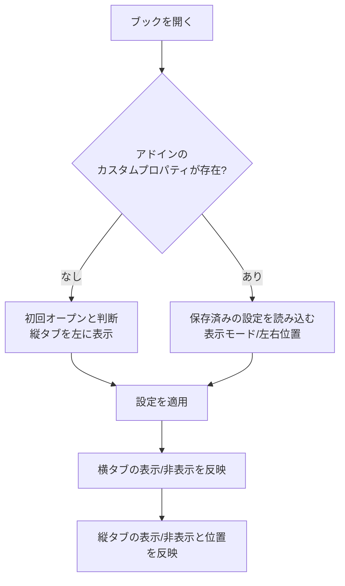
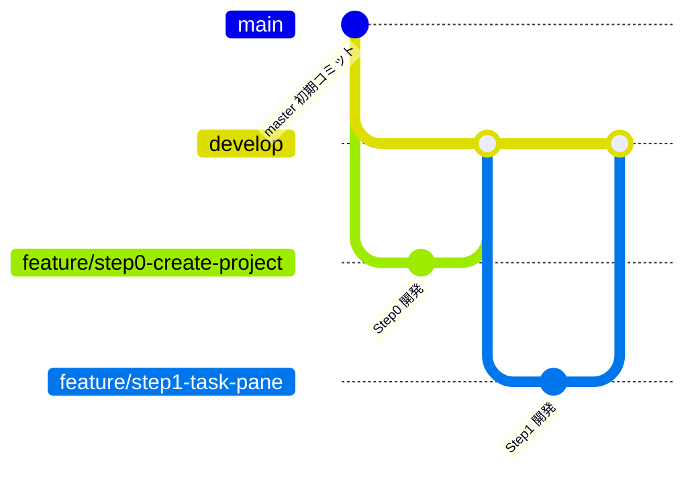

# Agents.md - 縦並びシートタブ Excelアドイン 開発方針

最終更新: 2026-10-19 (相談中。随時更新)

## 1. 目的

Excelのシートタブは標準で横並びだが、シート数が増えると操作しづらく見づらい。
そこで、シートタブを縦並びで表示するExcelアドインを開発する。

## 2. 確定事項

| 項目 | 決定内容 |
|---|---|
| 対象 | Windows版 Excel (Microsoft 365) のみ |
| 方式 | VSTO アドイン (独自GUI描画のため) |
| 機能 | 縦並びでも、横並びタブと全く同一の機能が実行できる |
| タブ色 | 横並びと全く同じ色分けができる |
| 見た目 | 縦並びでも、横並びと同じグラフィック描画の外観にする |
| 見た目の再現度 | 可能な限り完全同一を目標とする (方針は2.3) |
| 機能の範囲 | 横タブの全機能 (切替、追加、削除、名前変更、ドラッグ移動、Ctrl+ドラッグコピー、複数選択、右クリックメニュー、タブ色変更、非表示/再表示 など) |
| 対象シート | ワークシートとグラフシートは表示。非表示とVeryHiddenのシートは縦タブにも表示しない |
| 縦タブが多い場合 | 縦スクロールバーで対応 |
| 幅の保存タイミング | ブック保存時のみ記録。保存せず閉じた場合は変更前の幅のまま |
| ビット数 | 64bit (x64)。このPCのExcel (Microsoft 365, ビルド16.0.20430) と同じ |
| 開発環境 | Visual Studio Community 2026 (18.x)。.NET SDK 10.0.401 も導入済み |
| 縦タブの幅 | 初回は半角8文字分 (当初は16文字。11.5で変更)。ユーザーがドラッグで変更可能 |
| 幅の保存/復元 | ブック保存時に直前の幅を保存し、再オープン時に復元 |
| 設定変更の入口 | (1) リボンのボタン (2) タブ右クリックメニューの先頭に「タブ表示の設定」を追加。どちらも同じ設定画面を開く |
| 縦タブのUI形式 | カスタムタスクペイン (CustomTaskPane + UserControl)。内部は自前描画。左右ドッキングと幅変更はペイン機能を利用 |
| ワークロード | VS 2026に「Office/SharePoint開発」を導入済み |
| シート名の最大長 | 横タブと同一 (Excel仕様の31文字) |
| 長いシート名の表示 | 幅に収まらない分は末尾を「…」で省略し、ホバー時にフルネームをツールチップ表示 |
| 設定画面 | 表示モード (ラジオ3択: 横のみ/縦のみ/両方)、縦タブの位置 (ラジオ2択: 左/右)、OK/キャンセル |
| 複数ブック | ブック/ウィンドウごとに専用ペインを持ち、設定は完全に独立 |
| 初回オープン時の表示 | 表示モードはC (横タブと縦タブの両方を表示)、縦タブは左側 |
| 初回表示位置 | ブックの初回オープン時は左側に縦タブを表示 |
| 表示位置の設定 | ユーザー設定で左/右を選択可能 |
| 設定の保存 | Excelのカスタムドキュメントプロパティにブック単位で保存し、オープン時に復元 |
| 初回判定 | 本アドインのカスタムプロパティがブックに無ければ初回オープンと判断 |
| タブ表示モード | 下記3パターンからユーザー設定で選択 |

### 2.1 タブ表示モード (ブック単位の設定)

| モード | 横タブ (標準) | 縦タブ (本アドイン) |
|---|---|---|
| A: 横のみ | 表示 | 非表示 |
| B: 縦のみ | 非表示 | 表示 |
| C: 両方 | 表示 | 表示 |

### 2.2 ブック保存設定 (カスタムドキュメントプロパティ)

| 設定項目 | 値 |
|---|---|
| 表示モード | A / B / C |
| 縦タブの位置 | 左 / 右 |
| 縦タブの幅 | 保存時の幅 (初回は半角8文字分) |

項目ごとに別のカスタムドキュメントプロパティとして保存する。

| プロパティ名 | 型 | 値 |
|---|---|---|
| `VTab.Mode` | 文字列 | `A` (横のみ) / `B` (縦のみ) / `C` (両方) |
| `VTab.Side` | 文字列 | `Left` / `Right` |
| `VTab.Width` | 数値 (整数) | ペイン内容部の幅。DPI非依存のピクセル値 (96dpi換算)。復元時は`DeviceDpi`で実ピクセルに戻す |

`VTab.Mode` 等のプロパティが存在しないブックは初回オープンと判断する。

### 2.3 見た目の再現方針

Excel標準タブの描画を取得するAPIは無いため、自前描画 (GDI+/WinForms等) で再現する。

- 実機のExcel標準タブをスクリーンショットで採寸し、寸法・色・フォント・余白を合わせる
- 再現対象の状態: 通常 / 選択中 / グループ選択 / マウスホバー / タブ色あり
- 再現対象の環境: Officeテーマ (カラフル/白/黒/ダークグレー)、DPI (100%-200%以上)、Windows 11の見た目
- 横タブとの差分は「縦に並ぶ」点のみとする (文字は横書きのまま)
- 完全同一が技術的に不可能な箇所は、その都度相談して許容差を決める

## 3. 処理フロー (ブックオープン時)

## 4. 実装方針 (相談で合意済み)

| 項目 | 方針 |
|---|---|
| VSTOのターゲット | .NET Framework 4.8 |
| 幅の換算 (半角8文字) | 数字「0」の幅x8+タブの余白で換算 (当初は16文字。11.5で変更) |
| タスクペイン方式の制約 | ペイン幅の変更検知、ウィンドウとの紐付け、枠の見た目は、試作段階で確認 |

## 5. 未決定事項

- 幅の最小値/最大値
- 「縦のみ」で保存したブックを、アドインの無いExcelで開いたユーザーへの案内 (実装しないことに決定。7-3)
  - アドインが無い環境では、アドインのコードが動かないため、ダイアログは出せない
  - 案: 設定画面で「縦のみ」を選んだとき、戻し方 (「ファイル > オプション > 詳細設定 > シート見出しを表示する」) を注意文として表示する。ブックの作成者に事前に知らせる目的

## 6. 開発ステップ

リスクの高い技術要素を先に小さく検証し、見た目の完全再現は最後に回す。

| Step | 内容 | 完了条件 | 主なリスク |
|---|---|---|---|
| 0 | VSTOプロジェクト作成、ビルドしてExcelで読み込み | アドインがExcelに読み込まれる | VS 2026とVSTOの相性 |
| 1 | ウィンドウごとにカスタムタスクペインを出す (左右切替、幅変更の検知) | 複数ブックで各自のペインが出る | 最大の技術リスク。ペイン幅の検知やウィンドウとの紐付け |
| 2 | シート名一覧を縦に表示し、クリックで切替。非表示/VeryHiddenは除外、グラフシートは表示 | 一覧と実際のシートが一致する | シート増減や名前変更への追従 |
| 3 | カスタムドキュメントプロパティ(`VTab.*`)の読み書き、初回判定、保存時の幅記録 | 保存して開き直すと設定と幅が復元される | 保存イベントのタイミング |
| 4 | 表示モードA/B/Cと設定画面、リボンボタン | 3パターンが切り替わる | 横タブの表示切替がブック単位でできるか |
| 5 | 全操作の実装 (追加、削除、名前変更、ドラッグ移動、Ctrl+ドラッグコピー、複数選択、右クリックメニュー、タブ色変更、非表示/再表示、「タブ表示の設定」項目) | 横タブと同じ操作ができる | 右クリックメニューの差し込み、ドラッグ操作、保護ブック時の挙動 |
| 6 | 見た目の完全再現 (実機の採寸、各状態、テーマ、DPI、省略表示、ツールチップ) | 横タブと並べて比較して差が許容内 | 時間がかかる。許容差を相談 |
| 7 | 仕上げ (例外処理、重いブックでの確認、インストーラ、署名) | 配布可能 | 配布方法の決定 |

## 7. Gitブランチ運用

- `master`: 初期コミットのみ。リリース時などに使う
- `develop`: 統合ブランチ。各Stepの開発が完了したものだけをマージする
- `feature/stepN-内容`: Stepごとに`develop`から作成する。ステップ番号と内容が一目で分かる名前にする (文字化け防止のため英小文字のkebab-case)

| Step | ブランチ名 |
|---|---|
| 0 | `feature/step0-create-project` |
| 1 | `feature/step1-task-pane` |
| 2 | `feature/step2-sheet-list` |
| 3 | `feature/step3-persist-settings` |
| 4 | `feature/step4-display-mode` |
| 5 | `feature/step5-tab-operations` |
| 6 | `feature/step6-visual-fidelity` |
| 7 | `feature/step7-finishing` |

- 流れ: featureブランチで開発 -> 完了条件を確認 -> `develop`へマージ (`--no-ff`) -> 次のStepのfeatureブランチを`develop`から作成
- 各Stepの完了時に結果を報告し、マージと次Stepへの着手はその都度確認する
- コミットメッセージは日本語で書く

## 8. 開発メモ

### Step0 (プロジェクト作成) の結果

- VS 2026のExcel VSTOアドイン(C#)テンプレートの内容を元に、手作業でプロジェクトを作成した
  - `VerticalSheetTabs.sln` / `VerticalSheetTabs/VerticalSheetTabs.csproj` (.NET Framework 4.8、AnyCPU)
  - Resources/Settings は不要なため省略した
- ビルド: VS 2026付属のMSBuild (`MSBuild\Current\Bin\MSBuild.exe`) でビルド成功
- マニフェスト署名: 自己署名証明書 `VerticalSheetTabs_TemporaryKey.pfx` (パスワードなし) を使用。`.gitignore`済みのためリポジトリには含めない
  - 別PCで開発する場合は、VS 2026で「署名」タブから新しい証明書を作成し、`.csproj`の`ManifestCertificateThumbprint`を更新する
- 読み込み確認: ビルドでHKCUにアドインが登録され、Excelを通常起動すると`COMAddIns`に`VerticalSheetTabs`が`Connect=True`で表示された
  - COM自動化 (`New-Object -ComObject Excel.Application`) で起動したExcelでは、VSTOアドインは読み込まれなかった。動作確認はExcelの通常起動で行う

### Step1 (タスクペイン表示) の結果

実装: `PaneManager.cs` (ウィンドウごとにペインを管理)、`TabPaneControl.cs` (試作用の中身)、`ThisAddIn.cs` (イベント接続)。

| 確認項目 | 結果 |
|---|---|
| ウィンドウごとのペイン | OK。複数ブックを開くと、各ウィンドウに独立したペインが表示された |
| 左右のドッキング | OK。`DockPosition`で左/右の切替ができた。初期表示は左 |
| 幅変更の検知 | OK。ペインの端をドラッグすると、`UserControl.Resize`で新しい幅を検知できた |
| ブックを閉じたとき | OK。`WorkbookBeforeClose`でペインを削除し、他のウィンドウのペインは残った |
| 新規ブック作成 | OK。`WindowActivate`でペインが作られた |

分かったこと・制約:

- Excel 365はブックごとに別のトップレベルウィンドウ (SDI) になる。ペインの管理キーにはウィンドウハンドル (`Window.Hwnd`) を使えた
- ペインには、タイトルバー (タイトル、メニュー、閉じるボタン) が付く。タブ領域だけの見た目にはできない。「完全同一の見た目」の許容差として、Step6までに相談する
- ユーザーがペインの閉じるボタンで閉じた場合の扱い (再表示の方法) を、Step3/4で決める
- `CustomTaskPane.Width`に150を設定したとき、中身のコントロール幅は134pxだった。幅の単位とDPIの関係は、Step3で`VTab.Width`を決めるときに確認する
- `WorkbookBeforeClose`で保存確認がキャンセルされた場合は、ペインが消えたままになる可能性がある。Step2以降で対策する (`WindowActivate`での再作成など)
- 動作確認は、Excelを通常起動して、UI Automation (`System.Windows.Automation`) とキー送信で行った

### Step2 (シート名の縦一覧と切替) の結果

実装: `PaneManager.cs` (シート一覧の読み取りと同期、シートの切替)、`TabPaneControl.cs` (試作用の`ListBox`で一覧表示)。

| 確認項目 | 結果 |
|---|---|
| 一覧の内容 | OK。ワークシートとグラフシートを表示。非表示とVeryHiddenは除外 |
| シートの切替 | OK。一覧のクリックで、ワークシート、グラフシートとも切り替わった |
| 名前変更への追従 | OK |
| 追加・削除への追従 | OK |
| 並べ替え (移動) への追従 | OK |
| 非表示/再表示への追従 | OK。非表示にするとアクティブシートが別のシートに移り、一覧もそれに追従した |
| アクティブシートの強調 | OK。一覧の選択状態がアクティブシートと一致した |

方式:

- Excelには、シート名変更、並べ替え、非表示/再表示のイベントが無い。そのため、300ms間隔のタイマーで、シート名・表示状態・アクティブシートを読み直す
  - 一覧は、内容が変わったときだけ更新する (ちらつきやスクロール位置の消失を防ぐ)
  - `SheetActivate`イベントでも即時に同期する
- セル編集中などでExcelがビジー状態のときのCOM例外は握りつぶし、次回のタイマーで再試行する (実機での確認は未実施)

未確認・今後の課題:

- セル編集中のタイマー動作
- 保護されたブック、構造保護時の挙動 (Step5で確認)
- シートが非常に多いブックでの負荷 (Step7で確認)
- タブ色の取得 (Step6で実装)
- 試験用ボタン「Dock Left/Right」は、Step4で設定画面に置き換えるまで残す

確認時の注意: PowerShellからの画面キャプチャは`PrintWindow`でExcelのウィンドウだけを撮る。画面全体のコピーでは、他のウィンドウが写り込む。

### Step3 (設定の保存と復元) の結果

実装: `WorkbookSettings.cs` (プロパティの読み書き)、`PaneManager.cs` (読み込み、幅の適用、保存時の書き込み)、`ThisAddIn.cs` (`WorkbookBeforeSave`の接続)。

| 確認項目 | 結果 |
|---|---|
| 初回判定 | OK。`VTab.*`が無いブックでは初回と判断し、縦タブを左に表示した |
| 初回の幅 | OK。半角16文字分 (数字「0」16文字の幅 + 左右の余白) で表示された |
| 保存 | OK。ブックの保存時に`VTab.Mode`/`VTab.Side`/`VTab.Width`が書き込まれた (保存したxlsxの`docProps/custom.xml`で確認) |
| 復元 | OK。再オープンで、保存した左右位置と幅に復元された |
| 保存せず閉じた場合 | OK。ブックの保存時のみ記録するため、変更は残らない |

仕様の確定内容:

- `VTab.Width`は、ペイン内容部 (コントロール) の幅を、96dpi換算のピクセル値で保存する。ペインの枠 (実測16px) は復元時に加算する
- ペインの幅は、表示直後は確定しないため、250ms後に内容幅を測って適用する
- 書き込みの対象は、そのブックの1つのウィンドウの状態 (1ブックに複数ウィンドウがある場合は先頭のウィンドウ)
- 読み書きの失敗 (読み取り専用ブックなど) は握りつぶし、既定値で動作する
- 初回オープン時の既定の表示モードは「C: 両方」で確定 (ユーザー確認済み)

未確認・今後の課題:

- 100%以外のDPIでの幅の換算 (このPCは96dpiのみ。Step7で複数DPIを確認する)
- 1ブックに複数ウィンドウがある場合の保存内容
- OneDriveの自動保存時の書き込み (`WorkbookBeforeSave`が呼ばれるか)
- 幅の最小値/最大値 (復元時に極端な値が入っていた場合の補正)
- C# 7.3の制約: `ref`付きラムダなどは使えない (VS 2026のVSTOプロジェクトの既定の言語バージョン)

### Step4 (表示モードと設定画面、リボンボタン) の結果

実装: `SettingsForm.cs` (設定画面)、`RibbonController.cs` (リボンボタン)、`PaneManager.cs` (モードの適用)、`WorkbookSettings.cs` (Step3から利用)。試験用の「Dock Left/Right」ボタンと情報ラベルは削除した。

| 確認項目 | 結果 |
|---|---|
| リボンボタン | OK。「表示」タブの「縦タブ」グループに「タブ表示の設定」を追加。押すと設定画面が開く |
| 設定画面 | OK。表示モード3択、縦タブの位置2択、OK/キャンセル。現在の設定が初期選択される。横のみのときは位置の選択が無効になる |
| モードA (横のみ) | OK。横タブ表示、縦タブのペインは非表示 |
| モードB (縦のみ) | OK。横タブ非表示、縦タブのペインを表示 |
| モードC (両方) | OK。両方表示 |
| 左右の切替 | OK。ダイアログで選んだ側にペインが移動した |
| 保存と復元 | OK。モードB・右を保存して再オープンすると、同じ状態で復元された |
| 初回オープン | OK。両方表示、縦タブは左 |

仕様の確定内容:

- 横タブの表示/非表示は、`Window.DisplayWorkbookTabs` で切り替える (ウィンドウ単位)
- 縦タブは、ペインの表示/非表示 (`Visible`) で切り替える
- ユーザーがペインの閉じるボタンで閉じた場合は、モードAに切り替え、横タブを再表示する (縦のみのブックでタブが無くなるのを防ぐ)。ペインを再表示するには、設定画面でモードを変える
- 設定画面の変更は、そのブックにだけ適用する。ブックの保存時に`VTab.*`へ書き込む (保存しないと残らない)

横タブ非表示のままファイルに残る件 (確定: 現状の動作のままとする):

- 原因: 横タブの表示/非表示は、Excelのブックごとの設定 (`xl/workbook.xml`の`showSheetTabs`) としてファイルに保存される。本アドインは、「縦のみ」のときにこの設定をオフにして横タブを隠すため、保存するとファイルに非表示の状態が残る
- 影響: 「縦のみ」で保存したブックを、本アドインの無いExcelで開くと、横タブが表示されない。「横のみ」「両方」のブックには影響しない
- 戻し方: 「ファイル > オプション > 詳細設定 > このブックで作業するための表示設定 > シート見出しを表示する」にチェックを入れる。ブックのデータには影響しない
- 検討して採用しなかった方法 (いずれも複雑さに対して効果が限定的なため):
  - 保存直前 (`WorkbookBeforeSave`) に`DisplayWorkbookTabs`を戻す: Excelが保存イベント中の変更を無視するため不可
  - 保存直後に横タブを表示してもう一度保存する: 保存が2回になるため不可
  - 保存を中断して横タブを表示し、同じ保存を再実行する: 保存と名前を付けて保存では動作したが、閉じるときの保存確認の経路では効かず、マクロの`Save`直後の終了で変更を失うおそれがある
  - 保存後のファイル (xlsx) を直接書き換える: Excelがファイルをロックしているため不可
- 将来、必要になった場合は、「保存を中断して再実行」を土台に、閉じる経路 (`WorkbookBeforeClose`) の対応を足す方法を再検討する

その他の注意点:

- 設定画面の見た目 (グループ枠の余白など) は暫定。Step7で整える
- コンテキストメニューの「タブ表示の設定」はStep5で追加する

確認時の注意:

- WinFormsの設定画面のコントロールは、UI Automationでは見つからなかった。ボタン操作は、子ウィンドウに`BM_CLICK`を送って行った
- 確認用のPowerShellスクリプトにWindows PowerShell 5.1で日本語を含める場合は、UTF-8 BOM付きで保存する

### Step5 (タブ操作の全機能) の進捗

実装は小さな段階に分けて進める。各段階の終わりに`feature/step5-tab-operations`へコミットし、Step5全体の完了後に`develop`へマージする。

| 段階 | 内容 | 状態 |
|---|---|---|
| 5-1 | 右クリックメニューの土台、先頭に「タブ表示の設定」 | 完了 |
| 5-2 | 追加、削除、名前変更 (ダブルクリック、31文字制限)、非表示、再表示 | 完了 |
| 5-3 | 移動とコピー (ドラッグ、Ctrl+ドラッグ) | 完了 |
| 5-4 | 複数選択 (Shift/Ctrlクリック)、グループ選択、一括操作 | 完了 |
| 5-5 | タブ色の変更、保護ブック/構造保護時の挙動 | 完了 |
| 5-6 | Excel標準の横タブの右クリックメニューにも「タブ表示の設定」を追加 | 完了 |

メニュー項目は、Excel標準のシートタブのメニューに合わせる。各項目は、Excelの既存機能を呼び出して実行する。

#### 5-1 右クリックメニューの結果

- `TabPaneControl`に`ContextMenuStrip`を追加。先頭の項目「タブ表示の設定」から、リボンのボタンと同じ設定画面を開く
- Excel標準のタブと同様に、右クリックしたシートを先にアクティブにしてからメニューを表示する
- 実機で、右クリックでシートが切り替わり、メニューの先頭項目から設定画面が開くことを確認した
- 標準項目 (挿入、削除、名前の変更、移動またはコピー、シートの保護、タブの色、非表示、再表示など) は、5-2以降で順に追加する

#### 5-2 追加・挿入・削除・名前変更・非表示・再表示の結果

- 追加: 一覧の下の「+」ボタン。アクティブシートの後ろに新しいワークシートを追加する (Excelの「+」と同じ)
- 右クリックメニュー (Excelの並びに合わせた): タブ表示の設定 / 挿入 / 削除 / 名前の変更 / 非表示 / 再表示
  - 挿入、削除、非表示、再表示は、Excelの標準コマンド (`CommandBars.ExecuteMso`: `SheetInsert`、`SheetDelete`、`SheetHide`、`SheetUnhide`) を呼び出す。確認ダイアログやエラーメッセージも、Excel標準のものになる
  - 「再表示」は、非表示のシートがあるときだけ有効。VeryHiddenは対象外
- 名前の変更: ダブルクリックまたはメニューから、その場で編集する。Enterまたはフォーカスを外すと確定、Escで取り消し。入力は31文字まで
  - 使えない文字 (`: \ / ? * [ ]`)、前後のアポストロフィ、空白のみ、重複 (非表示シートを含む) は、Excelに近い文面のメッセージで知らせる。メッセージ文は独自 (Excelの文面と完全には一致しない)
  - グラフシートも名前を変更できる
- 実機で確認: 追加、名前変更、不正な名前のメッセージ、非表示、削除、再表示 (Excelのダイアログ)、挿入 (Excelのダイアログ)
- 未確認: ブックの構造が保護されているときの動作 (5-5で確認する)、「+」ボタンの見た目 (Step6で整える)

注意:

- 確認用スクリプトは、Excelの標準ダイアログを`SendKeys`で操作した。Windows PowerShell 5.1の別セッションをまたいで型定義が残らないため、定義は毎回同じスクリプト内に置く

#### 5-3 移動とコピーの結果

- ドラッグで、シートの順序を移動する。ドラッグ中は、挿入位置に線を表示する。Ctrlを押しながらドラッグすると、コピーする (コピーしたシートの名前は、Excelの規則で付く。例: 「Sheet3 (2)」)
- 挿入位置は、行の上半分なら、その行の前、下半分なら、その行の後ろ。最後の行より下は、表示中のシートの末尾
- 非表示のシートは、元の位置のまま。表示中のシートの前後に移動またはコピーする
- 右クリックメニューに「移動またはコピー」を追加した (Excel標準のダイアログ `SheetMoveOrCopy`)
- 一覧の端の近くにドラッグすると、自動でスクロールする (実機では未確認)
- 同じ位置へのドロップは、何もしない
- ブックの構造が保護されているときは、メッセージを表示する (5-5で確認する)
- 実機で確認: 先頭への移動、末尾への移動 (非表示のシートの位置は変わらない)、Ctrl+ドラッグのコピー、メニューからのExcel標準ダイアログ、クリックでのシート切替

実装上の注意:

- Excelはシートをアクティブにすると、フォーカスをExcel側に移す。左クリックの場合に、マウスを押した時点でシートを切り替えると、始まったばかりのドラッグが取り消される。そのため、左クリックでのシート切替は、ボタンを離した時点に行う (ドラッグしたときは切り替えない)。右クリックは、メニューの対象にするため、押した時点で切り替える
- 確認用スクリプトでドラッグを再現するときは、`mouse_event`の絶対座標移動 (`MOUSEEVENTF_ABSOLUTE`) を使う。`SetCursorPos`だけでは、ボタンを押している間の`MouseMove`が届かない

#### 5-4 複数選択とグループ選択の結果

- 一覧の選択は、`ListBox`の標準の選択ではなく、独自に管理する (`SelectionMode.None` + オーナー描画)。Excelのタブと同じ規則にするため
  - クリック: そのシートだけを選択。ただし、グループの内側のシートをクリックしたときは、グループを保ったまま、そのシートをアクティブにする (全シートを選択しているときは解除する)
  - Ctrl+クリック: シートをグループに追加/解除。追加したシートがアクティブになる
  - Shift+クリック: アクティブなシートからクリックしたシートまでを選択。アクティブなシートは変わらない
  - 右クリック: グループの外のシートなら、そのシートだけを選択してアクティブにする。グループの内側なら、グループを保ったままアクティブにする
  - 上下キー: アクティブなシートを移動する (単一選択)
- グループ中のアクティブなシートは、太字で描画する (選択中のシートは、強調色で描画)。タブのグラフィックはStep6で整える
- Excelへの反映: `Worksheet.Select(Replace)`を使う。アクティブなシートを最初に選択し (置き換え)、残りを追加する (追加の`Select(false)`では、アクティブなシートは変わらないため)
- Excel側の選択の変更も、タイマーの同期で一覧に反映する (`Window.SelectedSheets`)。マウスのボタンを押している間は、同期で選択を上書きしない
- 右クリックメニューに「すべてのシートを選択」と、グループ中だけ表示する「シートのグループ解除」を追加した。名前の変更は、グループ中は無効
- ドラッグ: グループのシートをドラッグすると、グループ全体を移動する。Ctrl+ドラッグで、グループ全体をコピーする (`Sheets.Move/Copy`)。グループに含まれないシートをドラッグしたときは、そのシートだけを動かす
- 削除と非表示は、Excel標準コマンドに任せるため、グループ全体が対象になる
- 実機で確認: クリック、Ctrl+クリック、Shift+クリック、グループ内のクリック、グループ外のクリック、すべてのシートを選択、グループ解除、グループのドラッグ移動、グループのCtrl+ドラッグコピー、グループの非表示
- 未確認: グループの削除 (Excelの確認ダイアログ)、キーボードの上下キーの動作、グラフシートを含むグループの移動

#### 5-5 タブ色と保護の結果

- 右クリックメニューの並び (Excelに合わせた): タブ表示の設定 / 挿入 / 削除 / 名前の変更 / 移動またはコピー / コードの表示 / シートの保護 / シート見出しの色 ▸ / 非表示 / 再表示 / すべてのシートを選択 / シートのグループ解除 (グループ中のみ)
- タブ色: 「シート見出しの色」のサブメニューに、Excelと同じ構成のパレット (`TabColorPalette.cs`) を表示する
  - テーマの色 (10色 x 6行。ブックのテーマの色を、`Workbook.Theme.ThemeColorScheme`から取得。行ごとの明るさの調整は、Excelと同じ値)、標準の色 (10色)、色なし、その他の色 (Windows標準のカラーダイアログ。Excel自身のダイアログではない)
  - テーマの色は、`Tab.ThemeColor` + `Tab.TintAndShade`で設定するため、Excelと同じく、ブックのテーマに追従する。標準の色とその他の色は、`Tab.Color` (RGB)、色なしは、`Tab.ColorIndex = xlColorIndexNone`
  - グループ中は、選択している全シートに適用する (Excelと同じ)
  - 縦タブの表示: 色が付いたシートは、左端に色の帯を表示する (暫定。標準タブに合わせたグラフィックはStep6)。色は、タイマーで`Tab.ColorIndex`/`Tab.Color`を読んで反映する
- シートの保護: Excel標準コマンド (`SheetProtect`) を呼び出す。保護中は、メニューの文言が「シート保護の解除」に変わる (保護の状態は`ProtectContents`で判定)
- コードの表示: Excel標準コマンド (`ViewCode`)
- ブックの構造が保護されているとき: 挿入、削除、名前の変更、移動またはコピー、非表示、再表示のメニュー項目と、「+」ボタンを無効にし、ドラッグでの移動と、ダブルクリックでの名前の変更も行わない (`Workbook.ProtectStructure`で判定)
- 実機で確認: 標準の色、テーマの色 (基本色、明るさの異なる行)、グループへの色の適用、色なし、シートの保護 (ダイアログと文言の切替)、構造保護時のメニューの無効化
- 未確認: 「その他の色」のカラーダイアログ、テーマが変わったときのパレットの色、保護されたシートでの色の変更

性能に関する注意 (Step7で確認する):

- タイマー (300ms) の同期で、全シートの名前、表示状態、タブ色を、COM経由で読む。シートが非常に多いブックでは、負荷が大きくなる可能性がある。必要なら、間隔を延ばす、または、イベントで更新する範囲を増やす

#### 5-6 横タブのメニューへの追加の結果

- Excel標準の横タブを右クリックしたときのメニューにも、先頭に「タブ表示の設定」を追加した。リボンのボタンと同じ設定画面を開く
- 実装: リボンのカスタムUI (`RibbonController.cs`) の`contextMenus`で、`ContextMenuWorkbookPly`のメニューに、`insertBeforeMso="SheetInsertPage"` (= 先頭の「挿入」) のボタンを挿入する
  - 「挿入」の`idMso`は`SheetInsertPage`。ExcelBabyの`idMso`一覧 (Windows版) から候補を選び、メニューに挿入して位置を確かめて特定した。`SheetInsert`などは、このメニューの項目ではない
  - 同じ方法で確認できたこのメニューの`idMso`: `SheetDelete`、`SheetMoveOrCopy`、`SheetTabColorGallery` (シート見出しの色)、`SelectAllSheets`
- `CommandBars["Ply"]`に従来方式 (`Controls.Add`) で追加すると、メニューの末尾に付くため、この方式は使わない
- 区切り線を足そうとして`separator`を挿入すると、カスタムUI全体が読み込まれず、項目が出なくなる (確認済み)。区切り線は付けていない
- アイコンは付けていない
- 縦タブのメニューでも、「タブ表示の設定」が先頭にある (5-1)
- 実機で確認: 横タブを右クリックして、先頭の項目をクリックすると、設定画面が開く

## 9. Step6 見た目の再現

### 9.1 段階

| 段階 | 内容 | 状態 |
|---|---|---|
| 6-1 | 実機のExcelの横タブを撮影して採寸する | 完了 |
| 6-2 | 一覧を自前描画のコントロールに置き換え、1つのタブをExcelの横タブと同じ見た目で描く | 完了 |
| 6-3 | 「+」ボタン、ドラッグ中の表示、ホバーとフォーカスの見た目を、Excelに合わせる | 完了 |
| 6-4 | Officeテーマ (カラフル/白/黒/ダークグレー) とDPI (100%から200%以上) に対応する | 完了 (一部未確認) |
| 6-5 | 省略表示、ツールチップ、スクロール、ペインの余白を整え、横タブと並べて比較する | 完了 |

### 9.2 採寸結果 (6-1)

測定環境: Windows 11、画面の拡大率125% (物理5120x2160)、Excel 365 (Officeテーマ: カラフル)、日本語UI。値は物理ピクセル (125%) で測り、DIP (96dpi換算 = 物理 / 1.25) を併記する。画像は、`PrintWindow`でExcelのウィンドウを撮影して、ピクセル値を読み取った。

#### 色

| 要素 | 色 |
|---|---|
| タブバーの背景 | #EDEBED (237,235,237) |
| タブバーの上の線 (1px) | #E0E0E0 (224,224,224) |
| タブバーの下の線 (1px) | #FFFFFF。その下はステータスバー #F5F5F5 |
| 選択中のタブ (色なし) の塗り | #FFFFFF |
| 選択中のタブの外枠 (左右と下、1px) | #E0E0E0 |
| 選択中のタブの下線 | #107C41 (16,124,65)、2px |
| 文字 (色なしのタブ) | #242424 (36,36,36) |
| 区切り線 (1px) | #D1D1D1 (209,209,209) |
| 色付きの非選択タブの文字 | 白 (#FFFFFF)。背景が明るい色のときの色は未確認 |

#### 寸法 (物理px / DIP)

| 要素 | 値 |
|---|---|
| タブバーの高さ (上の線から下の線の手前まで) | 40px / 32DIP |
| タブの幅 (1つ分の区画) | 文字の幅 + 約37px (30DIP)。「Sheet1」(文字の幅約59px) で96px、「Chart1」で93px |
| 選択中のタブ | 区画の左4px、右5px内側。上端はタブバーの上の線の直下 (シートの領域とつながる)、下端は区画の下から5px上。下の2つの角を丸める (半径 約5px / 4DIP) |
| 選択中のタブの下線 | 太さ2px、タブの下端から3px上。左右とも、タブの内側から10px (8DIP) 内側 |
| 色付きの非選択タブ | 区画の左右5px内側、上5px、下5px内側 (高さ約30px / 24DIP)。4つの角を丸める (半径 約5px) |
| 区切り線 | 1px、高さ24px (19DIP)、タブバーの上下の中央。各区画の右端 (最後のタブの右にもある) |
| 文字の位置 | 色なしの選択中のタブは、非選択のタブより、約4px上 (下線のための余白) |

#### 状態ごとの見た目

| 状態 | 見た目 |
|---|---|
| 色なし・非選択 | 背景なし (タブバーの色)、文字#242424、右端に区切り線 |
| 色なし・選択中 | 白い塗り、外枠、下線 (緑)、文字#242424 |
| 色なし・グループの一員 (非アクティブ) | 白い塗り。下線は付かない |
| 色付き・非選択 | タブの色の塗り (丸い四角)、文字は背景に応じて白 |
| 色付き・選択中 | 上から下へのグラデーション。上端は白、下端はタブの色の約45% (白との混合。混合の割合は上端から下端へ0から約0.45まで直線的に増える)。外側に白の枠1pxと外枠#E0E0E0、下線 (緑)、文字#242424 |
| ホバー | 撮影ではホバーの変化が確認できなかった (Excelの横タブには、目に見えるホバー効果が無い可能性が高い)。この点は、実機で最終確認する |

フォント: 文字の幅から、「Yu Gothic UI」系の11から12pt相当。6-2で、候補のフォントを描画して、幅を比較して決める。

#### 追加で分かったこと (対応が必要)

- Excelは、拡大率125%で、DPI対応 (高DPI) の状態で描画している。一方、タスクペイン内のWinFormsコントロールは、`Control.DeviceDpi`が96を返す (拡大率を認識しない)。ペインの描画は、実際のDPIを`GetDpiForWindow`などで取得して、自前で拡大する。6-4で対応する
- Step3で保存する`VTab.Width`は、`DeviceDpi` (= 96) で96dpi換算している。実際のDPIが100%以外のPCでは、幅の換算が正しくない。実際のDPIで換算するように、6-4で修正する
- 縦タブでは、1つのタブの区画の高さを、横タブの高さと同じ32DIPにすることを、仮の方針とする (見た目を同一にするため)

### 9.3 6-2 自前描画のコントロールの結果

実装: `TabStrip.cs` (縦に並ぶタブの描画、選択、ドラッグ、名前の変更、スクロール)、`DpiHelper.cs` (DPIの取得)。`TabPaneControl.cs`は、`TabStrip`、「+」ボタン、右クリックメニューを載せるだけにした。`ListBox`は使わない。

- 描画: 9.2の採寸結果どおりに、1つのタブを1行 (高さ32DIP) として描く
  - 選択中 (白、外枠、緑の下線)、グループの一員 (白、下線なし)、色付き・非選択 (丸い四角、文字は背景に応じて白/濃い色)、色付き・選択中 (白から色への縦のグラデーション)、区切り線 (各行の下に、横向きに短く引く)
  - 文字は左寄せ。選択中のタブの文字は、下線の分だけ上に寄せる
  - 実機の横タブと並べて撮影して比較し、色、形、文字の幅 (「Sheet1」で58px) が一致することを確認した
- フォント: 「Yu Gothic」(游ゴシック)、96dpiで15.5px相当 (拡大率125%で約19.4px)。文字の幅が、Excelの横タブと一致するように、実測で決めた。`FontFamily("Yu Gothic")`で取得する (`FontFamily.Families`の名前は、日本語名「游ゴシック」のため、英語名では見つからない)
- DPI: ペイン内の描画は、Excel本体のウィンドウのDPI (`GetDpiForWindow`) で拡大する (`DpiHelper`)。拡大率125%の実機で、行の高さが40px (= 32DIP x 1.25) になることを確認した
- Step5の機能は、すべて新しいコントロールで動作することを確認した (クリック、Ctrl/Shiftクリック、グループ内/外のクリック、ドラッグ、グループのドラッグ、名前の変更 (ダブルクリックとメニュー)、「+」ボタン、右クリックメニュー、タブ色)
- スクロール: シートが多いときは、右端に縦スクロールバーを出し、マウスのホイールでスクロールする (40枚のシートで確認)。長いシート名は、末尾を「…」で省略する
- 既にExcelが選択しているシートの選択は、Excelに送らない。これにより、アクティブなタブのクリックで、フォーカスがExcelのグリッドに移らず、ダブルクリックでの名前の変更が妨げられない

重要な教訓 (タスクペインの実装):

- 描画や配置のコードで例外が出ると、タスクペインのコントロールが、Excelのウィンドウの階層に組み込まれない。ペインは表示されるが、マウス入力が一切届かず、`IsWindowVisible`も偽になる。今回は、スクロールバーの`Value`が範囲外で例外になっていた。ペイン内のコードでは、例外を出さないように、値を検証する
- 確認用スクリプト (PowerShell) では、変数名の大文字小文字が区別されない。関数の引数`$row`と変数`$ROW`が同じになり、クリック位置がずれた
- Excelのタスクペインに対する、マウス入力の再現は、物理座標 (`SetProcessDPIAware`後の`mouse_event`の絶対座標) で行う

未対応 (6-3以降):

- 「+」ボタンの見た目 (標準のボタンのまま)
- ドラッグ中の表示 (挿入位置の線のみ)
- ホバー時の表示、キーボード操作の見た目
- 100%以外の拡大率での確認 (このPCは125%のみ)
- Officeテーマ (黒、ダークグレー、白) への対応

### 9.4 6-3 「+」ボタンとドラッグ中の表示の結果

実機のExcelの横タブで、「+」、ドラッグ中、ホバー時の見た目を撮影して測り、`TabStrip.cs`に反映した。

#### Excelの「+」ボタン (測定結果)

| 要素 | 値 |
|---|---|
| 記号 | 縦13px x 横14px (約10.5DIP)、線の太さ2px (約1.6DIP)、色 #393938 |
| ホバー時 | 記号の背後に、薄い丸い四角を表示する。大きさ 約30x29px (24DIP)、色 #FAFAFA、角の丸み 約4px (3.2DIP)。タブバーの背景 (#EDEBED) より明るい |
| 位置 | 最後のタブの次の区画の中央 |

縦タブでの再現: 最後のタブの次に、「+」の行 (高さ32DIP) を置く。記号は、行の中央。クリックの範囲は、ホバー時の丸い四角の範囲。タブが多くて、ウィンドウに収まらないときは、「+」の行を、一覧の下に固定する (一覧は、その上でスクロールする)。ブックの構造が保護されているときは、記号をグレーにして、ホバーとクリックを無効にする。

#### ドラッグ中の表示 (測定結果)

- Excelの横タブをドラッグすると、挿入位置の上に、小さな黒い三角形 (下向き、約10x5px = 8x4DIP) が出る。ほかの表示 (線や、ドラッグ中のタブの複製) は出ない
- 縦タブでの再現: 挿入位置の境界の、左端に、黒い三角形 (右向き、幅4DIP x 高さ8DIP) を表示する。以前の、青い線は廃止した

#### ホバーとフォーカス

- タブ自体のホバー: 実機の横タブで、色なし/色付きのタブにポインターを乗せて撮影したが、見た目の変化は無かった。縦タブも、ホバー効果は付けない
- フォーカスの枠: Excelの横タブには、フォーカスの点線の枠が無いため、縦タブにも付けない
- 実機で確認: 「+」の通常/ホバー/クリックでのシートの追加、ドラッグ中の三角形、シートが40枚のときの「+」の固定と、スクロールバー (「+」の行の上で止まる)

未対応 (6-4以降):

- 「+」の押下時 (マウスを押している間) の見た目は、未確認
- 100%以外の拡大率、Officeテーマ (黒、ダークグレー、白)

### 9.5 6-4 Officeテーマとの対応、DPIの結果

#### Officeテーマごとのタブバーの色 (実機で測定)

測定は、Excelのウィンドウを撮影して、ピクセルの値を読み取った。カラフルとダークグレーは、テスト用のExcelを起動して撮影し、白もそうした。黒は、環境の都合で、保存値が保存されなかったため、ユーザーのExcelを開いたままにしてもらい、シートタブの帯だけを撮影した (ほかの部分は、画面に出さず、保存もしていない)。

| 要素 | カラフル / 白 | ダークグレー | 黒 |
|---|---|---|---|
| タブバーの背景 | #EDEBED | #565656 | #0A0A0A |
| 上の線 / 選択中のタブの外枠 | #E0E0E0 | #474747 | #424242 |
| 区切り線 | #D1D1D1 | #8A8A8A | #666666 |
| 非選択のタブの文字 | #242424 | 白 | 白 |
| 「+」の記号 | #393938 | #D4D4D4 | #D4D4D4 |
| 「+」のホバー背景 | #FAFAFA | #3D3D3D | 未測定 (#242424を仮に使用) |
| ドラッグ中の三角形 | 黒 | 未確認 (白を仮に使用) | 未確認 (白を仮に使用) |

- 選択中のタブ (白、文字 #242424)、色付きのタブ、緑の下線 (#107C41) は、どのテーマでも同じ
- 白のテーマは、タブバーの色が、カラフルと同じ (ウィンドウ上部のタイトルバーの色だけが違う)

#### テーマの検出

- `TabTheme.cs`が、レジストリの `HKCU\Software\Microsoft\Office\16.0\Common` の `UI Theme` (DWORD) を、2秒ごとに読んで、配色を切り替える
  - 0 = カラフル、3 = ダークグレー、4 = 黒、5 = 白、6 または値なし = システム設定に従う (Windowsのアプリのテーマ `AppsUseLightTheme` が0なら、暗い配色)
- 重要な制約: この値は、Excelの起動時に、アカウントのローミング設定 (`...\Common\Roaming\Identities\...\Settings	86`) から書き込まれる。Excelの実行中にテーマを切り替えても、値は、次にExcelを起動するまで、更新されない。レジストリの値を直接書き換えても、Excelが、起動時に、ローミング設定で上書きする (実機で確認)
  - そのため、テーマの切り替えは、Excelを再起動したときに、アドインに反映される (実行中の切り替えへの追従は、未対応)
- 黒のテーマは、この環境では、ユーザーが選んでも、保存値に反映されない時期があった。原因は、特定できていない (ほかのテーマは反映された)

#### DPI

- `VTab.Width`の換算を、実際のDPI (`DpiHelper`) で行うように修正した (以前は、`Control.DeviceDpi` = 96を使用)
- 実機 (拡大率125%) で確認: 初回の幅 = 半角16文字分、ドラッグで広げる、保存、再オープンで、同じ幅に復元された (`VTab.Width` は96dpi換算 (DIP) で保存)
- 以前のStep3の確認で保存したブックの`VTab.Width`は、96dpi扱いで換算した値 (実際のDPI 125%では、実ピクセル値) になっている。開発中のテスト用ブックのみで、移行処理は行わない

#### 確認の手順に関する注意 (自動テスト)

- テスト用スクリプトは、自分が起動したExcelのプロセスだけを終了する。ほかのExcelが動いているときは、起動を中止する
  - 以前のスクリプトは、実行前に、動いているExcelをすべて強制終了していた。このため、ユーザーが、Officeテーマの切り替えに使ったExcelも、終了させてしまった。同じことを繰り返さない

#### 未確認

- 暗い配色 (ダークグレー、黒) でのペインの描画 (実機の表示)
- 100%、150%、200%などの拡大率 (このPCは125%のみ)
- 実行中のテーマの切り替えへの追従

### 9.6 6-5 仕上げと、横タブとの比較

#### 追加した機能

- ツールチップ: シート名が長くて、タブに収まらない (末尾が「…」になる) ときに、そのタブにマウスを乗せると、フルネームを表示する (0.5秒後、4秒間)。収まっている名前では、表示しない。Excelの横タブは、名前の長さに合わせて広がるため、ツールチップは持たない (縦タブ独自の機能)
- 選択中のタブの下線の位置を、2px上げた (Excelの横タブは、下線の下に、白い行が3px残る)

#### 横タブと縦タブの比較 (実機、拡大率125%、明るい配色で、同じ状態を撮影して、ピクセルを測定)

| 項目 | 横タブ | 縦タブ | 判定 |
|---|---|---|---|
| タブバー/ペインの背景色 | #EDEBED | #EDEBED | 一致 |
| 色付きタブの高さ | 30px | 29から30px (縁の淡い画素を除く) | 一致 |
| 下線の太さと色 | 2px、#107C41 | 2px、#107C41 | 一致 |
| 下線の左右の余白 | タブの内側から10px | 10px | 一致 |
| 下線の下の余白 | 白い行が3px | 3px (調整後) | 一致 |
| 文字の高さ | 14px | 14px | 一致 |
| 文字の幅 (「Sheet1」) | 58px | 58px | 一致 |
| 区切り線の色、「+」の記号、ホバー背景 | 測定値のとおり | 同じ値 | 一致 |
| 文字の位置 | タブの中央 | 左寄せ (左の余白12DIP) | 差あり (縦に積むため、左寄せにした) |
| タブの幅 | 文字の幅 + 約30DIP | ペインの幅いっぱい | 差あり (縦に積むため) |
| 区切り線の向き | 縦 (高さ24px) | 横 (長さ約24px、タブの下) | 差あり (縦に積むため、向きを回転した) |
| 文字の描画 | Excel (DirectWrite) | GDI+ | 差あり (縦タブの字は、わずかに細く見える) |
| 多数のタブ | スクロールの矢印 | 縦のスクロールバー、「+」は下に固定 | 差あり |
| 長い名前 | 広がる | 「…」で省略、ツールチップで全体を表示 | 差あり |
| タスクペインの枠 | なし | タイトルバー (「Sheet Tabs」、メニュー、閉じるボタン) が付く | 差あり (Excelの仕様で、消せない) |

#### 許容する差 (まとめ)

上の「差あり」の項目は、縦に積むために必要な違い、または、Excelのタスクペインの仕様による制約として、許容する。それ以外の、色、形、余白、文字の大きさは、一致した。

#### 未確認

- 暗い配色 (ダークグレー、黒) での、縦タブの実機の表示 (配色の値は、測定値を使用。検出は、レジストリの`UI Theme`)
- 100%、150%、200%の拡大率 (このPCは125%のみ。描画は、DPIに比例して拡大する設計)
- 「+」を押している間の見た目、ホバー時のタブの見た目 (Excelの横タブには無いため、付けていない)
- ペインのタイトルは、7-3で、「シートタブ」に変更し、その後、「縦タブ」に変更した (11.6)

## 10. Step7 仕上げ

| 段階 | 内容 | 状態 |
|---|---|---|
| 7-1 | 例外処理と堅牢性 | 完了 |
| 7-2 | 性能 (シートが数百枚のブック) | 完了 |
| 7-3 | 設定画面の整形、ペインのタイトルの日本語化 | 完了 |
| 7-4 | 配布 (インストーラ、署名、アンインストール) | 完了 (インストールの実機確認は未実施) |
| 7-5 | 最終確認とドキュメントの整理 | 完了 |

### 10.1 7-1 例外処理と堅牢性の結果

実装した内容:

- すべてのイベント処理 (`ThisAddIn.cs`) を、例外を握りつぶすガードで囲んだ。Excelがビジー、ウィンドウやブックが閉じる途中などの例外で、Excelのエラー画面が出たり、アドインが止まったりしない。保存時の処理は、保存そのものを妨げない
- 保存確認で「キャンセル」しても、縦タブのペインが残る。以前は、閉じる直前にペインを削除していたため、キャンセルしても消えたままになった。また、保存確認の表示中にペインを作り直すと、ペインが、作られても表示されない状態になる (Excelが、ダイアログの表示中は、ペインのレイアウトを処理しない)。そのため、閉じる直前の削除はやめ、ウィンドウが本当に無くなったら (同期が20回続けて失敗)、そのウィンドウのペインの管理情報を削除する
- ペインがないウィンドウが開いている場合は、3秒に1回、ペインを作り直す (ペインの作成に失敗した場合の回復)
- アドインを無効にしたとき (またはExcelの終了時) は、「縦のみ」のブックで、Excelの横タブを元に戻して、ペインを削除する
- 横タブの表示を変えると、ブックが、変更あり、になるため、「保存しますか?」と聞かれてしまう。値が実際に変わるときだけ設定し、変更前に未変更 (`Saved`) なら、未変更に戻す。ブックを開いて、何もせずに閉じるときに、確認が出ない (実機で確認)
- 同期の周期を、1回の処理時間に応じて、0.3秒から3秒の間で調整する (処理時間の8倍。シートが多いブックで、Excelを忙しくしない)

実機で確認 (拡大率125%):

| 項目 | 結果 |
|---|---|
| ブックを変更して、Ctrl+Wで閉じ、保存確認で「キャンセル」 | OK。ペインが残る |
| 「縦のみ」のブックで、アドインを無効にする | OK。横タブが戻り、ペインが消える。有効にすると、ペインが戻る |
| 同じブックの新しいウィンドウ | OK。それぞれに、ペインが付く |
| 2つのブックを開いて、片方を閉じる | OK。残りのブックのペインは、そのまま |
| 何も変更せずに、ブックを開いて、閉じる/Excelを終了する | OK。保存確認は出ず、Excelのプロセスも正常に終了する |

確認の手順の注意:

- COM経由でExcelを操作したスクリプトは、`Quit()`のあとも、スクリプトがCOMの参照を持っている間は、Excelのプロセスが残る。終了の確認は、参照を解放して (`FinalReleaseComObject`、GC) から行う
- Excelが、ほかに動いていると、テストを中止する。ヘルパーが起動した隠れたExcelのプロセスが、終了するまで、待つ

### 10.2 7-2 性能の結果

測定環境: Excel 365 (64bit)、拡大率125%。シートの名前、非表示の状態、タブ色を、タイマーで読む処理 (同期) の時間を測った。7枚に1枚は、タブ色付き。

| シート数 | 同期1回の時間 (最小 / 平均 / 最大) | 周期 |
|---|---|---|
| 100枚 | 1 / 2 / 32 ms | 300ms (調整なし) |
| 300枚 | 5 / 5 / 32 ms | 300ms |
| 1000枚 | 23 / 27 / 48 ms | 300ms |

- 1000枚でも、同期1回は、30ms程度で、300msの周期のうち、約1割。1000枚のブックで、外部からのCOM呼び出し (簡単な呼び出し20回 = 8ms、シートの切り替え = 34ms) も、重くならなかった
- 周期の自動調整 (処理時間の8倍、0.3秒から3秒) は、このPCでは、実際には、働かなかった (どの条件でも、処理時間 x 8 < 300ms)。処理が遅いPCやブックの保険として残す
- ペインの描画は、表示中の行だけを描くため、シート数に依存しない (40枚で確認済み)

改善した点:

- 多数のシートを、まとめて選択する処理が遅かった。シートを1つずつ選択すると、300枚で3.5秒かかる (1枚あたり約12ms)。次のように変えた
  - 右クリックメニューの「すべてのシートを選択」は、Excel自身のコマンド (`SelectAllSheets`) を使う。300枚で、約120ms
  - 13枚以上のグループは、シートの配列を渡して、1回の呼び出しで選択する (アクティブなシートは、配列の先頭に置く)。実機で、14枚のグループの選択と、アクティブなシートが保たれることを確認した

未確認:

- 大きなブック (1000枚以上、または、ファイルサイズが大きい) を開く時間への影響
- 多数のシートが選択された状態での、削除/非表示 (Excel標準コマンドに任せているため、Excelの速度に依存する)
- 同期処理が遅いPCでの、周期の自動調整の動作

### 10.3 7-3 設定画面の整形とペインのタイトルの結果

- ペインのタイトルを、「Sheet Tabs」から「シートタブ」に変更した (`PaneManager.PaneTitle`。のちに「縦タブ」に変更、11.6)。確認用スクリプトが、タイトルでペインを探している場合は、この名前に合わせる
- 設定画面 (`SettingsForm.cs`) の見た目を整えた
  - 「表示モード」と「縦タブの位置」の2つのグループ枠を、同じ幅にそろえた
  - グループ枠は、中身の大きさに合わせて、大きさを計算する (`AutoSize`は、右と下に、広い余白が残るため使わない)
  - ボタン (OK、キャンセル) は、右寄せ。ウィンドウの余白を広げた
  - 「横タブのみ表示」を選ぶと、「縦タブの位置」が無効 (灰色) になる
- 実機で確認: 設定画面の表示 (通常/縦タブの位置が無効)、ペインのタイトルの表示
- 設定画面に、「縦のみ」を選んだときの注意文を出す案 (保留中の案C) は、実装しない (ユーザーの判断)。9章の未決定事項にある、この案の項目は、「実装しない」に変更した

### 10.4 7-4 配布 (ClickOnce) の結果

方式: ClickOnce (VSTO標準)。ユーザーの選択 (案A)。

- `VerticalSheetTabs.csproj`に、ClickOnceの公開用の設定を追加した (製品名、発行元、表示名「縦並びシートタブ」、説明、バージョン1.0.0.0、ディスクからのインストール、自動更新なし)
- 公開: `MSBuild.exe VerticalSheetTabs\VerticalSheetTabs.csproj -t:Publish -p:Configuration=Release`。成果物は、`VerticalSheetTabs\bin\Release\app.publish\` (約1.2MB): `setup.exe`、`VerticalSheetTabs.vsto`、`Application Files\VerticalSheetTabs_1_0_0_0\` (DLL、マニフェスト)。`bin\`は`.gitignore`済みのため、成果物はリポジトリに含めない
- マニフェストは、自己署名の証明書 (`CN=VerticalSheetTabs`) で署名されていることを確認した
- 手順書: `README.md` (インストール、署名の証明書の信頼、アンインストール、既知の制約)
- 署名: 現在は、自己署名の証明書。他のPCに入れるには、公開部分 (`.cer`) を、そのPCの「信頼された発行元」と「信頼されたルート証明機関」に、登録する (README参照)。正式な配布には、コード署名証明書が必要
- アンインストール: Windowsの「アプリ」から。ブックの`VTab.*`は、残る (データには影響しない)

注意:

- 公開時の警告 (MSB3696): VSTOランタイム (インストーラが導入するもの) が、.NET Frameworkの各バージョンを要求するが、`setup.exe`には含めない、という内容。Windows 11には、.NET Framework 4.8が標準で入っているため、問題にならない (古いWindowsでは、別途 .NET Framework 4.8 の導入が必要)

未実施:

- `setup.exe`によるインストール、Excelでの動作、アンインストールの実機確認。この開発PCには、開発用 (Debugビルド) の登録が、すでにある。ClickOnceのインストールは、この登録を置き換える (同じ名前のため) ので、実施の前に、ユーザーの了承を取る

#### 7-4 インストールの実機確認 (ユーザーの了承のうえ実施)

- `setup.exe`: 確認画面なしで、数秒でインストールできた。アドインの登録が、ClickOnceのインストール先に置き換わり、Windowsの「アプリ」の一覧に、「VerticalSheetTabs」が追加された
- Excelの起動: アドインが接続され (表示名「縦並びシートタブ」)、縦タブのペイン (タイトル「シートタブ」) が表示された
- アンインストール: `VSTOInstaller.exe /Uninstall <.vsto> /S` (終了コード0) で、アドインの登録と、「アプリ」の一覧の項目が、削除された
- 開発用の登録は、Debugビルドで元に戻した。Excelでの動作も確認した

## 11. 完了状況と残課題 (7-5 最終確認)

### 11.1 開発ステップの状況

| Step | 内容 | 状態 |
|---|---|---|
| 0 | プロジェクト作成 | 完了 |
| 1 | タスクペインの表示 | 完了 |
| 2 | シート名の縦一覧と切替 | 完了 |
| 3 | 設定の保存と復元 | 完了 |
| 4 | 表示モードと設定画面 | 完了 |
| 5 | タブ操作の全機能 (5-1から5-6) | 完了 |
| 6 | 見た目の再現 (6-1から6-5) | 完了 |
| 7 | 仕上げ (7-1から7-5) | 完了 |

### 11.2 最終の動作確認 (Debugビルド、実機、拡大率125%)

- クリック、Ctrl+クリック、Shift+クリック、グループ内/外のクリック、グループのドラッグ移動、先頭への移動、名前の変更 (ダブルクリック) が、動作する。ペインのタイトルは「シートタブ」
- ClickOnceのインストール、Excelでの動作、アンインストールを確認した (10.4)

### 11.3 残課題 (未確認または未対応)

| 項目 | 内容 |
|---|---|
| 暗い配色の実機表示 | ダークグレー、黒の配色の値は、測定値を使用している。縦タブの表示は、実機で未確認。黒のテーマの「+」のホバー背景と、ドラッグ中の三角形の色は、仮の値 |
| 拡大率 | 125%のみ確認。100%、150%、200%は、未確認 (描画は、DPIに比例して拡大する設計) |
| テーマの切り替え | Excelの再起動後に反映される (実行中の切り替えには、追従しない) |
| 「縦のみ」で保存したブック | アドインの無いExcelでは、横タブが表示されない。ユーザーの判断で、現状の動作のままとし、注意文も、出さない (戻し方は、READMEに記載) |
| 大きなブック | 1000枚以上のブックを開く時間への影響は、未測定 (同期の処理は、1000枚で約30ms) |
| 配布 | 自己署名の証明書。他のPCに入れるには、証明書の信頼が必要。正式な配布には、コード署名証明書が必要 |
| 横タブのメニュー | 区切り線なし、アイコンなし (カスタムUIの制約) |
| 幅の最小値/最大値 | 未設定 (ペインの幅は、Excel標準の範囲) |

### 11.4 ブランチの状況

- `feature/step7-finishing` の内容を、`develop` にマージすると、全機能が、`develop` に入る
- `master` は、初期コミットのまま。リリースとして、`master` に反映する場合は、`develop` から、マージ (またはタグ付け) する

### 11.5 見直し: 縦タブの既定の幅を、半角16文字から8文字に変更

- ユーザーの見直しにより、初回オープン時の縦タブの幅を、半角8文字分に変更した (`TabStrip.DefaultContentWidth`、数字「0」8文字の幅 + タブの余白)
- 実機 (拡大率125%) で確認: 初回の幅は、ペインの幅で、222pxから134pxになった (保存される`VTab.Width`は、107 (96dpi換算))。ドラッグで広げられる。保存、再オープンで復元される
- すでに保存されている`VTab.Width`は、そのまま使う (幅を保存済みのブックは、変わらない)。変わるのは、`VTab.*`が無い、初回オープンのブックだけ
- 「Sheet1」から「Sheet9」程度のシート名は、収まる。それより長い名前は、「…」で省略され、ツールチップで全体を表示する

### 11.6 見直し: ペインのタイトルを「縦タブ」に変更

- ペインのタイトルを、「シートタブ」から「縦タブ」に変更した (`PaneManager.PaneTitle`)。リボンのグループ名「縦タブ」と、そろえた
- タイトルバーの右の、メニューボタン (∨) と閉じるボタン (×) は、Excelが描く標準のタスクペインの枠で、アドインのAPIには、隠す手段が無い。ユーザーと相談して、現状のまま (Excel標準の枠) とした。閉じるボタンを押すと、横タブのみのモードに戻る (6-5、4章)
- 確認用スクリプトが、タイトルでペインを探している場合は、この名前に合わせる

### 11.7 配布用インストーラの更新 (バージョン1.0.1.0)

- 見直し (既定の幅を8文字、ペインのタイトルを「縦タブ」) の反映のため、バージョンを、1.0.0.0から1.0.1.0に上げて、ClickOnceのインストーラを、作り直した (`ApplicationVersion`、`AssemblyVersion`、`AssemblyFileVersion`)
- 成果物: `VerticalSheetTabs\bin\Release\app.publish\` (`setup.exe`、`VerticalSheetTabs.vsto`、`Application Files\VerticalSheetTabs_1_0_1_0\`)。新しいタイトルの文字列が、DLLに含まれ、古いタイトルが無いことを確認した
- すでに1.0.0.0を入れたPCへの反映: 自動更新は、無効 (`UpdateEnabled=false`) のため、新しい`setup.exe`を、もう一度実行する (上書きされる)。未実機確認 (この開発PCでの、インストールの確認は、1.0.0.0で実施済み)

## 12. フォルダ機能 (Step8) の設計

縦タブに、シートを分類する「フォルダ」を追加する。ユーザーの要望 (v1.0.1のあと) による機能追加。

### 12.1 決定事項 (ユーザー確認済み)

| 項目 | 決定内容 |
|---|---|
| フォルダの階層 | 1段のみ (フォルダの中に、フォルダは作れない) |
| シートの順序 | Excelのシートの実際の並びに反映する。フォルダに入っている縦タブのシートの順が、横タブにも反映される (案2) |
| フォルダの色 | フォルダにも色を付けられる。色の選択は、タブと同じパレット (テーマの色、標準の色、色なし、その他の色) |
| フォルダ名の最大長 | シート名と同じ (31文字)。使えない文字などの規則も、シート名に準じる |
| フォルダごとの一括操作 | 必要 (12.4。決定) |
| 横タブ | 表示は、これまでどおり1列。ただし、並び順は、フォルダの内容を反映する |

### 12.2 方針 (案)

- 保存先: ブックの「カスタムXMLパーツ」 (`Workbook.CustomXMLParts`)。フォルダの構成 (フォルダ名、色、開閉の状態、フォルダの並び、所属するシート) を保存する
  - 理由: カスタムプロパティは文字数に限りがあり、シートが多いと収まらないため。このアドインの無いExcelでは無視され、ブックのデータには影響しない
- シートとの対応づけ: シートの固有の識別名 (`CodeName`) で結びつける。シート名を変えても、所属が保たれる。コピーしたシートは、元のシートと同じフォルダに入れる
- Excelのシートの並びと、縦タブの並びを一致させる (案2)
  - 縦タブの表示は、上から、「フォルダ (中のシート) と、フォルダに入っていないシート」が、混在して並ぶ
  - Excelのシートの順序は、この表示の順に、そろえる。フォルダ内のシートは、連続して並ぶ
  - 横タブで、シートを移動したときは、移動先の位置から、所属を決める (両隣が、同じフォルダなら、そのフォルダに入る。そうでなければ、フォルダの外)
- フォルダを閉じると、縦タブでは、中のシートが隠れる (横タブには、影響しない)
- ブックの構造が保護されているときは、シートの移動を伴うフォルダ操作を、無効にする

### 12.3 開発の進め方 (案)

| 段階 | 内容 |
|---|---|
| 8-1 | データの保存と読み込み (カスタムXMLパーツ)。シートの追加、削除、名前の変更、並べ替えとの照合 |
| 8-2 | フォルダの表示 (フォルダの行、開閉、インデント、色)。右クリックメニュー |
| 8-3 | フォルダの作成、名前の変更、削除。シートのフォルダへの移動 (ドラッグ、メニュー)。Excelのシートの順序への反映 |
| 8-4 | 横タブでの移動、シートのコピー、「+」での追加との整合 |
| 8-5 | フォルダごとの一括操作、フォルダの色 |
| 8-6 | 仕上げ (性能、例外処理、実機確認)、ドキュメント、v1.1.0のリリース |

### 12.4 フォルダごとの一括操作 (決定)

右クリックメニュー (フォルダの行) に、次の項目を用意する。

| 項目 | 内容 |
|---|---|
| フォルダ内のシートをすべて選択 | フォルダ内のシートを、グループ選択する |
| すべて非表示 / すべて再表示 | フォルダ内のシートを、まとめて、非表示/再表示にする |
| タブ色を、フォルダ内のシートに適用 | パレットで選んだ色を、フォルダ内の、すべてのシートのタブ色にする |
| 一括保護 | フォルダ内のシートを、まとめて保護する (Excel標準のシートの保護) |
| 移動またはコピー | フォルダ内のシートを、まとめて、移動またはコピーする (Excel標準のダイアログ) |
| フォルダの削除 | フォルダだけ削除する。中のシートは、フォルダの外に出て、残る |
| フォルダ内のシートをすべて削除 | フォルダと、中のシートを、削除する (確認つき) |
| フォルダ名の変更、フォルダの色 | フォルダ自体の設定 |

### 12.5 追加の決定事項 (ユーザー確認済み)

| 項目 | 決定内容 |
|---|---|
| フォルダに入っていないシート | フォルダの間に、混在させてよい。縦タブの表示は、上から、「フォルダ」と「フォルダに入っていないシート」が、混在して並ぶ |
| フォルダの移動 | ドラッグで、フォルダの位置を、移動できる。中のシートは、まとめて動く (Excelのシートの並びも、そろえる) |
| シートをフォルダの外に出す | シートのタブを、ドラッグして、フォルダの外に移動する |
| Delキーでの削除 | フォルダを選んで、Delキーを押すと、フォルダと、中のシートを、削除する (外には出さない)。誤操作を防ぐため、削除の前に、確認を出す (実装時に、確認の内容を決める)。シートを残して、フォルダだけ削除するときは、右クリックメニューの「フォルダの削除」を使う |
| フォルダの色 | フォルダの行の表示だけ。中のシートのタブの色には、反映しない。反映したいときは、一括操作の「タブ色を、フォルダ内のシートに適用」を使う |
| 一括操作の項目 | 12.4の、とおり |

### 12.6 未決定事項

- Delキーでの削除の確認の内容 (例: 「フォルダ『名前』と、中の○枚のシートを、削除しますか?」)
- フォルダの行の見た目 (色の付け方、開閉の矢印、インデント) の、具体的なデザイン
- 複数のフォルダ/シートを、同時に選択して、ドラッグ、削除できるようにするか
