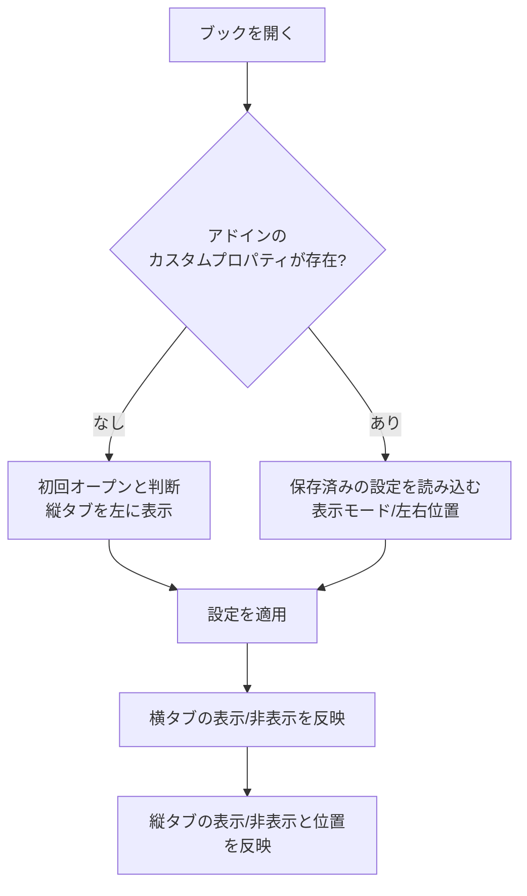
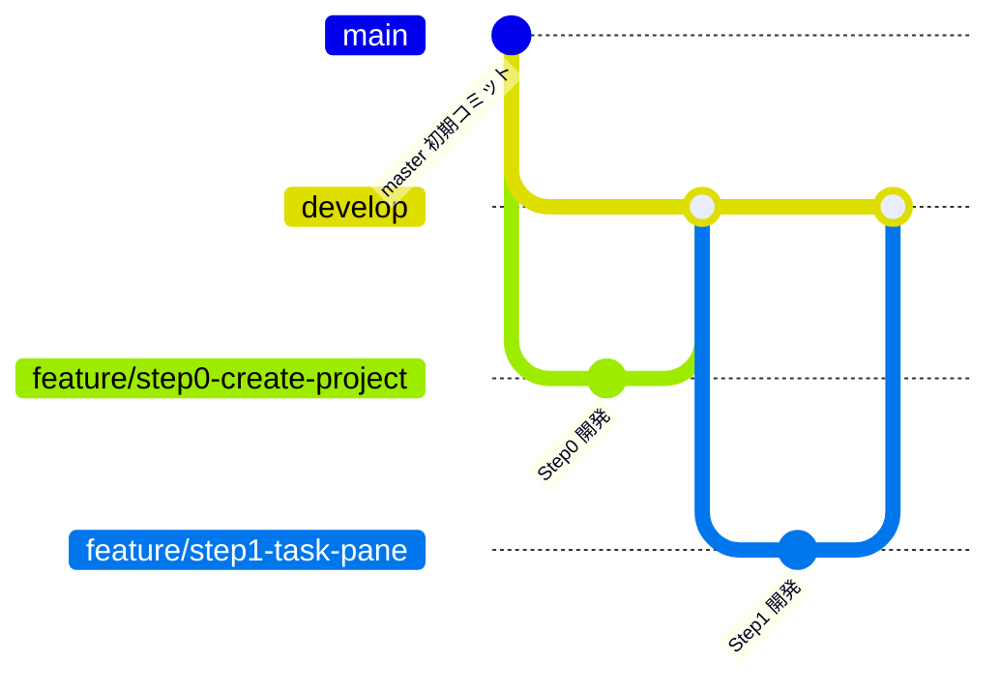

# Agents.md - 縦並びシートタブ Excelアドイン 開発方針

最終更新: 2026-10-22 (v1.1.24 の時点。随時更新)

## 0. 現在の状態 (v1.1.86) と、この文書の読み方

この文書は、相談と開発の経緯を、時系列で記録したものです。**後の章 (特に12章) の変更が、前の章の記述より優先**されます。前の章で、のちに変わった記述には、「(→ 12.x で変更)」の注記を付けています。利用者向けの説明は `README.md`、開発者向けの手順は `DEVELOPMENT.md` にあります。

### 0.1 現在の状態

| 項目 | 内容 |
|---|---|
| 最新版 | v1.1.86 (`develop`、`master`、タグ `v1.1.86` は、同じコミット)。v1.1.4 は、`master` に反映せず、タグも無い (内容は v1.1.5 に含まれる) |
| 開発ステップ | Step0 から Step8 (フォルダ機能) まで完了。以降は、ユーザーの要望と不具合の修正を、`fix/...`、`feature/...` ブランチで行い、リリースごとにインストーラと配布用zipを作る (13章) |
| 配布 | ClickOnce のインストーラ + 配布用zip (`配布用zip\VerticalSheetTabs_v1.1.86.zip`。README.pdf つき)。自己署名の証明書 |
| 実機の確認環境 | Windows 11、拡大率125%、Excel 365 (64bit、カラフルのテーマ)。ほかの拡大率、暗い配色は、未確認 (11.3) |

### 0.2 現在の仕様の要約 (最新の決定)

| 項目 | 現在の仕様 | 経緯 |
|---|---|---|
| 表示モードの初回の既定値 | A (横タブのみ)。縦タブは、設定画面で表示モードを変えると出る | 2章、12.119 |
| 縦タブの初回の幅 | 半角12文字分 | 2章、11.5、12.40 |
| ペインのタイトル | 「縦タブ」 | 10.3、11.6 |
| ブック保存設定 | `VTab.Mode`、`VTab.Side`、`VTab.Width`、`VTab.Outline`、`VTab.OutlineLevel`、`VTab.NameRule`、`VTab.SelectStyle`、`VTab.ActiveMarker`、`VTab.Badges`、`VTab.RowAnim`、`VTab.DoneAnim`、`VTab.Wobble`、`VTab.WobbleAmp`、`VTab.WobbleDur`、`VTab.WobbleSound`、`VTab.WobbleVolume`、`VTab.WobbleSampleStyle` (2.2) | 12.50、12.56、12.99、12.110、12.141 |
| フォルダの保存 | ブックのカスタムXMLパート。シートの識別は、隠しカスタムプロパティ `VTab.Id` (`CodeName` は使わない) | 12.8 |
| フォルダの選択 | フォルダの行のクリックで、フォルダだけを選択 / 解除する。中のシートは、Excelで選択されない | 12.19 |
| フォルダの色 | フォルダの行全体に付ける (左端の帯ではない)。シートには反映しない | 12.19 |
| フォルダの一括操作 | 名前の変更 / すべて非選択 / すべて選択 / すべて非表示 / すべて再表示 / フォルダの色 / 中の全てを常にフォルダと同一色に設定 (ON/OFF、チェックマーク) / フォルダの削除 / フォルダと中のシートを削除 / 全てのフォルダを閉じる / 全てのフォルダを開く。「保護」、「移動またはコピー」、「フォルダと中のシートの色」、「中の全てを選択中シートと同一色に変更」は、削除した | 12.12、12.28 から 12.31、12.39、12.65、12.66、12.80、12.82 |
| 選択中の行の見た目 | アクティブなシートの印は、設定画面の「アクティブシートのマーカー表示」(下線マーカー / 三角マーカー / 両端バーマーカー / マーカーなし。初期値は下線。ブックごと) で選び、選択デザインと組み合わせて表示する (12.110、12.111、12.116)。三角は、白い縁取りとぼかし (約2px) 付き (12.109)。設定画面の「フォルダ＆シート選択のデザイン」で、8つのタイプから選ぶ (ブックごと。初期値は「標準タイプ」。12.99、12.105、12.107、12.115、12.131)。ストライプタイプは、ななめの縞と枠、クリスタルタイプは、斜めのカット面と、消えていく明るい色 (12.139。12.131 のグラデーション枠を置き換えた)。アクティブシートのマーカーには、チェックバッジマーカー (名前の左に丸いチェック) もある (12.131)。インセットタイプは、行が押し込まれたように凹んで見える (12.115)。グロッシーグラスタイプ、フロストグラス１タイプ、フロストグラス２タイプは、行の上に、半透明のガラスを重ねる (12.105、12.107)。標準タイプは、v1.1.28 までの見た目 (白い塗りと薄い枠、色付きは上が白のグラデーション、アクティブなシートだけに緑の下線)。ダブルフレームタイプは、次の見た目: 影が付き、暗い外枠と白い内枠の二重の枠で囲まれ、アクティブなシート (内容が表示されているシート) だけに、左右の端に、中央を向いた小さな三角が付く (フォルダと、グループの、ほかのシートには、付かない。12.95、12.97)。文字は太字。色付きは、元の色のまま。三角は、行の色の反対色 (色なしの行は、Excelの緑) で、白い縁と、約4pxの白いぼかしが付く。選択中のすべてのフォルダとシートが、同じ見た目 (グループの、アクティブでないシートは、影が弱い) | 12.85、12.91、12.93、12.95、12.97、12.99、12.105、12.107、12.109、12.110、12.111、12.115、12.116 |
| 開いたフォルダ | 点線で囲む (右上と左下が欠ける)。表示 / 非表示と色の段階 (1から9) は、設定画面で選ぶ | 12.42、12.47、12.48、12.50 |
| 「+」ボタン | 縦タブの下端に常に固定。選択が閉じたフォルダの中だけのときは、一番下に追加 | 12.17、12.50 |
| シート名のルール | `フォルダ名 \| シート名`。ブックごとに、使う / 使わないを選ぶ (初期値: 使わない) | 12.56 |
| 縦タブの「挿入」 | アドインの処理。フォルダ内のシートで選ぶと、そのフォルダに入る | 12.73 |
| キー入力 | シートを選んだ直後のキー入力は、セルに入る (ペインがフォーカスを持っていたときは、F6 を送って、Excelに戻す)。セルの入力中にシートを選ぶと、入力を確定してから切り替える | 12.58、12.60、12.123 |
| 保存の確認 | 開いただけ、同期しただけでは、ブックを「変更あり」にしない (シート名のルールによる、開いた直後の並べ直しも含む)。フォルダの開閉、色、名前などの操作は、「変更あり」にする | 12.14、12.25、12.103 |
| 縦タブでのショートカット | Ctrl+S、F12 のみ、Excelの保存を実行する | 12.21 |
| 設定画面の表示 | 左下に、バージョン、著作権、ライセンス (BSD 3条項) | 12.62、12.63、12.69 |

### 0.3 章の案内

| 章 | 内容 |
|---|---|
| 1から5 | 目的、確定事項、処理フロー、実装方針、未決定事項 |
| 6、7 | 開発ステップ、ブランチ運用 |
| 8 | Step0 から Step5 の開発メモ |
| 9 | Step6 見た目の再現 (採寸結果、テーマ、DPI) |
| 10、11 | Step7 仕上げ、完了状況と残課題 |
| 12 | Step8 フォルダ機能の設計と、その後の改善、不具合の修正、リリースの記録 (12.1 から 12.213) |
| 13 | リリースの定型作業 |

## 1. 目的

Excelのシートタブは標準で横並びだが、シート数が増えると操作しづらく見づらい。
そこで、シートタブを縦並びで表示するExcelアドインを開発する。

## 2. 確定事項

| 項目 | 決定内容 |
|---|---|
| 対象 | Windows版 Excel (Microsoft 365) のみ |
| 方式 | VSTO アドイン (独自GUI描画のため) |
| 機能 | 縦並びでも、横並びタブと全く同一の機能が実行できる |
| タブ色 | 横並びと全く同じ色分けができる |
| 見た目 | 縦並びでも、横並びと同じグラフィック描画の外観にする |
| 見た目の再現度 | 可能な限り完全同一を目標とする (方針は2.3) |
| 機能の範囲 | 横タブの全機能 (切替、追加、削除、名前変更、ドラッグ移動、Ctrl+ドラッグコピー、複数選択、右クリックメニュー、タブ色変更、非表示/再表示 など) |
| 対象シート | ワークシートとグラフシートは表示。非表示とVeryHiddenのシートは縦タブにも表示しない |
| 縦タブが多い場合 | 縦スクロールバーで対応 |
| 幅の保存タイミング | ブック保存時のみ記録。保存せず閉じた場合は変更前の幅のまま |
| ビット数 | 64bit (x64)。このPCのExcel (Microsoft 365, ビルド16.0.20430) と同じ |
| 開発環境 | Visual Studio Community 2026 (18.x)。.NET SDK 10.0.401 も導入済み |
| 縦タブの幅 | 初回は半角12文字分 (当初は16文字、のち8文字。11.5、12.40で変更)。ユーザーがドラッグで変更可能 |
| 幅の保存/復元 | ブック保存時に直前の幅を保存し、再オープン時に復元 |
| 設定変更の入口 | (1) リボンのボタン (2) タブ右クリックメニューの先頭に「タブ表示の設定」を追加。どちらも同じ設定画面を開く |
| 縦タブのUI形式 | カスタムタスクペイン (CustomTaskPane + UserControl)。内部は自前描画。左右ドッキングと幅変更はペイン機能を利用 |
| ワークロード | VS 2026に「Office/SharePoint開発」を導入済み |
| シート名の最大長 | 横タブと同一 (Excel仕様の31文字) |
| 長いシート名の表示 | 幅に収まらない分は末尾を「…」で省略し、ホバー時にフルネームをツールチップ表示 |
| 設定画面 | 表示モード (ラジオ3択: 横のみ/縦のみ/両方)、縦タブの位置 (ラジオ2択: 左/右)、OK/キャンセル。のちに、シート名のルール (12.56)、フォルダを囲む点線 (12.50) を追加 |
| 複数ブック | ブック/ウィンドウごとに専用ペインを持ち、設定は完全に独立 |
| 初回オープン時の表示 | 表示モードはC (横タブと縦タブの両方を表示)、縦タブは左側 (→ 12.119 で、表示モードの初回の既定値は、A (横タブのみ) に変更) |
| 初回表示位置 | ブックの初回オープン時は左側に縦タブを表示 |
| 表示位置の設定 | ユーザー設定で左/右を選択可能 |
| 設定の保存 | Excelのカスタムドキュメントプロパティにブック単位で保存し、オープン時に復元 |
| 初回判定 | 本アドインのカスタムプロパティがブックに無ければ初回オープンと判断 |
| タブ表示モード | 下記3パターンからユーザー設定で選択 |

### 2.1 タブ表示モード (ブック単位の設定)

| モード | 横タブ (標準) | 縦タブ (本アドイン) |
|---|---|---|
| A: 横のみ | 表示 | 非表示 |
| B: 縦のみ | 非表示 | 表示 |
| C: 両方 | 表示 | 表示 |

### 2.2 ブック保存設定 (カスタムドキュメントプロパティ)

| 設定項目 | 値 |
|---|---|
| 表示モード | A / B / C |
| 縦タブの位置 | 左 / 右 |
| 縦タブの幅 | 保存時の幅 (初回は半角12文字分) |
| フォルダを囲む点線 | 表示 / 非表示、色の段階 (12.50) |
| シート名のルール | 使う / 使わない (12.56) |

項目ごとに別のカスタムドキュメントプロパティとして保存する。

| プロパティ名 | 型 | 値 |
|---|---|---|
| `VTab.Mode` | 文字列 | `A` (横のみ) / `B` (縦のみ) / `C` (両方) |
| `VTab.Side` | 文字列 | `Left` / `Right` |
| `VTab.Width` | 数値 (整数) | ペイン内容部の幅。DPI非依存のピクセル値 (96dpi換算)。復元時は実際のDPIで実ピクセルに戻す (→ 9.5 で、`DeviceDpi` から実際のDPIに変更) |
| `VTab.Outline` | 文字列 | `On` / `Off` (開いたフォルダを囲む点線。12.50)。無いブックは `On` |
| `VTab.OutlineLevel` | 数値 (整数) | 点線の色の段階 1から9 (12.50)。無いブックは 5 |
| `VTab.NameRule` | 文字列 | `On` / `Off` (シート名のルール。12.56)。無いブックは `Off` |
| `VTab.Wobble` | 文字列 | `None` / `Shake` / `Wobble` / `Jelly` / `Bounce` / `Pulse` / `Swing` / `Random` (選択したシートの揺れのアニメーション。12.141)。無いブックは `None` |
| `VTab.WobbleAmp` | 数値 (整数) | 揺れの大きさ。40から200 (%)。無いブックは 100 (12.141) |
| `VTab.WobbleDur` | 数値 (整数) | 揺れの長さ。300から1200 (ミリ秒)。無いブックは 600 (12.141) |
| `VTab.WobbleSampleStyle` | 文字列 | `On` / `Off` (アニメーションの設定のサンプルの見た目を、選択デザインとマーカー表示に合わせる、のチェック。12.178)。無いブックは `Off` |
| `VTab.WobbleSound` | 文字列 | `On` / `Off` (揺れの効果音。12.172)。無いブックは `Off` |
| `VTab.WobbleVolume` | 数値 (整数) | 効果音の音量。0から100 (%)。無いブックは 60 (12.172) |
| `VTab.DoneAnim` | 文字列 | `On` / `Off` (進捗を「完了」にしたときの、印のはじける動き。12.199)。無いブックは `On` |
| `VTab.RowAnim` | 文字列 | `On` / `Off` (フォルダ、シートの追加、削除のアニメーション。12.194、12.196)。無いブックは `On` (12.197) |
| `VTab.Badges` | 文字列 | `None`、または、`Error` / `Memo` / `Protect` / `Progress` を、カンマでつないだもの (行の右端に出すバッジ。12.190、12.199)。無いブックは `None` |
| `VTab.ActiveMarker` | 文字列 | `None` / `Underline` / `Triangle` / `EdgeBars` / `CheckBadge` (アクティブなシートのマーカー。12.110、12.111、12.116、12.131)。無いブックは `Underline` |
| `VTab.SelectStyle` | 文字列 | `Standard` / `DoubleFrame` / `FrostedGlass` / `GlossyGlass` / `FrostedGlass2` / `Inset` / `Stripes` / `Crystal` (選択中のフォルダとシートの見た目。12.99、12.105、12.107、12.115、12.131)。無いブックは `Standard` |

`VTab.Mode` 等のプロパティが存在しないブックは初回オープンと判断する (`VTab.Outline`、`VTab.OutlineLevel`、`VTab.NameRule`、`VTab.SelectStyle`、`VTab.ActiveMarker`、`VTab.Wobble` と、その大きさ、長さは、判断に使わない)。

### 2.3 見た目の再現方針

Excel標準タブの描画を取得するAPIは無いため、自前描画 (GDI+/WinForms等) で再現する。

- 実機のExcel標準タブをスクリーンショットで採寸し、寸法・色・フォント・余白を合わせる
- 再現対象の状態: 通常 / 選択中 / グループ選択 / マウスホバー / タブ色あり
- 再現対象の環境: Officeテーマ (カラフル/白/黒/ダークグレー)、DPI (100%-200%以上)、Windows 11の見た目
- 横タブとの差分は「縦に並ぶ」点のみとする (文字は横書きのまま)
- 完全同一が技術的に不可能な箇所は、その都度相談して許容差を決める

## 3. 処理フロー (ブックオープン時)

## 4. 実装方針 (相談で合意済み)

| 項目 | 方針 |
|---|---|
| VSTOのターゲット | .NET Framework 4.8 |
| 幅の換算 (半角12文字) | 数字「0」の幅x12+タブの余白で換算 (当初は16文字、のち8文字。11.5、12.40で変更) |
| タスクペイン方式の制約 | ペイン幅の変更検知、ウィンドウとの紐付け、枠の見た目は、試作段階で確認 |

## 5. 未決定事項

- 幅の最小値/最大値
- 「縦のみ」で保存したブックを、アドインの無いExcelで開いたユーザーへの案内 (実装しないことに決定。7-3)
  - アドインが無い環境では、アドインのコードが動かないため、ダイアログは出せない
  - 案: 設定画面で「縦のみ」を選んだとき、戻し方 (「ファイル > オプション > 詳細設定 > シート見出しを表示する」) を注意文として表示する。ブックの作成者に事前に知らせる目的

## 6. 開発ステップ

リスクの高い技術要素を先に小さく検証し、見た目の完全再現は最後に回す。

| Step | 内容 | 完了条件 | 主なリスク |
|---|---|---|---|
| 0 | VSTOプロジェクト作成、ビルドしてExcelで読み込み | アドインがExcelに読み込まれる | VS 2026とVSTOの相性 |
| 1 | ウィンドウごとにカスタムタスクペインを出す (左右切替、幅変更の検知) | 複数ブックで各自のペインが出る | 最大の技術リスク。ペイン幅の検知やウィンドウとの紐付け |
| 2 | シート名一覧を縦に表示し、クリックで切替。非表示/VeryHiddenは除外、グラフシートは表示 | 一覧と実際のシートが一致する | シート増減や名前変更への追従 |
| 3 | カスタムドキュメントプロパティ(`VTab.*`)の読み書き、初回判定、保存時の幅記録 | 保存して開き直すと設定と幅が復元される | 保存イベントのタイミング |
| 4 | 表示モードA/B/Cと設定画面、リボンボタン | 3パターンが切り替わる | 横タブの表示切替がブック単位でできるか |
| 5 | 全操作の実装 (追加、削除、名前変更、ドラッグ移動、Ctrl+ドラッグコピー、複数選択、右クリックメニュー、タブ色変更、非表示/再表示、「タブ表示の設定」項目) | 横タブと同じ操作ができる | 右クリックメニューの差し込み、ドラッグ操作、保護ブック時の挙動 |
| 6 | 見た目の完全再現 (実機の採寸、各状態、テーマ、DPI、省略表示、ツールチップ) | 横タブと並べて比較して差が許容内 | 時間がかかる。許容差を相談 |
| 7 | 仕上げ (例外処理、重いブックでの確認、インストーラ、署名) | 配布可能 | 配布方法の決定 |

## 7. Gitブランチ運用

- `master`: 初期コミットのみ。リリース時などに使う (→ v1.1.0 以降は、リリースした版を反映し、タグ `vX.Y.Z` を付ける。13章)
- `develop`: 統合ブランチ。各Stepの開発が完了したものだけをマージする
- `feature/stepN-内容`: Stepごとに`develop`から作成する。Step8 以降の改善は `feature/...`、不具合の修正は `fix/...` を、`develop` から作成し、マージ後に削除する (13章)。ステップ番号と内容が一目で分かる名前にする (文字化け防止のため英小文字のkebab-case)

| Step | ブランチ名 |
|---|---|
| 0 | `feature/step0-create-project` |
| 1 | `feature/step1-task-pane` |
| 2 | `feature/step2-sheet-list` |
| 3 | `feature/step3-persist-settings` |
| 4 | `feature/step4-display-mode` |
| 5 | `feature/step5-tab-operations` |
| 6 | `feature/step6-visual-fidelity` |
| 7 | `feature/step7-finishing` |

- 流れ: featureブランチで開発 -> 完了条件を確認 -> `develop`へマージ (`--no-ff`) -> 次のStepのfeatureブランチを`develop`から作成
- 各Stepの完了時に結果を報告し、マージと次Stepへの着手はその都度確認する
- コミットメッセージは日本語で書く

## 8. 開発メモ

### Step0 (プロジェクト作成) の結果

- VS 2026のExcel VSTOアドイン(C#)テンプレートの内容を元に、手作業でプロジェクトを作成した
  - `VerticalSheetTabs.sln` / `VerticalSheetTabs/VerticalSheetTabs.csproj` (.NET Framework 4.8、AnyCPU)
  - Resources/Settings は不要なため省略した
- ビルド: VS 2026付属のMSBuild (`MSBuild\Current\Bin\MSBuild.exe`) でビルド成功
- マニフェスト署名: 自己署名証明書 `VerticalSheetTabs_TemporaryKey.pfx` (パスワードなし) を使用。`.gitignore`済みのためリポジトリには含めない
  - 別PCで開発する場合は、VS 2026で「署名」タブから新しい証明書を作成し、`.csproj`の`ManifestCertificateThumbprint`を更新する
- 読み込み確認: ビルドでHKCUにアドインが登録され、Excelを通常起動すると`COMAddIns`に`VerticalSheetTabs`が`Connect=True`で表示された
  - COM自動化 (`New-Object -ComObject Excel.Application`) で起動したExcelでは、VSTOアドインは読み込まれなかった。動作確認はExcelの通常起動で行う

### Step1 (タスクペイン表示) の結果

実装: `PaneManager.cs` (ウィンドウごとにペインを管理)、`TabPaneControl.cs` (試作用の中身)、`ThisAddIn.cs` (イベント接続)。

| 確認項目 | 結果 |
|---|---|
| ウィンドウごとのペイン | OK。複数ブックを開くと、各ウィンドウに独立したペインが表示された |
| 左右のドッキング | OK。`DockPosition`で左/右の切替ができた。初期表示は左 |
| 幅変更の検知 | OK。ペインの端をドラッグすると、`UserControl.Resize`で新しい幅を検知できた |
| ブックを閉じたとき | OK。`WorkbookBeforeClose`でペインを削除し、他のウィンドウのペインは残った |
| 新規ブック作成 | OK。`WindowActivate`でペインが作られた |

分かったこと・制約:

- Excel 365はブックごとに別のトップレベルウィンドウ (SDI) になる。ペインの管理キーにはウィンドウハンドル (`Window.Hwnd`) を使えた
- ペインには、タイトルバー (タイトル、メニュー、閉じるボタン) が付く。タブ領域だけの見た目にはできない。「完全同一の見た目」の許容差として、Step6までに相談する
- ユーザーがペインの閉じるボタンで閉じた場合の扱い (再表示の方法) を、Step3/4で決める
- `CustomTaskPane.Width`に150を設定したとき、中身のコントロール幅は134pxだった。幅の単位とDPIの関係は、Step3で`VTab.Width`を決めるときに確認する
- `WorkbookBeforeClose`で保存確認がキャンセルされた場合は、ペインが消えたままになる可能性がある。Step2以降で対策する (`WindowActivate`での再作成など)
- 動作確認は、Excelを通常起動して、UI Automation (`System.Windows.Automation`) とキー送信で行った

### Step2 (シート名の縦一覧と切替) の結果

実装: `PaneManager.cs` (シート一覧の読み取りと同期、シートの切替)、`TabPaneControl.cs` (試作用の`ListBox`で一覧表示)。

| 確認項目 | 結果 |
|---|---|
| 一覧の内容 | OK。ワークシートとグラフシートを表示。非表示とVeryHiddenは除外 |
| シートの切替 | OK。一覧のクリックで、ワークシート、グラフシートとも切り替わった |
| 名前変更への追従 | OK |
| 追加・削除への追従 | OK |
| 並べ替え (移動) への追従 | OK |
| 非表示/再表示への追従 | OK。非表示にするとアクティブシートが別のシートに移り、一覧もそれに追従した |
| アクティブシートの強調 | OK。一覧の選択状態がアクティブシートと一致した |

方式:

- Excelには、シート名変更、並べ替え、非表示/再表示のイベントが無い。そのため、300ms間隔のタイマーで、シート名・表示状態・アクティブシートを読み直す
  - 一覧は、内容が変わったときだけ更新する (ちらつきやスクロール位置の消失を防ぐ)
  - `SheetActivate`イベントでも即時に同期する
- セル編集中などでExcelがビジー状態のときのCOM例外は握りつぶし、次回のタイマーで再試行する (実機での確認は未実施)

未確認・今後の課題:

- セル編集中のタイマー動作
- 保護されたブック、構造保護時の挙動 (Step5で確認)
- シートが非常に多いブックでの負荷 (Step7で確認)
- タブ色の取得 (Step6で実装)
- 試験用ボタン「Dock Left/Right」は、Step4で設定画面に置き換えるまで残す

確認時の注意: PowerShellからの画面キャプチャは`PrintWindow`でExcelのウィンドウだけを撮る。画面全体のコピーでは、他のウィンドウが写り込む。

### Step3 (設定の保存と復元) の結果

実装: `WorkbookSettings.cs` (プロパティの読み書き)、`PaneManager.cs` (読み込み、幅の適用、保存時の書き込み)、`ThisAddIn.cs` (`WorkbookBeforeSave`の接続)。

| 確認項目 | 結果 |
|---|---|
| 初回判定 | OK。`VTab.*`が無いブックでは初回と判断し、縦タブを左に表示した |
| 初回の幅 | OK。半角16文字分 (数字「0」16文字の幅 + 左右の余白) で表示された |
| 保存 | OK。ブックの保存時に`VTab.Mode`/`VTab.Side`/`VTab.Width`が書き込まれた (保存したxlsxの`docProps/custom.xml`で確認) |
| 復元 | OK。再オープンで、保存した左右位置と幅に復元された |
| 保存せず閉じた場合 | OK。ブックの保存時のみ記録するため、変更は残らない |

仕様の確定内容:

- `VTab.Width`は、ペイン内容部 (コントロール) の幅を、96dpi換算のピクセル値で保存する。ペインの枠 (実測16px) は復元時に加算する
- ペインの幅は、表示直後は確定しないため、250ms後に内容幅を測って適用する
- 書き込みの対象は、そのブックの1つのウィンドウの状態 (1ブックに複数ウィンドウがある場合は先頭のウィンドウ)
- 読み書きの失敗 (読み取り専用ブックなど) は握りつぶし、既定値で動作する
- 初回オープン時の既定の表示モードは「C: 両方」で確定 (ユーザー確認済み) (→ 12.119 で、「A: 横のみ」に変更)

未確認・今後の課題:

- 100%以外のDPIでの幅の換算 (このPCは96dpiのみ。Step7で複数DPIを確認する)
- 1ブックに複数ウィンドウがある場合の保存内容
- OneDriveの自動保存時の書き込み (`WorkbookBeforeSave`が呼ばれるか)
- 幅の最小値/最大値 (復元時に極端な値が入っていた場合の補正)
- C# 7.3の制約: `ref`付きラムダなどは使えない (VS 2026のVSTOプロジェクトの既定の言語バージョン)

### Step4 (表示モードと設定画面、リボンボタン) の結果

実装: `SettingsForm.cs` (設定画面)、`RibbonController.cs` (リボンボタン)、`PaneManager.cs` (モードの適用)、`WorkbookSettings.cs` (Step3から利用)。試験用の「Dock Left/Right」ボタンと情報ラベルは削除した。

| 確認項目 | 結果 |
|---|---|
| リボンボタン | OK。「表示」タブの「縦タブ」グループに「タブ表示の設定」を追加。押すと設定画面が開く |
| 設定画面 | OK。表示モード3択、縦タブの位置2択、OK/キャンセル。現在の設定が初期選択される。横のみのときは位置の選択が無効になる |
| モードA (横のみ) | OK。横タブ表示、縦タブのペインは非表示 |
| モードB (縦のみ) | OK。横タブ非表示、縦タブのペインを表示 |
| モードC (両方) | OK。両方表示 |
| 左右の切替 | OK。ダイアログで選んだ側にペインが移動した |
| 保存と復元 | OK。モードB・右を保存して再オープンすると、同じ状態で復元された |
| 初回オープン | OK。両方表示、縦タブは左 |

仕様の確定内容:

- 横タブの表示/非表示は、`Window.DisplayWorkbookTabs` で切り替える (ウィンドウ単位)
- 縦タブは、ペインの表示/非表示 (`Visible`) で切り替える
- ユーザーがペインの閉じるボタンで閉じた場合は、モードAに切り替え、横タブを再表示する (縦のみのブックでタブが無くなるのを防ぐ)。ペインを再表示するには、設定画面でモードを変える
- 設定画面の変更は、そのブックにだけ適用する。ブックの保存時に`VTab.*`へ書き込む (保存しないと残らない)

横タブ非表示のままファイルに残る件 (確定: 現状の動作のままとする):

- 原因: 横タブの表示/非表示は、Excelのブックごとの設定 (`xl/workbook.xml`の`showSheetTabs`) としてファイルに保存される。本アドインは、「縦のみ」のときにこの設定をオフにして横タブを隠すため、保存するとファイルに非表示の状態が残る
- 影響: 「縦のみ」で保存したブックを、本アドインの無いExcelで開くと、横タブが表示されない。「横のみ」「両方」のブックには影響しない
- 戻し方: 「ファイル > オプション > 詳細設定 > このブックで作業するための表示設定 > シート見出しを表示する」にチェックを入れる。ブックのデータには影響しない
- 検討して採用しなかった方法 (いずれも複雑さに対して効果が限定的なため):
  - 保存直前 (`WorkbookBeforeSave`) に`DisplayWorkbookTabs`を戻す: Excelが保存イベント中の変更を無視するため不可
  - 保存直後に横タブを表示してもう一度保存する: 保存が2回になるため不可
  - 保存を中断して横タブを表示し、同じ保存を再実行する: 保存と名前を付けて保存では動作したが、閉じるときの保存確認の経路では効かず、マクロの`Save`直後の終了で変更を失うおそれがある
  - 保存後のファイル (xlsx) を直接書き換える: Excelがファイルをロックしているため不可
- 将来、必要になった場合は、「保存を中断して再実行」を土台に、閉じる経路 (`WorkbookBeforeClose`) の対応を足す方法を再検討する

その他の注意点:

- 設定画面の見た目 (グループ枠の余白など) は暫定。Step7で整える
- コンテキストメニューの「タブ表示の設定」はStep5で追加する

確認時の注意:

- WinFormsの設定画面のコントロールは、UI Automationでは見つからなかった。ボタン操作は、子ウィンドウに`BM_CLICK`を送って行った
- 確認用のPowerShellスクリプトにWindows PowerShell 5.1で日本語を含める場合は、UTF-8 BOM付きで保存する

### Step5 (タブ操作の全機能) の進捗

実装は小さな段階に分けて進める。各段階の終わりに`feature/step5-tab-operations`へコミットし、Step5全体の完了後に`develop`へマージする。

| 段階 | 内容 | 状態 |
|---|---|---|
| 5-1 | 右クリックメニューの土台、先頭に「タブ表示の設定」 | 完了 |
| 5-2 | 追加、削除、名前変更 (ダブルクリック、31文字制限)、非表示、再表示 | 完了 |
| 5-3 | 移動とコピー (ドラッグ、Ctrl+ドラッグ) | 完了 |
| 5-4 | 複数選択 (Shift/Ctrlクリック)、グループ選択、一括操作 | 完了 |
| 5-5 | タブ色の変更、保護ブック/構造保護時の挙動 | 完了 |
| 5-6 | Excel標準の横タブの右クリックメニューにも「タブ表示の設定」を追加 | 完了 |

メニュー項目は、Excel標準のシートタブのメニューに合わせる。各項目は、Excelの既存機能を呼び出して実行する。

#### 5-1 右クリックメニューの結果

- `TabPaneControl`に`ContextMenuStrip`を追加。先頭の項目「タブ表示の設定」から、リボンのボタンと同じ設定画面を開く
- Excel標準のタブと同様に、右クリックしたシートを先にアクティブにしてからメニューを表示する
- 実機で、右クリックでシートが切り替わり、メニューの先頭項目から設定画面が開くことを確認した
- 標準項目 (挿入、削除、名前の変更、移動またはコピー、シートの保護、タブの色、非表示、再表示など) は、5-2以降で順に追加する

#### 5-2 追加・挿入・削除・名前変更・非表示・再表示の結果

- 追加: 一覧の下の「+」ボタン。アクティブシートの後ろに新しいワークシートを追加する (Excelの「+」と同じ)
- 右クリックメニュー (Excelの並びに合わせた): タブ表示の設定 / 挿入 / 削除 / 名前の変更 / 非表示 / 再表示
  - 挿入、削除、非表示、再表示は、Excelの標準コマンド (`CommandBars.ExecuteMso`: `SheetInsert`、`SheetDelete`、`SheetHide`、`SheetUnhide`) を呼び出す。確認ダイアログやエラーメッセージも、Excel標準のものになる
  - 「再表示」は、非表示のシートがあるときだけ有効。VeryHiddenは対象外
- 名前の変更: ダブルクリックまたはメニューから、その場で編集する。Enterまたはフォーカスを外すと確定、Escで取り消し。入力は31文字まで
  - 使えない文字 (`: \ / ? * [ ]`)、前後のアポストロフィ、空白のみ、重複 (非表示シートを含む) は、Excelに近い文面のメッセージで知らせる。メッセージ文は独自 (Excelの文面と完全には一致しない)
  - グラフシートも名前を変更できる
- 実機で確認: 追加、名前変更、不正な名前のメッセージ、非表示、削除、再表示 (Excelのダイアログ)、挿入 (Excelのダイアログ)
- 未確認: ブックの構造が保護されているときの動作 (5-5で確認する)、「+」ボタンの見た目 (Step6で整える)

注意:

- 確認用スクリプトは、Excelの標準ダイアログを`SendKeys`で操作した。Windows PowerShell 5.1の別セッションをまたいで型定義が残らないため、定義は毎回同じスクリプト内に置く

#### 5-3 移動とコピーの結果

- ドラッグで、シートの順序を移動する。ドラッグ中は、挿入位置に線を表示する。Ctrlを押しながらドラッグすると、コピーする (コピーしたシートの名前は、Excelの規則で付く。例: 「Sheet3 (2)」)
- 挿入位置は、行の上半分なら、その行の前、下半分なら、その行の後ろ。最後の行より下は、表示中のシートの末尾
- 非表示のシートは、元の位置のまま。表示中のシートの前後に移動またはコピーする
- 右クリックメニューに「移動またはコピー」を追加した (Excel標準のダイアログ `SheetMoveOrCopy`)
- 一覧の端の近くにドラッグすると、自動でスクロールする (実機では未確認)
- 同じ位置へのドロップは、何もしない
- ブックの構造が保護されているときは、メッセージを表示する (5-5で確認する)
- 実機で確認: 先頭への移動、末尾への移動 (非表示のシートの位置は変わらない)、Ctrl+ドラッグのコピー、メニューからのExcel標準ダイアログ、クリックでのシート切替

実装上の注意:

- Excelはシートをアクティブにすると、フォーカスをExcel側に移す。左クリックの場合に、マウスを押した時点でシートを切り替えると、始まったばかりのドラッグが取り消される。そのため、左クリックでのシート切替は、ボタンを離した時点に行う (ドラッグしたときは切り替えない)。右クリックは、メニューの対象にするため、押した時点で切り替える
- 確認用スクリプトでドラッグを再現するときは、`mouse_event`の絶対座標移動 (`MOUSEEVENTF_ABSOLUTE`) を使う。`SetCursorPos`だけでは、ボタンを押している間の`MouseMove`が届かない

#### 5-4 複数選択とグループ選択の結果

- 一覧の選択は、`ListBox`の標準の選択ではなく、独自に管理する (`SelectionMode.None` + オーナー描画)。Excelのタブと同じ規則にするため
  - クリック: そのシートだけを選択。ただし、グループの内側のシートをクリックしたときは、グループを保ったまま、そのシートをアクティブにする (全シートを選択しているときは解除する)
  - Ctrl+クリック: シートをグループに追加/解除。追加したシートがアクティブになる
  - Shift+クリック: アクティブなシートからクリックしたシートまでを選択。アクティブなシートは変わらない
  - 右クリック: グループの外のシートなら、そのシートだけを選択してアクティブにする。グループの内側なら、グループを保ったままアクティブにする
  - 上下キー: アクティブなシートを移動する (単一選択)
- グループ中のアクティブなシートは、太字で描画する (選択中のシートは、強調色で描画)。タブのグラフィックはStep6で整える
- Excelへの反映: `Worksheet.Select(Replace)`を使う。アクティブなシートを最初に選択し (置き換え)、残りを追加する (追加の`Select(false)`では、アクティブなシートは変わらないため)
- Excel側の選択の変更も、タイマーの同期で一覧に反映する (`Window.SelectedSheets`)。マウスのボタンを押している間は、同期で選択を上書きしない
- 右クリックメニューに「すべてのシートを選択」と、グループ中だけ表示する「シートのグループ解除」を追加した。名前の変更は、グループ中は無効
- ドラッグ: グループのシートをドラッグすると、グループ全体を移動する。Ctrl+ドラッグで、グループ全体をコピーする (`Sheets.Move/Copy`)。グループに含まれないシートをドラッグしたときは、そのシートだけを動かす
- 削除と非表示は、Excel標準コマンドに任せるため、グループ全体が対象になる
- 実機で確認: クリック、Ctrl+クリック、Shift+クリック、グループ内のクリック、グループ外のクリック、すべてのシートを選択、グループ解除、グループのドラッグ移動、グループのCtrl+ドラッグコピー、グループの非表示
- 未確認: グループの削除 (Excelの確認ダイアログ)、キーボードの上下キーの動作、グラフシートを含むグループの移動

#### 5-5 タブ色と保護の結果

- 右クリックメニューの並び (Excelに合わせた): タブ表示の設定 / 挿入 / 削除 / 名前の変更 / 移動またはコピー / コードの表示 / シートの保護 / シート見出しの色 ▸ / 非表示 / 再表示 / すべてのシートを選択 / シートのグループ解除 (グループ中のみ)
- タブ色: 「シート見出しの色」のサブメニューに、Excelと同じ構成のパレット (`TabColorPalette.cs`) を表示する
  - テーマの色 (10色 x 6行。ブックのテーマの色を、`Workbook.Theme.ThemeColorScheme`から取得。行ごとの明るさの調整は、Excelと同じ値)、標準の色 (10色)、色なし、その他の色 (当初は、Windows標準のカラーダイアログ。→ 12.78 で、Excel自身の「色の設定」画面に変更)
  - テーマの色は、`Tab.ThemeColor` + `Tab.TintAndShade`で設定するため、Excelと同じく、ブックのテーマに追従する。標準の色とその他の色は、`Tab.Color` (RGB)、色なしは、`Tab.ColorIndex = xlColorIndexNone`
  - グループ中は、選択している全シートに適用する (Excelと同じ)
  - 縦タブの表示: 色が付いたシートは、左端に色の帯を表示する (暫定。標準タブに合わせたグラフィックはStep6)。色は、タイマーで`Tab.ColorIndex`/`Tab.Color`を読んで反映する
- シートの保護: Excel標準コマンド (`SheetProtect`) を呼び出す。保護中は、メニューの文言が「シート保護の解除」に変わる (保護の状態は`ProtectContents`で判定)
- コードの表示: Excel標準コマンド (`ViewCode`)
- ブックの構造が保護されているとき: 挿入、削除、名前の変更、移動またはコピー、非表示、再表示のメニュー項目と、「+」ボタンを無効にし、ドラッグでの移動と、ダブルクリックでの名前の変更も行わない (`Workbook.ProtectStructure`で判定)
- 実機で確認: 標準の色、テーマの色 (基本色、明るさの異なる行)、グループへの色の適用、色なし、シートの保護 (ダイアログと文言の切替)、構造保護時のメニューの無効化
- 未確認: 「その他の色」のカラーダイアログ、テーマが変わったときのパレットの色、保護されたシートでの色の変更

性能に関する注意 (Step7で確認する):

- タイマー (300ms) の同期で、全シートの名前、表示状態、タブ色を、COM経由で読む。シートが非常に多いブックでは、負荷が大きくなる可能性がある。必要なら、間隔を延ばす、または、イベントで更新する範囲を増やす

#### 5-6 横タブのメニューへの追加の結果

- Excel標準の横タブを右クリックしたときのメニューにも、先頭に「タブ表示の設定」を追加した。リボンのボタンと同じ設定画面を開く
- 実装: リボンのカスタムUI (`RibbonController.cs`) の`contextMenus`で、`ContextMenuWorkbookPly`のメニューに、`insertBeforeMso="SheetInsertPage"` (= 先頭の「挿入」) のボタンを挿入する
  - 「挿入」の`idMso`は`SheetInsertPage`。ExcelBabyの`idMso`一覧 (Windows版) から候補を選び、メニューに挿入して位置を確かめて特定した。`SheetInsert`などは、このメニューの項目ではない
  - 同じ方法で確認できたこのメニューの`idMso`: `SheetDelete`、`SheetMoveOrCopy`、`SheetTabColorGallery` (シート見出しの色)、`SelectAllSheets`
- `CommandBars["Ply"]`に従来方式 (`Controls.Add`) で追加すると、メニューの末尾に付くため、この方式は使わない
- 区切り線を足そうとして`separator`を挿入すると、カスタムUI全体が読み込まれず、項目が出なくなる (確認済み)。区切り線は付けていない
- アイコンは付けていない
- 縦タブのメニューでも、「タブ表示の設定」が先頭にある (5-1)
- 実機で確認: 横タブを右クリックして、先頭の項目をクリックすると、設定画面が開く

## 9. Step6 見た目の再現

### 9.1 段階

| 段階 | 内容 | 状態 |
|---|---|---|
| 6-1 | 実機のExcelの横タブを撮影して採寸する | 完了 |
| 6-2 | 一覧を自前描画のコントロールに置き換え、1つのタブをExcelの横タブと同じ見た目で描く | 完了 |
| 6-3 | 「+」ボタン、ドラッグ中の表示、ホバーとフォーカスの見た目を、Excelに合わせる | 完了 |
| 6-4 | Officeテーマ (カラフル/白/黒/ダークグレー) とDPI (100%から200%以上) に対応する | 完了 (一部未確認) |
| 6-5 | 省略表示、ツールチップ、スクロール、ペインの余白を整え、横タブと並べて比較する | 完了 |

### 9.2 採寸結果 (6-1)

測定環境: Windows 11、画面の拡大率125% (物理5120x2160)、Excel 365 (Officeテーマ: カラフル)、日本語UI。値は物理ピクセル (125%) で測り、DIP (96dpi換算 = 物理 / 1.25) を併記する。画像は、`PrintWindow`でExcelのウィンドウを撮影して、ピクセル値を読み取った。

#### 色

| 要素 | 色 |
|---|---|
| タブバーの背景 | #EDEBED (237,235,237) |
| タブバーの上の線 (1px) | #E0E0E0 (224,224,224) |
| タブバーの下の線 (1px) | #FFFFFF。その下はステータスバー #F5F5F5 |
| 選択中のタブ (色なし) の塗り | #FFFFFF |
| 選択中のタブの外枠 (左右と下、1px) | #E0E0E0 |
| 選択中のタブの下線 | #107C41 (16,124,65)、2px |
| 文字 (色なしのタブ) | #242424 (36,36,36) |
| 区切り線 (1px) | #D1D1D1 (209,209,209) |
| 色付きの非選択タブの文字 | 白 (#FFFFFF)。背景が明るい色のときの色は未確認 |

#### 寸法 (物理px / DIP)

| 要素 | 値 |
|---|---|
| タブバーの高さ (上の線から下の線の手前まで) | 40px / 32DIP |
| タブの幅 (1つ分の区画) | 文字の幅 + 約37px (30DIP)。「Sheet1」(文字の幅約59px) で96px、「Chart1」で93px |
| 選択中のタブ | 区画の左4px、右5px内側。上端はタブバーの上の線の直下 (シートの領域とつながる)、下端は区画の下から5px上。下の2つの角を丸める (半径 約5px / 4DIP) |
| 選択中のタブの下線 | 太さ2px、タブの下端から3px上。左右とも、タブの内側から10px (8DIP) 内側 |
| 色付きの非選択タブ | 区画の左右5px内側、上5px、下5px内側 (高さ約30px / 24DIP)。4つの角を丸める (半径 約5px) |
| 区切り線 | 1px、高さ24px (19DIP)、タブバーの上下の中央。各区画の右端 (最後のタブの右にもある) |
| 文字の位置 | 色なしの選択中のタブは、非選択のタブより、約4px上 (下線のための余白) |

#### 状態ごとの見た目

| 状態 | 見た目 |
|---|---|
| 色なし・非選択 | 背景なし (タブバーの色)、文字#242424、右端に区切り線 |
| 色なし・選択中 | 白い塗り、外枠、下線 (緑)、文字#242424 |
| 色なし・グループの一員 (非アクティブ) | 白い塗り。下線は付かない |
| 色付き・非選択 | タブの色の塗り (丸い四角)、文字は背景に応じて白 |
| 色付き・選択中 | 上から下へのグラデーション。上端は白、下端はタブの色の約45% (白との混合。混合の割合は上端から下端へ0から約0.45まで直線的に増える)。外側に白の枠1pxと外枠#E0E0E0、下線 (緑)、文字#242424 |
| ホバー | 撮影ではホバーの変化が確認できなかった (Excelの横タブには、目に見えるホバー効果が無い可能性が高い)。この点は、実機で最終確認する |

フォント: 文字の幅から、「Yu Gothic UI」系の11から12pt相当。6-2で、候補のフォントを描画して、幅を比較して決める。

#### 追加で分かったこと (対応が必要)

- Excelは、拡大率125%で、DPI対応 (高DPI) の状態で描画している。一方、タスクペイン内のWinFormsコントロールは、`Control.DeviceDpi`が96を返す (拡大率を認識しない)。ペインの描画は、実際のDPIを`GetDpiForWindow`などで取得して、自前で拡大する。6-4で対応する
- Step3で保存する`VTab.Width`は、`DeviceDpi` (= 96) で96dpi換算している。実際のDPIが100%以外のPCでは、幅の換算が正しくない。実際のDPIで換算するように、6-4で修正する
- 縦タブでは、1つのタブの区画の高さを、横タブの高さと同じ32DIPにすることを、仮の方針とする (見た目を同一にするため)

### 9.3 6-2 自前描画のコントロールの結果

実装: `TabStrip.cs` (縦に並ぶタブの描画、選択、ドラッグ、名前の変更、スクロール)、`DpiHelper.cs` (DPIの取得)。`TabPaneControl.cs`は、`TabStrip`、「+」ボタン、右クリックメニューを載せるだけにした。`ListBox`は使わない。

- 描画: 9.2の採寸結果どおりに、1つのタブを1行 (高さ32DIP) として描く
  - 選択中 (白、外枠、緑の下線)、グループの一員 (白、下線なし)、色付き・非選択 (丸い四角、文字は背景に応じて白/濃い色)、色付き・選択中 (白から色への縦のグラデーション)、区切り線 (各行の下に、横向きに短く引く)
  - 文字は左寄せ。選択中のタブの文字は、下線の分だけ上に寄せる
  - 実機の横タブと並べて撮影して比較し、色、形、文字の幅 (「Sheet1」で58px) が一致することを確認した
- フォント: 「Yu Gothic」(游ゴシック)、96dpiで15.5px相当 (拡大率125%で約19.4px)。文字の幅が、Excelの横タブと一致するように、実測で決めた。`FontFamily("Yu Gothic")`で取得する (`FontFamily.Families`の名前は、日本語名「游ゴシック」のため、英語名では見つからない)
- DPI: ペイン内の描画は、Excel本体のウィンドウのDPI (`GetDpiForWindow`) で拡大する (`DpiHelper`)。拡大率125%の実機で、行の高さが40px (= 32DIP x 1.25) になることを確認した
- Step5の機能は、すべて新しいコントロールで動作することを確認した (クリック、Ctrl/Shiftクリック、グループ内/外のクリック、ドラッグ、グループのドラッグ、名前の変更 (ダブルクリックとメニュー)、「+」ボタン、右クリックメニュー、タブ色)
- スクロール: シートが多いときは、右端に縦スクロールバーを出し、マウスのホイールでスクロールする (40枚のシートで確認)。長いシート名は、末尾を「…」で省略する
- 既にExcelが選択しているシートの選択は、Excelに送らない。これにより、アクティブなタブのクリックで、フォーカスがExcelのグリッドに移らず、ダブルクリックでの名前の変更が妨げられない

重要な教訓 (タスクペインの実装):

- 描画や配置のコードで例外が出ると、タスクペインのコントロールが、Excelのウィンドウの階層に組み込まれない。ペインは表示されるが、マウス入力が一切届かず、`IsWindowVisible`も偽になる。今回は、スクロールバーの`Value`が範囲外で例外になっていた。ペイン内のコードでは、例外を出さないように、値を検証する
- 確認用スクリプト (PowerShell) では、変数名の大文字小文字が区別されない。関数の引数`$row`と変数`$ROW`が同じになり、クリック位置がずれた
- Excelのタスクペインに対する、マウス入力の再現は、物理座標 (`SetProcessDPIAware`後の`mouse_event`の絶対座標) で行う

未対応 (6-3以降):

- 「+」ボタンの見た目 (標準のボタンのまま)
- ドラッグ中の表示 (挿入位置の線のみ)
- ホバー時の表示、キーボード操作の見た目
- 100%以外の拡大率での確認 (このPCは125%のみ)
- Officeテーマ (黒、ダークグレー、白) への対応

### 9.4 6-3 「+」ボタンとドラッグ中の表示の結果

実機のExcelの横タブで、「+」、ドラッグ中、ホバー時の見た目を撮影して測り、`TabStrip.cs`に反映した。

#### Excelの「+」ボタン (測定結果)

| 要素 | 値 |
|---|---|
| 記号 | 縦13px x 横14px (約10.5DIP)、線の太さ2px (約1.6DIP)、色 #393938 |
| ホバー時 | 記号の背後に、薄い丸い四角を表示する。大きさ 約30x29px (24DIP)、色 #FAFAFA、角の丸み 約4px (3.2DIP)。タブバーの背景 (#EDEBED) より明るい |
| 位置 | 最後のタブの次の区画の中央 |

縦タブでの再現: 最後のタブの次に、「+」の行 (高さ32DIP) を置く。記号は、行の中央。クリックの範囲は、ホバー時の丸い四角の範囲。タブが多くて、ウィンドウに収まらないときは、「+」の行を、一覧の下に固定する (一覧は、その上でスクロールする)。ブックの構造が保護されているときは、記号をグレーにして、ホバーとクリックを無効にする。

#### ドラッグ中の表示 (測定結果)

- Excelの横タブをドラッグすると、挿入位置の上に、小さな黒い三角形 (下向き、約10x5px = 8x4DIP) が出る。ほかの表示 (線や、ドラッグ中のタブの複製) は出ない
- 縦タブでの再現: 挿入位置の境界の、左端に、黒い三角形 (右向き、幅4DIP x 高さ8DIP) を表示する。以前の、青い線は廃止した

#### ホバーとフォーカス

- タブ自体のホバー: 実機の横タブで、色なし/色付きのタブにポインターを乗せて撮影したが、見た目の変化は無かった。縦タブも、ホバー効果は付けない
- フォーカスの枠: Excelの横タブには、フォーカスの点線の枠が無いため、縦タブにも付けない
- 実機で確認: 「+」の通常/ホバー/クリックでのシートの追加、ドラッグ中の三角形、シートが40枚のときの「+」の固定と、スクロールバー (「+」の行の上で止まる)

未対応 (6-4以降):

- 「+」の押下時 (マウスを押している間) の見た目は、未確認
- 100%以外の拡大率、Officeテーマ (黒、ダークグレー、白)

### 9.5 6-4 Officeテーマとの対応、DPIの結果

#### Officeテーマごとのタブバーの色 (実機で測定)

測定は、Excelのウィンドウを撮影して、ピクセルの値を読み取った。カラフルとダークグレーは、テスト用のExcelを起動して撮影し、白もそうした。黒は、環境の都合で、保存値が保存されなかったため、ユーザーのExcelを開いたままにしてもらい、シートタブの帯だけを撮影した (ほかの部分は、画面に出さず、保存もしていない)。

| 要素 | カラフル / 白 | ダークグレー | 黒 |
|---|---|---|---|
| タブバーの背景 | #EDEBED | #565656 | #0A0A0A |
| 上の線 / 選択中のタブの外枠 | #E0E0E0 | #474747 | #424242 |
| 区切り線 | #D1D1D1 | #8A8A8A | #666666 |
| 非選択のタブの文字 | #242424 | 白 | 白 |
| 「+」の記号 | #393938 | #D4D4D4 | #D4D4D4 |
| 「+」のホバー背景 | #FAFAFA | #3D3D3D | 未測定 (#242424を仮に使用) |
| ドラッグ中の三角形 | 黒 | 未確認 (白を仮に使用) | 未確認 (白を仮に使用) |

- 選択中のタブ (白、文字 #242424)、色付きのタブ、緑の下線 (#107C41) は、どのテーマでも同じ
- 白のテーマは、タブバーの色が、カラフルと同じ (ウィンドウ上部のタイトルバーの色だけが違う)

#### テーマの検出

- `TabTheme.cs`が、レジストリの `HKCU\Software\Microsoft\Office\16.0\Common` の `UI Theme` (DWORD) を、2秒ごとに読んで、配色を切り替える
  - 0 = カラフル、3 = ダークグレー、4 = 黒、5 = 白、6 または値なし = システム設定に従う (Windowsのアプリのテーマ `AppsUseLightTheme` が0なら、暗い配色)
- 重要な制約: この値は、Excelの起動時に、アカウントのローミング設定 (`...\Common\Roaming\Identities\...\Settings	86`) から書き込まれる。Excelの実行中にテーマを切り替えても、値は、次にExcelを起動するまで、更新されない。レジストリの値を直接書き換えても、Excelが、起動時に、ローミング設定で上書きする (実機で確認)
  - そのため、テーマの切り替えは、Excelを再起動したときに、アドインに反映される (実行中の切り替えへの追従は、未対応)
- 黒のテーマは、この環境では、ユーザーが選んでも、保存値に反映されない時期があった。原因は、特定できていない (ほかのテーマは反映された)

#### DPI

- `VTab.Width`の換算を、実際のDPI (`DpiHelper`) で行うように修正した (以前は、`Control.DeviceDpi` = 96を使用)
- 実機 (拡大率125%) で確認: 初回の幅 = 半角16文字分、ドラッグで広げる、保存、再オープンで、同じ幅に復元された (`VTab.Width` は96dpi換算 (DIP) で保存)
- 以前のStep3の確認で保存したブックの`VTab.Width`は、96dpi扱いで換算した値 (実際のDPI 125%では、実ピクセル値) になっている。開発中のテスト用ブックのみで、移行処理は行わない

#### 確認の手順に関する注意 (自動テスト)

- テスト用スクリプトは、自分が起動したExcelのプロセスだけを終了する。ほかのExcelが動いているときは、起動を中止する
  - 以前のスクリプトは、実行前に、動いているExcelをすべて強制終了していた。このため、ユーザーが、Officeテーマの切り替えに使ったExcelも、終了させてしまった。同じことを繰り返さない

#### 未確認

- 暗い配色 (ダークグレー、黒) でのペインの描画 (実機の表示)
- 100%、150%、200%などの拡大率 (このPCは125%のみ)
- 実行中のテーマの切り替えへの追従

### 9.6 6-5 仕上げと、横タブとの比較

#### 追加した機能

- ツールチップ: シート名が長くて、タブに収まらない (末尾が「…」になる) ときに、そのタブにマウスを乗せると、フルネームを表示する (0.5秒後、4秒間)。収まっている名前では、表示しない。Excelの横タブは、名前の長さに合わせて広がるため、ツールチップは持たない (縦タブ独自の機能)
- 選択中のタブの下線の位置を、2px上げた (Excelの横タブは、下線の下に、白い行が3px残る)

#### 横タブと縦タブの比較 (実機、拡大率125%、明るい配色で、同じ状態を撮影して、ピクセルを測定)

| 項目 | 横タブ | 縦タブ | 判定 |
|---|---|---|---|
| タブバー/ペインの背景色 | #EDEBED | #EDEBED | 一致 |
| 色付きタブの高さ | 30px | 29から30px (縁の淡い画素を除く) | 一致 |
| 下線の太さと色 | 2px、#107C41 | 2px、#107C41 | 一致 |
| 下線の左右の余白 | タブの内側から10px | 10px | 一致 |
| 下線の下の余白 | 白い行が3px | 3px (調整後) | 一致 |
| 文字の高さ | 14px | 14px | 一致 |
| 文字の幅 (「Sheet1」) | 58px | 58px | 一致 |
| 区切り線の色、「+」の記号、ホバー背景 | 測定値のとおり | 同じ値 | 一致 |
| 文字の位置 | タブの中央 | 左寄せ (左の余白12DIP) | 差あり (縦に積むため、左寄せにした) |
| タブの幅 | 文字の幅 + 約30DIP | ペインの幅いっぱい | 差あり (縦に積むため) |
| 区切り線の向き | 縦 (高さ24px) | 横 (長さ約24px、タブの下) | 差あり (縦に積むため、向きを回転した) |
| 文字の描画 | Excel (DirectWrite) | GDI+ | 差あり (縦タブの字は、わずかに細く見える) |
| 多数のタブ | スクロールの矢印 | 縦のスクロールバー、「+」は下に固定 | 差あり |
| 長い名前 | 広がる | 「…」で省略、ツールチップで全体を表示 | 差あり |
| タスクペインの枠 | なし | タイトルバー (「縦タブ」、メニュー、閉じるボタン) が付く (当初は「Sheet Tabs」。→ 10.3、11.6) | 差あり (Excelの仕様で、消せない) |

#### 許容する差 (まとめ)

上の「差あり」の項目は、縦に積むために必要な違い、または、Excelのタスクペインの仕様による制約として、許容する。それ以外の、色、形、余白、文字の大きさは、一致した。

#### 未確認

- 暗い配色 (ダークグレー、黒) での、縦タブの実機の表示 (配色の値は、測定値を使用。検出は、レジストリの`UI Theme`)
- 100%、150%、200%の拡大率 (このPCは125%のみ。描画は、DPIに比例して拡大する設計)
- 「+」を押している間の見た目、ホバー時のタブの見た目 (Excelの横タブには無いため、付けていない)
- ペインのタイトルは、7-3で、「シートタブ」に変更し、その後、「縦タブ」に変更した (11.6)

## 10. Step7 仕上げ

| 段階 | 内容 | 状態 |
|---|---|---|
| 7-1 | 例外処理と堅牢性 | 完了 |
| 7-2 | 性能 (シートが数百枚のブック) | 完了 |
| 7-3 | 設定画面の整形、ペインのタイトルの日本語化 | 完了 |
| 7-4 | 配布 (インストーラ、署名、アンインストール) | 完了 (インストールの実機確認は未実施) |
| 7-5 | 最終確認とドキュメントの整理 | 完了 |

### 10.1 7-1 例外処理と堅牢性の結果

実装した内容:

- すべてのイベント処理 (`ThisAddIn.cs`) を、例外を握りつぶすガードで囲んだ。Excelがビジー、ウィンドウやブックが閉じる途中などの例外で、Excelのエラー画面が出たり、アドインが止まったりしない。保存時の処理は、保存そのものを妨げない
- 保存確認で「キャンセル」しても、縦タブのペインが残る。以前は、閉じる直前にペインを削除していたため、キャンセルしても消えたままになった。また、保存確認の表示中にペインを作り直すと、ペインが、作られても表示されない状態になる (Excelが、ダイアログの表示中は、ペインのレイアウトを処理しない)。そのため、閉じる直前の削除はやめ、ウィンドウが本当に無くなったら (同期が20回続けて失敗)、そのウィンドウのペインの管理情報を削除する
- ペインがないウィンドウが開いている場合は、3秒に1回、ペインを作り直す (ペインの作成に失敗した場合の回復)
- アドインを無効にしたとき (またはExcelの終了時) は、「縦のみ」のブックで、Excelの横タブを元に戻して、ペインを削除する
- 横タブの表示を変えると、ブックが、変更あり、になるため、「保存しますか?」と聞かれてしまう。値が実際に変わるときだけ設定し、変更前に未変更 (`Saved`) なら、未変更に戻す。ブックを開いて、何もせずに閉じるときに、確認が出ない (実機で確認)
- 同期の周期を、1回の処理時間に応じて、0.3秒から3秒の間で調整する (処理時間の8倍。シートが多いブックで、Excelを忙しくしない)

実機で確認 (拡大率125%):

| 項目 | 結果 |
|---|---|
| ブックを変更して、Ctrl+Wで閉じ、保存確認で「キャンセル」 | OK。ペインが残る |
| 「縦のみ」のブックで、アドインを無効にする | OK。横タブが戻り、ペインが消える。有効にすると、ペインが戻る |
| 同じブックの新しいウィンドウ | OK。それぞれに、ペインが付く |
| 2つのブックを開いて、片方を閉じる | OK。残りのブックのペインは、そのまま |
| 何も変更せずに、ブックを開いて、閉じる/Excelを終了する | OK。保存確認は出ず、Excelのプロセスも正常に終了する |

確認の手順の注意:

- COM経由でExcelを操作したスクリプトは、`Quit()`のあとも、スクリプトがCOMの参照を持っている間は、Excelのプロセスが残る。終了の確認は、参照を解放して (`FinalReleaseComObject`、GC) から行う
- Excelが、ほかに動いていると、テストを中止する。ヘルパーが起動した隠れたExcelのプロセスが、終了するまで、待つ

### 10.2 7-2 性能の結果

測定環境: Excel 365 (64bit)、拡大率125%。シートの名前、非表示の状態、タブ色を、タイマーで読む処理 (同期) の時間を測った。7枚に1枚は、タブ色付き。

| シート数 | 同期1回の時間 (最小 / 平均 / 最大) | 周期 |
|---|---|---|
| 100枚 | 1 / 2 / 32 ms | 300ms (調整なし) |
| 300枚 | 5 / 5 / 32 ms | 300ms |
| 1000枚 | 23 / 27 / 48 ms | 300ms |

- 1000枚でも、同期1回は、30ms程度で、300msの周期のうち、約1割。1000枚のブックで、外部からのCOM呼び出し (簡単な呼び出し20回 = 8ms、シートの切り替え = 34ms) も、重くならなかった
- 周期の自動調整 (処理時間の8倍、0.3秒から3秒) は、このPCでは、実際には、働かなかった (どの条件でも、処理時間 x 8 < 300ms)。処理が遅いPCやブックの保険として残す
- ペインの描画は、表示中の行だけを描くため、シート数に依存しない (40枚で確認済み)

改善した点:

- 多数のシートを、まとめて選択する処理が遅かった。シートを1つずつ選択すると、300枚で3.5秒かかる (1枚あたり約12ms)。次のように変えた
  - 右クリックメニューの「すべてのシートを選択」は、Excel自身のコマンド (`SelectAllSheets`) を使う。300枚で、約120ms
  - 13枚以上のグループは、シートの配列を渡して、1回の呼び出しで選択する (アクティブなシートは、配列の先頭に置く)。実機で、14枚のグループの選択と、アクティブなシートが保たれることを確認した

未確認:

- 大きなブック (1000枚以上、または、ファイルサイズが大きい) を開く時間への影響
- 多数のシートが選択された状態での、削除/非表示 (Excel標準コマンドに任せているため、Excelの速度に依存する)
- 同期処理が遅いPCでの、周期の自動調整の動作

### 10.3 7-3 設定画面の整形とペインのタイトルの結果

- ペインのタイトルを、「Sheet Tabs」から「シートタブ」に変更した (`PaneManager.PaneTitle`。のちに「縦タブ」に変更、11.6)。確認用スクリプトが、タイトルでペインを探している場合は、この名前に合わせる
- 設定画面 (`SettingsForm.cs`) の見た目を整えた
  - 「表示モード」と「縦タブの位置」の2つのグループ枠を、同じ幅にそろえた
  - グループ枠は、中身の大きさに合わせて、大きさを計算する (`AutoSize`は、右と下に、広い余白が残るため使わない)
  - ボタン (OK、キャンセル) は、右寄せ。ウィンドウの余白を広げた
  - 「横タブのみ表示」を選ぶと、「縦タブの位置」が無効 (灰色) になる
- 実機で確認: 設定画面の表示 (通常/縦タブの位置が無効)、ペインのタイトルの表示
- 設定画面に、「縦のみ」を選んだときの注意文を出す案 (保留中の案C) は、実装しない (ユーザーの判断)。9章の未決定事項にある、この案の項目は、「実装しない」に変更した

### 10.4 7-4 配布 (ClickOnce) の結果

方式: ClickOnce (VSTO標準)。ユーザーの選択 (案A)。

- `VerticalSheetTabs.csproj`に、ClickOnceの公開用の設定を追加した (製品名、発行元、表示名「縦並びシートタブ」、説明、バージョン1.0.0.0、ディスクからのインストール、自動更新なし)
- 公開: `MSBuild.exe VerticalSheetTabs\VerticalSheetTabs.csproj -t:Publish -p:Configuration=Release`。成果物は、`VerticalSheetTabs\bin\Release\app.publish\` (約1.2MB): `setup.exe`、`VerticalSheetTabs.vsto`、`Application Files\VerticalSheetTabs_1_0_0_0\` (DLL、マニフェスト)。`bin\`は`.gitignore`済みのため、成果物はリポジトリに含めない
- マニフェストは、自己署名の証明書 (`CN=VerticalSheetTabs`) で署名されていることを確認した
- 手順書: `README.md` (インストール、署名の証明書の信頼、アンインストール、既知の制約)
- 署名: 現在は、自己署名の証明書。他のPCに入れるには、公開部分 (`.cer`) を、そのPCの「信頼された発行元」と「信頼されたルート証明機関」に、登録する (README参照)。正式な配布には、コード署名証明書が必要
- アンインストール: Windowsの「アプリ」から。ブックの`VTab.*`は、残る (データには影響しない)

注意:

- 公開時の警告 (MSB3696): VSTOランタイム (インストーラが導入するもの) が、.NET Frameworkの各バージョンを要求するが、`setup.exe`には含めない、という内容。Windows 11には、.NET Framework 4.8が標準で入っているため、問題にならない (古いWindowsでは、別途 .NET Framework 4.8 の導入が必要)

未実施:

- `setup.exe`によるインストール、Excelでの動作、アンインストールの実機確認。この開発PCには、開発用 (Debugビルド) の登録が、すでにある。ClickOnceのインストールは、この登録を置き換える (同じ名前のため) ので、実施の前に、ユーザーの了承を取る

#### 7-4 インストールの実機確認 (ユーザーの了承のうえ実施)

- `setup.exe`: 確認画面なしで、数秒でインストールできた。アドインの登録が、ClickOnceのインストール先に置き換わり、Windowsの「アプリ」の一覧に、「VerticalSheetTabs」が追加された
- Excelの起動: アドインが接続され (表示名「縦並びシートタブ」)、縦タブのペイン (タイトル「シートタブ」) が表示された
- アンインストール: `VSTOInstaller.exe /Uninstall <.vsto> /S` (終了コード0) で、アドインの登録と、「アプリ」の一覧の項目が、削除された
- 開発用の登録は、Debugビルドで元に戻した。Excelでの動作も確認した

## 11. 完了状況と残課題 (7-5 最終確認)

### 11.1 開発ステップの状況

| Step | 内容 | 状態 |
|---|---|---|
| 0 | プロジェクト作成 | 完了 |
| 1 | タスクペインの表示 | 完了 |
| 2 | シート名の縦一覧と切替 | 完了 |
| 3 | 設定の保存と復元 | 完了 |
| 4 | 表示モードと設定画面 | 完了 |
| 5 | タブ操作の全機能 (5-1から5-6) | 完了 |
| 6 | 見た目の再現 (6-1から6-5) | 完了 |
| 7 | 仕上げ (7-1から7-5) | 完了 |
| 8 | フォルダ機能 (8-1から8-6。12章) | 完了 (v1.1.0)。以降の改善は12章に記録 |

### 11.2 最終の動作確認 (Debugビルド、実機、拡大率125%)

- クリック、Ctrl+クリック、Shift+クリック、グループ内/外のクリック、グループのドラッグ移動、先頭への移動、名前の変更 (ダブルクリック) が、動作する。ペインのタイトルは「シートタブ」 (→ 11.6 で「縦タブ」に変更)
- ClickOnceのインストール、Excelでの動作、アンインストールを確認した (10.4)

### 11.3 残課題 (未確認または未対応)

(v1.1.24 の時点でも、この表の内容は、そのまま有効。フォルダ機能以降の制約は、12.13、12.56、12.73 にある。)

| 項目 | 内容 |
|---|---|
| 暗い配色の実機表示 | ダークグレー、黒の配色の値は、測定値を使用している。縦タブの表示は、実機で未確認。黒のテーマの「+」のホバー背景と、ドラッグ中の三角形の色は、仮の値 |
| 拡大率 | 125%のみ確認。100%、150%、200%は、未確認 (描画は、DPIに比例して拡大する設計) |
| テーマの切り替え | Excelの再起動後に反映される (実行中の切り替えには、追従しない) |
| 「縦のみ」で保存したブック | アドインの無いExcelでは、横タブが表示されない。ユーザーの判断で、現状の動作のままとし、注意文も、出さない (戻し方は、READMEに記載) |
| 大きなブック | 1000枚以上のブックを開く時間への影響は、未測定 (同期の処理は、1000枚で約30ms) |
| 配布 | 自己署名の証明書。他のPCに入れるには、証明書の信頼が必要。正式な配布には、コード署名証明書が必要 |
| 横タブのメニュー | 区切り線なし、アイコンなし (カスタムUIの制約) |
| 幅の最小値/最大値 | 未設定 (ペインの幅は、Excel標準の範囲) |

### 11.4 ブランチの状況

- Step7 完了時の記録: `feature/step7-finishing` の内容を `develop` にマージすると、全機能が `develop` に入る。`master` は初期コミットのままで、リリースのときに `develop` からマージする
- (→ v1.1.24 の時点) リリースは、`develop` > `master` へのマージ、配布用zipのコミット、タグ `vX.Y.Z` の手順で行う (13章)。`develop` と `master` は、リリース後は同じコミット

### 11.5 見直し: 縦タブの既定の幅を、半角16文字から8文字に変更

- (→ 12.40 で、半角12文字分に再変更) ユーザーの見直しにより、初回オープン時の縦タブの幅を、半角8文字分に変更した (`TabStrip.DefaultContentWidth`、数字「0」8文字の幅 + タブの余白)
- 実機 (拡大率125%) で確認: 初回の幅は、ペインの幅で、222pxから134pxになった (保存される`VTab.Width`は、107 (96dpi換算))。ドラッグで広げられる。保存、再オープンで復元される
- すでに保存されている`VTab.Width`は、そのまま使う (幅を保存済みのブックは、変わらない)。変わるのは、`VTab.*`が無い、初回オープンのブックだけ
- 「Sheet1」から「Sheet9」程度のシート名は、収まる。それより長い名前は、「…」で省略され、ツールチップで全体を表示する

### 11.6 見直し: ペインのタイトルを「縦タブ」に変更

- ペインのタイトルを、「シートタブ」から「縦タブ」に変更した (`PaneManager.PaneTitle`)。リボンのグループ名「縦タブ」と、そろえた
- タイトルバーの右の、メニューボタン (∨) と閉じるボタン (×) は、Excelが描く標準のタスクペインの枠で、アドインのAPIには、隠す手段が無い。ユーザーと相談して、現状のまま (Excel標準の枠) とした。閉じるボタンを押すと、横タブのみのモードに戻る (6-5、4章)
- 確認用スクリプトが、タイトルでペインを探している場合は、この名前に合わせる

### 11.7 配布用インストーラの更新 (バージョン1.0.1.0)

- 見直し (既定の幅を8文字、ペインのタイトルを「縦タブ」) の反映のため、バージョンを、1.0.0.0から1.0.1.0に上げて、ClickOnceのインストーラを、作り直した (`ApplicationVersion`、`AssemblyVersion`、`AssemblyFileVersion`)
- 成果物: `VerticalSheetTabs\bin\Release\app.publish\` (`setup.exe`、`VerticalSheetTabs.vsto`、`Application Files\VerticalSheetTabs_1_0_1_0\`)。新しいタイトルの文字列が、DLLに含まれ、古いタイトルが無いことを確認した
- すでに1.0.0.0を入れたPCへの反映: 自動更新は、無効 (`UpdateEnabled=false`) のため、新しい`setup.exe`を、もう一度実行する (上書きされる)。未実機確認 (この開発PCでの、インストールの確認は、1.0.0.0で実施済み)

## 12. フォルダ機能 (Step8) の設計

縦タブに、シートを分類する「フォルダ」を追加する。ユーザーの要望 (v1.0.1のあと) による機能追加。

### 12.1 決定事項 (ユーザー確認済み)

| 項目 | 決定内容 |
|---|---|
| フォルダの階層 | 1段のみ (フォルダの中に、フォルダは作れない) |
| シートの順序 | Excelのシートの実際の並びに反映する。フォルダに入っている縦タブのシートの順が、横タブにも反映される (案2) |
| フォルダの色 | フォルダにも色を付けられる。色の選択は、タブと同じパレット (テーマの色、標準の色、色なし、その他の色) |
| フォルダ名の最大長 | シート名と同じ (31文字)。使えない文字などの規則も、シート名に準じる |
| フォルダごとの一括操作 | 必要 (12.4。決定) |
| 横タブ | 表示は、これまでどおり1列。ただし、並び順は、フォルダの内容を反映する |

### 12.2 方針 (案)

- 保存先: ブックの「カスタムXMLパーツ」 (`Workbook.CustomXMLParts`)。フォルダの構成 (フォルダ名、色、開閉の状態、フォルダの並び、所属するシート) を保存する
  - 理由: カスタムプロパティは文字数に限りがあり、シートが多いと収まらないため。このアドインの無いExcelでは無視され、ブックのデータには影響しない
- シートとの対応づけ: シートの固有の識別名 (`CodeName`) で結びつける (→ 12.8 で、隠しカスタムプロパティ `VTab.Id` に変更。`CodeName` はVBAのないブックで空になるため)。シート名を変えても、所属が保たれる。コピーしたシートは、元のシートと同じフォルダに入れる
- Excelのシートの並びと、縦タブの並びを一致させる (案2)
  - 縦タブの表示は、上から、「フォルダ (中のシート) と、フォルダに入っていないシート」が、混在して並ぶ
  - Excelのシートの順序は、この表示の順に、そろえる。フォルダ内のシートは、連続して並ぶ
  - 横タブで、シートを移動したときは、移動先の位置から、所属を決める (両隣が、同じフォルダなら、そのフォルダに入る。そうでなければ、フォルダの外)
- フォルダを閉じると、縦タブでは、中のシートが隠れる (横タブには、影響しない)
- ブックの構造が保護されているときは、シートの移動を伴うフォルダ操作を、無効にする

### 12.3 開発の進め方 (案)

| 段階 | 内容 |
|---|---|
| 8-1 | データの保存と読み込み (カスタムXMLパーツ)。シートの追加、削除、名前の変更、並べ替えとの照合 |
| 8-2 | フォルダの表示 (フォルダの行、開閉、インデント、色)。右クリックメニュー |
| 8-3 | フォルダの作成、名前の変更、削除。シートのフォルダへの移動 (ドラッグ、メニュー)。Excelのシートの順序への反映 |
| 8-4 | 横タブでの移動、シートのコピー、「+」での追加との整合 |
| 8-5 | フォルダごとの一括操作、フォルダの色 |
| 8-6 | 仕上げ (性能、例外処理、実機確認)、ドキュメント、v1.1.0のリリース |

### 12.4 フォルダごとの一括操作 (決定)

(最新のメニューは、12.54 と、0.2 を参照。以下は、当初の決定。)

右クリックメニュー (フォルダの行) に、次の項目を用意する。

| 項目 | 内容 |
|---|---|
| フォルダ内のシートをすべて選択 | フォルダ内のシートを、グループ選択する |
| すべて非表示 / すべて再表示 | フォルダ内のシートを、まとめて、非表示/再表示にする |
| タブ色を、フォルダ内のシートに適用 | パレットで選んだ色を、フォルダ内の、すべてのシートのタブ色にする (→ 12.28、12.31 で名称と動作を変更) |
| 一括保護 | (→ 12.39 で削除) フォルダ内のシートを、まとめて保護する |
| 移動またはコピー | (→ 12.39 で削除) フォルダ内のシートを、まとめて、移動またはコピーする |
| フォルダの削除 | フォルダだけ削除する。中のシートは、フォルダの外に出て、残る |
| フォルダ内のシートをすべて削除 | フォルダと、中のシートを、削除する (確認つき) |
| フォルダ名の変更、フォルダの色 | フォルダ自体の設定 |

### 12.5 追加の決定事項 (ユーザー確認済み)

| 項目 | 決定内容 |
|---|---|
| フォルダに入っていないシート | フォルダの間に、混在させてよい。縦タブの表示は、上から、「フォルダ」と「フォルダに入っていないシート」が、混在して並ぶ |
| フォルダの移動 | ドラッグで、フォルダの位置を、移動できる。中のシートは、まとめて動く (Excelのシートの並びも、そろえる) |
| シートをフォルダの外に出す | シートのタブを、ドラッグして、フォルダの外に移動する |
| Delキーでの削除 | フォルダを選んで、Delキーを押すと、フォルダと、中のシートを、削除する (外には出さない)。誤操作を防ぐため、削除の前に、確認を出す (実装時に、確認の内容を決める)。シートを残して、フォルダだけ削除するときは、右クリックメニューの「フォルダの削除」を使う |
| フォルダの色 | フォルダの行の表示だけ。中のシートのタブの色には、反映しない。反映したいときは、一括操作の「フォルダと中のシートの色」を使う (旧名「タブ色を、フォルダ内のシートに適用」。12.28。→ 12.80 で、この項目は削除。反映したいときは、「中の全てを常にフォルダと同一色に設定」をONにする) |
| 一括操作の項目 | 12.4の、とおり |

### 12.6 追加の決定事項 (2回目、ユーザー確認済み)

| 項目 | 決定内容 |
|---|---|
| Delキーでの削除の確認文面 | 「フォルダと中のシートを削除しますが、よろしいですか？」 |
| フォルダの行の開閉の記号 | フォルダが閉じているときは、行の先頭に「＞」(右向き) を表示する。開いているときは、「＞」を下向きにした記号 (「∨」) を表示する |
| 複数選択 | 複数のフォルダと、シートを、同時に選択して、ドラッグ移動と削除ができる |

複数選択の扱い (実装時の方針。→ 12.19 で見直し: フォルダを選択しても中のシートは選択されず、フォルダとシートを同時に選んでの、1回のドラッグは、できなくなった):

- フォルダを選択するとは、フォルダの行を選択すること。フォルダを選択すると、そのフォルダの中のシートも、操作の対象になる (ドラッグ移動、削除、Excelでのグループ選択)
- フォルダと、フォルダの外のシートを、同時に選択して、ドラッグすると、選択したものが、ドロップした位置に、まとめて移動する (選択したものの、相対的な順序は、保つ)
- フォルダの中のシートと、フォルダの外のシートを、同時に選択して、ドラッグすると、ドロップした位置の所属 (フォルダの中か外か) に、まとめて入る
- Delキーは、選択したフォルダ (中のシートを含む) と、シートを、まとめて削除する。確認の文面は、フォルダが含まれるときに、上の文面を使う。フォルダを含まず、シートだけのときは、Excel標準の削除の確認を、そのまま使う

### 12.7 未決定事項

- (なし。フォルダの行の見た目は、8-2 で決定、12.9)

### 12.8 Step8-1 の結果 (データの保存と読み込み)

- 追加: `FolderModel.cs` (フォルダ構造のモデル、XMLの読み書き、Excelのシート順との突き合わせ `Reconcile`)、`FolderStore.cs` (ブックの `CustomXMLParts` への保存と読み込み、シートの識別)。画面への接続は、8-2 以降
- 保存先: ブックのカスタムXMLパート (名前空間 `urn:VerticalSheetTabs:folders:1`)。フォルダ (id、名前、色、開閉、中のシート) と、フォルダ外のシートを、表示順に並べる。フォルダが1つもないときは、パートを作らない (削除する)。XMLが同じときは書き込まない (ブックを変更済みにしない)
- 確認: 実機のExcelで、パートの追加、保存、再読み込み、削除ができること、読み込むだけではブックが変更済みにならないことを、確認した
- **シートの識別を変更**: 当初案の `CodeName` は、VBAプロジェクトのないブックで、Excelが空文字を返すため、使えなかった (実機で確認)。代わりに、ワークシートの隠しカスタムプロパティ `VTab.Id` (GUID) を使う。シートの名前変更や移動で変わらない。シートをコピーしたときは、プロパティはコピーされないので、新しいidが付く。グラフシートは、カスタムプロパティを持てないため、名前 (`n:` + 名前) で識別する (グラフシートをExcel側で名前変更すると、フォルダの所属が外れる。ペインからの名前変更は、モデルも更新する予定)
- idは、フォルダを使うブックだけに付ける (使わないブックは、変更しない)
- `Reconcile` の規則 (単体テストで確認):
  - なくなったシートは外す
  - モデルが知らないシート (追加、コピー) が、同じフォルダの2つのシートの間にあるときは、そのフォルダに入る。それ以外は、フォルダの外
  - モデルがフォルダ外と知っているシートは、フォルダの間に挟まれても、フォルダの外のまま
  - Excelの順序が正。フォルダは連続した範囲とし、分断されたときは、最長の範囲を残す (同じ長さなら先頭)
  - 空のフォルダは、元の位置 (次の要素の前) に残す

### 12.9 Step8-2 の結果 (フォルダの表示)

- `PaneManager` が、ブックのフォルダ構成 (`FolderModel`) を読み込み、縦タブの行 (`StripRow`: フォルダの行、またはシートの行) を作って、`TabStrip` に渡す。フォルダが1つもないブックでは、従来どおり、シート1つにつき1行
- フォルダの構成は、メモリ上で持ち、ブックの保存時 (`WorkbookBeforeSave`) に、カスタムXMLパートへ書き込む (開閉の操作だけで、ブックを変更済みにしないため)。シートのid (`VTab.Id`) は、フォルダのあるブックで、同期のときに、未設定のシートへ付ける。シート名の並びが変わったときだけ、読み直して、`Reconcile` をかける
- フォルダの行の見た目 (12.7の案を、実機で確認して決定):
  - 先頭に、開閉の記号を線で描く (閉じている: `>` 右向き、開いている: `∨` 下向き)。文字ではなく線で描くため、フォントに依存しない
  - フォルダ名は、太字。区切り線は、シートと同じ
  - フォルダの色は、行の左端に、色の細い帯 (幅4DIP、丸い端) で表示する (→ 12.19 で、行全体の色に変更)。色なしのときは、帯なし。色は、シートのタブ色と同じ形式 (RGB、テーマの色 + 明るさ) で、テーマの色は、ブックのテーマから求める
  - フォルダ内のシートは、14DIP、右にインデントする。タブの色、選択の見た目は、フォルダ外のシートと同じ
  - フォルダを閉じると、中のシートの行は、出さない (横タブは変わらない)。閉じたフォルダの中のシートが、アクティブなときは、どの行も強調されない
- 操作: フォルダの行を左クリックすると、開閉する (8-2の暫定。フォルダの選択は、8-3で追加)。フォルダの行の右クリックは、まだ何もしない
- 暫定の制限 (8-3で解消): フォルダのあるブックでは、縦タブでのドラッグ移動を、無効にしている。フォルダの作成、名前の変更、削除は、まだない (フォルダは、ブックのXMLにあるものだけ表示)
- 実機で確認 (テスト用ブックを、COMとXMLで作成): フォルダ、色の帯、色付きシート、閉じたフォルダ、インデント、開閉のクリック、フォルダ内のシートのクリックでの切り替え、長い名前の省略 (「閉じたフォルダ」が幅8文字で「閉じた…」)
- 未確認: 暗い配色での見た目、100%以外の拡大率、フォルダの色 (テーマの色) の表示、シートの多いブックでの、同期の負荷 (フォルダのあるブックで、シート名の並びが変わるたびに、全シートの `VTab.Id` を読む)

### 12.10 Step8-3 の結果 (フォルダの作成・名前の変更・削除・移動・複数選択)

実装: `FolderModel.cs` (`CreateFolder`、`Move`、`RemoveFolder`、`RemoveSheets`)、`TabStrip.cs` (フォルダの選択、ドラッグ先の判定、Delキー、名前の変更)、`TabPaneControl.cs` (メニュー)、`PaneManager.cs` (Excelのシート順への反映)。

- 作成: シートの右クリックメニューの「新しいフォルダ(&F)」。選択中のシートで、新しいフォルダ (名前は「フォルダ1」「フォルダ2」…) を、先頭の選択シートの位置に作り、続けて、名前を入力できる (Enterで確定、Escで取り消し)。ブックの構造が保護されているときは、無効
- 名前の変更: フォルダ名のダブルクリック、F2、フォルダのメニューの「フォルダ名の変更」。規則はシート名に準じる (31文字まで、`: \ / ? * [ ]` 不可、前後の `'` 不可、空白のみ不可)。フォルダ名の重複 (大文字小文字を区別しない) も、不可
- 開閉: 行の先頭の記号 (`>`、`∨`) のあたりのクリック。それより右のクリックは、フォルダの選択
- 選択 (→ 12.19 で、フォルダと中のシートの選択を、独立に変更): フォルダの行をクリックすると、フォルダが選択され、中のシートが、Excelでグループ選択される。Ctrlで追加/解除、Shiftで範囲 (アンカーは最後にクリックしたフォルダ、なければアクティブなシート)。フォルダの選択は、中のシートがすべて選択されている間だけ有効 (Excel側で選択が変わると外れる)。選択中のフォルダは、白地に外枠で表示する
- ドラッグ移動: 選択中のフォルダとシートを、まとめて動かせる。選択したものの並びは、保つ。ドロップ位置:
  - フォルダ内のシートの間、または、フォルダの最後 (ポインターが、インデントより右のとき) に落とすと、そのフォルダに入る。フォルダ外の位置に落とすと、フォルダから出る
  - フォルダは、フォルダの中には入れない。フォルダ内の位置に落としたときは、そのフォルダの前または後ろに置く
  - 挿入位置の三角形は、フォルダ内に入るときは、インデント分だけ右に出す
  - 閉じたフォルダへは、落とせない (開いてから落とす)
  - コピー (Ctrl+ドラッグ) は、フォルダのあるブックでは、まだ使えない (8-4で対応)。フォルダのないブックでは、これまでどおり
- Excelのシート順への反映: モデルの順 (フォルダは、シートの連続した範囲) に合わせて、必要な分だけ、シートを移動する。グループ選択のままでは、まとめて動いてしまうため、いったん、単一選択にして、移動後に、選択を戻す。非表示のシートも、モデルでは、フォルダに属し、フォルダの移動に付いていく。ブックの構造が保護されているときは、移動しない
- 削除:
  - Delキー: フォルダが選択されているときは、確認 (「フォルダと中のシートを削除しますが、よろしいですか？」、はい/いいえ) のあと、フォルダと、中のシート (非表示のものも)、選択中のシートを、Excelの確認なしで削除する。フォルダを含まず、シートだけのときは、Excel標準の削除 (標準の確認つき)
  - 削除すると、表示されるシートが1つもなくなるときは、メッセージを出して、削除しない
  - フォルダの右クリックメニュー: 「フォルダの削除」(フォルダだけ。中のシートは、その位置に、フォルダの外として残る)、「フォルダと中のシートを削除」(Delキーと同じ確認つき)
- 実機で確認 (テスト用ブック): フォルダ内へのドラッグ移動 (Excelのシート順も、そのとおり)、フォルダの移動、ドラッグで、フォルダの外へ、新しいフォルダの作成と名前の入力、フォルダの選択とDelキー (確認つき)、フォルダとシートの複数選択でのドラッグ、フォルダだけの削除
- 単体テスト (`Move` ほか、15件): フォルダの出し入れ、フォルダの移動、混在、自分自身の前への移動 (変化なし)、フォルダ内への移動の無視など
- 直した不具合: シートを1つずつ選択している途中で、Excelのイベントが、同期を起動して、途中の選択をフォルダの選択に反映し、フォルダの選択が外れた。選択の変更中は、同期をしない
- 未実装 (次の段階): 横タブでの移動やコピー、「+」で追加したシートの位置 (8-4)、フォルダの色の設定、一括操作 (すべて非表示など。8-5)
- 未確認: 空のフォルダの作成 (今は、シートから作る)、フォルダ内のシートが、すべて非表示のとき、グラフシートを含むフォルダ、多数のシートでの、並べ替えの時間、保護された構造でのフォルダの扱い

### 12.11 Step8-4 の結果 (コピー、横タブでの移動、「+」)

- コピー (Ctrl+ドラッグ): フォルダのあるブックでも、使える。選択中のシートと、ドラッグしたフォルダの中のシートを、ドロップ位置にコピーする (Excel標準のコピー。名前は「Sheet4 (2)」のようになる)
  - フォルダ内の位置に落とすと、コピーは、そのフォルダに入る。外に落とすと、フォルダの外に入る
  - フォルダをコピーすると、「フォルダ名 (2)」のように、新しい名前のフォルダができ、中のシートのコピーが入る。色と開閉の状態は、元のフォルダと同じ
  - ブックの構造が保護されているときは、メッセージを出して、何もしない
  - 注意: Ctrlを押したままドラッグを始めると、Excelと同じく、Ctrl+クリックと同じ扱いで、選択中のほかのシートも一緒にコピーされる。ドラッグを始めてから、Ctrlを押すと、そのシートだけ
- 「+」 (新しいシートの追加): アクティブなシートが、フォルダの中にあるときは、新しいシートも、そのフォルダに入る (アクティブなシートの次の位置)。以前は、フォルダの最後のシートがアクティブなとき、新しいシートは、フォルダの外になる
- 横タブでの移動、ほかの方法で追加したシートなど (Excelのシート順が、アドインの外で変わったとき) は、Excelの順序を正として、フォルダの所属を決め直す (12.8 の `Reconcile` の規則)。縦タブには、シート名の並びが変わった時点 (最長3秒以内) に反映される
  - フォルダ内のシートの間に、横タブで、別のシートを移動したときは、モデルが、そのシートを、フォルダ外のシートと知っているため、フォルダは、2つに分かれ、長いほうがフォルダとして残る
  - 新しく増えたシート (挿入、コピー、Excel標準の「移動またはコピー」) が、フォルダ内のシートの間にあるときは、そのフォルダに入る。フォルダの先頭の前、最後の後ろにあるときは、フォルダの外
- 実機で確認: Ctrl+ドラッグでのコピー (フォルダ内、フォルダのコピー、Excelのシート順)、横タブでの移動 (フォルダの分割)、フォルダの最後のシートがアクティブなときの「+」
- 未確認: 非表示のシートを含むフォルダのコピー (非表示のシートも、一緒にコピーする想定)、Excel標準の挿入 (Shift+F11) の位置、グラフシートのコピー

### 12.12 Step8-5 の結果 (フォルダの色と一括操作)

フォルダの行を右クリックしたときのメニュー (選択中のフォルダすべてが対象):

| 項目 | 動作 |
|---|---|
| フォルダ名の変更 | 名前を、その場で編集する (8-3) |
| フォルダ内のシートをすべて選択 | 表示中のシートを、Excelでグループ選択する (先頭がアクティブ) |
| すべて非表示 | 表示中のシートを選択して、Excel標準の「非表示」(`SheetHide`) を実行する |
| すべて再表示 | 非表示のシート (VeryHiddenは除く) を、すべて、再表示する。Excelのダイアログは出ない |
| フォルダ内のシートの保護 | (→ 12.39 で削除) |
| 移動またはコピー | (→ 12.39 で削除) |
| フォルダの色 | シートのタブ色と同じパレット (テーマの色、標準の色、色なし、その他の色)。フォルダの行の色になる (当初は左端の帯。→ 12.19)。シートには、影響しない |
| フォルダと中のシートの色 (旧名: シート見出しの色をフォルダ内のシートに適用。12.28) | (→ 12.80 で削除) 同じパレットで選んだ色を、フォルダ内のすべてのシート (非表示のものも) のタブ色にする |
| フォルダの削除 / フォルダと中のシートを削除 | 8-3 のとおり |

- フォルダの色は、ブックのテーマの色に追従する (テーマの色を選んだ場合、色の値は、ブックのテーマから求める)
- ブックの構造が保護されているときは、非表示、再表示、移動またはコピー、フォルダと中のシートの削除は、無効
- 実機で確認: すべて選択 (2枚)、すべて非表示、すべて再表示、メニューの全項目の表示、フォルダの色 (オレンジの帯)、フォルダ内のシートへのタブ色の適用 (Excelのタブ色が、フォルダ内のシートだけに付いた)
- 未確認: 一括保護と、移動またはコピーの、Excelのダイアログの動作 (Excel標準の実行を、選択のうえで呼ぶだけ)、「その他の色」、複数フォルダを選択しての一括操作、非表示のシートを含むフォルダ

### 12.13 Step8-6 の結果 (仕上げ)

- 性能 (Excel 365、300枚のブックを、COMで測定): シートの識別 (`VTab.Id`) の全読み込みは、約1秒 (PowerShell経由。アドイン内は、もう少し速い見込み)。20枚のシートの移動は、75ms。シート名の並びが変わらない通常の同期は、フォルダの有無で変わらない (行の組み立てのみ)。フォルダのあるブックで、シート名の並びが変わるたびに、約3ms/枚の読み込みがかかる (1000枚で、約3秒の停止)。名前だけで識別を再利用する案は、名前の入れ替えで、所属を取り違える恐れがあるため、採用しない
- 回帰確認 (フォルダのないブック): ドラッグ移動、Ctrl+ドラッグのコピーが、従来どおり動作する
- フォルダの操作は、例外を握り、メッセージを出して、同期を続ける (`ChangeFolders`、`CopyItems`、`DeleteItems`)。操作中は、同期を止める (`Busy`)
- README に、フォルダ機能と制約を追記した

#### フォルダ機能の既知の制約

| 項目 | 内容 |
|---|---|
| 空のフォルダ | シートを選んで作る。ブックの保存時に、シートのないフォルダも保存する |
| グラフシート | 識別が、名前のため、Excel側で名前を変えると、フォルダの所属が外れる (縦タブからの名前の変更は、同様に外れる。今後の改善候補) |
| 閉じたフォルダ | 閉じたフォルダには、ドロップできない |
| 保存 | フォルダの構成は、ブックの保存時に書き込む (保存しないと、残らない) |
| アドインのないExcel | フォルダの構成は、無視される。ただし、シートの順序は、フォルダの順のまま |
| 非表示のシート | フォルダのメンバーのまま、フォルダの移動に付いていく。縦タブには、出ない |
| 未確認 | 暗い配色、100%以外の拡大率、1000枚を超えるブック、保護された構造での、フォルダ操作 |

#### リリース

- バージョンは、1.1.0.0 にする予定だった (実施は12.15)。インストーラの作成、`develop`/`master`へのマージ、タグ付けは、ユーザーの確認のあとに行う (→ v1.1.0 以降の流れは、13章)

### 12.14 見直し: フォルダの開閉などを、ブックの変更として扱う

- ユーザーの要望により、フォルダの開閉、色、名前の変更、フォルダだけの削除でも、ブックを「変更あり」にする (`PaneManager.MarkChanged`)。保存せずに閉じるときは、Excelの保存確認が出る。保存すると、開閉の状態も、保存される (12.8 の保存先)
- 実機で確認: 開いた直後は、変更なし、フォルダの開閉のクリックのあとは、変更あり
- 12.13 の「フォルダの構成は、ブックの保存時に書き込む (保存しないと、残らない)」は、この見直しのあとも、同じ (保存しなければ、残らないことを、確認で知らせる)

### 12.15 リリース (v1.1.0)

- バージョンを 1.1.0.0 に上げ (`ApplicationVersion`、`AssemblyVersion`、`AssemblyFileVersion`)、ClickOnce のインストーラを作り直した。成果物: `VerticalSheetTabs\bin\Release\app.publish\` (`setup.exe`、`VerticalSheetTabs.vsto`、`Application Files\VerticalSheetTabs_1_1_0_0\`)
- すでに1.0.1.0を入れたPCは、新しい `setup.exe` を、もう一度実行する (自動更新は無効)

#### 12.15.1 インストールの実機確認 (1.1.0.0、ユーザーの了承のうえ実施)

- `setup.exe`: 終了コード0。Windowsの「アプリ」の一覧に、「VerticalSheetTabs 1.1.0.0」が追加され、Excelのアドインの登録が、ClickOnceのものになった
- Excelの起動: アドインが接続され (表示名「縦並びシートタブ」)、縦タブのペインが、表示された。フォルダのあるテスト用ブックで、フォルダの表示、ドラッグでのフォルダへの移動 (Excelのシート順も反映)、フォルダの開閉が、動作した
- アンインストール (`VSTOInstaller.exe /Uninstall <.vsto> /S`): 終了コード0。登録と「アプリ」の項目が、削除された。この開発PCは、アドインのない、通常のExcelの状態

### 12.16 改善: フォルダのクリックで、選択と非選択を切り替える

- ユーザーの要望により、フォルダの行 (開閉の記号より右) を、クリックするたびに、選択と非選択が切り替わる。選択中のフォルダをクリックすると、そのフォルダと、中のシートが、選択から外れる (ほかに選択がなければ、アクティブなシートだけが、選択として残る。Excelは、常に1枚以上を選択するため)
- 開閉の記号 (`>`、`∨`) をクリックしたときは、開閉だけを行い、選択は、変えない
- 選択中のフォルダのドラッグは、これまでどおり、選択を保ったまま移動する (切り替えは、ドラッグせずに、ボタンを離したときだけ)
- Ctrl+クリックでの追加/解除、Shift+クリックでの範囲選択は、変わらない
- 実機で確認: 1回目のクリックで選択 (2枚)、2回目で解除 (1枚)、3回目で再び選択、記号のクリックで、選択を変えずに閉じる/開く、選択したフォルダのドラッグ

### 12.17 改善: 選択が、閉じたフォルダの中だけのときの「+」

- ユーザーの要望により、選択中のシートが、すべて、閉じたフォルダの中にあり、縦タブの上に、選択が、見えないときに、「+」を押すと、新しいシートは、縦タブの一番下 (ブックの最後) の、フォルダの外に追加する (`PaneManager.AddSheet`)。以前は、閉じたフォルダの中の、アクティブなシートの次に追加されて、新しいシートが、そのフォルダに入り、閉じたフォルダの中で、見えなくなっていた
- それ以外のとき (選択が見えているとき) は、12.11 のとおり (アクティブなシートの次。アクティブなシートがフォルダの中なら、そのフォルダに入る)
- 実機で確認: 閉じたフォルダの中の「Sheet5」を選択して「+」を押すと、「Sheet8」が一番下に、フォルダの外に追加された。開いたフォルダの中の「Sheet2」を選択して「+」を押すと、「Sheet9」が「Sheet2」の次に、そのフォルダの中に追加された

### 12.18 インストーラの更新 (バージョン1.1.1.0)

- 12.16 (フォルダのクリックでの選択の切り替え)、12.17 (閉じたフォルダの選択時の「+」) を含めて、バージョンを 1.1.1.0 に上げ、ClickOnce のインストーラを作り直した (`develop` と `master` に反映し、`v1.1.1` のタグを付けた)
- 成果物: `VerticalSheetTabs\bin\Release\app.publish\` (`setup.exe`、`VerticalSheetTabs.vsto`、`Application Files\VerticalSheetTabs_1_1_1_0\`)。インストールの実機確認は、未実施

### 12.19 改善: フォルダの選択とフォルダの色の見直し

- フォルダの行をクリックしても、フォルダの中のシートは、選択しない (Excelの選択も、変えない)。フォルダ内のシートをまとめて選ぶときは、右クリックメニューの「フォルダ内のシートをすべて選択」(12.12) を使う。12.10 / 12.16 の「フォルダを選択すると、中のシートも、グループ選択される」は、この見直しで、廃止した
  - フォルダの選択は、シートの選択とは独立した状態になり、選択中のフォルダは、白地に外枠で表示する (クリックで、選択と非選択が、切り替わる。記号のクリックは、開閉のみ)。フォルダの選択は、Excel側の選択が変わっても、外れない (フォルダがなくなったときだけ、外れる)
  - ドラッグ: フォルダの行からは、選択中のフォルダ (と、その中のシート) を動かす。シートの行からは、選択中のシートを動かす。フォルダとシートを同時に選んでの、1回のドラッグは、できなくなった
  - Delキー: フォルダが選択されているときは、選択中のフォルダと、その中のシートだけを削除する (確認つき。アクティブなシートなど、フォルダの外のシートは、削除しない)。フォルダが選択されていないときは、これまでどおり (Excel標準の削除)
  - F2: フォルダが1つだけ選択されているときは、そのフォルダ名を編集する
- フォルダの色は、行の左端の帯ではなく、フォルダの行全体に付ける。シートのタブ色と同じ見た目: 選択されていないときは、色の丸い四角 (文字と記号は、色の明るさに応じて、白または濃い色)、選択されているときは、白地に、色が上から下へ濃くなるグラデーション、外枠、文字は濃い色
- 直した不具合: 選択中のフォルダをドラッグしたあと、ボタンを離した通知が来ないため、フォルダの選択を外す予約が残り、次の操作で、選択が外れてしまった。マウスを押したとき、ドラッグを始めたときに、予約を消す
- 実機で確認: フォルダの色の行全体への表示 (選択/非選択)、フォルダのクリックで、Excelの選択が変わらないこと (選択中のシートは、1枚のまま)、クリックでの選択/解除、フォルダのドラッグ移動、Delキーでのフォルダと中のシートの削除 (フォルダの外のシートは、残る)

### 12.20 インストーラの更新 (バージョン1.1.2.0)

- 12.19 (フォルダの選択とフォルダの色の見直し) を含めて、バージョンを 1.1.2.0 に上げ、ClickOnce のインストーラを作り直した (`develop` と `master` に反映し、`v1.1.2` のタグを付けた)
- 成果物: `VerticalSheetTabs\bin\Release\app.publish\` (`setup.exe`、`VerticalSheetTabs.vsto`、`Application Files\VerticalSheetTabs_1_1_2_0\`)。インストールの実機確認は、未実施

### 12.21 不具合の修正: 縦タブにフォーカスがあるときの Ctrl+S

- 現象: フォルダの開閉だけを変えて、縦タブにフォーカスがある状態で Ctrl+S を押しても、保存されない (Excelを閉じるときに、保存の確認が出る)
- 原因: ブックは、変更あり (12.14) になっているが、縦タブ (タスクペイン) にフォーカスがあると、Ctrl+S が、Excelに届かない。シートのグリッドにフォーカスがあるときは、保存される (実機で、再現と確認)。リボンの保存ボタンや、「ファイル」からの保存は、フォーカスに関係なく、動作する
- 修正: 縦タブで、Ctrl+S を押したときは、Excel標準の「上書き保存」(`FileSave`) を実行し、F12 は、「名前を付けて保存」(`FileSaveAs`) を実行する (`TabStrip.ProcessCmdKey`)。名前の編集中は、編集ボックスの通常の動作のまま
- 実機で確認: フォルダの開閉のあと、縦タブにフォーカスがある状態で、Ctrl+S を押すと、ファイルが保存され (更新日時が変わる)、ブックが、変更なしに戻る
- 未対応: 縦タブにフォーカスがあるときの、ほかのExcelのショートカット (Ctrl+Z、Ctrl+P など)。必要になったときに、対応する

### 12.22 インストーラの更新 (バージョン1.1.3.0)

- 12.21 (縦タブにフォーカスがあるときの Ctrl+S) を含めて、バージョンを 1.1.3.0 に上げ、ClickOnce のインストーラを作り直した (`develop` と `master` に反映し、`v1.1.3` のタグを付けた)
- 成果物: `VerticalSheetTabs\bin\Release\app.publish\` (`setup.exe`、`VerticalSheetTabs.vsto`、`Application Files\VerticalSheetTabs_1_1_3_0\`)。インストールの実機確認: ユーザーが、配布用zip (証明書と手順つき) から、インストールして確認し、問題なし

### 12.23 改善: 「シート見出しの色」のカラーパレットを、Excelの横タブと同じにする

- 比較: 同じブックで、横タブの「シート見出しの色」と、縦タブの同じメニューを開き、パレットの画面と、各色のピクセル値を、比べた (実機、拡大率125%)
- 違っていた点と、修正:
  - 色の濃淡の段階: Excelは、テーマの色の明るさで、5段の濃淡の組を変える。とても明るい色 (明るさ80%超。例: 背景2のE8E8E8) は、暗くする方向の組 (-10%、-25%、-50%、-75%、-90%)、とても暗い色 (20%未満。例: テキスト2の0E2841) は、明るくする方向の組 (+90%、+75%、+50%、+25%、+10%)、そのほかは、(+80%、+60%、+40%、-25%、-50%)。白の列 (-5%、-15%、-25%、-35%、-50%) と黒の列 (+50%、+35%、+25%、+15%、+5%) は、固有。以前は、すべての列で、そのほかの組を使っていたため、3列目と4列目の色が違っていた。修正後の各色は、Excelの値と、一致した (差は、1以内)
  - 配置と大きさ: Excelの寸法 (24x24DIPの色、列の間隔3.2DIP、5段の濃淡は、隙間なく並ぶ、グループの見出しは、太字、グループの間に、区切り線) に合わせた。色なし/その他の色の行も、同じ高さと位置。以前は、色が小さく (18DIP)、1つずつ、枠線で囲まれていた
  - 大きさは、ペインの拡大率 (96dpi固定) ではなく、実際のDPIに合わせる (拡大率125%で、Excelのパレットと、同じ大きさ)
  - 色にポインターを乗せたときは、濃い枠、「色なし」「その他の色」は、薄い灰色の背景
- Excelのパレットにある、「ハイ コントラストのみ」の切り替えは、付けていない (Excelの表示の設定で、アドインの機能ではないため)
- フォルダの色のパレットも、同じ部品を使うため、同様に変わった
- 実機で確認: 縦タブのメニューの「シート見出しの色」のパレットが、Excelのパレットと、同じ見た目、同じ色

### 12.24 調査と修正: ブックを開いたときの縦タブの幅が、前回の保存時と異なる

- 調査 (実機、拡大率125%): 幅を、ドラッグで広げて保存し、(1) Excelを再起動して開く、(2) 同じExcelで、閉じて開き直す、を繰り返した。Excelの再起動後は、毎回、同じ幅 (6回の起動で、0.7秒後、1.4秒後、2.8秒後とも同じ値) だった。同じExcelで、閉じて開き直した場合は、幅は同じだが、**縦タブのペインが出るまでに、時間がかかる**ことが分かった (5秒後でも、ペインがない)
- 原因の候補と修正:
  1. 同じExcelで、ブックを閉じて、別のブック (または同じブック) を開くと、Excelが、閉じたウィンドウと同じウィンドウハンドルを、新しいブックに使うことがあり、閉じたブックの管理情報が残っているため、新しいブックにペインが作られなかった (ペインの管理情報は、同期が20回続けて失敗するまで、約6秒、残る。その後、3秒間隔の再作成で、ペインが出ていた)。修正: 管理情報のブックが、今のブックと違うときは、古い管理情報を捨てて、新しくペインを作る (`EnsurePane`)
  2. 幅を戻すときの、ペインの枠の幅 (ペインの幅 - 中身の幅) の測定が、ペインの配置が終わる前だと、不正確になり、保存した幅とずれる。修正: 枠の幅が、ありえない値のときは、既定値 (16DIP) を使う。さらに、幅を設定したあと、0.3秒おきに最大4回、中身の幅を読み戻して、ずれていれば、その差だけ、ペインの幅を直す (ユーザーがドラッグ中は、直さない)
  3. 保存時に、ペインの中身の幅が、小さすぎる (40px未満。非表示や最小化中など) ときは、幅を書き込まない (壊れた値を、保存しない)
- 実機で確認: 修正後、同じExcelで、閉じて開き直したときに、約6秒以内に、ペインが、保存した幅で表示される。Excelの再起動後も、同じ幅
- 再現できなかったもの: 幅が、実際に、ずれた状態は、再現できなかった。上の候補は、原因と考えられる、タイミングの問題を、防ぐための修正。同じ現象が、また起きるときは、状況 (ブックを開いた方法、複数のブックやウィンドウ、モニターの拡大率、Excelのウィンドウの大きさ) を教えてほしい

### 12.25 調査と修正: 何も操作していないのに、Excelを閉じるときに、保存の確認が出る

- 現象: フォルダを展開した状態で保存して、Excelを閉じ、そのブックを開いて、縦タブが復元されたあと、何も操作せずに、ウィンドウ右上の×で閉じようとすると、保存するかを聞かれることがある
- 調査 (実機): 保存したフォルダのあるブック (展開、閉じたフォルダ、色付きのシート、フォルダのテーマの色、非表示/VeryHidden/保護されたシート、シートの識別 (`VTab.Id`) がないシート) を、繰り返し開き、開いたあと、約13秒後までの、ブックの変更の状態 (`Saved`) を調べた。どの場合も、変更なしのままで、**再現できなかった**。「+」で追加した直後の保存 (識別のないシートを含む保存) の場合も、同じだった
- 再現できなかったが、アドインが、ブックを変更する可能性のある箇所を、すべて、確認して、次の防止策を入れた:
  1. 縦タブの同期 (0.3秒から3秒おき、ブックを開いた直後を含む) は、読むだけの処理だが、もし、この処理の中で、ブックが「変更あり」になったときは、同期の前に変更なしだったブックは、変更なしに戻す (`SyncSheets`)。同期は、UIスレッドで、最後まで続けて実行されるため、この間の変更は、ユーザーの操作ではない。ユーザーの操作 (フォルダの開閉、色、名前など) は、同期の前に、変更ありにする (`MarkChanged`)ため、影響しない
  2. シートの識別 (`VTab.Id`) を、背景の同期で付けるときは、変更なしのブックは、変更なしのままにする (`SheetKeys` の `keepSaved`)
  3. ブックの保存時 (`WorkbookBeforeSave`) に、フォルダのあるブックでは、識別のないシートにも、識別を付けてから保存する。保存したファイルに識別があるため、次に開くときに、識別を付ける必要がない
  4. フォルダの作成、移動などの操作 (`ChangeFolders`) は、操作の終わりに、明示的に、ブックを変更ありにする (以前は、識別を付けることによる変更に、頼っていた)
- 実機で確認: 修正後も、(1) フォルダの開閉のあとは、変更あり、Ctrl+Sで保存すると、変更なしに戻る、(2) ブックを開いただけでは、変更なしのまま
- 原因は、特定できていない。Excel自身の再計算 (RAND、NOW、TODAYなどの揮発性関数、外部リンクを含むブック) でも、開いた直後に、保存の確認が出ることがある (アドインとは無関係)。同じ現象が、また起きるときは、そのブックに揮発性関数などがあるか、どの順に操作したか (保存の方法、開いた方法) を教えてほしい

### 12.26 インストーラの更新 (バージョン1.1.4.0)

- 12.23 (タブ色のパレット)、12.24 (縦タブの幅の復元)、12.25 (保存の確認の防止策) を含めて、バージョンを 1.1.4.0 に上げ、ClickOnce のインストーラを作り直した (`develop` ブランチ。`master` への反映とタグは、未実施のまま。内容は、次の v1.1.5 に含まれる。v1.1.4 のタグは無い)
- 成果物: `VerticalSheetTabs\bin\Release\app.publish\` (`setup.exe`、`VerticalSheetTabs.vsto`、`Application Files\VerticalSheetTabs_1_1_4_0\`)。インストールの実機確認は、未実施

### 12.27 不具合の修正: パレットの、白と黒などの列で、選んだ色と違う色になる

- 現象: 縦タブの「シート見出しの色」で、白の列の一番下の、濃い灰色を選ぶと、黒になった
- 原因: テーマの色は、`Tab.ThemeColor` (番号) と `TintAndShade` (明暗) で、Excelに伝える。Excelの番号は、`XlThemeColor` の名前と、**1と2、3と4が逆**だった (実機で測定: 1 = 白 (背景1)、2 = 黒 (テキスト1)、3 = 背景2 (E8E8E8)、4 = テキスト2 (0E2841)。名前では、1 = Dark1、2 = Light1、3 = Dark2、4 = Light2)。アドインは、名前の番号 (白 = 2) を、そのまま渡していたため、白の列は黒、黒の列は白、背景2の列とテキスト2の列も、入れ替わっていた。アクセント1から6 (5から10) は、一致していたため、気づかなかった
- 修正: Excelに渡す直前に、番号を入れ替える (`PaneManager.TabThemeColorIndex`)。パレットと、フォルダの色の保存形式 (名前の番号) は、変えない (保存済みのフォルダの色は、そのまま使える)
- 実機で確認 (パレットを、クリックして、Excelの `Tab.Color` を読む): 白の列の一番下は 808080、黒の列の2段目は 595959、アクセントの列の3段目は、Excelの値と同じ、背景2の列の2段目は ADADAD (暗くなる方向)
### 12.28 改善: フォルダの一括操作に「すべて非選択」を追加、タブ色の項目名の変更

- フォルダの右クリックメニューに、「フォルダ内のシートをすべて非選択(&N)」を追加した (「すべて選択」の上)。選ぶと、フォルダ内のシートのうち、Excelで選択されているものは、フォルダの順で先頭の1枚だけ、選択を残し、残りは、選択から外す。フォルダの外のシートの選択は、変えない。複数のフォルダを選択しているときは、フォルダごとに、先頭の1枚を残す。アクティブなシートが、外されたときは、そのフォルダで、残ったシートが、アクティブになる (`PaneManager.DeselectFolderSheets`)
  - フォルダ内のシートが、選択されていないとき、または、1枚だけのときは、何もしない
- 「シート見出しの色をフォルダ内のシートに適用」の名称を、「フォルダと中のシートの色(&T)」に変えた (動作は、12.12 のとおり。選んだ色を、フォルダ内のすべてのシートのタブ色にする。→ 12.80 で、この項目は削除)
- 実機で確認: メニューの並びと名称。フォルダ内の2枚を選択して、「すべて非選択」を選ぶと、先頭の1枚だけが選択 (アクティブ) として残る。フォルダの外の「Sheet1」と、フォルダ内の2枚を選択しているときは、「Sheet1」と、フォルダの先頭の1枚が、選択として残る

### 12.29 見直し: 「フォルダ内のシートをすべて非選択」の動作

- フォルダ (選択中のフォルダすべて) の中のシート以外に、選択状態のシートがあるときは、フォルダ内のシートを、すべて、選択から外す (先頭の1枚も残さない)。アクティブなシートが、フォルダ内のシートだったときは、残った選択の先頭のシートが、アクティブになる
- フォルダ内のシート以外に、選択状態のシートがないときは、12.28 のとおり (Excelは、1枚以上を選択するため、フォルダの順で先頭の、選択中の1枚を残す)
- フォルダ内のシートが、1枚も選択されていないときは、何もしない
- 実機で確認: (A) フォルダ内の2枚だけを選択: 先頭の1枚が残る、(B) 「Sheet1」(フォルダの外) とフォルダ内の2枚を選択 (アクティブは「Sheet1」): 「Sheet1」だけが残る、(C) 同じ選択で、アクティブがフォルダ内のシート: 「Sheet1」だけが残り、アクティブになる

### 12.30 インストーラの更新 (バージョン1.1.5.0)

- 12.27 (パレットのテーマ色の番号の入れ替わりの修正)、12.28 と 12.29 (フォルダの一括操作の変更) を含めて、バージョンを 1.1.5.0 に上げ、ClickOnce のインストーラを作り直した (`develop` と `master` に反映し、`v1.1.5` のタグを付けた)
- 成果物: `VerticalSheetTabs\bin\Release115\app.publish\` (`setup.exe`、`VerticalSheetTabs.vsto`、`Application Files\VerticalSheetTabs_1_1_5_0\`)。インストールの実機確認は、未実施
- 公開の出力先について: 通常の出力先 `bin\Release\app.publish\` が、ほかのプロセスに使われていて (どのプロセスかは、特定できていない)、削除できなかったため、出力先を `bin\Release115\` に変えて、公開した (`-p:OutputPath=bin\Release115\`)。`bin\Release\app.publish\` が、使えるようになったら、通常の出力先で、公開し直せる

### 12.31 不具合の修正: 「フォルダと中のシートの色」で、フォルダの色が変わらない (→ 12.80 で、この項目は削除)

- 現象: フォルダの右クリックメニューの「フォルダと中のシートの色」で色を選ぶと、中のシートのタブ色だけが変わり、フォルダの色は変わらなかった (12.12 の元の仕様は、「中のシートのタブ色にする」だけで、フォルダの色には、触れていなかった)
- 修正: 選んだ色を、選択中のフォルダの色にも付ける (中のシートのタブ色と同時)。ブックは、変更ありになる。「フォルダの色」(フォルダだけ) の動作は、変わらない
- 実機で確認: 「フォルダと中のシートの色」で、テーマのオレンジを選ぶと、フォルダの行と、中の2枚のシートが、オレンジになり、Excelのタブ色も、オレンジ (`3271E9`、BGR) になった

### 12.32 インストーラの更新 (バージョン1.1.6.0)

- 12.31 (「フォルダと中のシートの色」で、フォルダの色も変わる修正) を含めて、バージョンを 1.1.6.0 に上げ、ClickOnce のインストーラを作り直した (`develop` と `master` に反映し、`v1.1.6` のタグを付けた)
- 成果物: `VerticalSheetTabs\bin\Release\app.publish\` (`setup.exe`、`VerticalSheetTabs.vsto`、`Application Files\VerticalSheetTabs_1_1_6_0\`)。インストールの実機確認は、未実施
- 12.30 に書いた、出力先 (`bin\Release\app.publish\`) が使えない状態は、解消していた (原因は、特定できないまま)。今回は、標準の出力先で、公開できた。`bin\Release115\` は、不要になった

### 12.33 変更: 縦タブのシートの右クリックメニューで、「新しいフォルダ」の位置を移動

- 「新しいフォルダ(&F)」を、メニューの最後から、「タブ表示の設定」と「挿入」の間に移した。上下に、区切り線を入れた (並びは、タブ表示の設定 / 区切り線 / 新しいフォルダ / 区切り線 / 挿入 / 削除 / 名前の変更 / 移動またはコピー / コードの表示 / シートの保護 / シート見出しの色 / 区切り線 / 非表示 / 再表示 / 区切り線 / すべてのシートを選択 / シートのグループ解除 (グループ中のみ))。動作 (選択中のシートで、フォルダを作る) は、変わらない
- 実機で確認: メニューの並びと区切り線

### 12.34 インストーラの更新 (バージョン1.1.7.0)

- 12.33 (シートのメニューの「新しいフォルダ」の位置の変更) を含めて、バージョンを 1.1.7.0 に上げ、ClickOnce のインストーラを作り直した (`develop` と `master` に反映し、`v1.1.7` のタグを付けた)
- 成果物: `VerticalSheetTabs\bin\Release\app.publish\` (`setup.exe`、`VerticalSheetTabs.vsto`、`Application Files\VerticalSheetTabs_1_1_7_0\`)。インストールの実機確認は、未実施

### 12.35 調整: フォルダ名とシート名の文字の、上下の位置

- 現象: 縦タブの、フォルダ名とシート名の文字が、タブの上下の中央より、上に寄っていた
- 原因: 文字は、フォントの行の高さの中央に、そろえて描いていたが、游ゴシックは、行の下側 (ディセント) が大きく、文字の形が、行の中央より、上に出る。特に、日本語の文字は、英数字より、さらに上に出る
- 測定 (実機、拡大率125%): 色付きのタブの本体 (28px) の中央に対して、英数字の文字は、約1.5px、日本語のフォルダ名は、約4px、上だった
- 修正: 文字を、下に動かす (`TabStrip.TextShift`)。英数字だけの名前は、1.2DIP、日本語の文字を含む名前は、3.2DIP。選択中のタブの文字を、下線の分だけ、上げる (採寸した、Excelの寸法) 処理は、そのまま
- 修正後の測定: 色付きのフォルダ (日本語) の文字の中央は、本体の中央と、0.5pxの差、色付きのシート (英数字) は、0.5pxの差。色のない行の英数字は、行の中央に対して、約1px下 (差は、わずか)
- 未確認: 拡大率125%以外 (100%、150%、200%) での見え方 (ずらす量は、DIPで指定し、拡大率に比例して、拡大する)、名前の変更中の入力ボックス内の文字の位置

### 12.36 インストーラの更新 (バージョン1.1.8.0)

- 12.35 (フォルダ名とシート名の文字の、上下の位置の調整) を含めて、バージョンを 1.1.8.0 に上げ、ClickOnce のインストーラを作り直した (`develop` と `master` に反映し、`v1.1.8` のタグを付けた)
- 成果物: `VerticalSheetTabs\bin\Release\app.publish\` (`setup.exe`、`VerticalSheetTabs.vsto`、`Application Files\VerticalSheetTabs_1_1_8_0\`)。インストールの実機確認は、未実施

### 12.37 変更: フォルダ内のシートを、最後のシートの下にドラッグすると、フォルダの外に出る

- 変更前: フォルダ内のシートを、そのフォルダの最後のシートの下に、ドラッグして (ポインターが、インデントより右のとき) 落とすと、フォルダの中の最後に入るため、位置が変わらず、フォルダの外に出す方法は、ポインターを、インデントより左に動かす必要があった (12.10)
- 変更後: ドラッグしているシートの中に、そのフォルダのシートがあるときは、そのフォルダの最後のシートの下に落とすと、ポインターの左右にかかわらず、フォルダの外 (フォルダの次の位置) に出る (`TabStrip.FromFolderOfRow`)
- フォルダの外のシート (そのフォルダのシートを含まないドラッグ) を、最後のシートの下に落とすときは、これまでどおり (ポインターが、インデントより右なら、フォルダの最後に入り、左なら、フォルダの外)。フォルダの最後に、そのフォルダのシートを置き直したいときは、フォルダ内の、シートとシートの間に落とす
- 実機で確認: 「Sheet2」(フォルダ内) を、最後の「Sheet3」の下に落とすと、「Sheet2」がフォルダの外に出て、「Sheet3」の次に並んだ (Excelの順序は、Sheet1、Sheet3、Sheet2、…)。フォルダの外の「Sheet7」を、同じ位置に落とすと、フォルダの最後に入った

### 12.38 インストーラの更新 (バージョン1.1.9.0)

- 12.37 (フォルダ内のシートを、最後のシートの下にドラッグすると、フォルダの外に出る変更) を含めて、バージョンを 1.1.9.0 に上げ、ClickOnce のインストーラを作り直した (`develop` と `master` に反映し、`v1.1.9` のタグを付けた)
- 成果物: `VerticalSheetTabs\bin\Release\app.publish\` (`setup.exe`、`VerticalSheetTabs.vsto`、`Application Files\VerticalSheetTabs_1_1_9_0\`)。インストールの実機確認は、未実施

### 12.39 機能の削除: フォルダの一括操作の「保護」と「移動またはコピー」

- ユーザーの要望により、フォルダの右クリックメニューから、「フォルダ内のシートの保護(&P)...」と「フォルダ内のシートの移動またはコピー(&M)...」を、削除した (12.4、12.12 で用意した一括操作のうち、この2つ)。関連する処理も、削除した (`PaneManager.FolderCommand` の `protect`、`movecopy`)
- 削除後のフォルダのメニュー (最新の並びは、12.80): フォルダ名の変更 / 区切り線 / すべて非選択 / すべて選択 / すべて非表示 / すべて再表示 / 区切り線 / フォルダの色 ▸ / フォルダと中のシートの色 ▸ / 区切り線 / フォルダの削除 / フォルダと中のシートを削除
- シートを、まとめて保護する、または、移動やコピーするときは、「フォルダ内のシートをすべて選択」で、グループ選択したあと、シートの右クリックメニューの、「シートの保護」、「移動またはコピー」を使う (Excelのグループ選択の動作)。フォルダごと移動やコピーするときは、フォルダをドラッグする (Ctrl+ドラッグでコピー)
- 実機で確認: 削除後のフォルダのメニューの並び
### 12.40 変更: 縦タブの初回の表示幅を、半角8文字から12文字に変更

- ユーザーの要望により、`VTab.Width` が無い (初回オープンの) ブックの、縦タブの幅を、半角8文字分から、半角12文字分に変更した (`TabStrip.DefaultContentWidth`: 数字「0」12文字の幅 + タブの余白)。2章の確定事項の表と、4章の換算の記述も、更新した
- すでに幅を保存したブック (`VTab.Width` があるブック) は、変わらない。変わるのは、初回オープンのブックだけ (11.5 と同じ)
- 実機で確認 (拡大率125%): 初回オープンのペインの幅が、134px (8文字) から、178px (12文字) になった。ドラッグで広げて、保存し、開き直すと、保存した幅になる
- 「Sheet1」から、約半角12文字までのシート名が、省略されずに収まる (それより長い名前は、これまでどおり、「…」で省略し、ツールチップで全体を表示する)

### 12.41 インストーラの更新 (バージョン1.1.10.0)

- 12.39 (フォルダの一括操作から「保護」と「移動またはコピー」を削除)、12.40 (初回の表示幅を、半角12文字に変更) を含めて、バージョンを 1.1.10.0 に上げ、ClickOnce のインストーラを作り直した (`develop` と `master` に反映し、`v1.1.10` のタグを付けた)
- 成果物: `VerticalSheetTabs\bin\Release\app.publish\` (`setup.exe`、`VerticalSheetTabs.vsto`、`Application Files\VerticalSheetTabs_1_1_10_0\`)。インストールの実機確認は、未実施

### 12.42 追加: 開いたフォルダと、中のシートを囲む点線

- 縦タブで、フォルダを開いているとき (中のシートの行があるとき)、フォルダの行と、中のシートの行を、点線で囲む。右上の角は、斜めに欠ける (欠けは、10DIP)。フォルダを閉じると、点線は、消える (`TabStrip.DrawFolderOutlines`)
- 点線の色は、選択状態のタブ (フォルダ、シート) の塗りと同じ、白 (どのOfficeテーマでも、同じ)。線の太さは、1.2DIP、間隔は、既定の破線 (Dash)
- 中のシートが1枚もない (空の、または、中のシートが、すべて非表示の) フォルダは、開いていても、囲まない。複数のフォルダは、それぞれ、囲む。スクロールで、一部だけが見えているときも、見えている部分に、線を描く
- 実機で確認: 開いたフォルダ (中の2枚) に、点線が出る (右上の角が欠ける)、フォルダを閉じると、点線が消える、開き直すと、点線が戻る。色付きのフォルダ、色付きのシート、選択中のシートと、点線が、重ならない
- 未確認: 暗い配色での見え方 (白い点線は、暗い背景でも見える見込み)、100%以外の拡大率

### 12.43 インストーラの更新 (バージョン1.1.11.0)

- 12.42 (開いたフォルダと中のシートを囲む点線) を含めて、バージョンを 1.1.11.0 に上げ、ClickOnce のインストーラを作り直した (`develop` と `master` に反映し、`v1.1.11` のタグを付けた)
- 成果物: `VerticalSheetTabs\bin\Release\app.publish\` (`setup.exe`、`VerticalSheetTabs.vsto`、`Application Files\VerticalSheetTabs_1_1_11_0\`)。インストールの実機確認は、未実施

## 13. リリースの定型作業 (ユーザーの指示、2026-10-21)

`master` に反映するときは、ユーザーの指示がなくても、続けて、次の①から④を行う (2026-10-21 のユーザーの指示。④のタグ付けのタイミングは、v1.1.12 の後に変更)。

1. マージ済みの feature / fix ブランチを、削除する (`git branch -d`。マージ済みであることを確認してから。`develop` と `master` は、残す)
2. ワークスペースのルートの「配布用zip」フォルダの中に、配布用 zip (証明書 `VerticalSheetTabs.cer`、証明書を信頼するスクリプト、手順書つき) を、作成する。zip は、最新バージョンだけを残す (フォルダの中の、古い zip を、削除する)。zip は、公開済みのインストーラ (`VerticalSheetTabs\bin\Release\app.publish\`) から作る。作成は、`tools\make-dist-zip.ps1 -Version X.Y.Z` で行う (12.62)
3. 「配布用zip」フォルダの中身も含めて、`master` にコミットする (`develop` は、`master` に、早送りで合わせる)
4. バージョンタグ (`vX.Y.Z`) は、**配布用 zip をコミットしたあと** (③の後) に、そのコミットに付ける。`master` へのマージ直後には、付けない (タグが、配布用 zip を含まないコミットを指さないようにするため)。Agents.md の記録 (「`master` への反映とタグを付けた」) を更新するコミットが、zip のコミットの後に必要なときは、その更新のコミットまで終えてから、最後のコミットに、タグを付ける

- 2 の zip の中身: `setup.exe`、`VerticalSheetTabs.vsto`、`Application Files\<バージョン>\`、`VerticalSheetTabs.cer`、`証明書を信頼する.ps1`、`はじめにお読みください.txt`、`README.md` (利用者向けの説明。機能一覧、使い方、図つき。13章の見直しで全面的に書き直した)、`license\` (BSD ライセンスの英文と日本語訳。12.69)。開発者向けの `DEVELOPMENT.md` と `Agents.md` は、zip に入れない。`VerticalSheetTabs_TemporaryKey.pfx` (署名の秘密鍵) は、zip にも、リポジトリにも、含めない
- v1.1.11 から、zip の置き場所を、ルートから、「配布用zip」フォルダに変えた。ルートにあった古い zip は、削除した
- v1.1.12 のタグは、最初、`master` へのマージのコミットに付けたが、ユーザーの指示で、配布用 zip を含むコミットに、付け直した (タグを、zip を含む状態に、そろえるため。リモートは無いため、付け直しても、影響はない)

### 12.44 調整: 点線と、フォルダ名、シート名の右端の間隔

- ユーザーの要望により、開いたフォルダを囲む点線 (12.42) と、フォルダの行、中のシートの行 (名前を含む、色や選択の塗りも) の右端の間に、半角1文字分 (タブの文字の、数字「0」の幅。拡大率125%で約10px) の空きを入れた。点線の外のシート、閉じたフォルダの行は、これまでどおり、幅いっぱいに描く
- 点線に囲まれた行 (`StripRow.InGroup`: 中のシートがあって、開いているフォルダの、フォルダの行と、中のシートの行) の右端を、通常の余白 (4DIP) に、半角1文字分を足した位置にする。名前の省略 (「…」)、ツールチップを出す判定、名前の変更の入力ボックスの幅も、同じ右端に合わせる (ツールチップの判定は、インデントと、フォルダの記号の幅も、考えに入れるように、直した)
- 実機で確認: フォルダの行 (色付き) と、中のシートの行 (色付き、選択中) の右端が、点線から、半角1文字分、内側にある。フォルダを閉じると、フォルダの行は、幅いっぱいに戻る

### 12.45 見直し: 点線と右端の間隔を、点線の右上の欠けの幅にする

- 12.44 の、半角1文字分の空きは、広すぎたため (実測、拡大率125%: 色付きのシートの右端から点線まで、約27px)、空きの幅を、点線の右上の角の欠けの横幅 (10DIP、拡大率125%で約12px) と、同じにした。点線に囲まれた行の右端は、点線から、欠けの幅だけ内側になる (`TabStrip.RightInset`: 点線の右の余白1.5DIP + 欠けの幅10DIP。点線の描画と、同じ定数 `OutlineRightInset`、`OutlineCut` を使う)
- 実機で確認 (実測): 色付きのシート、色付きのフォルダの右端から、点線まで、約12から13px。欠けの横幅は、約12px

### 12.46 インストーラの更新 (バージョン1.1.12.0)

- 12.44、12.45 (点線と、フォルダ、シートの右端の間隔の調整) を含めて、バージョンを 1.1.12.0 に上げ、ClickOnce のインストーラを作り直した (`develop` と `master` に反映し、`v1.1.12` のタグを付けた)
- 成果物: `VerticalSheetTabs\bin\Release\app.publish\` (`setup.exe`、`VerticalSheetTabs.vsto`、`Application Files\VerticalSheetTabs_1_1_12_0\`)。インストールの実機確認は、未実施

### 12.47 変更: 点線の左下の角も、欠けさせる

- ユーザーの要望により、開いたフォルダを囲む点線 (12.42) の、左下の角も、右上の角と同じ大きさ (10DIP) で、斜めに欠けさせた。右上と左下の、2か所が欠ける (`TabStrip.DrawFolderOutlines`)
- 実機で確認: 開いたフォルダの点線の、右上と左下が欠けている。フォルダを閉じると、点線が消え、開き直すと、戻る。点線と右端の間隔 (12.45) は、変わらない

### 12.48 変更: 点線の色を、縦タブの背景色の、色相環の反対側の色にする

- ユーザーの要望により、開いたフォルダを囲む点線 (12.42、12.47) の色を、白から、縦タブの背景色 (タブバーの背景。Officeテーマで変わる) の、色相環で反対側 (色相 +180度) の色に変えた (`TabStrip.OutlineColor`)。いったん試した、暗い色での縁取り (背景色より75%暗い色) は、取りやめた
- 背景がほぼ灰色 (カラフルの #EDEBED など) のときは、色相が定まらず、反対側の色でも背景と区別できないため、彩度を0.85以上に上げ、明るさは、背景が明るければ0.35、暗ければ0.65にする。カラフルでは、緑系の色になる
- 線の太さ、破線の形、欠けは、12.47 のまま

### 12.49 インストーラの更新 (バージョン1.1.13.0)

- 12.47 (点線の左下の欠け)、12.48 (点線の色を、背景色の色相環の反対側の色にする) を含めて、バージョンを 1.1.13.0 に上げ、ClickOnce のインストーラを作り直した (`develop` と `master` に反映し、`v1.1.13` のタグを付けた。配布用zip: `配布用zip\VerticalSheetTabs_v1.1.13.zip`)
- 成果物: `VerticalSheetTabs\bin\Release\app.publish\` (`setup.exe`、`VerticalSheetTabs.vsto`、`Application Files\VerticalSheetTabs_1_1_13_0\`)。インストールの実機確認は、未実施

### 12.50 変更: 「+」の固定、点線の表示のON/OFFと色の段階 (設定画面)

- 「+」ボタン: 縦タブの下部に、常に固定する (`TabStrip.ViewHeight`、`PlusButtonRect`)。以前は、最後のタブの次に置き、タブがウィンドウに収まらなくなったときだけ下に固定していたため、シートを足すたびに「+」が下にずれ、連続して押しにくかった。タブの一覧は、「+」の行の上の領域で、スクロールする (収まらないときだけ、縦スクロールバー)。実機で確認 (7枚と25枚のシート): 「+」が、ペインの下端に出る
- 設定画面 (「タブ表示の設定」) に、「フォルダを囲む点線」のグループを追加した (縦タブの位置の下)
  - 「点線を表示する」のチェック。初期値は、表示 (ON)。OFFにすると、点線を描かず、点線の分の右端の余白も取らない (フォルダ、シートの行は、幅いっぱいになる)
  - 「色」のスライドバー (1から9の9段階)。段階9が、12.48 の決め方による色 (背景色の、色相環の反対側の色。最大の色差)、段階1から8は、背景色から段階9の色へ、9等分で近づく途中の色 (段階 n = 背景色から段階9の色へ、n/9 の位置。`TabStrip.OutlineColorAt`)。初期値は、中間の5段階。スライドバーの横に、選んだ色の見本と、段階 (n / 9) を表示する。点線を表示しないときは、スライドバーは、無効
  - OKで、そのブックの縦タブに、すぐ反映する
- ブックの保存 (カスタムドキュメントプロパティ): `VTab.Outline` (文字列。`On` / `Off`)、`VTab.OutlineLevel` (数値。1から9)。ほかの設定 (12.2) と同様に、ブックの保存時に書き込む。プロパティが無い (古いバージョンで保存した) ブックは、表示ON、段階5。初回オープンの判定 (`VTab.Mode` などが無い) には、使わない
- 実機で確認 (Debugビルド、拡大率125%): 段階5 (薄い緑)、段階9 (濃い緑)、段階1 (背景に近い薄い色)、OFF (点線なし) の表示、設定画面の表示 (表示ON、段階9、OFF)
- 未確認: 設定画面の操作 (スライドバーを動かして、OKを押す) の実機での確認、暗い配色での、段階ごとの見え方

### 12.51 インストーラの更新 (バージョン1.1.14.0)

- 12.50 (「+」の下部への固定、点線の表示ON/OFFと色の段階) を含めて、バージョンを 1.1.14.0 に上げ、ClickOnce のインストーラを作り直した (`develop` と `master` に反映し、`v1.1.14` のタグを付けた。配布用zip: `配布用zip\VerticalSheetTabs_v1.1.14.zip`)
- 成果物: `VerticalSheetTabs\bin\Release\app.publish\` (`setup.exe`、`VerticalSheetTabs.vsto`、`Application Files\VerticalSheetTabs_1_1_14_0\`)。インストールの実機確認は、未実施

### 12.52 追加: リボンのボタンのアイコン

- リボンの「表示」タブ、「縦タブ」グループの「タブ表示の設定」ボタンに、専用のアイコンを付けた (それまでは、Excel標準の `ViewNewWindow` のアイコンを、仮に使っていた)。`RibbonIcon.cs` (アイコンの描画)、`RibbonController.cs` (`getImage` のコールバック `GetSettingsImage`)
- 図柄 (ユーザーと相談して決定): 白いシートの左端に、縦に並ぶタブの列。上から、タブ (青)、フォルダ (黄)、フォルダ内のインデントしたタブ 2 つ (橙、緑)、フォルダ外のタブ 2 つ (青、灰)。6 行の間隔は、すべて同じ。フォルダの見出し (出っ張り) は、左側。背景は、薄い灰色の角丸の四角
- 描き方: 32 x 32 の設計の格子に、`System.Drawing` (アンチエイリアス) で描き、要求の大きさに拡大して返す。ボタンには、64px の画像を渡し、Excelが、DPIに合わせて縮小する。画像のファイル (リソース) は、持たない
- 実機で確認 (拡大率125%): 「縦タブ」グループの大きなボタンに、アイコンが出た。シートの右の線、タブの色、フォルダの形が、判別できる
- 横タブの右クリックメニューの項目 (「タブ表示の設定」) には、アイコンを付けていない (5-6 のまま)

### 12.53 インストーラの更新 (バージョン1.1.15.0)

- 12.52 (リボンのボタンのアイコン) を含めて、バージョンを 1.1.15.0 に上げ、ClickOnce のインストーラを作り直した (`develop` と `master` に反映し、`v1.1.15` のタグを付けた。配布用zip: `配布用zip\VerticalSheetTabs_v1.1.15.zip`)
- 成果物: `VerticalSheetTabs\bin\Release\app.publish\` (`setup.exe`、`VerticalSheetTabs.vsto`、`Application Files\VerticalSheetTabs_1_1_15_0\`)。インストールの実機確認は、未実施

### 12.54 追加: フォルダの右クリックメニューの先頭に「タブ表示の設定」

- ユーザーの要望により、フォルダの行を右クリックしたときのメニューにも、先頭に「タブ表示の設定」を追加した (リボンのボタン、シートのメニューと同じ設定画面を開く)。その下に区切り線を入れた (`TabPaneControl.cs`)
- 削除後のフォルダのメニュー (12.39。最新の並びは、12.80) は、次の並びになった: タブ表示の設定 / 区切り線 / フォルダ名の変更 / 区切り線 / すべて非選択 / すべて選択 / すべて非表示 / すべて再表示 / 区切り線 / フォルダの色 ▸ / フォルダと中のシートの色 ▸ / 区切り線 / フォルダの削除 / フォルダと中のシートを削除
- 実機で確認 (拡大率125%): フォルダを右クリックしたメニューの先頭に、「タブ表示の設定」が出る

### 12.55 インストーラの更新 (バージョン1.1.16.0)

- 12.54 (フォルダの右クリックメニューの先頭に「タブ表示の設定」を追加) を含めて、バージョンを 1.1.16.0 に上げ、ClickOnce のインストーラを作り直した (`develop` と `master` に反映し、`v1.1.16` のタグを付けた。配布用zip: `配布用zip\VerticalSheetTabs_v1.1.16.zip`)
- 成果物: `VerticalSheetTabs\bin\Release\app.publish\` (`setup.exe`、`VerticalSheetTabs.vsto`、`Application Files\VerticalSheetTabs_1_1_16_0\`)。インストールの実機確認は、未実施

### 12.56 追加: シート名のルール (「フォルダ名 | シート名」)

ユーザーの要望による機能。使う/使わないは、「タブ表示の設定」の「シート名のルール」で選ぶ (ブック単位。初回の既定は、使わない)。保存は、カスタムドキュメントプロパティ `VTab.NameRule` (文字列。`On` / `Off`)。実装は、`NameRule.cs` (名前の解析、並びの整理、名前からフォルダ構成を作る部分)、`PaneManager.cs` (Excelへの適用)、`TabStrip.cs` (表示と名前の入力)、`WorkbookSettings.cs`、`SettingsForm.cs`。

#### ルール

- 区切りは、半角スペース、縦棒、半角スペース (` | `)。横タブのシート名が「A | B」のとき、縦タブでは、「A」という名前のフォルダの中の、「B」という名前のシートとして表示する。区切りの前後の、どちらかが空のとき (例: 「A | 」) は、ルールの対象にしない。区切りが2つ以上あるときは、最初の区切りで分ける
- 横タブで、シート名を「A | D」に変えたとき、そのシートが、フォルダ A の並びの中に無ければ、左側にある、「A | 」で始まるシートのうち、最も近いものの右側に、自動で移動する (左側に、「A | 」のシートが無いときは、そのまま。その位置に、フォルダ A ができる)。名前の変更だけでなく、並びが、ほかの理由で崩れたときも、同じ規則で直す
- 縦タブで、フォルダ名とシート名に、「 | 」を含む名前を入力したときは、警告を出して、入力を中断する
- 縦タブの操作は、横タブのシート名に反映する: フォルダの作成 (フォルダ外のシート「M」に、フォルダ「N」を作ると、「N | M」)、シートのフォルダへの出し入れ (ドラッグ)、フォルダ名の変更 (中のシートすべての名前を、「新しい名前 | シート」に変える)、シート名の変更 (「フォルダ名 | 新しい名前」)、フォルダだけの削除 (中のシートは、「シート」だけの名前に戻る)、「+」での追加 (フォルダの中のシートがアクティブなときは、「フォルダ名 | Sheet4」)、Ctrl+ドラッグのコピー (コピーを落とした場所に合わせて名前を付ける)
- 縦タブでの、フォルダ名とシート名の長さの合計は、28 文字まで (横タブのシート名の最大文字数31 − 区切りの3文字)。名前の入力ボックスは、その分の長さまでしか入力できない。この長さや、名前の重複で、操作に必要な名前を付けられないときは、メッセージを出して、何も変えない
- フォルダの色、開閉の状態は、フォルダ名で引き継ぐ (名前が同じフォルダの、色と開閉を使う)

#### 実装の方針

- ルールを使うブックでは、縦タブのフォルダ構成は、シート名から作る (`NameRule.BuildModel`)。シート名の並びが変わるたびに、作り直す。名前に区切りのあるシートが無いブックは、フォルダ無しの表示になる
- 縦タブでの操作は、これまでどおり、モデルを変えてから、シート名を合わせる (`PaneManager.ApplyNamesFromModel`)。名前を付けられないとき (長さ、重複) は、モデルを元に戻す。名前の入れ替わり (名前を交換する) は、仮の名前を経由する
- 横タブでの名前の変更や、並びの崩れの直し (`EnforceNameGrouping`) は、縦タブの同期のとき、シート名の並びが変わったときだけ行う。移動したときは、ブックを「変更あり」にする
- 縦タブの行 (`StripRow`) には、表示する文字 (`Display`: 「A | B」のシートは「B」) と、入力できる長さ (`EditLimit`) を持たせた。名前の変更は、フォルダの中のシートでは、「B」の部分だけを編集する
- 「+」でシートを追加している間は、同期を止める (Excelの新しいシートのイベントが、名前を付ける前のシートで、並びの整理を起こしてしまうため)
- ルールを「使う」に切り替えたとき: すでにあるフォルダの中のシートに、「フォルダ名 | シート名」の名前を付ける。付けられないとき (長さ、重複) は、メッセージを出して、ルールは使わない状態のままにする。「使わない」に戻したとき: シート名は、そのまま (縦タブは、モデルの、フォルダ構成の表示に戻る)

#### 確認 (実機、拡大率125%、Debugビルド)

- 開くとき、「A | B」「C」「A | D」「X」の並びが、「A | B」「A | D」「C」「X」になり、縦タブで、フォルダ A の中に B と D が出る
- 横タブで、「X」を「A | E」に変えると、「A | D」の右に移動し、フォルダ A の中に、E が出る
- 縦タブで、シート C から新しいフォルダ「N」を作ると、「N | C」になる。シート D を、「Q」に変えると、「A | Q」。フォルダ A を、「Z」に変えると、中のシートが「Z | ...」になる。「R | S」を入力すると、警告が出て、名前は変わらない
- ドラッグで、フォルダの外のシート C を、フォルダ A の中に入れると、「A | C」になる。フォルダ A の中のシートがアクティブなときの「+」で、「A | Sheet1」が、アクティブなシートの次にできる。「フォルダの削除」(フォルダだけ) で、シート名が、「B」「Sheet1」「C」「D」に戻る
- Ctrl+ドラッグで、フォルダ内のシート B のコピーを、末尾に落とすと、「B (2)」(フォルダの外) になる
- ルールを「使わない」から「使う」に切り替えると、既存のフォルダ「資料」の中の、Sheet2 と Sheet3 が、「資料 | Sheet2」「資料 | Sheet3」になる
- 設定画面の表示 (「シート名のルール」のグループ)

#### 未確認

- フォルダのコピー (Ctrl+ドラッグ) のとき、新しいフォルダの名前 (「A (2)」) に合わせた、シート名の変更 (長さの超過では、Excelが付けた名前のままになる)
- グラフシート (フォルダへの所属は、名前で決まるため、ルールの下では、名前の変更で所属が変わるだけ)
- 非表示のシートを含むフォルダ、構造が保護されたブック、多数のシートのブックでの、名前の変更の時間

### 12.57 インストーラの更新 (バージョン1.1.17.0)

- 12.56 (シート名のルール「フォルダ名 | シート名」) を含めて、バージョンを 1.1.17.0 に上げ、ClickOnce のインストーラを作り直した (`develop` と `master` に反映し、`v1.1.17` のタグを付けた。配布用zip: `配布用zip\VerticalSheetTabs_v1.1.17.zip`)
- 成果物: `VerticalSheetTabs\bin\Release\app.publish\` (`setup.exe`、`VerticalSheetTabs.vsto`、`Application Files\VerticalSheetTabs_1_1_17_0\`)。インストールの実機確認は、未実施

### 12.58 不具合の修正: 縦タブでシートを選んだ直後のキー入力が、セルに入らない

- 現象: 横タブでシートを選ぶと、直後のキー入力が、そのシートの選択中のセルに入る。縦タブでシートを選んだあとは、キー入力が、どこにも入らない
- 調査 (実機。Excelの起動、縦タブ・横タブ・セルのクリックと、`SendKeys` での入力で、入った文字をセルから読む):
  - 縦タブのクリックで、ペイン (WinForms のコントロール) が、キーボードフォーカスを取る。そのまま、Excelが、シートを切り替えても、フォーカスは、ペインのまま。キーは、ペインに渡り、セルには入らない
  - Win32 のフォーカスを、シートの窓 (`EXCEL7`) に、プログラムで移しても (`SetFocus`)、直らない。フォーカスの窓の種類、UI Automation のフォーカス、アクティブな窓、マウスのキャプチャは、横タブをクリックした後と、すべて同じなのに、キーは、セルに入らない。ペインがフォーカスを取った時点で、Excelが、キーを、ペインに渡す状態になり、フォーカスを移しても、戻らないと考えられる (コントロールの `Enabled`、`Visible` の切り替え、`ActivePane.Activate`、`Window.Activate`、UI Automation の `SetFocus` は、いずれも直らなかった)
  - ペインが、フォーカスを取らないときは、キーが、セルに入る。ペインを、非表示にして、表示し直すと、ペインの影響も、消える
- 修正:
  1. シートを選び直すクリック (アクティブなタブ以外のシート、または、Ctrl、Shiftを押したクリック) では、ペインに、フォーカスを取らせない (`TabStrip.WndProc`: そのクリックの間だけ、コントロールを、フォーカスを受けない状態にする)。フォーカスは、クリックの前の場所に、残る。マウスのボタンを離して、Excelのシートの選択が変わったあとに、フォーカスを、シートの窓に移す (`PaneManager.FocusGrid`)。これで、横タブと同じように、キー入力が、セルに入る
  2. アクティブなタブ、フォルダの行のクリックは、これまでどおり、ペインに、フォーカスを取らせる (F2、Del、上下キーの操作のため。ダブルクリックでの名前の変更も、そのまま動く)
  3. (→ 12.123 で、ペインの非表示と再表示をやめ、F6 を送る方法に変更) ペインが、フォーカスを持っているときに、別のシートを選ぶクリックをしたときだけ、ペインを、いったん、非表示にして、表示し直す (ペインが、キーを握った状態を、解く。ユーザーが、閉じたとは、扱わない)。このとき、ペインの幅、表示モードは、変わらない
- 実機で確認 (拡大率125%): 縦タブで、別のシートをクリックして、直後に入力すると、そのシートの選択中のセルに入る。アクティブなタブ (ペインにフォーカス) をクリックしたあと、別のシートをクリックして入力しても、入る。フォルダの行をクリックして、F2 でフォルダ名を変更できる。そのあとシートをクリックして入力すると、入る。アクティブなタブのダブルクリック、別のタブのダブルクリックでの名前の変更も、動く。ペインの幅、横タブの表示は、変わらない
- 未確認: Ctrl、Shiftを押したクリックのあとの入力、グループ選択のときの入力、数式バーの編集中にクリックしたとき

### 12.59 インストーラの更新 (バージョン1.1.18.0)

- 12.58 (縦タブでシートを選んだ直後のキー入力の修正) を含めて、バージョンを 1.1.18.0 に上げ、ClickOnce のインストーラを作り直した (`develop` と `master` に反映し、`v1.1.18` のタグを付けた。配布用zip: `配布用zip\VerticalSheetTabs_v1.1.18.zip`)
- 成果物: `VerticalSheetTabs\bin\Release\app.publish\` (`setup.exe`、`VerticalSheetTabs.vsto`、`Application Files\VerticalSheetTabs_1_1_18_0\`)。インストールの実機確認は、未実施

### 12.60 不具合の修正: セルの入力途中に、縦タブで別シートを選んでも、切り替わらない

- 現象: セルに入力している途中で、横タブで別のシートを選ぶと、そこまでの入力で確定して (選択中のセルは、そのまま)、別のシートに切り替わる。縦タブで選んでも、入力中のままで、切り替わらない
- 調査 (実機。セルをクリックして入力し、横タブ、縦タブをクリックする。確定の結果を、セルの値と、選択中のセルで確認):
  - 横タブ: 入力は、元のシートの、入力中のセルに確定され、選択中のセルは、そのセルのまま (Ctrl+Enter で確定したときと同じ。Enter では、下のセルに移る)。そのあと、シートが切り替わる
  - 縦タブ: マウスの操作が、ペインに届いていなかった。セルの入力中は、Excelが、タスクペインの入れ物 (`NUIPane`) を、無効にする (リボンなども、同じ)。無効な窓には、クリックが届かない。横タブは、Excel自身の部品なので、そのまま使える。入力中は、フォーカスが、Excelの入力用の窓 (`EXCEL6`) にある
  - なお、アドインの中からのオブジェクトモデルの呼び出しは、入力中でも、エラーにならない (外部のプロセスからの呼び出しだけが、拒否される)。`Application.Ready` も、入力中に、真のまま。入力中かどうかは、フォーカスのある窓の種類で調べる
- 修正:
  1. セルの入力中 (フォーカスが、`EXCEL6` または `EXCEL<` の窓にあるとき) は、0.3秒の同期のたびに、ペインから、Excelのメイン窓の手前までの、無効な窓を、有効に戻す (`PaneManager.AllowPaneInput`)。入力が終わると、Excelが、自分で有効に戻す。ダイアログが出ているときは、メイン窓が無効になり、入力中とは判定しないため、触らない
  2. 入力中の、タブへのクリックは、ペインに、フォーカスを取らせない (`TabStrip.WndProc`。12.58 と同じ仕組み)。入力用の窓に、フォーカスが残る
  3. シートを選ぶ操作 (縦タブでのクリック、キー)、「+」の追加の前に、入力中なら、Ctrl+Enter のキー操作を送って、入力を確定する (`PaneManager.CommitCellEdit`)。Excelのメッセージループが、キーを処理するのを、待ってから (最長1.5秒)、シートを切り替える
- 実機で確認 (拡大率125%): セルに入力中に、縦タブで別のシートをクリックすると、入力が、元のシートの、そのセルに確定され (選択中のセルも、そのまま)、クリックしたシートに切り替わる。続けて、すぐに入力すると、切り替わったシートの、選択中のセルに入る。12.58 の確認 (フォーカス、名前の変更) も、引き続き、動く
- 未確認: 数式バーでの入力中 (フォーカスの窓の種類を、`EXCEL<` と仮定)、入力中に、右クリックメニューや、ドラッグを使うとき (ペインは有効になるが、確定は、シートを選ぶ操作と、「+」のときだけ行う)、複数のセルを選択して入力しているとき (Ctrl+Enter は、選択中のすべてのセルに、入力を入れる。横タブは、入力中のセルだけ)

### 12.61 インストーラの更新 (バージョン1.1.19.0)

- 12.60 (セルの入力途中に縦タブで別シートを選んだときの修正) を含めて、バージョンを 1.1.19.0 に上げ、ClickOnce のインストーラを作り直した (`develop` と `master` に反映し、`v1.1.19` のタグを付けた。配布用zip: `配布用zip\VerticalSheetTabs_v1.1.19.zip`)
- 成果物: `VerticalSheetTabs\bin\Release\app.publish\` (`setup.exe`、`VerticalSheetTabs.vsto`、`Application Files\VerticalSheetTabs_1_1_19_0\`)。インストールの実機確認は、未実施

### 12.62 追加: 「タブ表示の設定」にバージョンを表示、配布用zipの作成スクリプト

- 「タブ表示の設定」の画面の、左下に、「バージョン v1.1.19」のように、アドインのバージョン (リリースのタグと同じ) を表示する (`SettingsForm.cs`、`AddInVersion.cs`)。バージョンは、実行中のアドイン自身のアセンブリのバージョン (`AssemblyInfo.cs` の `AssemblyVersion`) から読む。「1.1.19.0」の、最後の「.0」は、除く
- バージョンが、アドインに埋め込まれる時期: インストーラを作るとき (`develop` へのマージのあと、「バージョンを上げ、インストーラを作り直す」コミット)。このとき、`AssemblyVersion`、`AssemblyFileVersion`、`ApplicationVersion` (`.csproj`) を、タグにする版数に上げて、公開する (v1.1.24 までは、`README.md` のインストーラのフォルダ名も更新していた。13章の見直しで、`README.md` から、この記載をなくした)。タグは、`master` への反映と、配布用zipのコミットのあとに、同じ版数で付ける (13章)。そのため、zipの作成の時点で、アドインの版数は、すでに、タグの版数になっている
- 配布用zipの作成スクリプト `tools\make-dist-zip.ps1` を、リポジトリに入れた (以前は、作業用の一時ファイルだった)。使い方: `powershell -File tools\make-dist-zip.ps1 -Version X.Y.Z`。zipを作る直前に、公開済みのインストーラの DLL の版数が、指定した版数と同じことを確かめ、違うときは、zipを作らずに、止まる (版数の上げ忘れを防ぐ)。そのあと、いまの配布用zip (証明書、証明書を信頼するスクリプト、手順書) を引き継いで、新しいzipを作り、古いzipを削除する。作業用の場所は、`%TEMP%\vst_dist` (使ったあとに削除)
- 実機で確認: 設定画面に、「バージョン v1.1.19」が出る (Debugビルド)。スクリプトで、版数 1.1.19 のzipが、作成済みのzipと、同じ大きさで作れる。版数 1.1.20 を指定すると、アドインの版数 (1.1.19.0) と違うため、止まる

### 12.63 追加: 「タブ表示の設定」に、著作権とライセンスを表示

- ユーザーの要望により、「タブ表示の設定」の画面の左下、バージョンの下に、次の2行を表示する: 「Copyright (c) 2026 nk_taka」、「BSD ライセンスに準拠」 (`AddInVersion.Copyright`、`AddInVersion.License`)。アセンブリの著作権の表記 (`AssemblyInfo.cs` の `AssemblyCopyright`) も、「Copyright (c) 2026 nk_taka」にそろえた
- 「BSD ライセンス」は、画面の表示だけで、版 (2条項、3条項) や、ライセンス全文の `LICENSE` ファイルは、まだ無い。必要なときは、版を決めて、全文を追加する
- 実機で確認: 設定画面の左下に、バージョン、著作権、ライセンスの3行が出る (Debugビルド)

### 12.64 インストーラの更新 (バージョン1.1.20.0)

- 12.62 と 12.63 (設定画面のバージョン、著作権、ライセンスの表示、配布用zipの作成スクリプト) を含めて、バージョンを 1.1.20.0 に上げ、ClickOnce のインストーラを作り直した (`develop` と `master` に反映し、`v1.1.20` のタグを付けた。配布用zip: `配布用zip\VerticalSheetTabs_v1.1.20.zip`)
- 成果物: `VerticalSheetTabs\bin\Release\app.publish\` (`setup.exe`、`VerticalSheetTabs.vsto`、`Application Files\VerticalSheetTabs_1_1_20_0\`)。インストールの実機確認は、未実施

### 12.65 追加: フォルダの一括操作「中の全てを選択中シートと同一色に変更」 (→ 12.80 で削除)

- フォルダの右クリックメニューの、「フォルダと中のシートの色」の次に、「中の全てを選択中シートと同一色に変更(&Y)」を追加した (`TabPaneControl.cs`、`PaneManager.SameColorAsSelected`)
- 動作: そのフォルダの中の、Excelで選択されているシートのうち、フォルダの中の並びで先頭のシートの、シート見出しの色を、フォルダ内のすべてのシート (非表示のシートも) の色にする。選択中のシートが複数あるときは、先頭のシート (選択した順ではなく、フォルダの並びの順) の色
- 色は、Excelが持っている形のまま写す: 色なし、テーマの色 (`ThemeColor` と `TintAndShade`。ブックのテーマに追従する)、RGBの色。写す元は、`ColorIndex` が色なし (-4142) のとき色なし、`ThemeColor` が 0 でないときテーマの色、それ以外は RGB と判定する (実機で確認)。フォルダ自身の色 (行の色) は変えない
- フォルダ内に、選択中のシートが無いときは、「フォルダ内で選択中のシートはありません」というメッセージを出して、色を変えずに終わる。複数のフォルダを選んでいるときは、フォルダごとに処理して、選択中のシートが無いフォルダは、そのままにして、最後に、メッセージ (フォルダ名つき) を出す。どのフォルダにも無いときは、上の文面だけ
- 保護されたシートなどで、色を変えられないときは、既存のタブ色の変更と同じメッセージ
- 実機で確認 (拡大率125%): (A) フォルダ内に選択中のシートが無い: メッセージが出て、色は変わらない。(B) テーマの色 (アクセント1、明るさ+0.4) のシートだけを選択: フォルダ内の他のシートも、同じテーマの色と明るさになる。(C) 2枚 (Sheet3 と Sheet4) を選択: 先頭の Sheet3 の色になる。(D) 色なしのシートを選択: フォルダ内の全シートが、色なしになる。フォルダの外のシートの色は、変わらない

### 12.66 追加: フォルダの「中の全てをフォルダと同一色に変更」(チェックマークのON/OFF。→ 12.80 で、名称を「中の全てを常にフォルダと同一色に設定」に変更)

- フォルダの右クリックメニューの、「中の全てを選択中シートと同一色に変更」の次に、「中の全てをフォルダと同一色に変更(&F)」を追加した (`TabPaneControl.cs`、`PaneManager.ToggleSyncColor`)。選ぶたびに、フォルダごとの状態が、ON/OFFに切り替わる。ONのフォルダは、フォルダの行の右端に、チェックマークを表示する (名前の末尾ではなく、行の右端。`TabStrip.DrawCheck`。名前は、チェックマークに、かからないように、省略表示の幅を狭める)
- 状態の保存: フォルダごとに、カスタムXMLパートの `<folder>` の属性 `syncColor="1"` に保存する (OFFのときは、属性を書かない。以前のブックのXMLは、変わらない)。ブックを開くときに、復元する (`FolderModel.SyncColor`)。新しいフォルダは、OFF。フォルダのコピー (Ctrl+ドラッグ) は、元のフォルダと同じ状態で、複製する
- OFFからONにしたとき: その時点で、フォルダ内のすべてのシート (非表示のシートも) に、フォルダの色を付ける。フォルダの色が「色なし」のときは、シートも色なしにする。ONからOFFにしたときは、シートの色を、何も変えない (元にも戻さない)
- ONのフォルダ: そのフォルダに、新しく入ったシートに、自動で、フォルダの色を付ける。縦タブのドラッグで、フォルダの外から移したシート、「+」で追加したシート、挿入したシート、コピーしたシート、横タブで移動したシート、シート名のルール (12.56) で、フォルダに入ったシートが、対象。縦タブの同期のとき (0.3秒から3秒以内) に、フォルダの前回のシートの一覧と比べて、新しく増えたシートを見つけて、色を付ける (`PaneManager.ApplySyncColors`)。ブックを開いた直後の、最初の同期は、シートの一覧を記録するだけで、色は変えない (開いただけで、ブックが、変更されないようにするため)。同期の中で、色を付けたときは、ブックを「変更あり」にする
- 複数のフォルダを選んで、この項目を選んだとき: どれか1つでもOFFのフォルダがあれば、すべてONにする。すべてONのときは、すべてOFFにする
- 要望に書かれていない、追加の動作: ONのフォルダの色を、「フォルダの色」のメニューで変えたときは、中のシートの色も、同じ色に変える (ONの間は、フォルダと中のシートが、同じ色になる、という意味に合わせた)。「フォルダの色」を、シートに反映したくないときは、先に、OFFにする
- 実機で確認 (拡大率125%): (1) OFFからONにすると、フォルダ (赤) 内の2枚が、赤になり、行の右端にチェックマークが出る。(2) フォルダの外のシートを、フォルダの中にドラッグすると、赤になる。(3) フォルダ内のシートがアクティブなときの「+」で追加したシートが、赤になる。(4) OFFにして、シートを手で緑にしても、そのまま。(5) 再びONにすると、全シートが赤になる。(6) 保存して、アドインなしで、あるシートを緑にして、開き直すと、チェックマークが復元され、緑のシートは、そのまま (開いただけでは、色を変えない)。保存したXMLに、`syncColor="1"` が入っている
- 未確認: 横タブでの移動、Excel標準の挿入 (Shift+F11)、シート名のルールとの組み合わせ、複数のフォルダを同時に選んだとき、非表示のシート、暗い配色でのチェックマークの見え方

### 12.67 調整: チェックマークの周りの、明るいぼかしの縁取り

- ユーザーの要望により、12.66 のチェックマーク (`TabStrip.DrawCheck`) の周りに、明るい (白の) 縁取りを付け、数pxのぼかしで、周囲になじませるようにした。暗い配色 (ダークグレー、黒) の縦タブや、色のついたフォルダの行でも、チェックマークが見えるようにするため
- 描き方: GDI+ には、ぼかしの機能が無いため、幅を段階的に太くした白い線 (不透明度 約18%) を、6本、重ねて描いて、ぼかしの見た目にする。広がりは、3DIP (拡大率125%で約4px)。その上に、チェックマークを、暗い色 (`#242424`) で描く。縁取りが明るいため、チェックマークは、すべての行 (配色、フォルダの色、選択の有無) で、暗い色に統一した (以前は、文字と同じ色。暗い配色では、白かった)
- 確認 (画面に描いて、画像で確認。ExcelのOfficeテーマは、切り替えず、`TabTheme` の配色を、直接指定して描画): 明るい配色、ダークグレー、黒の、3つの配色で、色なし、赤、黄、選択中のフォルダの行に、チェックマークが見える。暗い配色の、色なしの行では、チェックマークの周りに、明るいぼかしが出る
- 調整: ぼかしの広がり (`CheckHalo`)、不透明度 (46/255)、重ねる本数 (`steps`) は、`TabStrip.DrawCheck` の中の値

### 12.68 インストーラの更新 (バージョン1.1.21.0)

- 12.65 から 12.67 (フォルダの「中の全てを選択中シートと同一色に変更」、「中の全てをフォルダと同一色に変更」とチェックマーク) を含めて、バージョンを 1.1.21.0 に上げ、ClickOnce のインストーラを作り直した (`develop` と `master` に反映し、`v1.1.21` のタグを付けた。配布用zip: `配布用zip\VerticalSheetTabs_v1.1.21.zip`)
- 成果物: `VerticalSheetTabs\bin\Release\app.publish\` (`setup.exe`、`VerticalSheetTabs.vsto`、`Application Files\VerticalSheetTabs_1_1_21_0\`)。インストールの実機確認は、未実施

### 12.69 追加: ライセンス (BSD 3条項) の格納

- ユーザーの要望により、BSD ライセンスに準拠するため、リポジトリのルートに、`license` フォルダを作り、条文を入れた (版は、ユーザーの指定で、3条項。著作権者の表記は、設定画面と同じ「Copyright (c) 2026 nk_taka」)
  - `license\LICENSE.txt`: 公式の英文 (OSI の「BSD 3-Clause License」の条文)。法的な効力は、英文にある
  - `license\LICENSE.ja.txt`: 日本語訳 (参考。非公式の訳で、英文と違うときは、英文が優先される、と冒頭に書いた)
- 配布用zip (13章) に、`license` フォルダを、次回から入れる (`tools\make-dist-zip.ps1` が、リポジトリの `license` フォルダを、zipの中の `VerticalSheetTabs_vX.Y.Z\license\` に、コピーする)。zipの `はじめにお読みください.txt` にも、ライセンスの説明を、1項目、足す (すでに入っているときは、足さない。「license」の文字があるかで判定)
- `README.md` に、「ライセンス」の項目を足した
- 設定画面の表示 (12.63) は、そのまま (「BSD ライセンスに準拠」)。12.63 に書いた、「版や全文の `LICENSE` は、まだ無い」は、この変更で、解消した
- 実機で確認: スクリプトで作った zip に、`license` フォルダ (2ファイル) が入り、`はじめにお読みください.txt` の末尾に、ライセンスの項目が付く。このフォルダの、ライセンスの条文が、zip の中身として、読める

### 12.70 インストーラの更新 (バージョン1.1.22.0)

- 12.69 (ライセンス「BSD 3条項」の条文 (英文、日本語訳) の格納。配布用zipへの同梱) を含めて、バージョンを 1.1.22.0 に上げ、ClickOnce のインストーラを作り直した (`develop` と `master` に反映し、`v1.1.22` のタグを付けた。配布用zip: `配布用zip\VerticalSheetTabs_v1.1.22.zip`)
- 成果物: `VerticalSheetTabs\bin\Release\app.publish\` (`setup.exe`、`VerticalSheetTabs.vsto`、`Application Files\VerticalSheetTabs_1_1_22_0\`)。インストールの実機確認は、未実施

### 12.71 追加: 配布するDLLに、開発PCのフォルダのパスを入れない (PathMap)

- 確認 (配布用zipの中身の調査。ユーザーの質問による): 証明書 (`VerticalSheetTabs.cer`) の発行先と発行者は、`CN=VerticalSheetTabs` だけで、個人名、メールアドレス、PC名は入っていない。秘密鍵も入っていない。マニフェストの発行元も、`VerticalSheetTabs` だけ。Windowsのユーザー名、PC名は、どのファイルにも無い。`nk_taka` は、著作権の表記 (README、手順書、ライセンス、DLLのアセンブリ情報) として、意図して入っている
- 見つかったもの: `VerticalSheetTabs.dll` (Releaseビルド) の、デバッグ情報に、PDBファイルのパス (`D:\Work\Develop\開発ツール\prote-type_06\VerticalSheetTabs\obj\Release\VerticalSheetTabs.pdb`) が入っていた。ユーザー名やPC名は無いが、開発PCのフォルダの構成が分かる
- 対応: `VerticalSheetTabs.csproj` の Release の設定に、`<PathMap>$(MSBuildProjectDirectory)=VerticalSheetTabs</PathMap>` を追加した。コンパイラが、プロジェクトのフォルダのパスを、「VerticalSheetTabs」に置き換えて、DLLに書く。Debugビルドには、付けない (デバッガーが、ソースのパスを見つけられなくなるため)。PDBファイル自体は、配布用zipに入っていない
- 確認: Releaseビルドの DLL に、「prote-type」、「開発ツール」、「D:\Work」の文字が、無くなった (UTF-8、UTF-16の両方で確認)。著作権の「nk_taka」は、残る

### 12.72 インストーラの更新 (バージョン1.1.23.0)

- 12.71 (DLLに、開発PCのフォルダのパスを入れない設定。PathMap) を含めて、バージョンを 1.1.23.0 に上げ、ClickOnce のインストーラを作り直した (`develop` と `master` に反映し、`v1.1.23` のタグを付けた。配布用zip: `配布用zip\VerticalSheetTabs_v1.1.23.zip`)
- 成果物: `VerticalSheetTabs\bin\Release\app.publish\` (`setup.exe`、`VerticalSheetTabs.vsto`、`Application Files\VerticalSheetTabs_1_1_23_0\`)。インストールの実機確認は、未実施

### 12.73 不具合の修正: フォルダ内のシートを選んで「挿入」すると、フォルダの外にシートが入る

- 現象: 縦タブで、フォルダ内のシートを選んで、右クリックメニューの「挿入」を選ぶと、新しいシートが、フォルダの外に入る (シート名のルールを使っているとき)
- 調査 (実機): 「挿入」は、Excel標準のコマンド (`SheetInsert`) で、ダイアログは出ず、アクティブなシートの手前に、新しいワークシート (「Sheet1」など、区切りのない名前) を、すぐ入れる。シート名のルール (12.56) では、フォルダは、シート名の「フォルダ名 | 」から決まるため、名前の無い新しいシートは、フォルダに入らない。フォルダの途中に入れたときは、同期が、フォルダのシートを、新しいシートの前後に分けて、並べ直す。フォルダの最初のシートの手前に入れたときは、フォルダの前に、新しいシートができる。ルールを使わないときも、フォルダの最初のシートの手前に入れたときは、フォルダの外になる (途中のときは、フォルダの中に入る)
- 修正: 「挿入」を、アドインの処理 (`PaneManager.InsertSheet`) にした。アクティブなシートが、フォルダの中にあるときは、新しいシートを、そのフォルダに入れる。ルールを使うときは、新しいシートに、すぐ、「フォルダ名 | 」を付ける (「A | Sheet1」)。ルールを使わないときは、フォルダのモデルに、アクティブなシートの手前で入れる。処理の間は、「+」と同じく、縦タブの同期を止める (名前を付ける前の、新しいシートで、並べ直しが起きないようにするため)。フォルダの外のシートで「挿入」したときは、これまでどおり、フォルダの外に入る。複数のシートを選んで挿入したときは、増えたシートすべてが、対象
- 実機で確認 (拡大率125%): (ルールを使う) 「A | B」「A | D」「C」「X」「Z」のうち、「A | B」(フォルダの最初のシート) を選んで挿入すると、「A | Sheet1」が、「A | B」の手前にできて、縦タブで、フォルダ A の中に出る。「A | D」(途中のシート) を選んだときは、「A | B」と「A | D」の間に「A | Sheet1」。「C」(フォルダの外) を選んだときは、「Sheet1」が、「C」の手前に、フォルダの外にできる。(ルールを使わない) フォルダ「資料」の最初のシートを選んで挿入すると、新しいシートが、フォルダの中の先頭に入る
- 未確認: Excel標準の横タブの右クリックからの「挿入」(アドインの処理を通らないため、ルールを使うときは、これまでどおり、名前の無いシートができる。必要なら、別途、対応する)、グループ選択して挿入したとき

### 12.74 インストーラの更新 (バージョン1.1.24.0)

- 12.73 (フォルダ内のシートを選んで「挿入」すると、フォルダの中に入る修正) を含めて、バージョンを 1.1.24.0 に上げ、ClickOnce のインストーラを作り直した (`develop` と `master` に反映し、`v1.1.24` のタグを付けた。配布用zip: `配布用zip\VerticalSheetTabs_v1.1.24.zip`)
- 成果物: `VerticalSheetTabs\bin\Release\app.publish\` (`setup.exe`、`VerticalSheetTabs.vsto`、`Application Files\VerticalSheetTabs_1_1_24_0\`)。インストールの実機確認は、未実施

### 12.75 文書の見直し: README.md、DEVELOPMENT.md、Agents.md

- ユーザーの依頼により、`Agents.md` と、配布用zipの `README.md` を、現状に合わせて見直した
- `README.md` を、利用者向けに全面的に書き直した (配布用zipに入る)。画面のイメージ、機能一覧、インストールの手順、基本の使い方 (マウス、キー、右クリックメニューの表)、フォルダ、シート名のルール、設定画面、設定の保存場所、既知の制約を、図 (Mermaid と、文字の画面図) つきで説明している。以前の `README.md` にあった、開発者向けの内容 (ビルド、ClickOnce の公開、署名の証明書、アンインストールのコマンド) は、`DEVELOPMENT.md` に移した (zipには入れない)
- `DEVELOPMENT.md` を追加した。ソースの構成、ビルド、リリースの手順 (図つき)、署名、自動確認の注意を書いている
- `Agents.md`: 冒頭に「0. 現在の状態 (v1.1.24) と、この文書の読み方」を追加した。後の変更で古くなった記述に、「(→ 12.x で変更)」の注記を付けた (2.2 の保存設定の表、7章、9.6、11章、12.2、12.4、12.5、12.6、12.9、12.10、12.12、12.13、12.26、12.62)。12.49 の配布用zipのパスの誤記を直した。12.7 の見出しの前の空行が抜けていたのを直した
- v1.1.24 の配布用zipは、アドイン本体 (DLL) を変えずに、新しい `README.md` で作り直した (`tools\make-dist-zip.ps1 -Version 1.1.24`)。タグ `v1.1.24` は、作り直したzipを含むコミットに付け直した (13章の v1.1.12 と同じ扱い。リモートは無いため、影響はない。付け直す前のコミットは `d342c70`)

### 12.76 性能の検討と、不具合の修正: 縦タブの同期の再入

- 検討 (ユーザーの依頼: 現状の挙動を変えずに、性能を上げられるか): アドイン内に計測コードを入れて測った (使い捨てのブランチ。破棄済み)。Excel 365、拡大率125%、1000枚のブック (7枚に1枚はタブ色付き)
  - 何も操作していないときの、同期1回は約25 ms (通常のブック、フォルダのあるブック、シート名のルールのあるブックで同じ)。周期300 msのうち約8%。300枚で約5 ms、100枚で約1 ms。数十枚では0.4%前後で、体感できる差はない
  - 同期の時間の約95%は、各シートの読み取り。1000枚の内訳: `Worksheet.Visible` の取得 約11.5 ms、シートの列挙 約6 ms、タブ色の取得 約3.6 ms、`Tab` の取得 約1.3 ms、`Name` の取得 約0.6 ms、型の判定 約0.2 ms。読み取りを1回にまとめる書き換えを試したが、24 msのまま変わらなかった (重いのは、Excel側の `Visible` の取得と列挙)
  - シートの識別 (`VTab.Id`) の全読み込みは、1000枚で13から18 ms (シート名の並びが変わったときだけ)。12.13 の「1000枚で約3秒」は、PowerShell経由の測定で過大だった (実際は約1/200)
  - 画面の更新 (`SetSheets`) は、0.2 ms前後。描画は、表示中の行だけを描き、二重バッファ済みで、問題なし
  - 挙動を変えずに速くできる余地は、ほとんど無い。挙動が変わる案 (変化がなければ周期を延ばす、`Visible` の読み取りを数回に1回にする、識別の読み直しを差分にする) は、見送った
- 不具合 (計測中に発見): シート名のルールを使うブックで、フォルダ内のシートを、区切りの無い名前に変えると、同期が連鎖して走った (300枚のブックで再現)
  - 原因: 同期の中で、アドイン自身がシートを移動する (`EnforceNameGrouping`) と、Excelが `SheetActivate` を発火し、そのハンドラーが同期を、実行中の同期の中で、もう一度始める。入れ子の同期は、移動の途中の並びを読んで、さらに移動する。入れ子の深さは最大21段、シートの移動は46回以上、約6秒間、毎秒150から500回の同期が走った。Excelが、COM呼び出しの最中に、タイマーの通知を配る場合も、同じ入れ子になる
  - 修正: ウィンドウごとの同期に、実行中のフラグを持たせ (`Entry.Syncing`)、実行中の同期のあいだは、新しい同期を始めない (`PaneManager.SyncSheets`)。実行中の同期が、シートを移動して終わったときは、次の周期 (0.3秒後) に、もう一度読む
  - 結果 (実機、ルールを使う300枚。名前変更から25秒間を、1秒ごとに測定): 修正前は、並びが8秒間変わり続け (最終的な並びも、フォルダ内のシートが逆順になった)、Excelのプロセスが約15秒分のCPUを使った。修正後は、1秒で並びが定まり (変化は1回)、CPUは約0.9秒分で、最終的な並びも正しい (「Renamed5」が、フォルダの最後に来る)
  - 挙動の確認 (実機): 12.56 の確認項目 (ルールを使う: 開いたときの並びの整理、横タブでの名前の変更による移動、フォルダから外れる名前への変更) が、修正前と同じ結果。縦タブの「挿入」 (12.73) も、フォルダ内に入る
- 未確認: 修正前に見られた、10秒おきに1枚が、1つ前の位置へ移る動き (計測用の特殊な名前の付け方による可能性がある。修正後は、見られなかった)、横タブで手で同じ操作をしたときの再現

### 12.77 インストーラの更新 (バージョン1.1.25.0)

- 12.76 (縦タブの同期が、実行中の同期の中で再び始まらないようにする修正。性能の検討) を含めて、バージョンを 1.1.25.0 に上げ、ClickOnce のインストーラを作り直した (`develop` と `master` に反映し、`v1.1.25` のタグを付けた。配布用zip: `配布用zip\VerticalSheetTabs_v1.1.25.zip`)
- 成果物: `VerticalSheetTabs\bin\Release\app.publish\` (`setup.exe`、`VerticalSheetTabs.vsto`、`Application Files\VerticalSheetTabs_1_1_25_0\`)。インストールの実機確認は、未実施

### 12.78 変更: 「その他の色」で、Excelの「色の設定」画面を開く

- ユーザーの要望により、縦タブの「シート見出しの色」、フォルダの「フォルダの色」、「フォルダと中のシートの色」(→ 12.80 で削除) の、パレットの「その他の色」を、Windows標準のカラーダイアログから、Excelの横タブで開く「色の設定」画面 (「標準」タブの六角形のパレットと、「ユーザー設定」タブ) に変えた (`PaneManager.PickMoreColor`、`TabColorPalette.MoreColorsProvider`、`TabPaneControl.MoreColorsProvider`)
- 方式: Excelの組み込みダイアログ `xlDialogEditColor` (`Application.Dialogs[...].Show(番号)`) を使う。これは、ブックのパレット (56色) の1つを編集する画面で、選んだ色は、その番号のパレットの色として、ブックに書き込まれる。そのため、次のように、パレットの1つ (56番。最後の色) を、一時的に貸す
  1. パレットの56番の色と、ブックの保存状態 (`Saved`) を、控える
  2. 56番を、アクティブなシートの、いまのタブ色にする (色がなければ、そのまま)。画面の「現在の色」に出る
  3. ダイアログを開く。キャンセルのとき (戻り値が偽) は、色を選ばなかったことにする
  4. OKのとき、56番の色を読み、そのRGBを、選んだ色にする (フォルダのときは、フォルダの色)
  5. 56番の色を、元に戻し、変更なしだったブックは、変更なしに戻す (そのあとの、タブ色の変更そのものは、通常どおり、ブックを変更ありにする)
- セルの入力中など、ダイアログを開けないときは、何も選ばれない (横タブの「その他の色」と同じ)。Excelの組み込みダイアログを開けない環境の予備として、パレットの部品には、Windows標準のダイアログを使う経路を残した (`MoreColorsProvider` が無いとき)
- 実機で確認 (拡大率125%): シートの右クリック > シート見出しの色 > その他の色で、添付図と同じ「色の設定」画面が開く。「ユーザー設定」の16進欄に `#FF8800` を入力してOKすると、シートのタブ色が `#FF8800` (`Tab.Color` = 35071) になる。キャンセルでは、色も、パレットの56番も変わらない。OKのあと、パレットの56番は、元の色 (`#333333`) のまま
- (→ 12.83 で、ダイアログを開けないときの動作を、安全側に改善した)
- 未確認: フォルダの色、フォルダと中のシートの色での「その他の色」 (同じ部品を使う)、グループ選択中の適用、ブックの構造が保護されているとき、ほかのブックを同時に開いているとき、「標準」タブの六角形のクリックでの選択 (自動操作では、六角形のクリックが届かず、キーボードで確認した)

### 12.79 インストーラの更新 (バージョン1.1.26.0)

- 12.78 (「その他の色」で、Excelの「色の設定」画面を開く変更) を含めて、バージョンを 1.1.26.0 に上げ、ClickOnce のインストーラを作り直した (`develop` と `master` に反映し、`v1.1.26` のタグを付けた。配布用zip: `配布用zip\VerticalSheetTabs_v1.1.26.zip`)
- 成果物: `VerticalSheetTabs\bin\Release\app.publish\` (`setup.exe`、`VerticalSheetTabs.vsto`、`Application Files\VerticalSheetTabs_1_1_26_0\`)。インストールの実機確認は、未実施

### 12.80 変更: フォルダの一括操作メニューの整理 (3項目)

ユーザーの要望により、フォルダの右クリックメニューの、色に関する項目を、次のとおり変えた。

| 項目 | 変更 |
|---|---|
| 「中の全てをフォルダと同一色に変更(&F)」 | 名称を、「中の全てを常にフォルダと同一色に設定(&F)」に変更した (動作は、12.66 のまま。選ぶたびに、ON / OFF が切り替わる) |
| 「中の全てを選択中シートと同一色に変更(&Y)」 | 削除した。この項目の処理 (`PaneManager.SameColorAsSelected`、`CopyTabColor`、`TabOf`、フォルダのコマンド `samecolor`) も、削除した |
| 「フォルダと中のシートの色(&T)」 | 削除した。この項目の処理 (`TabPaneControl.FolderTabColorRequested` と、`PaneManager` の、そのイベントの処理) も、削除した |

- 変更後のフォルダのメニュー: タブ表示の設定 / 区切り線 / フォルダ名の変更 / 区切り線 / すべて非選択 / すべて選択 / すべて非表示 / すべて再表示 / 区切り線 / フォルダの色 ▸ / 中の全てを常にフォルダと同一色に設定 / 区切り線 / フォルダの削除 / フォルダと中のシートを削除
- 影響しないもの (そのまま残る): 「フォルダの色」(フォルダの行の色。色の選択、「その他の色」の「色の設定」画面)、「中の全てを常にフォルダと同一色に設定」のON / OFFと、その保存 (`syncColor`)、チェックマーク、ONのフォルダに入った新しいシートへの、自動の色付け (`ApplySyncColors`)、シートのメニューの「シート見出しの色」
- 「フォルダと中のシートに、まとめて同じ色を付ける」ときは、「中の全てを常にフォルダと同一色に設定」をONにして、「フォルダの色」を選ぶ (ONのフォルダでは、フォルダの色を変えると、中のシートの色も変わる。12.66)。選択中のシートの色を、フォルダ内に広げる機能 (旧「中の全てを選択中シートと同一色に変更」) は、無くなった。シートの色は、シートのメニューの「シート見出しの色」を、グループ選択して使うと、まとめて変えられる
- 文書の整合: `README.md` のフォルダのメニューの表、`Agents.md` の 0.2 の表、12.5、12.12、12.28、12.31、12.39、12.54、12.65、12.66、12.78 に、「(→ 12.80 ...)」の注記を付けた。過去の記録 (12.65、12.66 の本文など) は、経緯として、そのまま残してある
- 実機で確認 (拡大率125%): フォルダの右クリックメニューが、上の並びになる。ビルドは、警告なしで通る。そのほかの操作 (フォルダの色、ON / OFFの切り替え) の動作は、コードの変更が、項目と、その処理の削除だけのため、再確認していない

### 12.81 インストーラの更新 (バージョン1.1.27.0)

- 12.80 (フォルダの一括操作メニューの整理) を含めて、バージョンを 1.1.27.0 に上げ、ClickOnce のインストーラを作り直した (`develop` と `master` に反映し、`v1.1.27` のタグを付けた。配布用zip: `配布用zip\VerticalSheetTabs_v1.1.27.zip`)
- 成果物: `VerticalSheetTabs\bin\Release\app.publish\` (`setup.exe`、`VerticalSheetTabs.vsto`、`Application Files\VerticalSheetTabs_1_1_27_0\`)。インストールの実機確認は、未実施

### 12.82 追加: フォルダの一括操作メニューに「全てのフォルダを閉じる」「全てのフォルダを開く」

- ユーザーの要望により、フォルダの右クリックメニューの、いちばん最後 (「フォルダと中のシートを削除」の下) に、区切り線を入れて、「全てのフォルダを閉じる(&L)」、「全てのフォルダを開く(&O)」を追加した (`TabPaneControl.cs`、`PaneManager.FolderCommand` のコマンド `closeall`、`openall`)
- 動作: 縦タブにある、すべてのフォルダを、閉じる / 開く。メニューを開いたフォルダや、選択中のフォルダに関係なく、すべてが対象。すでに、その状態のフォルダは、そのまま。変わったフォルダがあるときだけ、ブックを「変更あり」にする (フォルダの開閉と同じ。12.14)。開閉の状態は、ブックの保存時に、ほかのフォルダの設定と一緒に保存される
- 変更後のフォルダのメニュー (12.80 に追加): タブ表示の設定 / 区切り線 / フォルダ名の変更 / 区切り線 / すべて非選択 / すべて選択 / すべて非表示 / すべて再表示 / 区切り線 / フォルダの色 ▸ / 中の全てを常にフォルダと同一色に設定 / 区切り線 / フォルダの削除 / フォルダと中のシートを削除 / 区切り線 / 全てのフォルダを閉じる / 全てのフォルダを開く
- 実機で確認 (拡大率125%、2つのフォルダを開いたブック): フォルダのメニューの最後に、区切り線と2項目が出る。「全てのフォルダを閉じる」で、2つのフォルダが閉じ (記号が「>」になり、中のシートと点線が消える)、ブックが変更ありになる。「全てのフォルダを開く」で、2つとも開く
- 未確認: 閉じたフォルダの中のシートがアクティブなときの表示 (12.9 のとおり、どの行も強調されない見込み)、シート名のルールを使うブック (開閉の状態は、フォルダ名で引き継ぐ。12.56)、フォルダが1つもないブック (メニューが出ないため、操作できない)

### 12.83 不具合の修正: 「その他の色」で、ダイアログが開かないことがある

- 現象: シートの色、フォルダの色で、パレットの「その他の色」を選んでも、ダイアログが開かないことがあった
- 調査 (実機、拡大率125%。同じ操作を繰り返して、画面の「色の設定」ウィンドウの有無を見る): 次の場合は、毎回、開いた (単独のブック、2つのブックを開いたとき、グループ選択中、ブックの構造を保護、アクティブなシートを保護)。**セルの入力中 (確定していない) だけ、開かなかった**。Excelの組み込みダイアログは、セルの入力中は、開けず、`Show` が例外になり、アドインは、例外を握って、何も選ばなかったことにしていた。そのため、メニューを選んでも、何も起きないように見えた
- 見つけた、ほかの危険な箇所 (再現はしていない。いずれも、同じように、何も起きなくなる):
  1. ダイアログが編集するのは、アクティブなブックのパレットで、アクティブなブックが、このウィンドウのブックと違うと、色を読み違える
  2. ブックが、パレットの変更を受け付けない (読み取り専用、共有など) と、色の準備で例外になる
  3. 開いたメニューが、キーを取るため、セルの入力を確定する Ctrl+Enter が、入力中のセルに届かない (実機で確認。確定されず、入力中のままだった)
  4. Excelのダイアログが、手前に出ない (別のウィンドウが前面にある) 可能性
  5. パレットのマウスの処理の中で、例外が出ると、.NETのエラー画面が出る
- 改善 (`PaneManager.PickMoreColor`、`TryExcelColorDialog`、`TabPaneControl.RequestMoreColor`、`TabColorPalette.Choose`):
  1. 「その他の色」を選ぶと、まず、開いているメニューを閉じる (メニューが、キーとフォーカスを取るのを避ける)
  2. セルの入力中は、Ctrl+Enterで、入力を確定してから、ダイアログを開く (シートを切り替える操作と同じ)。それでも入力中なら、Excelのダイアログは使わない
  3. このウィンドウのブックを、アクティブにして、アクティブなブックが、このブックであることを確かめる。違うときは、Excelのダイアログは使わない
  4. Excelのウィンドウを、前面に出してから、ダイアログを開く
  5. Excelのダイアログを開けないとき (例外、または、すぐ「キャンセル」が返る (0.5秒未満。人が、キャンセルするには、それ以上かかる)) は、Windows標準のカラーダイアログを開く (いまのタブの色から始める)。ダイアログを何も出さずに、終わることは、無くなった。Windows標準のダイアログも、開けないときは、「色の設定画面を開けませんでした。」と、メッセージを出す
  6. パレットのマウスの処理で、例外が出ても、握る (何も選ばなかったことにする)
  7. パレット (56色) の一時的な書き換えは、どの終わり方でも、元に戻し、変更なしのブックは、変更なしに戻す (従来どおり)
- 実機で確認: セルの入力中 (「abc」を入力して、確定しない) に、シートのメニューから「その他の色」を選ぶと、入力が確定され (状態バーが「入力」から「準備完了」に変わる)、Excelの「色の設定」画面が開く。「ユーザー設定」の16進欄に `#FF8800` を入れてOKすると、タブ色が `#FF8800` になり、パレットの56番は、元の色 (`#333333`) のまま。単独のブック、グループ選択中、構造の保護、シートの保護の各場合も、開く
- 未確認: 読み取り専用のブック、共有ブック、保護ビューでの動作 (Windows標準のダイアログに切り替わる想定)、フォルダのメニューの「フォルダの色」の「その他の色」 (同じ部品、同じ処理)、Excelのウィンドウが前面にないときの、前面への切り替え

### 12.84 インストーラの更新 (バージョン1.1.28.0)

- 12.82 (フォルダのメニューに「全てのフォルダを閉じる」「全てのフォルダを開く」を追加)、12.83 (「その他の色」で、ダイアログを開けないときの改善) を含めて、バージョンを 1.1.28.0 に上げ、ClickOnce のインストーラを作り直した (`develop` と `master` に反映し、`v1.1.28` のタグを付けた。配布用zip: `配布用zip\VerticalSheetTabs_v1.1.28.zip`)
- 成果物: `VerticalSheetTabs\bin\Release\app.publish\` (`setup.exe`、`VerticalSheetTabs.vsto`、`Application Files\VerticalSheetTabs_1_1_28_0\`)。インストールの実機確認は、未実施
- 2つのブランチを `develop` にマージしたあとの実機確認 (Debugビルド、拡大率125%): 「全てのフォルダを閉じる」「全てのフォルダを開く」の動作と、「その他の色」の「色の設定」画面 (`#FF8800` を入れてOKで、タブ色が `#FF8800`、パレットの56番は元のまま) が、どちらも動作する。`Agents.md` の末尾の競合 (12.82 と 12.83) は、両方を残して解消した

### 12.85 変更: 選択中の行に影を付けて、浮き上がった見た目にする

- ユーザーの要望により、縦タブの、選択中のシートと、選択中のフォルダの行に、影を付けて、浮き上がって見えるようにした (`TabStrip.DrawShadow`。`DrawTab` と `DrawFolder` の、選択中の描画の、本体を塗る前に、呼ぶ)。非選択の行は、変えない。予想図 (案A「浮き上がり」、案B「立体ボタン」、案C「シートにつながる」、そのうちの組み合わせ) から、ユーザーが、最終的に、案Aを選んだ
  - 経緯: 最初に、案Aと案Bの組み合わせに、上下の緑線を加えた形を実装して (5f56bbf)、実機で確認したが、ユーザーの判断で、当初の案Aに変更した。案Bの陰影 (上の光、下の縁、本体のグラデーションの変更)、上線、文字の位置の変更は、取りやめた
- 見た目:
  1. 影: 行の下と右に、淡い影。透明度の低い黒の角丸の四角を、4枚、少しずつ大きく・下へずらして重ねる (GDI+ には、ぼかしが無いため)。明るい配色では、1枚あたり不透明度 約4%、ダークグレー/黒の配色では、約9%
  2. 本体: 色なしは、白 (以前のまま)。色付きは、**元の色そのまま** の単色 (以前の、白から色の約45%へのグラデーション (9.2) は、色が明るくなりすぎるため、やめた)。外枠は、色付きでは、薄い黒 (不透明度 約19%)、色なしでは、いつもの外枠の色。文字の色は、色付きの行では、色の明るさに応じて、白または濃い色 (非選択の色付きの行と同じ規則)
  3. 緑の下線、文字の位置: 以前のまま
- 強さ: アクティブなシートと、選択中のフォルダは、強さ 1。グループ選択の、アクティブでないシートは、強さ 0.6 (影が弱い。以前と同じく、下線なし)
- 経緯 (色): 影だけの案Aを実装したあと、ユーザーが、色付きの選択行が、明るくなりすぎる (白からのグラデーションのため) と指摘し、元の色のまま、影だけで浮き上がらせる見た目に変えた。非選択の色付きの行との違いは、影、下線、上端の位置 (選択中は、行の上寄り)、外枠になる
- 変えなかったもの: 行の高さ、並び、非選択の行、区切り線、開いたフォルダの点線、チェックマーク、クリック・ドラッグの範囲
- 横タブとの違い: Excelの横タブには、影が無く、色付きの選択中のタブは、白から色へのグラデーション。選択中の行に影が付く点と、色付きの選択行が、元の色そのままである点が、横タブとの差になる (9.6 の「差あり」に加わる)
- 実機で確認 (拡大率125%、カラフルの配色): アクティブなシート (色なし、元の色のままの橙)、選択中のフォルダ、グループ選択中の、アクティブでないシートを撮影して、予想図 (案A) どおりの見た目になることを確認した
- 未確認: ダークグレー、黒の配色 (影の強さを、背景の明るさで切り替える。実機では、Officeのテーマを切り替えられず、未確認)、100%、150%、200%の拡大率 (影の大きさは、DIPからの換算)、色付きのフォルダ (選択中) の見た目

### 12.86 インストーラの更新 (バージョン1.1.29.0)

- 12.85 (選択中の行を、影で浮き上がらせる。色付きは、元の色のまま) を含めて、バージョンを 1.1.29.0 に上げ、ClickOnce のインストーラを作り直した (`develop` と `master` に反映し、`v1.1.29` のタグを付けた。配布用zip: `配布用zip\VerticalSheetTabs_v1.1.29.zip`)
- 成果物: `VerticalSheetTabs\bin\Release\app.publish\` (`setup.exe`、`VerticalSheetTabs.vsto`、`Application Files\VerticalSheetTabs_1_1_29_0\`)。インストールの実機確認は、未実施

### 12.87 変更: 選択中の行の、左右の端を光らせる (→ 12.89 で、光の幅と強さを変更)

- ユーザーの要望 (案1「白い外光」、案2「緑の外光」、案3「端の内側の光」から、案3) により、選択中のシートと、選択中のフォルダの行の、左右の端が、内側から光っているように見せる (`TabStrip.DrawEdgeGlow`。`DrawTab` と `DrawFolder` の、選択中の描画で、本体を塗ったあとに呼ぶ)。12.85 の、影と、元の色のままの塗りは、そのまま
- 見た目: 本体の上に、左右の端から中央へ向かって、白い光が薄れる横のグラデーションを重ねる。光の幅は、14DIP (本体の幅が狭いときは、幅の40%まで)。端の不透明度 約70%、幅の35%の位置で約30%、端から14DIPで0。文字は、本体の左端から12DIPの位置から始まるため、光の薄い部分に載り、読める。行の色は、この両端以外は変わらない (色付きの行では、両端だけが、明るくなる)。光は、色なしの行 (白) では、見えない
- 強さ: アクティブなシートと、選択中のフォルダは、強さ 1。グループの、アクティブでないシートは、強さ 0.6
- 変えなかったもの: 影、緑の下線、文字の位置、行の高さ、並び、非選択の行、クリック・ドラッグの範囲
- 実機で確認 (拡大率125%、カラフルの配色): 橙のシートが選択中のとき、左右の端が明るく光る。文字は、読める。色なしのシート、フォルダは、変化が見えない (白のため)。グループの、アクティブでないシートも、正常に描かれる
- 横タブとの違い: Excelの横タブには、端の光が無い (12.85 の影と同じく、縦タブ独自の表現)
- 未確認: ダークグレー、黒の配色での見え方 (白い光が、暗い背景の上で、強く見える可能性)、100%、150%、200%の拡大率、白い文字 (暗い色の行) と、光の重なり、色付きで選択中のフォルダ

### 12.88 インストーラの更新 (バージョン1.1.30.0)

- 12.87 (選択中の行の、左右の端を光らせる) を含めて、バージョンを 1.1.30.0 に上げ、ClickOnce のインストーラを作り直した (`develop` と `master` に反映し、`v1.1.30` のタグを付けた。配布用zip: `配布用zip\VerticalSheetTabs_v1.1.30.zip`)
- 成果物: `VerticalSheetTabs\bin\Release\app.publish\` (`setup.exe`、`VerticalSheetTabs.vsto`、`Application Files\VerticalSheetTabs_1_1_30_0\`)。インストールの実機確認は、未実施

### 12.89 変更: 左右の端の光を、行の2/3の幅に広げる (最初は1/3。ユーザーの再要望で、2倍に)

- ユーザーの要望 (発光量が足りない。左右から、1/3の幅くらい発光してほしい。続けて、今の2倍くらいの幅で発光してほしい) により、12.87 の左右の端の光 (`TabStrip.DrawEdgeGlow`) を、広く、強くした。最初に、1/3の幅にして実機で確認したあと、その2倍の、2/3の幅にした (リリースは、2/3の幅のもの)
- 変更点:
  1. 光の幅: 端から14DIP から、行の幅の2/3 (`GlowFraction`) に広げた。左と右から、2/3ずつ光るため、2つの光は、行の中央で重なる (中央では、どちらも薄れていて、あわせて約12%の明るさ。中央の色は、ほぼ元のまま)。左と右の光は、別々のグラデーションで、角丸の本体の中だけに塗る
  2. 光の強さ: 端の不透明度を、約70%から、約75%に上げた。各側の光の長さに対して、25%の位置で約40%、60%の位置で約10%、端から2/3の位置で0 になめらかに薄れる
  3. 文字の色: 文字が、光の中に載るようになったため、選択中の色付きの行の文字の色は、色を、白と50%混ぜて明るくした色に対して、決める (`GlowedText` = `TextOn(Mix(色, 白, 0.5))`)。暗い色の行 (白い文字) でも、光で明るくなった背景に、白い文字が埋もれない。中間の色の行 (青など) は、非選択のときは、白い文字だが、選択中は、濃い文字になる
- 変えなかったもの: 影、緑の下線、文字の位置、行の高さ、並び、非選択の行、グループの、アクティブでないシートの、弱い強さ (0.6)
- 実機で確認 (拡大率125%、カラフルの配色): 橙のシート、青のシートが選択中のとき、左右から、広く光り、中央は、ほぼ元の色のまま。文字 (濃い色) は、読める。色なしのシート、フォルダ (白) は、変化が見えない
- 未確認: ダークグレー、黒の配色での見え方 (暗い背景で、白い光が強く見える可能性)、100%、150%、200%の拡大率、とても暗い色 (濃紺など) の行の文字の色、色付きで選択中のフォルダ

### 12.90 インストーラの更新 (バージョン1.1.31.0)

- 12.89 (左右の端の光を、行の2/3の幅に広げる) を含めて、バージョンを 1.1.31.0 に上げ、ClickOnce のインストーラを作り直した (`develop` と `master` に反映し、`v1.1.31` のタグを付けた。配布用zip: `配布用zip\VerticalSheetTabs_v1.1.31.zip`)
- 成果物: `VerticalSheetTabs\bin\Release\app.publish\` (`setup.exe`、`VerticalSheetTabs.vsto`、`Application Files\VerticalSheetTabs_1_1_31_0\`)。インストールの実機確認は、未実施

### 12.91 変更: 選択中の行の上下の線を付け、線と光の色を、行の色の反対色にする (→ 12.93 で、二重の枠と三角のマーカーに置き換え)

- ユーザーの要望 (選択されたフォルダ、シートは、上下に線を付ける。上下の線の色は、各フォルダ、各シートの色を元に、色相環的に最も色差が大きくなる色にする。発光色も、同様に、色差が大きくなる色にする) により、選択中の行の、線と光を変えた (`TabStrip.DrawSelectionLines`、`DrawEdgeGlow`、`LineColorFor`、`GlowColorFor`、`GlowedText`)
- 上下の線:
  1. 選択中の、すべてのフォルダとシートに、上と下の2本の線を入れる。以前は、アクティブなシートの下線 (緑) だけだった。グループ選択の、アクティブでないシートにも、入れる (「選択された」シートすべて)。線の長さ、太さ (1.6DIP)、余白 (両端から8DIP、端から3.2DIP) は、上下で同じ
  2. 線の色: 行の色の、色相環の反対側 (色相 +180度) の色。色差が最も大きくなるように、彩度は、0.85以上、明るさは、明るい色の行では 0.35 (暗い線)、暗い色の行では 0.65 (明るい線)。12.48 の、点線の色の決め方 (`OppositeColor`) と同じ。例: 橙の行は、青の線。青の行は、橙から茶の線
  3. 色なし (白) の行、または、灰色の行 (彩度が 0.12 未満) は、色相が無いため、反対色が決まらない。この場合は、これまでどおり、Excelの緑 (`#107C41`) を使う
  4. 文字は、上下の線ではさまれるため、選択中の行の文字を、1.6DIP、上に寄せる (以前の、アクティブなシートだけの、3.2DIPの持ち上げは、やめた)
- 発光色: 線と同じ色相 (反対色) で、明るさを 0.6 に固定した色 (彩度 0.85以上)。行を暗くしないで、光らせるため。色なしの行 (白) の光は、緑になり、白い行でも、見える (以前は、白い光で、見えなかった)。光の形 (強さ) は、12.89 のまま。光の幅は、ユーザーの要望により、行の幅の 2/3 から、いったん、その0.7倍 (約47%) に縮めたあと、最初に提案した、行の幅の1/3 (`GlowFraction` = 1/3。12.89 の最初の幅) に戻した。左右の光は、中央で重ならず、中央の約1/3は、行の元の色のまま
- 文字の色: 行の色と、光の色を、45%混ぜた色に対して、白または濃い色を決める (`GlowedText`)。以前は、白と50%混ぜた色だった
- 変えなかったもの: 影、本体の色 (元の色のまま)、行の高さ、並び、非選択の行、クリック・ドラッグの範囲、グループの、アクティブでないシートの、弱い光 (0.6)
- 実機で確認 (拡大率125%、カラフルの配色): 橙のシートが選択中のとき、青の上下の線と、青の光。青のシートが選択中のとき、橙から茶の線と、光。色なしのシート (グループの一員) は、緑の上下の線と、緑の光。文字は、読める
- 横タブとの違い: Excelの横タブは、選択中のタブの下線 (緑) だけで、上線、光、反対色は無い (12.85、12.87 と同じく、縦タブ独自の表現)
- 未確認: ダークグレー、黒の配色での見え方、100%、150%、200%の拡大率、色付きで選択中のフォルダ、反対色の線や光と、文字の色の組み合わせの全体 (黄、赤、紫、とても明るい色など)、灰色に近い (彩度が 0.12 付近の) 色の行

### 12.92 インストーラの更新 (バージョン1.1.32.0)

- 12.91 (選択中の行の上下の線と、反対色の線と光。光の幅は、行の幅の1/3) を含めて、バージョンを 1.1.32.0 に上げ、ClickOnce のインストーラを作り直した (`develop` と `master` に反映し、`v1.1.32` のタグを付けた。配布用zip: `配布用zip\VerticalSheetTabs_v1.1.32.zip`)
- 成果物: `VerticalSheetTabs\bin\Release\app.publish\` (`setup.exe`、`VerticalSheetTabs.vsto`、`Application Files\VerticalSheetTabs_1_1_32_0\`)。インストールの実機確認は、未実施

### 12.93 変更: 選択中の行を、二重の枠と、左右の三角のマーカーにする

- ユーザーの要望 (見やすさを重視した8パターンの予想図から、案6「二重の枠」と案8「左右の三角マーカー」の組み合わせを選択。三角は、暗い背景でも目立つよう、白い縁取りと、数pxのぼかしを付ける) により、選択中のフォルダとシートの見た目を、次のとおり変えた (`TabStrip.DrawSelectionFrame`、`DrawMarker`)。12.91 の、上下の線と、左右の端の光 (`DrawEdgeGlow`、`DrawSelectionLines`、`GlowColorFor`、`GlowedText`) は、取りやめて、削除した。12.85 の影 (`DrawShadow`) と、元の色のままの塗りは、残した
- 見た目 (選択中のすべてのフォルダとシート。グループの、アクティブでないシートも、同じ。影だけが弱い):
  1. 二重の枠: 暗い外枠 (2px。明るい配色は `#2B2B2B`、ダークグレー、黒の配色は `#101010`) と、その内側の白い内枠 (約1.6px)
  2. 左右の三角: 本体の左右の端から13DIPの位置に、中央を向いた小さな三角 (幅7DIP、高さ10DIP)。色は、行の色の反対色 (12.91 の `LineColorFor`。明るい色の行は暗い線、暗い色の行は明るい線。色なし、灰色の行は、Excelの緑)。三角には、1.2DIPの白い縁と、その外側に、幅を段階的に広げた白い三角を6枚、重ねた、約4pxのぼかし (チェックマークの縁取りと同じ方法) が付く
  3. 文字: 太字。三角のための余白として、左右に15DIPずつあけ、左へ15DIPずらす。色付きの行の文字色は、非選択のときと同じ規則 (色の明るさに応じて、白または濃い色)。フォルダの開閉の記号も、同じだけ右へずらす。文字を、1.6DIP、上に寄せる (外枠、内枠の、中央に合わせる)
- 変えなかったもの: 行の高さ、並び、非選択の行、クリック、ドラッグの範囲
- 横タブとの違い: Excelの横タブは、選択中のタブの下線 (緑) だけ。二重の枠、三角、太字は、縦タブ独自の表現 (12.85 の影と同じ)
- 実機で確認 (拡大率125%、カラフルの配色): 色なしのシート (グループの一員を含む)、橙のシート、青のシート、フォルダが選択中のとき、二重の枠と、左右の三角 (橙の行は青、青の行は橙、色なしの行は緑) が出る。三角は、白い縁とぼかしで、はっきり見える。文字は、読める。選択中のフォルダの、開閉の記号と、三角は、重ならない (余白を12DIPから15DIPにして、解消)
- 確認の手順の注意 (自動確認): 縦タブのアドインが読み込まれているExcelで、COMの自動化により、ブック (シート名のルールの設定や、フォルダのXML) を作って、`SaveAs` すると、アドインが、保存時に、自分の設定を書き込み、フォルダのXMLの部分を、削除する (アドインの仕様。ブックの保存時に、アドインが持つ状態で、書き直す)。確認用のブックを作るときは、`Application.EnableEvents = $false` にして、保存のイベントを止める
- 未確認: ダークグレー、黒の配色での、三角の見え方 (白い縁とぼかしで、見える見込み)、100%、150%、200%の拡大率、色付きで選択中のフォルダ、長いシート名 (左右の余白が、15DIPずつ増えたぶん、「…」で省略されやすくなる)、黄、赤、紫などの色の行の、三角の見え方

### 12.94 インストーラの更新 (バージョン1.1.33.0)

- 12.93 (選択中の行を、二重の枠と、白い縁取りの付いた左右の三角のマーカーにする) を含めて、バージョンを 1.1.33.0 に上げ、ClickOnce のインストーラを作り直した (`develop` と `master` に反映し、`v1.1.33` のタグを付けた。配布用zip: `配布用zip\VerticalSheetTabs_v1.1.33.zip`)
- 成果物: `VerticalSheetTabs\bin\Release\app.publish\` (`setup.exe`、`VerticalSheetTabs.vsto`、`Application Files\VerticalSheetTabs_1_1_33_0\`)。インストールの実機確認は、未実施

### 12.95 変更: 選択中のフォルダには、三角のマーカーを付けない

- ユーザーの要望により、選択中のフォルダの行から、左右の三角のマーカー (12.93) を外した (`TabStrip.DrawSelectionFrame` の引数 `markers`。フォルダは `false`、シートは `true`)。二重の枠、影、太字 (フォルダ名は、もともと太字) は、そのまま
- 三角が無いため、フォルダの行の、三角のための余白 (開閉の記号と、名前を、15DIPずつ寄せていた) は、無くした。開閉の記号と名前は、非選択のときと同じ位置になる (上への1.6DIPの持ち上げは、そのまま)
- 実機で確認 (拡大率125%): フォルダを選択すると、二重の枠だけが付き、三角は出ない。開閉の記号と名前は、非選択のときと同じ位置。シートの選択 (橙、色なし) は、これまでどおり、二重の枠と三角
- 未確認: 色付きのフォルダ (選択中)、ダークグレー、黒の配色

### 12.96 インストーラの更新 (バージョン1.1.34.0)

- 12.95 (選択中のフォルダには、三角のマーカーを付けない) を含めて、バージョンを 1.1.34.0 に上げ、ClickOnce のインストーラを作り直した (`develop` と `master` に反映し、`v1.1.34` のタグを付けた。配布用zip: `配布用zip\VerticalSheetTabs_v1.1.34.zip`)
- 成果物: `VerticalSheetTabs\bin\Release\app.publish\` (`setup.exe`、`VerticalSheetTabs.vsto`、`Application Files\VerticalSheetTabs_1_1_34_0\`)。インストールの実機確認は、未実施

### 12.97 変更: 三角のマーカーは、アクティブなシートだけに付ける

- ユーザーの要望 (シートの内容が表示されている、アクティブなシートだけ、三角のマーカーを表示する) により、三角 (12.93) を、アクティブなシートの行だけに付けるようにした (`TabStrip.DrawTab` が、`DrawSelectionFrame` に、`active` を渡す)。グループ選択の、ほかのシート (内容は表示されていない) には、二重の枠と影だけ付き、三角は付かない。フォルダには、12.95 のとおり、付かない
- 三角が無い行は、三角のための余白 (15DIP) を、あけない (文字は、非選択のときと同じ位置から始まる。太字と、1.6DIPの持ち上げは、そのまま)。アクティブなシートの行だけ、文字が、左へ15DIP、ずれる
- 実機で確認 (拡大率125%): 橙のシートがアクティブで、色なしのシートがグループに入っているとき、橙の行だけに、三角が出る。色なしの行 (グループ) は、二重の枠だけで、三角は出ない
- 未確認: ダークグレー、黒の配色、色付きのフォルダ、グループの、ほかのシートの、アクティブなシートとの見分けやすさ (二重の枠だけで、アクティブとの違いは、三角の有無のみ)

### 12.98 インストーラの更新 (バージョン1.1.35.0)

- 12.97 (三角のマーカーは、アクティブなシートだけに付ける) を含めて、バージョンを 1.1.35.0 に上げ、ClickOnce のインストーラを作り直した (`develop` と `master` に反映し、`v1.1.35` のタグを付けた。配布用zip: `配布用zip\VerticalSheetTabs_v1.1.35.zip`)
- 成果物: `VerticalSheetTabs\bin\Release\app.publish\` (`setup.exe`、`VerticalSheetTabs.vsto`、`Application Files\VerticalSheetTabs_1_1_35_0\`)。インストールの実機確認は、未実施

### 12.99 追加: 設定画面に「フォルダ＆シートの選択デザイン」(標準タイプ / ダブルフレームタイプ)

- ユーザーの要望により、「タブ表示の設定」に、「フォルダ＆シートの選択デザイン」を追加した。選択できるのは、「標準タイプ」と「ダブルフレームタイプ」。ブックごとの設定で、**初期値は、標準タイプ**
  - 標準タイプ: 選択中のフォルダとシートの、最初の見た目 (v1.1.28 まで。9.2 の採寸のとおり)。選択中の行は、白い塗りと、薄い灰色の枠 (`Theme.TabBorder`)。色付きの行は、上が白で、下へ元の色が約45%まで濃くなるグラデーション。緑の下線は、アクティブなシートだけ (フォルダ、グループの一員には、付かない)。アクティブなシートの文字は、3.2DIP、上に寄る。影、二重の枠、三角、太字は、無い
  - ダブルフレームタイプ: 12.85 から 12.97 の、いまの見た目 (影、二重の枠、アクティブなシートだけの三角、太字、色付きは元の色のまま)。見た目は、変えていない
- 保存: カスタムドキュメントプロパティ `VTab.SelectStyle` (文字列。`Standard` / `DoubleFrame`)。ほかの設定と同様に、ブックの保存時に書き込む。プロパティが無いブックは、標準タイプ。初回オープンの判定には、使わない。**v1.1.33 から v1.1.35 で保存したブックは、プロパティが無いため、開くと、標準タイプの見た目になる** (ダブルフレームタイプにしたいときは、ブックごとに、設定画面で切り替える。ユーザーの了承済み)
- 設定画面: 表示モード、縦タブの位置の次に、「フォルダ＆シートの選択デザイン」のグループを置く。タイプごとに、ラジオボタンと、サンプルを3枚並べる: 「非選択」、「選択 (色なしのシート)」(フォルダが選択中、Sheet1 がアクティブ)、「選択 (色付きのシート)」(橙の Sheet2 がアクティブ)。どのサンプルも、3行 (フォルダ「資料」、Sheet1、橙の Sheet2)。サンプルをクリックしても、そのタイプのラジオボタンが選ばれる。OKで、そのブックの縦タブに、すぐ反映する
- サンプルの描き方: 縦タブ本体 (`TabStrip`) の描画を、そのまま使う (`TabStrip.SetSample`、`IsSample`、`SampleSize`)。サンプルは、固定の3行で、「+」のボタンは出さず、クリック以外の操作 (選択、ドラッグ、名前の変更、キー、ホイール) は、受け付けない。そのため、実際の見た目と、必ず一致し、Officeの配色の変更にも、追従する
- 実装: `WorkbookSettings.cs` (`SelectStyle`)、`TabStrip.cs` (`SelectionStyle`、`DrawStandardSelected`。フォルダとシートの、選択中の描画を、タイプで分ける)、`TabPaneControl.cs`、`PaneManager.cs` (読み込み、設定画面からの反映)、`SettingsForm.cs`
- 実機で確認 (拡大率125%、カラフルの配色): 設定画面に、2つのタイプと、サンプルが出る (標準タイプは、白い塗り、緑の下線、色付きのグラデーション。ダブルフレームタイプは、二重の枠と三角)。ブックに `VTab.SelectStyle` を入れて開くと、ペイン本体が、そのタイプで描かれる (標準: 橙のシートがアクティブのとき、グラデーションと緑の下線。フォルダの選択は、白い塗りだけ。グループの一員は、白い塗りだけ。ダブルフレーム: 12.97 のとおり)
- 未確認: 設定画面での、ラジオボタンの切り替えとOK (クリック操作)、ダークグレー、黒の配色でのサンプル、100%、150%、200%の拡大率でのサンプルの大きさ (サンプルの大きさは、Excelのウィンドウの拡大率から求める)、画面の小さいPCでの、設定画面の高さ (グループが増えて、縦に長くなった)

### 12.100 インストーラの更新 (バージョン1.1.36.0)

- 12.99 (設定画面に「フォルダ＆シートの選択デザイン」(標準タイプ、ダブルフレームタイプ) を追加) を含めて、バージョンを 1.1.36.0 に上げ、ClickOnce のインストーラを作り直した (`develop` と `master` に反映し、`v1.1.36` のタグを付けた。配布用zip: `配布用zip\VerticalSheetTabs_v1.1.36.zip`)
- 成果物: `VerticalSheetTabs\bin\Release\app.publish\` (`setup.exe`、`VerticalSheetTabs.vsto`、`Application Files\VerticalSheetTabs_1_1_36_0\`)。インストールの実機確認は、未実施
- 注意: v1.1.33 から v1.1.35 で保存したブックは、`VTab.SelectStyle` が無いため、v1.1.36 で開くと、標準タイプの見た目になる (ダブルフレームタイプにするときは、ブックごとに、設定画面で選ぶ)

### 12.101 不具合の修正: 選択デザインの設定で、2つのラジオボタンが、両方とも選ばれた表示になる

- 現象: 設定画面の「フォルダ＆シートの選択デザイン」で、もう一方のタイプを選ぶと、標準タイプとダブルフレームタイプの、両方のラジオボタンが選ばれた表示になり、一方だけにならない
- 原因: WinForms のラジオボタンは、同じ入れ物 (親のコントロール) の中でだけ、排他になる。12.99 では、各タイプのラジオボタンを、そのタイプのサンプルと一緒に、別々の入れ物 (`FlowLayoutPanel`) に入れたため、2つのボタンが、互いに独立していた
- 修正: 一方が選ばれたときに、もう一方を外す処理を、フォームに入れた (`SettingsForm` の `CheckedChanged`)。ラジオボタンの入れ物は、そのまま
- 実機で確認 (拡大率125%): ダブルフレームタイプのラジオボタンをクリックすると、そのボタンだけが選ばれる。標準タイプの「非選択」のサンプルをクリックすると、標準タイプだけが選ばれる。ダブルフレームタイプのサンプルをクリックすると、ダブルフレームタイプだけが選ばれる
- 12.99 の「未確認: 設定画面での、ラジオボタンの切り替え」は、この確認で解消した (OKでの、縦タブへの反映は、未確認のまま)

### 12.102 インストーラの更新 (バージョン1.1.37.0)

- 12.101 (選択デザインの設定で、2つのラジオボタンが両方選ばれる不具合の修正) を含めて、バージョンを 1.1.37.0 に上げ、ClickOnce のインストーラを作り直した (`develop` と `master` に反映し、`v1.1.37` のタグを付けた。配布用zip: `配布用zip\VerticalSheetTabs_v1.1.37.zip`)
- 成果物: `VerticalSheetTabs\bin\Release\app.publish\` (`setup.exe`、`VerticalSheetTabs.vsto`、`Application Files\VerticalSheetTabs_1_1_37_0\`)。インストールの実機確認は、未実施

### 12.103 調査と修正: 開いて何もせずに閉じると、保存の確認が出る経路

- ユーザーの依頼により、アドインの実装を全部見直して、ブックを開いて何もせずに閉じるときに、アドインが原因で保存の確認が出る経路を調べた。ブックを書き換える処理 (`Saved` の変更、カスタムプロパティ、カスタムXMLパート、シートの移動、名前、色) をすべて洗い出し、それぞれが、ユーザーの操作なしに動く経路 (開いたとき、0.3秒ごとの同期、シートの切り替えのイベント、保存時) から呼ばれるか、書き換えのあとに `Saved` を戻しているか、例外のときに戻し忘れがないかを、3回見直した。縦タブの部品からの要求は、すべて、マウス、キー、メニューの操作から出ていて、自動では出ない
- 実機で確認 (修正前。ブックを作り、開いて何もせずに約8秒後の `Saved`): フォルダもルールもないブック、識別 (`VTab.Id`) のないシートを含むフォルダのブック、F12 (名前を付けて保存) を開いて Esc で閉じたとき、ルールを使い、並びが崩れたブックは、True (ルールのブックは、開く途中で並べ直され、Excel が、開き終わりに、変更なしに戻す)。**ルールを使い、並びが崩れていて、非表示のシートを含むブックと、ブックの構造が保護されたブックは、False** (保存の確認が出る)
- 見つかった経路と、修正 (`PaneManager.EnforceNameGrouping`、`BuildRows`、`FolderStore.SheetKeys`):
  1. 不具合: シート名のルールを使うブックで、並びが崩れていて、ブックの構造が保護されているとき、同期が、並べ直し (シートの移動) に失敗しても、「変更あり」にしていた。さらに、0.3秒ごとに、同じ移動を試し続けていた。修正: 1枚以上、移動できたときだけ、変更として扱う。移動できなかったときは、同じ並びでは、もう試さない (名前が変わると、また試す)
  2. 仕様の変更 (ユーザーの選択 (b)): ルールを使うブックの並びが、崩れたまま保存されていた (アドインのないExcelやマクロで並べ替えた、横タブで名前を変えた直後に保存した、など) とき、開いた直後の並べ直しは、ブックを「変更あり」にしない (`Entry.QuietRegroup`。並びが整うまで。非表示のシートを含むときは、開き終わったあとも並べ直しが続くことがあるため)。保存しなければ、次に開いたときも、同じように並べ直す。開いたあと、名前の変更などで並びが崩れたときの並べ直しは、これまでどおり、変更として扱う。ルールを設定画面で「使う」にしたときも、変更として扱う
  3. 予防 (再現はしていない): シートの識別の読み取りに失敗すると (Excelが忙しいときなど)、仮のキー (`u:` + 番号) で、フォルダの所属を決め直していた。この仮のキーで、シートがフォルダから外れ、のちに本当のキーで読めたときに、「新しくフォルダに入ったシート」と見なされ、「中の全てを常にフォルダと同一色に設定」のフォルダでは、色が付けられて、ブックが「変更あり」になる可能性があった。修正: 読み取りに失敗したときは、フォルダの構成を変えず、次の同期で読み直す (3回続けて失敗したときは、仮のキーを使うが、そのときと、その次の読み直しでは、色の自動の付与をせず、シートの一覧を記録するだけにする)
- 修正後の実機の確認: 上の5種類のブック (構造の保護、非表示のシートを含む、並びの崩れ、識別のないシート、フォルダもルールもない) で、開いて何もしなければ、`Saved` は True のまま。並びの崩れたブックは、開いた直後に並べ直される。構造が保護されたブックでは、シートは動かず、何もしない10秒の間の、Excelの CPU の使用時間は 0 ms (移動を試し続けない)。開いたあとに、横タブ側で「Y」を「A | 3」に変えると、フォルダ A の並びに移り、ブックは「変更あり」になる (これまでどおり)
- 問題がなかったもの (変更なし): 横タブの表示の切り替え (`SetHorizontalTabs`)、識別の付与 (`SheetKeys` の `keepSaved`)、同期中の読み取り、開いたときの設定とフォルダの読み込み、幅の調整、タイマー、保存時の書き込み。いずれも、`Saved` を元に戻すか、ブックを書き換えない。マクロや揮発性関数 (NOW など) による保存の確認は、アドインとは無関係
- 未確認: 3 の、読み取りの失敗そのもの (人工的に起こせないため、コードの見直しのみ)

### 12.104 インストーラの更新 (バージョン1.1.38.0)

- 12.103 (開いて何もせずに閉じたときに、保存の確認が出る経路の修正) を含めて、バージョンを 1.1.38.0 に上げ、ClickOnce のインストーラを作り直した (`develop` と `master` に反映し、`v1.1.38` のタグを付けた。配布用zip: `配布用zip\VerticalSheetTabs_v1.1.38.zip`)
- 成果物: `VerticalSheetTabs\bin\Release\app.publish\` (`setup.exe`、`VerticalSheetTabs.vsto`、`Application Files\VerticalSheetTabs_1_1_38_0\`)。インストールの実機確認は、未実施

### 12.105 追加: 選択デザインに「フロストグラスタイプ」と「グロッシーグラスタイプ」

- ユーザーの要望 (選択したフォルダ、シートを、磨りガラス越しに透けて見えるような表示にする) により、5つの予想図 (半透明の白ガラス、粒状の磨りガラス、光沢ガラス、色付き磨りガラス、縁が光るガラス) を示し、ユーザーが、案5「縁が光るガラス」を「フロストグラスタイプ」、案3「光沢ガラス」を「グロッシーグラスタイプ」として、選択デザインに追加することを選んだ
  - 予想図の作り方の注意: 最初の予想図は、HTML で作り、表示を確認せずに示したため、ユーザーから、正しく作成できていないと指摘された。作り直しでは、実装と同じ GDI+ で画像を描き、画像を開いて確認してから示した (影がガラスの下に透けて濁る問題を、そこで見つけて直した)。明るい配色とダークグレーの配色の2枚
- 見た目 (`TabStrip.DrawGlass`。選択中の行に、ガラスを重ねる。行の下の色付きの箱 (非選択のときと同じ) と、区切り線は、ガラス越しに透けて見える):
  - 共通: ガラスの外側だけに、淡い影 (12.85 の影を、ガラスの部分を除いて描く。ガラスの下に影が透けると、濁って見えるため)。角の丸みは、ほかのタイプより、1.6DIP大きい。文字は太字。色付きの行の文字は、濃い色 (ガラスで明るくなるため)。色なしの行の文字は、明るい配色では濃い色、ダークグレー、黒の配色では白。フォルダとアクティブなシートは、ガラスが濃く (強さ 1)、グループの、アクティブでないシートは、薄い (0.7)。暗い配色では、ガラスの白さを、0.55倍に下げる。三角、下線、文字の持ち上げは、無い
  - フロストグラスタイプ: 白 (不透明度 約41%) のガラスに、細かい粒の質感 (白い点が約30%、暗い点が約7%。97 x 97 の模様を、固定の乱数で一度だけ作り、敷き詰める。`GrainTexture`。描くたびに模様が変わらない) と、縁が内側から光る白い輪 (6本。内側ほど薄い) と、外側の細い暗い線
  - グロッシーグラスタイプ: 白 (不透明度 約37%) のガラスと、上半分 (48%) に、上ほど白い反射の帯、白い縁
- 保存: `VTab.SelectStyle` に、`FrostedGlass`、`GlossyGlass` を足した (12.99 のプロパティ。知らない値は、標準タイプ)
- 設定画面: 「フォルダ＆シートの選択デザイン」の4つのタイプを、2 x 2 に並べた (左上: 標準タイプ、右上: ダブルフレームタイプ、左下: フロストグラスタイプ、右下: グロッシーグラスタイプ)。設定画面は、その分、横に広い。サンプルの幅は、150DIP から 132DIP にした。ラジオボタンは、4つで排他 (12.101 の方法を、4つに広げた)
- 実機で確認 (拡大率125%、カラフルの配色): 設定画面に、4つのタイプが 2 x 2 で並び、各タイプのサンプル (非選択、選択 (色なしのシート)、選択 (色付きのシート)) が出る。ブックに `VTab.SelectStyle` を入れて開くと、ペイン本体が、フロストグラスタイプ、グロッシーグラスタイプで描かれる (選択中のフォルダ、アクティブなシート (色なし、橙、青)、グループの一員。色付きの行の色が、ガラス越しに透ける)
- 未確認: ダークグレー、黒の配色での実機の表示 (予想図では、ダークグレーで確認)、100%、150%、200%の拡大率、画面の小さいPCでの、設定画面の幅と高さ、設定画面でのラジオボタンの切り替えとOK (4つの排他は、12.101 と同じ処理)

### 12.106 インストーラの更新 (バージョン1.1.39.0)

- 12.105 (選択デザインに、フロストグラスタイプとグロッシーグラスタイプを追加。設定画面は 2 x 2) を含めて、バージョンを 1.1.39.0 に上げ、ClickOnce のインストーラを作り直した (`develop` と `master` に反映し、`v1.1.39` のタグを付けた。配布用zip: `配布用zip\VerticalSheetTabs_v1.1.39.zip`)
- 成果物: `VerticalSheetTabs\bin\Release\app.publish\` (`setup.exe`、`VerticalSheetTabs.vsto`、`Application Files\VerticalSheetTabs_1_1_39_0\`)。インストールの実機確認は、未実施

### 12.107 追加: 「フロストグラス２タイプ」、選択デザインの並びを 横3 x 縦2 に

- ユーザーの要望により、設定画面の「フォルダ＆シートの選択デザイン」の並びを、横3 x 縦2 にした。上段の左から、標準タイプ、ダブルフレームタイプ、グロッシーグラスタイプ。下段の左から、フロストグラス１タイプ (12.105 の「フロストグラスタイプ」の名前を変えた。見た目と保存の値 `FrostedGlass` は、そのまま)、フロストグラス２タイプ (新規)。下段の右端は、あとで検討するタイプのために、空けておく。サンプルの幅は、132DIP から 120DIP にした (設定画面の横幅を抑えるため)。ラジオボタンは、5つで排他
- フロストグラス２タイプ: 12.105 の予想図の案4「色付き磨りガラス」(`TabStrip.DrawGlass`。保存の値は `FrostedGlass2`)。白 (不透明度 約43%) と、行の色 (色なしの行は、Excelの緑 `#107C41`) (不透明度 約24%) を重ねた磨りガラスに、細かい粒の質感 (フロストグラス１と同じ模様。白の濃さだけ違う)、行の色の縁、その内側の細い白い線。影、文字 (太字、色付きの行は濃い色)、フォルダとアクティブなシートの濃さ、グループの一員の薄さ、暗い配色での白さの抑えは、12.105 の、ほかのガラスと同じ
- 粒の模様は、強さごとに1つずつ作って、取っておく (以前は、1つだけ取っておき、別の強さに切り替わるたびに作り直していた)
- 実機で確認 (拡大率125%、カラフルの配色): 設定画面に、5つのタイプが、横3 x 縦2 (下段の右端は空き) で並び、それぞれのサンプルが出る。ブックに `VTab.SelectStyle` = `FrostedGlass2` を入れて開くと、ペイン本体が、フロストグラス２タイプで描かれる (選択中のフォルダとアクティブな色なしのシートは、緑を帯びた磨りガラス、橙と青のシートは、その色を帯びた磨りガラス)
- 未確認: ダークグレー、黒の配色、100%、150%、200%の拡大率、画面の小さいPCでの、設定画面の幅 (横3列になり、さらに広くなった。拡大率125%の実機では、約1570px)

### 12.108 インストーラの更新 (バージョン1.1.40.0)

- 12.107 (フロストグラス２タイプの追加、選択デザインの並びを横3 x 縦2 に) を含めて、バージョンを 1.1.40.0 に上げ、ClickOnce のインストーラを作り直した (`develop` と `master` に反映し、`v1.1.40` のタグを付けた。配布用zip: `配布用zip\VerticalSheetTabs_v1.1.40.zip`)
- 成果物: `VerticalSheetTabs\bin\Release\app.publish\` (`setup.exe`、`VerticalSheetTabs.vsto`、`Application Files\VerticalSheetTabs_1_1_40_0\`)。インストールの実機確認は、未実施

### 12.109 変更: 三角のマーカーを、すべてのタイプに付け、ぼかしの幅を半分にする

- ユーザーの要望により、ダブルフレームタイプの三角のマーカー (12.93、12.97) のぼかしの幅を、半分にし、その三角を、すべての選択デザイン (標準、ダブルフレーム、グロッシーグラス、フロストグラス１、フロストグラス２) に付けた。先に、実装と同じ GDI+ で、ぼかしの今と半分の比較 (4倍の拡大つき) と、全タイプに付けた予想図 (カラフルとダークグレーの配色) を示し、ユーザーが選んだ
- ぼかし (`TabStrip.DrawMarker`): 白い三角を6枚、幅を広げて重ねる、1枚ごとの幅の増え方を、`Px(1.3)` から、その半分にした。拡大率125%では、2px から 1px (ぼかしの広がりは、約4px から約2px)。白い縁 (1.2DIP)、三角の大きさ、色 (行の色の反対色。色なしの行は、Excelの緑) は、そのまま
- 付く行: これまでと同じく、アクティブなシートだけ (フォルダと、グループの、アクティブでないシートには、付かない)。三角のための余白 (左右15DIP) も、すべてのタイプで、アクティブなシートの行にあける (`DrawTab` の `room`)
  - 標準タイプ: 白い塗り (色付きはグラデーション) と緑の下線の上に描く。アクティブなシートの文字は、下線のため 3.2DIP 上に寄るので、三角も、その半分 (1.6DIP) 上に寄せて、文字の高さにそろえる (`DrawMarkers` の `raise`)
  - ガラスの3タイプ: ガラスの上に描く (ガラスの下には、透けない)
  - ダブルフレームタイプ: これまでどおり (ぼかしだけ半分)
- 実機で確認 (拡大率125%、カラフルの配色): 標準タイプとグロッシーグラスタイプで、アクティブなシート (色なし、橙、青) の左右に三角が出る。標準タイプでは、三角が文字の高さにそろう。グループの一員 (色なし) には、出ない。設定画面の5つのタイプのサンプル (選択 (色なし)、選択 (色付き)) にも、三角が出る
- 未確認: ダークグレー、黒の配色の実機の表示 (予想図はダークグレーで確認)、100%、150%、200%の拡大率 (100%では、ぼかしの1枚ごとの増え方が 0.5px になる)、フロストグラス１、２タイプのペイン本体 (設定画面のサンプルで確認)

### 12.110 追加: 設定画面に「アクティブシートのマーカー表示」

- ユーザーの要望により、「タブ表示の設定」の「フォルダ＆シートの選択デザイン」の上に、「アクティブシートのマーカー表示」を追加した。マーカーなし、下線マーカー、三角マーカーの3つから、排他で選ぶ (ブックごと)。縦タブのペインでは、選んだマーカーと、選択デザインを、組み合わせて表示する。マーカーは、これまでどおり、アクティブなシートだけに付く (フォルダと、グループの、アクティブでないシートには、付かない)
  - 下線マーカー: 名前の下に、線を引く (Excelの寸法: 両端から8DIP内側、太さ1.6DIP、本体の下端から3.2DIP上。`TabStrip.DrawUnderline`)。文字は、線の分、3.2DIP上に寄る。線の色は、標準タイプは、Excelの緑 (行の色に関係なく。Excelの横タブと同じ)、ほかのタイプは、三角と同じ、行の色の反対色 (色なしの行は、Excelの緑)。ダブルフレームタイプでは、内側の白い枠のすぐ上に付く
  - 三角マーカー: 12.109 の三角 (左右の端。白い縁取りとぼかし)。文字の左右に、15DIPの余白をあける。標準タイプでも、文字は上に寄らないため、三角は、本体の中央 (12.109 の、標準タイプでの持ち上げは、不要になった)
  - マーカーなし: 印を付けない。選択デザインの見た目 (白い塗り、二重の枠、ガラスなど) だけ。標準タイプでも、下線は付かない
  - これまでの、タイプごとの決まり (標準タイプは緑の下線、ダブルフレームタイプは三角、12.109 で全タイプに三角) は、この設定に置き換えた
- 保存: カスタムドキュメントプロパティ `VTab.ActiveMarker` (文字列。`None` / `Underline` / `Triangle`)。プロパティが無いブックは、三角マーカー (12.109 の見た目に近い。標準タイプの緑の下線だけが、無くなる。→ 12.111 で、下線マーカーに変更)。初回オープンの判定には、使わない
- 設定画面: 「アクティブシートのマーカー表示」のグループ (3つのラジオボタン) を、縦タブの位置と、選択デザインの間に置いた。選んだマーカーは、選択デザインのすべてのサンプルに、すぐ反映する (`TabStrip.ActiveMarker`)。ダブルフレームタイプの説明を、「二重の枠と三角で、目立たせる」から「二重の枠で、目立たせる」に変えた (三角は、マーカーの設定で付くため)
- 実装: `WorkbookSettings.cs` (`ActiveMarker`)、`TabStrip.cs` (`ActiveMarker`、`DrawUnderline`。`DrawTab` で、マーカーを、タイプと別に描く)、`TabPaneControl.cs`、`PaneManager.cs`、`SettingsForm.cs`
- 実機で確認 (拡大率125%、カラフルの配色): ダブルフレームタイプ + 下線マーカー (橙の行は青の下線、青の行は橙茶色の下線、三角なし)、標準タイプ + マーカーなし (下線も三角も無い)、フロストグラス２タイプ + 下線マーカー で、ペイン本体が、組み合わせどおりに描かれる。設定画面に、マーカーのグループが出て、ブックの設定 (下線) が選ばれた状態で開き、サンプルにも下線が出る。設定画面で、三角マーカー、マーカーなしに切り替えると、サンプルが、その場で変わる
- 未確認: 設定画面でのOKの後の、ペインへの反映 (設定画面の、ほかの項目と同じ処理)、ダークグレー、黒の配色、100%、150%、200%の拡大率

### 12.111 変更: マーカーの選択肢を横並びに、項目の無いブックの初期値を下線マーカーに

- ユーザーの要望により、設定画面の「アクティブシートのマーカー表示」の3つの選択肢を、縦から横の並びに変えた (左から、マーカーなし、下線マーカー、三角マーカー)。3つのうち、最も長い項目 (「下線マーカー (名前の下に線)」) の幅に、半角4文字分 (数字「0」4つの幅) の空きを足した間隔で、左から等間隔に並べる (`SettingsForm.CreateRowGroup`)。同じ入れ物の中なので、排他は、WinForms の標準の動作
- `VTab.ActiveMarker` が無いブック (と、知らない値) の初期値を、三角マーカーから、下線マーカーに変えた (`WorkbookSettings`、`TabStrip` の初期値)。v1.1.40 までに保存したブックは、開くと、下線マーカーになる (標準タイプでは、これまでどおりの、Excelと同じ緑の下線)
- 実機で確認 (拡大率125%): 設定画面で、3つの選択肢が横に、等間隔 (約260px おき) に並ぶ。`VTab.ActiveMarker` の無いブックを開くと、下線マーカーが選ばれた状態で、ペインのアクティブなシートにも、下線が付く (標準タイプ、橙のシートは、緑の下線と、グラデーション)

### 12.112 インストーラの更新 (バージョン1.1.41.0)

- 12.109 から 12.111 (三角のマーカーのぼかしを半分にし、全タイプに。設定画面に「アクティブシートのマーカー表示」を追加。マーカーの選択肢の横並び、初期値は下線マーカー) を含めて、バージョンを 1.1.41.0 に上げ、ClickOnce のインストーラを作り直した (`develop` と `master` に反映し、`v1.1.41` のタグを付けた。配布用zip: `配布用zip\VerticalSheetTabs_v1.1.41.zip`)
- 成果物: `VerticalSheetTabs\bin\Release\app.publish\` (`setup.exe`、`VerticalSheetTabs.vsto`、`Application Files\VerticalSheetTabs_1_1_41_0\`)。インストールの実機確認は、未実施

### 12.113 変更: 設定画面の「表示モード」と「縦タブの位置」も、横並びに

- ユーザーの要望により、「タブ表示の設定」の「表示モード」(横タブのみ表示 / 縦タブのみ表示 / 両方を表示) と「縦タブの位置」(左 / 右) の選択肢も、「アクティブシートのマーカー表示」(12.111) と同じ規則で、横に並べた。各グループで、最も長い項目の幅に、半角4文字分の空きを足した間隔で、左から等間隔に置く (`SettingsForm.CreateRowGroup`)。縦に並べる部品 (`CreateGroup`) は、使われなくなったため、削除した
- 「横タブのみ表示」を選ぶと、「縦タブの位置」が無効 (灰色) になる動作 (10.3) は、そのまま
- 実機で確認 (拡大率125%): 表示モードの3項目、縦タブの位置の2項目、マーカーの3項目が、それぞれ横に、等間隔で並ぶ。設定画面の高さが、縦に並べていたときより、低くなった

### 12.114 インストーラの更新 (バージョン1.1.42.0)

- 12.113 (設定画面の表示モードと縦タブの位置の選択肢の横並び) を含めて、バージョンを 1.1.42.0 に上げ、ClickOnce のインストーラを作り直した (`develop` と `master` に反映し、`v1.1.42` のタグを付けた。配布用zip: `配布用zip\VerticalSheetTabs_v1.1.42.zip`)
- 成果物: `VerticalSheetTabs\bin\Release\app.publish\` (`setup.exe`、`VerticalSheetTabs.vsto`、`Application Files\VerticalSheetTabs_1_1_42_0\`)。インストールの実機確認は、未実施

### 12.115 追加: 選択デザインの最後の一枠に「インセットタイプ」

- ユーザーの要望 (残りの一枠に、今の5タイプと被らない、素敵でクールで見やすいデザインを) により、8つの候補 (ネオングロー、アクセントバー、ダークカプセル、グラデーション枠、コーナーブラケット、インセット、アロータブ、HUD カット) を、実装と同じ GDI+ で描いて示した (カラフルとダークグレーの配色)。続けて、インセットの外側だけをネオンで光らせる案、インセットとマーカー (なし、下線、三角) の組み合わせも示し、ユーザーが、案6「インセット」を選んだ
- 見た目 (`TabStrip.DrawInset`): 選択中の行が、押し込まれたように凹む。本体は、縦タブの背景より少し暗い色 (明るい配色は 10%、ダークグレー、黒の配色は 30% 暗くする。色付きの行は、その色を 12% 暗くした色)。本体の上の縁と左の縁から、内側へ薄れる影 (約4DIP。不透明度 約22% から 0)、下の縁に、細い明るい線 (明るい配色は白 約78%、暗い配色は 約27%)。文字は太字で、色は、本体の明るさに応じて、白または濃い色 (濃くした橙、青の行は、白)。影の付いた浮き上がり、枠、ガラスは無い。フォルダ、アクティブなシート、グループの一員は、同じ見た目
- マーカー (12.110): 下線マーカーと三角マーカーは、凹んだ本体の上に描く。色は、ほかのタイプと同じ (行の色の反対色。色なしの行は、Excelの緑)
- 保存: `VTab.SelectStyle` の値 `Inset`
- 設定画面: 選択デザインの、下段の右端 (空けておいた枠) に置いた。6つのタイプで、横3 x 縦2 が埋まった。ラジオボタンは、6つで排他
- 実機で確認 (拡大率125%、カラフルの配色): ブックに `VTab.SelectStyle` = `Inset` を入れて開くと、ペイン本体の、選択中のフォルダ、アクティブなシート (色なし、橙、青)、グループの一員が、凹んだ見た目になる。下線マーカー、三角マーカーとの組み合わせも描ける。設定画面の6つのタイプのサンプルが、横3 x 縦2 に並ぶ
- 未確認: ダークグレー、黒の配色の実機の表示 (予想図はダークグレーで確認。予想図では、暗い配色の色なしの行の、緑の下線マーカーが、暗い本体の上で見えにくい。必要なら、暗い配色のときだけ、明るい緑にする)、100%、150%、200%の拡大率

### 12.116 追加: マーカー表示に「両端バーマーカー」

- 経緯: いったん、マーカー表示の4つ目に「外側ネオングロー」(アクティブなシートの外側だけが光る) を実装したが、ユーザーが実機で見て、あまり見やすくないとして、取りやめた (コミットごと取り消した。リリースはしていない)。代わりに、見やすいマーカーの候補を6つ (左端バー、ドット、ブックマーク、コーナータブ、アクセント枠、シェブロン) を、実装と同じ GDI+ で描いて示した (標準タイプとインセットタイプに付けた例。カラフルとダークグレーの配色)。ユーザーが、案1「左端バー」の帯の幅を2倍にして、左右の両端に付ける形を求め、その予想図を確認して、「両端バーマーカー」として追加することを選んだ
- 見た目 (`TabStrip.DrawEdgeBars`): アクティブなシートの本体の、左右の端に、角の丸い太い帯 (幅8DIP、端から3DIP、上下4DIPあける。角の丸み2.5DIP)。帯には、白い縁 (1.2DIP) が付く。色は、ほかのマーカーと同じ (行の色の反対色。色なしの行は、Excelの緑)。文字は、帯の分、左右に9DIPずつ余白をあける。マーカーは、これまでどおり、アクティブなシートだけ (フォルダと、グループの一員には付かない)
- 選択肢: 「両端バーマーカー (左右の端に帯)」を、三角マーカーの右に置いた。4つの選択肢を、12.111 の規則で、横に等間隔に並べる
- すべての選択デザインと組み合わせられる (標準、ダブルフレーム、グロッシーグラス、フロストグラス１、２、インセット)
- 保存: `VTab.ActiveMarker` の値 `EdgeBars`
- 実機で確認 (拡大率125%、カラフルの配色): インセットタイプ、グロッシーグラスタイプで、アクティブなシートの左右の端に帯が出る (橙の行は青、青の行は橙茶色)。グループの一員には出ない。設定画面に、4つのマーカーが横に等間隔で並び、6つのタイプのサンプルにも、両端の帯が出る
- 未確認: ダークグレー、黒の配色の実機の表示 (予想図では、白い縁で、暗い本体の上でも見える)、100%、150%、200%の拡大率、長いシート名 (左右の余白の分、「…」で省略されやすい)

### 12.117 インストーラの更新 (バージョン1.1.43.0)

- 12.115 (選択デザインにインセットタイプを追加)、12.116 (マーカー表示に両端バーマーカーを追加) を含めて、バージョンを 1.1.43.0 に上げ、ClickOnce のインストーラを作り直した (`develop` と `master` に反映し、`v1.1.43` のタグを付けた。配布用zip: `配布用zip\VerticalSheetTabs_v1.1.43.zip`)
- 成果物: `VerticalSheetTabs\bin\Release\app.publish\` (`setup.exe`、`VerticalSheetTabs.vsto`、`Application Files\VerticalSheetTabs_1_1_43_0\`)。インストールの実機確認は、未実施

### 12.118 変更: マーカー表示の選択肢の並び

- ユーザーの要望により、「アクティブシートのマーカー表示」の選択肢の並びを、左から、下線マーカー、三角マーカー、両端バーマーカー、マーカーなし、に変えた (以前は、マーカーなし、下線、三角、両端)。並べ方 (最も長い項目の幅 + 半角4文字分の間隔で、等間隔。12.111) と、選択の動作、保存の値は、変えていない
- 実機で確認 (拡大率125%): 設定画面で、4つの選択肢が、上の順に、横に等間隔で並ぶ

### 12.119 変更: 表示モードの初回の既定値を、横タブのみに

- ユーザーの要望により、`VTab.Mode` などが無い (初めて開く) ブックの表示モードの既定値を、「C: 両方を表示」から「A: 横タブのみ表示」に変えた (`WorkbookSettings` の初期値)。初めて開くブックでは、縦タブのペインは出ず、Excelの横タブだけが表示される。縦タブを使うときは、リボンの「タブ表示の設定」(または、横タブの右クリックメニューの先頭の「タブ表示の設定」) で、表示モードを変える
- すでに `VTab.Mode` を保存したブックは、保存した表示モードのまま (変わらない)。初回オープンの判定 (2.2)、縦タブの位置 (左)、初回の幅 (半角12文字分) は、変えていない。初回の幅は、縦タブを初めて表示したときに使う
- 初めて開いたブックは、これまでどおり、開いただけでは、「変更あり」にならない (横タブは、もともと表示されているため、`DisplayWorkbookTabs` も変えない)
- 実機で確認 (拡大率125%): `VTab.*` の無いブックを開くと、横タブだけが表示され、縦タブのペインは出ない。ブックは、変更なしのまま。`VTab.Mode` = `C` で保存したブックは、これまでどおり、縦タブが出る
- 文書: 2章の確定事項の表と、Step3 の記録に、「(→ 12.119 ...)」の注記を付けた。README の「はじめて開いたとき」と、開いたときの流れの図を、横タブのみに合わせた

### 12.120 インストーラの更新 (バージョン1.1.44.0)

- 12.118 (マーカー表示の選択肢の並びの変更)、12.119 (表示モードの初回の既定値を、横タブのみに) を含めて、バージョンを 1.1.44.0 に上げ、ClickOnce のインストーラを作り直した (`develop` と `master` に反映し、`v1.1.44` のタグを付けた。配布用zip: `配布用zip\VerticalSheetTabs_v1.1.44.zip`)
- 成果物: `VerticalSheetTabs\bin\Release\app.publish\` (`setup.exe`、`VerticalSheetTabs.vsto`、`Application Files\VerticalSheetTabs_1_1_44_0\`)。インストールの実機確認は、未実施

### 12.121 変更: 選択デザインの選択肢の名前から「タイプ」を外す

- ユーザーの要望により、設定画面の「フォルダ＆シートの選択デザイン」の6つの選択肢の名前から、末尾の「タイプ」を外した: 標準、ダブルフレーム、グロッシーグラス、フロストグラス１、フロストグラス２、インセット (括弧の中の説明は、そのまま)。動作、保存の値 (`VTab.SelectStyle`) は、変えていない
- README の、選択肢の名前も、画面に合わせた (「標準タイプ」を「標準」など。「ガラスのタイプ」を「ガラスの選択肢」)。この文書 (Agents.md) の、これまでの記録の中の「〇〇タイプ」は、経緯として、そのまま残す (12.121 より前の記録の「〇〇タイプ」は、それぞれの選択肢を指す)
- 実機で確認 (拡大率125%): 設定画面に、6つの選択肢が、「タイプ」の無い名前で出る

### 12.122 インストーラの更新 (バージョン1.1.45.0)

- 12.121 (選択デザインの選択肢の名前から「タイプ」を外す) を含めて、バージョンを 1.1.45.0 に上げ、ClickOnce のインストーラを作り直した (`develop` と `master` に反映し、`v1.1.45` のタグを付けた。配布用zip: `配布用zip\VerticalSheetTabs_v1.1.45.zip`)
- 成果物: `VerticalSheetTabs\bin\Release\app.publish\` (`setup.exe`、`VerticalSheetTabs.vsto`、`Application Files\VerticalSheetTabs_1_1_45_0\`)。インストールの実機確認は、未実施

### 12.123 調査と修正: フォルダやシートを選ぶときのちらつき

- ユーザーの依頼 (縦タブでフォルダやシートを選ぶと、ちらつくことがある。実装を全て調べて、ちらつきを無くす方法を、3回以上、あらゆる可能性を検討する) により、クリックから描き直しまでの流れ (縦タブの描画、Excelへの選択の反映、同期、フォーカスの扱い) を見直した
- 見直しの結果:
  - 縦タブの描画は、二重バッファで、内容が変わったときだけ描き直す (ちらつきの原因ではない)。0.3秒ごとの同期は、選択の途中やボタンを押している間は、表示を上書きしない。シートの内容の描き直しそのものは、横タブで切り替えても同じ (防げない)
  - **原因1 (最も大きい)**: `PaneManager.FocusGrid` は、シートを選ぶクリックの時点で、ペインがキーボードのフォーカスを持っていたとき (フォルダの行のクリック、アクティブなタブのクリック、右クリック、名前の変更、キー操作のあと)、キー入力をセルに戻すため (12.58)、ペインを、いったん非表示にして、表示し直していた。そのたびに、Excelが、ウィンドウを2回レイアウトし直し、画面全体がちらついた。フォルダを触ったあとにシートを選ぶと、毎回、起きていた
  - **原因2**: 複数のシートを選ぶとき (Ctrl / Shift+クリック。12枚以下)、Excelにシートを1枚ずつ選ばせるため、途中の状態 (横タブとシートの描き直し) が見えていた。グループの中で、アクティブなシートを変えるときも、いったん、グループを解いて、選び直していた
- 実験 (実機。フォルダの行をクリックしたあと、別のシートをクリックして、すぐに文字を入力し、セルに入るかを調べる):
  1. 今のコード (ペインの非表示と再表示): 3回とも、セルに入る
  2. ペインの非表示と再表示を、やめただけ: 3回とも、セルに入らない (今のExcelでも、12.58 の問題は、残っている)
  3. ペインの非表示と再表示の代わりに、F6 (Excelが、ウィンドウの中の、次の部分へフォーカスを移すキー) を送る: 3回とも、セルに入る。リボンへのフォーカスの枠やキーヒントは、出ない (画面を撮影して確認)
- 修正:
  1. 原因1: ペインの非表示と再表示をやめ、F6 のキー操作を送る (`FocusGrid`)。そのあと、これまでどおり、シートの窓にフォーカスを移す。ペインが、レイアウトし直されなくなり、ちらつきの原因が、無くなった
  2. 原因2: 複数のシートを選ぶ間は、Excelの画面更新を止め (`Application.ScreenUpdating`)、最後に1回だけ描く。グループと同じシートのまま、アクティブなシートだけを変えるときは、そのシートを、`Activate` する (グループは、解かれない) (`SelectSheets`、`CurrentGroup`、`ActivateSheet`)
- 実機で確認 (拡大率125%): フォルダをクリックしたあとに、別のシートを選んで入力すると、セルに入る (2回)。シートからシートへの切り替えの後の入力も、セルに入る。Ctrl+クリックで3枚のグループができ、グループの中のシートのクリックでは、グループのまま、アクティブなシートだけが変わる (2回)。グループの外のシートのクリックで、1枚の選択になる。Shift+クリックで、範囲が選ばれる
- 未確認: 画面の分割 (ウィンドウ枠の分割) をしているときの F6 (分割した枠の間で、フォーカスが動く可能性がある。そのあと、シートの窓にフォーカスを移す)、右クリックメニューのあとの入力 (フォルダのあとと、同じ処理)、ちらつきが減ったことの、目視での確認 (ペインの非表示と再表示が、無くなったことは、コードで確認)

### 12.124 インストーラの更新 (バージョン1.1.46.0)

- 12.123 (フォルダやシートを選ぶときのちらつきを減らす修正) を含めて、バージョンを 1.1.46.0 に上げ、ClickOnce のインストーラを作り直した (`develop` と `master` に反映し、`v1.1.46` のタグを付けた。配布用zip: `配布用zip\VerticalSheetTabs_v1.1.46.zip`)
- 成果物: `VerticalSheetTabs\bin\Release\app.publish\` (`setup.exe`、`VerticalSheetTabs.vsto`、`Application Files\VerticalSheetTabs_1_1_46_0\`)。インストールの実機確認は、未実施

### 12.125 調整: 設定画面の「シート名のルール」の説明文の改行位置

- ユーザーの要望により、「シート名のルール」の説明文の改行位置を直した。以前は、設定画面の横幅が狭かったときに合わせて、文の途中 (「…フォルダ A の中の / シート B として…」、「…フォルダの作成、移動、/ 名前の変更も…」) で3行に折っていた。設定画面が横に広がった (12.107 以降) ため、文の切れ目だけで、2行にした: 1行目「横タブのシート名が「A | B」のとき、縦タブでは、フォルダ A の中のシート B として表示します。」、2行目「縦タブでの、フォルダの作成、移動、名前の変更も、横タブのシート名に反映します。」(`SettingsForm.CreateRuleGroup`)
- 実機で確認 (拡大率125%): 説明文が、文の途中で折れず、2行で、グループの枠の中に収まる。ほかの文 (点線の色の説明など) は、もともと1行

### 12.126 インストーラの更新 (バージョン1.1.47.0)

- 12.125 (設定画面の「シート名のルール」の説明文の改行位置) を含めて、バージョンを 1.1.47.0 に上げ、ClickOnce のインストーラを作り直した (`develop` と `master` に反映し、`v1.1.47` のタグを付けた。配布用zip: `配布用zip\VerticalSheetTabs_v1.1.47.zip`)
- 成果物: `VerticalSheetTabs\bin\Release\app.publish\` (`setup.exe`、`VerticalSheetTabs.vsto`、`Application Files\VerticalSheetTabs_1_1_47_0\`)。インストールの実機確認は、未実施

### 12.127 変更: README.md を、画面の Before / After で見せる構成に書き直す

- ユーザーの指示 (オープンソースとして GitHub で一般公開する予定。適用前と適用後を、左右に並べて比較でき、使いたくなる文章にする。最低限、(1) リボンのアイコン、(2) 設定画面と設定できること、(3) 表示モードごとの変化、(4) 各機能による変化、(5) 各機能の使い方、を載せる。GitHub での表示を、エミュレートして確認する) による
- 画像: 実機の Excel (拡大率125%、アドインあり / なし) を、スクリプトで撮影して、PIL で、ラベル付きの左右比較などに合成した。`docs\images\` に置く (`hero.png`、`ribbon.png`、`settings_full.png`、`settings_design.png`、`modes.png`、`designs.png`、`markers.png`、`menu_sheet.png`、`menu_folder.png`、`menu_palette.png`、`rule.png`)。撮影用のブックは、アドインを登録解除した状態で作り、アドインあり / なしで、同じブックを開いて撮った
- README.md: 先頭に、ヒーロー画像 (Before / After) と、特長を置き、1章を「使うとこう変わる」に変えた (1.1 リボン、1.2 設定画面、1.3 表示モード、1.4 フォルダ、1.5 選択デザインとマーカー、1.6 シート名のルール、1.7 シート見出しの色、1.8 使い方のまとめ)。2章以降の番号と内容は、そのまま (相互参照を保つため)
- 配布用zip: `tools\make-dist-zip.ps1` が、`docs` フォルダ (画像) も、zip に入れる (zip内の README.md の画像の、相対パスが切れないように)
- GitHub の表示の確認: marked (GFM) と github-markdown-css、mermaid を使って、組み込みブラウザで表示した。画像11枚の読み込み、表の表示、mermaid 4か所、目次のリンク (すべて有効) を確認した
- 注意: 画像は、撮影時の環境 (Windows 11、拡大率125%、カラフルの配色) のもの。UI を変えたときは、撮り直す

### 12.128 インストーラの更新 (バージョン1.1.48.0)

- 12.127 (README.md を、画面の Before / After で見せる構成に書き直す。画像を `docs\images` に追加) を含めて、バージョンを 1.1.48.0 に上げ、ClickOnce のインストーラを作り直した (`develop` と `master` に反映し、`v1.1.48` のタグを付けた。配布用zip: `配布用zip\VerticalSheetTabs_v1.1.48.zip`。zip には `docs\images` の画像も入る)。アドイン本体の変更は無い (版数のみ)
- 成果物: `VerticalSheetTabs\bin\Release\app.publish\` (`setup.exe`、`VerticalSheetTabs.vsto`、`Application Files\VerticalSheetTabs_1_1_48_0\`)。インストールの実機確認は、未実施

### 12.129 変更: 「フォルダ＆シート選択のデザイン」に名称変更、非選択のサンプルを、各段の左端に1つだけ置く

- ユーザーの要望により、設定画面のグループ名「フォルダ＆シートの選択デザイン」を、「フォルダ＆シート選択のデザイン」に変えた (README、この文書の、設定画面を指す表記も合わせた。過去の記録の本文は、経緯として、そのまま)
- 選択肢ごとの「非選択」のサンプルは、どの選択肢でも同じ絵のため、左端に、1つだけ、2段の真ん中の高さに置くだけにした (`SettingsForm.CreateNoneBlock`。ユーザーの図のとおり。当初は、各段に1つずつ置いたが、図に合わせて1つにした)。各選択肢には、「選択 (色なしのシート)」と「選択 (色付きのシート)」の2つのサンプルだけが出る (`CreateStyleBlock`)。選択肢の配置は、横3 x 縦2 のまま (6つ)
- 設定画面の横幅は、約1570px から約1290px (拡大率125%) に狭まった。空いた幅に、各段の右端へ、もう1つずつ、選択肢を足せる (上段と下段で、あわせて2つ。追加する選択肢は、後日、相談する)
- 実機で確認 (拡大率125%): 左端の非選択のサンプルが、2段の真ん中の高さに、1つだけ出る。選択肢のラジオボタン、サンプルのクリックでの選択は、変わらない。README の設定画面の画像 (`settings_full.png`、`settings_design.png`) を、撮り直した

### 12.130 インストーラの更新 (バージョン1.1.49.0)

- 12.129 (「フォルダ＆シート選択のデザイン」への名称変更、非選択サンプルを左端に1つだけ置く配置) を含めて、バージョンを 1.1.49.0 に上げ、ClickOnce のインストーラを作り直した (`develop` と `master` に反映し、`v1.1.49` のタグを付けた。配布用zip: `配布用zip\VerticalSheetTabs_v1.1.49.zip`)
- 成果物: `VerticalSheetTabs\bin\Release\app.publish\` (`setup.exe`、`VerticalSheetTabs.vsto`、`Application Files\VerticalSheetTabs_1_1_49_0\`)。インストールの実機確認は、未実施

### 12.131 追加: 選択デザインに「ストライプ」と「グラデーション枠」、マーカーに「チェックバッジマーカー」

- ユーザーの要望により、設定画面の各段の右端に空けていた枠に、2つの選択デザインを足した (上段の右端に「ストライプ」、下段の右端に「グラデーション枠」。選択肢は、8つになり、横4 x 縦2)。さらに、「アクティブシートのマーカー表示」に、5つ目の選択肢「チェックバッジマーカー」を足した。経緯: 候補を、実装と同じ見た目の予想図 (PIL で描画) で、10案 + 10案 示し、ユーザーが、1回目の案9 (ななめストライプ) を選んだ。もう1つは、いったん、案5 (ニューモーフィズム) と 案20 (チェックバッジ) の組み合わせ (影は、案5の半分) にしたが、ユーザーが、チェックバッジを、マーカーにして、全選択デザインで使えるようにしたい、と変更し、選択デザインは、案1 (淡色チップ + 色の輪) の輪を、案2 (グラデーション枠) で表現し、案5の影 (半分) を加えた案B (行の色から作るグラデーション) にした。ネットの調査 (サイドバーの選択状態のデザイン) も参考にした
- ストライプ (`TabStrip.DrawStripes`): 白い本体 (色付きの行は、その色) に、ななめの細い縞 (白い本体は緑、色付きは白) と、枠 (緑。色付きは、その色の濃い色)。文字は太字。保存の値 `Stripes`
- グラデーション枠 (`TabStrip.DrawGradientFrame`): 淡い面 (色付きの行は、その色を白に72%混ぜた色。色なしは、Excelの緑を白に88%混ぜた色) が、柔らかく浮き出て (影は、ニューモーフィズムの案の半分の幅。右下に淡い影、左上に白い光。GDI+ にはぼかしが無いため、少しずつ大きい半透明の図形を重ねる)、左から右へ色が変わる輪 (2.6DIP) で囲まれる (色付きの行は、その色の濃い色から、明るい色。色なしは、Excelの緑から、青緑 `#00B0A0`)。角の丸みは8DIP。文字は太字。グループの、アクティブでないシートは、影が弱い。保存の値 `GradientFrame`
- チェックバッジマーカー (`TabStrip.DrawCheckBadge`): アクティブなシートの左端に、丸いバッジ (緑に白いチェック。色付きの行は、白に、その色のチェック)。文字は、バッジの分 (18DIP) 右へ寄る。ほかのマーカー (下線、三角、両端バー) とは、排他。すべての選択デザインと組み合わせられる。フォルダ、グループの、ほかのシートには、付かない。保存の値 `CheckBadge` (`VTab.ActiveMarker`)
- 暗い配色: グラデーション枠の影は、黒で、少し濃く、光は弱い。ストライプ、チェックバッジは、配色に関係なく同じ
- 設定画面: 選択肢は、横4 x 縦2 (左端の非選択のサンプルを除く)。マーカーの選択肢は、横に5つ。画面の幅は、約1620px (拡大率125%)。チェックバッジマーカーの文言は、「チェックバッジマーカー (名前の左に印)」 (幅を抑えるため、短くした)
- 実機で確認 (拡大率125%、カラフルの配色): ペイン本体で、グラデーション枠と、4つのマーカー (下線、三角、両端バー、チェックバッジ)、チェックバッジマーカーと、標準、インセット、グロッシーグラス、ダブルフレームの組み合わせを、色なしのシート、橙のシートで撮影して確認した。ストライプも、3つのマーカーで確認した。設定画面も確認した。README の画像 (`designs.png`、`markers.png`、`settings_full.png`、`settings_design.png`) を撮り直した
- 未確認: ダークグレー、黒の配色の実機の表示、100%、150%、200%の拡大率、画面の小さいPC (横幅が約1620px のため) での設定画面、チェックバッジマーカーと、フロストグラス、ストライプの組み合わせ (実機では、一部のみ確認)

### 12.132 変更: ガラスをマーカーにも掛ける、チェックバッジと両端バーを小さくする

- ユーザーの要望により、まず、グロッシーグラス、フロストグラス１、フロストグラス２に、マーカー (下線、三角、両端バー、チェックバッジ) も含めて、ガラスを掛けた実機の表示を、ユーザーに見せ、ユーザーが、確定した。ガラスの3つの選択デザインでは、アクティブなシートのマーカーを、先に描き、ガラスを後から掛ける (マーカーは、ガラス越しに、半透明の白に包まれて、やわらかく見える)。ほかの選択デザイン (標準、ダブルフレーム、インセット、ストライプ、グラデーション枠) は、これまでどおり、マーカーが、本体の上にくっきり出る (`TabStrip.DrawTab` のガラスの分岐)
- チェックバッジマーカー (12.131): 丸いバッジの直径を、0.75倍にした (`BadgeScale`)。バッジの左端の位置は、そのまま (中心が、少し左に寄る)。文字の左の余白は、バッジの大きさに合わせて 18DIP から 12DIP にした (`BadgeRoom`)
- 両端バー (12.116): バーの太さを 8DIP から 6DIP、高さを 0.75倍にした (`BarWidth`、`BarScale`)。端からの距離は、3DIP から、バー1本分 (6DIP) 内側の 9DIP にした (`BarInset`)。文字の左右の余白を、9DIP から 12DIP にした (`BarRoom`)
- 文字との重なり: 長いシート名 (「売上_大阪の非常に長い名前の例」。幅は狭い) で、両端バー、チェックバッジ、三角のそれぞれが、文字と重ならないことを、実機で確認した。長い名前は、右端の余白の分だけ、先に「…」で省略される
- 実機で確認 (拡大率125%): ガラス3種 x マーカー4種を、色なしのシート、橙のシートで撮影した。標準、ガラス、チェックバッジと両端バーの組み合わせ、長い名前での文字の重なりを確認した。README の `markers.png` を、撮り直した
- 未確認: ダークグレー、黒の配色、100%、150%、200%の拡大率 (バッジとバーの大きさは、DIPからの換算)

### 12.133 インストーラの更新 (バージョン1.1.50.0)

- 12.131 (選択デザインに「ストライプ」と「グラデーション枠」、マーカーに「チェックバッジマーカー」)、12.132 (ガラスをマーカーにも掛ける、チェックバッジと両端バーを小さくする) を含めて、バージョンを 1.1.50.0 に上げ、ClickOnce のインストーラを作り直した (`develop` と `master` に反映し、`v1.1.50` のタグを付けた。配布用zip: `配布用zip\VerticalSheetTabs_v1.1.50.zip`)
- 成果物: `VerticalSheetTabs\bin\Release\app.publish\` (`setup.exe`、`VerticalSheetTabs.vsto`、`Application Files\VerticalSheetTabs_1_1_50_0\`)。インストールの実機確認は、未実施

### 12.134 変更: マーカーの色が、行の色に近いときは、色差の大きい色に調整する

- ユーザーの要望により、アクティブなシートのマーカー (下線、三角、両端バー、チェックバッジ) の色が、その行の色と近いとき (見分けにくいとき) は、色差が大きくなるように、調整するようにした (`TabStrip.Visible`、`ColorDistance`、`Lab`)
- 規則: マーカーの色と、その後ろの色 (色付きの行は、その色。色なしの行は、白) の、色差 (CIE76 の ΔE、L*a*b* 色空間の距離) が、45未満のとき、マーカーの色を、黒に近づける方向と、白に近づける方向に、5%ずつ変えて、最初に、色差が45以上になる色にする (両方向が同時に満たすときは、色差が大きい方)。どの濃さでも足りないときは、黒または白 (色差が大きい方)。色差が十分なマーカーは、色を変えない
- 適用先: 反対色のマーカー (`LineColorFor`。三角、両端バー、ダブルフレームなどの枠の三角、下線)、標準の選択デザインの、Excelの緑の下線 (後ろの色は、白から、その色に45%混ぜた色)、チェックバッジ (色付きの行は、白いバッジに、その色のチェック。チェックの色が、白に近いときは、濃い色のチェックにする。行の色が、白に近く、白いバッジが、見えないときは、濃い緑のバッジに、白いチェック)
- 実機で確認 (拡大率125%、標準の選択デザイン): 緑、黄、白、灰、濃紺、水色、紫、茶の8色のシートで、4つのマーカーを撮影した。例: 黄色の行のチェックは、白に近いため、濃い黄色のチェックになり、緑の行の下線は、そのままの緑だが、バッジは、行の色と区別できる。三角、両端バーは、行の反対色で、色差が足りない行は、濃い、または、明るい色になる
- 未確認: 暗い配色での、後ろの色の見積もり (選択デザインごとの、本体の色が、白でない場合 (インセット、ガラスなど) は、白、または、行の色で見積もる。多少の差は、残る)

### 12.135 変更: 明るい色の行のチェックバッジを、暗いバッジにする

- 現象 (ユーザーの指摘): 黄色の行のチェックバッジが、白に近いバッジに、黄色のチェックで、見分けにくい (12.134 の、色差の調整だけでは、白いバッジの上の、黄色のチェックは、読み取りにくかった)
- 修正 (ユーザーが、3案 (緑のバッジ、行の色を暗くしたバッジ、黒に近いバッジ) の予想図から、行の色を暗くしたバッジを選択): `TabStrip.DrawCheckBadge` で、明るい色の行 (文字が濃い色になる行。`TextOn` の規則) は、行の色を60%暗くした色のバッジに、白いチェックにする。暗い色の行は、これまでどおり、白いバッジに、行の色のチェック (白に近いときは、色差の調整 (12.134) で、濃い、または明るいチェックにする)。色なしの行は、緑のバッジに、白いチェック (変更なし)
- 実機で確認 (拡大率125%、標準の選択デザイン): 緑、黄、白、灰、濃紺、水色、紫、茶の8色の行で、チェックバッジが見分けられることを撮影して確認した (黄、白、水色は、暗い色のバッジに、白いチェック。緑、濃紺、紫、茶は、白いバッジに、行の色のチェック)
- 未確認: 灰色 (中間の明るさ) の行の、チェックの見やすさ (白いバッジに、灰色のチェックで、やや薄い)、暗い配色

### 12.136 インストーラの更新 (バージョン1.1.51.0)

- 12.134 (マーカーの色が、行の色に近いときの、色差の調整)、12.135 (明るい色の行のチェックバッジを、暗いバッジにする) を含めて、バージョンを 1.1.51.0 に上げ、ClickOnce のインストーラを作り直した (`develop` と `master` に反映し、`v1.1.51` のタグを付けた。配布用zip: `配布用zip\VerticalSheetTabs_v1.1.51.zip`)
- 成果物: `VerticalSheetTabs\bin\Release\app.publish\` (`setup.exe`、`VerticalSheetTabs.vsto`、`Application Files\VerticalSheetTabs_1_1_51_0\`)。インストールの実機確認は、未実施

### 12.137 変更: ストライプの選択で、明るい色の行は、暗い縞にする

- ユーザーの要望により、ストライプ (12.131) の、色付きの行の縞を、明るい色の行では、暗い縞にして、見やすくした (`TabStrip.DrawStripes`)。ユーザーが、3案 (縞の不透明度が、約37%、約50%、約65%) の予想図から、約37% (案A。ふつう) を選んだ
- 縞の色: 色なしの行 (白い本体) は、これまでどおり、緑の縞 (不透明度 約22%)。色付きの行は、明るい色 (文字が濃い色になる行。`TextOn` の規則) の行は、その色を 55% 暗くした色 (不透明度 約37%)、暗い色の行は、これまでどおり、白い縞 (不透明度 約27%)。縞の太さ、間隔、枠は、変えない
- 実機で確認 (拡大率125%): 緑、黄、白、灰、濃紺、水色、紫、茶の8色の行で、縞が見えることを撮影して確認した (黄、白、水色は暗い縞、緑、灰、濃紺、紫、茶は白い縞)

### 12.138 インストーラの更新 (バージョン1.1.52.0)

- 12.137 (ストライプの選択で、明るい色の行は、暗い縞にする) を含めて、バージョンを 1.1.52.0 に上げ、ClickOnce のインストーラを作り直した (`develop` と `master` に反映し、`v1.1.52` のタグを付けた。配布用zip: `配布用zip\VerticalSheetTabs_v1.1.52.zip`)
- 成果物: `VerticalSheetTabs\bin\Release\app.publish\` (`setup.exe`、`VerticalSheetTabs.vsto`、`Application Files\VerticalSheetTabs_1_1_52_0\`)。インストールの実機確認は、未実施

### 12.139 変更: 選択デザインの「グラデーション枠」を、「クリスタル」に置き換える

- ユーザーの要望により、12.131 の「グラデーション枠」を止めて、「クリスタル」に置き換えた。経緯: 追加の候補を、10案 示し (ネオブルータル、オーロラ、ラベルテープ、リボン、クリスタル、方眼紙、切手、メタル、フォルダタブ、ピクセル)、いったん、追加は中止したが、その後、案5のクリスタルに、グラデーション枠のときのドロップシャドウ (案5の半分の幅) を加え、さらに、カットの左の明るい色が、右へ向かって、フェードアウトする効果を、カット線を残して加えた案を、予想図で確認し、「カット位置が左寄り (行の幅の38%)、中ほどで消える (幅の約40%)」の案 (A2) を選んだ。カット線の右側に沿った影は、付けない
- 見た目 (`TabStrip.DrawCrystal`): 行を、斜めのカット (上の端が、カット位置より右に8DIP、下の端が、左に6DIP) で、左の明るい面 (行の色を、白に55%混ぜた色。色なしの行は、淡い青 `#96B9E1` を、同じく明るくした色) と、右の濃い面 (行の色を、黒に12%混ぜた色) に分ける。カットから右へ向かって、明るい色が、濃い色へ、行の幅の約40%の距離で、変わっていく (グラデーションの向きは、カット線に直角)。カットには、白い線 (1.6DIP) と、その左側に、淡い青の細い線を引く。全体は、白い縁 (1.2DIP) で囲み、柔らかい影 (右下に淡い影、左上に白い光。案5の半分の幅。GDI+ にはぼかしが無いため、少しずつ大きい半透明の図形を重ねる) で、少し浮いて見える。角の丸みは6DIP。文字は太字、色は、いつもの濃い色。グループの、アクティブでないシートは、影が弱い
- 保存: `VTab.SelectStyle` の値 `Crystal`。**v1.1.50 から v1.1.52 で、「グラデーション枠」(`GradientFrame`) を保存したブックは、読み込み時に、「クリスタル」として扱う** (`WorkbookSettings` の読み取り)
- 設定画面: 下段の右端の選択肢が、「クリスタル (斜めのカット面で、明るい色が消えていく)」に変わった。README の画像 (`designs.png`、`settings_full.png`、`settings_design.png`) を、撮り直した
- 実機で確認 (拡大率125%、カラフルの配色): クリスタルと、4つのマーカー (下線、三角、両端バー、チェックバッジ) の組み合わせを、色なしのシート、橙のシートで撮影して確認した。設定画面の選択肢のサンプルも確認した
- 未確認: ダークグレー、黒の配色、100%、150%、200%の拡大率、グラデーション枠の保存値を持つ、古いブックの実機での読み込み (コードの対応のみ)

### 12.140 インストーラの更新 (バージョン1.1.53.0)

- 12.139 (選択デザインの「グラデーション枠」を、「クリスタル」に置き換える) を含めて、バージョンを 1.1.53.0 に上げ、ClickOnce のインストーラを作り直した (`develop` と `master` に反映し、`v1.1.53` のタグを付けた。配布用zip: `配布用zip\VerticalSheetTabs_v1.1.53.zip`)
- 成果物: `VerticalSheetTabs\bin\Release\app.publish\` (`setup.exe`、`VerticalSheetTabs.vsto`、`Application Files\VerticalSheetTabs_1_1_53_0\`)。インストールの実機確認は、未実施

### 12.141 追加: 選択したシートの揺れのアニメーション

- ユーザーの要望により、縦タブで、シートを選んだとき (アクティブなシートが変わったとき)、そのシートの行が、揺れるアニメーションを追加した。動きは、6種類と、ランダム、なし。設定画面の「選択したシートのアニメーション」で選び、「揺れの大きさ」(40%から200%。初期値100%)、「揺れの長さ」(0.3秒から1.2秒。初期値0.6秒) を、スライダーで決める
  - 1 シェイク (横に揺れる)、2 ウォブル (中心を軸に回って揺れる)、3 ジェリー (縦横に伸び縮みする)、4 バウンス (跳ねる)、5 パルス (大きくなって戻る)、6 スイング (左上を支点に振り子のように揺れる)、7 ランダム (シートを選ぶたびに、1から6のいずれかを選ぶ)。どの動きも、時間とともに小さくなって、最後は、元の位置に戻る (`Wobble.cs` の `WobbleMotion.At`)
  - 「なし」を追加した (要望にはない)。**初期値は、なし** (`VTab.Wobble` の無いブックは、これまでどおり、揺れない)。使うときは、ブックごとに、設定画面で選ぶ
- 動作 (`TabStrip`): アクティブなシートの名前が変わったことを、描画のときに見つけて、揺れを始める (縦タブのクリック、Excel側 (横タブ、キー、マクロ) での切り替えの、どちらでも動く。最初に表示された、アクティブなシートでは、動かない。アクティブなシートが、すでに選ばれているときの再クリックでは、動かない)。15ミリ秒おきのタイマーで、縦タブを、描き直す。揺れの間だけ動き、終わると止まる。揺れている行は、最後に (ほかの行の上に) 描き、移動、回転、拡大縮小の変換を掛ける。回転、拡大縮小の間は、文字を、グレースケールのアンチエイリアスで描く (ClearType は、変換で、にじむため)
- 設定画面: 「アクティブシートのマーカー表示」、「フォルダ＆シート選択のデザイン」の下に置いた。配置は、左端にサンプル (1行だけ。橙のシート「サンプル」。長さは、選択デザインのサンプルのシートと同じ (120DIP) で、グループの枠の中の上下の中央)、その右の上段に動きの選択 (横一列)、中段の左に「揺れの大きさ」、右に「揺れの長さ」のスライダー、下段に「選択したデザインとマーカー表示の見た目にする」のチェックボックス、「揺れの長さ」の段の「揺れの長さ」のスライダーの右側に「揺れのリセット」ボタン (押すと、揺れの大きさと長さを、初期値の100%、0.6秒に戻す。動きが「なし」のときは、無効)。チェックを入れると、サンプルが、いま選んでいる選択デザインとマーカー表示で描かれる (入れないときは、標準と下線マーカー。この状態は、保存しない。初期値は、入れない)。あわせて、「フォルダを囲む点線」と「シート名のルール」の2つのグループを、左右に半分ずつ並べ、高さをそろえた。サンプルは1つで、選んだ動きを、2.2秒おきに繰り返す (ランダムのときは、毎回、違う動き)。選択デザイン、マーカーを変えたときは、チェックを入れているときだけ、サンプルも変わる。動き、スライダーを変えたとき、サンプルをクリックしたときも、すぐに、再生する。「なし」を選ぶと、スライダーは、無効になる
- 保存: `VTab.Wobble` (`None` / `Shake` / `Wobble` / `Jelly` / `Bounce` / `Pulse` / `Swing` / `Random`)、`VTab.WobbleAmp`、`VTab.WobbleDur`。ほかの設定と同様に、ブックの保存時に書き込む。初回オープンの判定には、使わない
- 実機で確認 (拡大率125%): 6種類の動きを、シートを切り替えた直後から、約0.12秒おきに撮影して、動き (シェイクは横にずれる、ウォブルとスイングは、下線が傾く、ジェリー、パルスは大きさが変わる、バウンスは上に跳ねる) と、終わりに、元の位置に戻ることを確認した。ランダムの設定画面で、サンプルが、時間とともに動くことを確認した。確認を終えたあと、Excelのプロセスが残らないこと
- 未確認: グループ選択のとき、フォルダの中のシート (閉じたフォルダの中のシートは、行が無いため、動かない)、シート名を変えたとき (アクティブなシートの名前が変わるため、揺れる可能性がある)、シート数が多いブック、画面の小さいPCでの設定画面の高さ (グループが増えて、約1280px になった。拡大率125%)、100%、150%、200%の拡大率

### 12.142 インストーラの更新 (バージョン1.1.54.0)

- 12.141 (選択したシートの揺れのアニメーション。設定画面の配置の変更を含む) を含めて、バージョンを 1.1.54.0 に上げ、ClickOnce のインストーラを作り直した (`develop` と `master` に反映し、`v1.1.54` のタグを付けた。配布用zip: `配布用zip\VerticalSheetTabs_v1.1.54.zip`)
- 成果物: `VerticalSheetTabs\bin\Release\app.publish\` (`setup.exe`、`VerticalSheetTabs.vsto`、`Application Files\VerticalSheetTabs_1_1_54_0\`)。インストールの実機確認は、未実施

### 12.143 インストーラの更新 (バージョン1.1.55.0)

- 揺れのリセットボタン (12.141。「揺れの長さ」のスライダーの右側。押すと、揺れの大きさと長さを、初期値の100%、0.6秒に戻す) を含めて、バージョンを 1.1.55.0 に上げ、ClickOnce のインストーラを作り直した (`develop` と `master` に反映し、`v1.1.55` のタグを付けた。配布用zip: `配布用zip\VerticalSheetTabs_v1.1.55.zip`)
- 成果物: `VerticalSheetTabs\bin\Release\app.publish\` (`setup.exe`、`VerticalSheetTabs.vsto`、`Application Files\VerticalSheetTabs_1_1_55_0\`)。インストールの実機確認は、未実施

### 12.144 変更: フォルダの開閉も揺らす、アニメーションの設定名の変更

- ユーザーの要望により、設定画面のグループ名を、「選択したシートのアニメーション」から「開閉したフォルダ＆選択したシートのアニメーション」に変えた。フォルダを開いたとき、閉じたときも、そのフォルダの行が、12.141 で選んだ動き、大きさ、長さで、シートと同じように揺れる (`TabStrip` の `StartWobble`。描画のときに、フォルダの開閉の状態が前回と変わったことを見つけて始める。最初に表示されたフォルダと、新しくできたフォルダでは、揺れない。「全てのフォルダを閉じる / 開く」では、変わったフォルダすべてが、同時に、同じ動きで揺れる。シートを選んだときの揺れと、同時に起きても、よい)。動きが「なし」のときは、揺れない。設定の保存 (`VTab.Wobble` など) は、12.141 のまま。設定画面のサンプルは、シート1つのまま
- 確認: 縦タブの部品を、単独の画面に置いて、フォルダの開閉の状態を変えて、数フレームを撮影した (フォルダの行だけが跳ねて、元に戻る。アクティブなシートは、動かない)。アドインを読み込んだ Excel (実機、拡大率125%) でも、フォルダを閉じたとき、フォルダの行だけが跳ねて、元に戻ることを確認した

### 12.145 変更: フォルダを開いたとき、中のシートも一斉に揺らす

- ユーザーの要望により、フォルダを開いたとき (12.144)、そのフォルダの中のシートのうち、縦タブの表示範囲の中にある行も、フォルダと同時に、同じ動きで揺れる (`TabStrip` の `_animSheets`。フォルダの `Members` (表示中のシート) を使う。描画は、表示範囲の行だけを対象にするため、スクロールで見えていないシートは、揺れない)。フォルダを閉じたときは、フォルダだけが揺れる (中のシートの行は、消える)。「全てのフォルダを開く」では、開いたすべてのフォルダと、その中の見えているシートが、一斉に揺れる
- 確認: 縦タブの部品を、単独の画面に置いて、フォルダを閉じた状態から開いた状態にして、数フレームを撮影した (フォルダと、中の2枚のシートが、同時に跳ねて、元に戻る)。アドインを読み込んだ Excel での確認は、未実施

### 12.146 インストーラの更新 (バージョン1.1.56.0)

- 12.144 (フォルダの開閉も揺らす、アニメーションの設定名の変更)、12.145 (フォルダを開いたとき、中のシートも一斉に揺らす) を含めて、バージョンを 1.1.56.0 に上げ、ClickOnce のインストーラを作り直した (`develop` と `master` に反映し、`v1.1.56` のタグを付けた。配布用zip: `配布用zip\VerticalSheetTabs_v1.1.56.zip`)
- 成果物: `VerticalSheetTabs\bin\Release\app.publish\` (`setup.exe`、`VerticalSheetTabs.vsto`、`Application Files\VerticalSheetTabs_1_1_56_0\`)。インストールの実機確認は、未実施

### 12.147 不具合の修正: 縦タブでシートをドラッグして移動したあと、アクティブなシートが、ドラッグ前のシートに戻る

- 現象: 縦タブで、シートを押したまま、移動先までドラッグして離すと、ドラッグしたシートではなく、ドラッグする直前のアクティブなシートが、アクティブのままになる (Excelの横タブは、移動したシートが、アクティブになる)
- 原因: ドラッグでは、選択を変えない設計 (5-3。ドラッグを始めたばかりのときに、シートを切り替えると、ドラッグが取り消されるため)。移動のあと、フォルダのあるブックでは、移動前の選択とアクティブなシートに戻す (`ApplyExcelOrder`)
- 修正: 1枚のシートだけを、ドラッグして移動したとき (フォルダを含まない。複数のシート、グループのドラッグは、これまでどおり、選択を保つ) は、移動のあと、そのシートだけを選択して、アクティブにする (`PaneManager.MoveItems`、`MoveOrCopySheets`)。フォルダのあるブックでは、シート名のルールで、移動によって名前が変わることがあるため、移動前のシートの識別 (`VTab.Id`) から、移動後の名前を求めて選ぶ。Ctrl+ドラッグのコピーは、変えていない
- 実機で確認 (拡大率125%、マウスの操作を再現): フォルダのあるブックと、フォルダのないブックで、アクティブなシートが「概要」のとき、最後の「メモ」を「概要」の下へドラッグして離すと、「メモ」がアクティブになり、並びも、そのとおりになる
- 未確認: シート名のルールを使うブックでの、フォルダへのドラッグ、グラフシート、Ctrl+ドラッグ (コピー) したあとのアクティブなシート

### 12.148 インストーラの更新 (バージョン1.1.57.0)

- 12.147 (縦タブでシートをドラッグして移動したあと、そのシートをアクティブにする修正) を含めて、バージョンを 1.1.57.0 に上げ、ClickOnce のインストーラを作り直した (`develop` と `master` に反映し、`v1.1.57` のタグを付けた。配布用zip: `配布用zip\VerticalSheetTabs_v1.1.57.zip`)
- 成果物: `VerticalSheetTabs\bin\Release\app.publish\` (`setup.exe`、`VerticalSheetTabs.vsto`、`Application Files\VerticalSheetTabs_1_1_57_0\`)。インストールの実機確認は、未実施

### 12.149 修正: ドラッグで移動したシートをアクティブにするとき、直前のアクティブなシートが、一瞬、見える

- 現象 (12.147 の修正のあと): シートをドラッグして離すと、アクティブなシートが、一瞬、ドラッグする直前のシートに戻り、そのあと、ドラッグしたシートになる (目視で見える)
- 原因: 12.147 では、移動 (`ChangeFolders`) が、移動前の選択とアクティブなシートを復元して、縦タブを同期し、そのあとで、ドラッグしたシートを選んでいた。同期の時点で、古いアクティブなシートが、縦タブに出ていた。フォルダのないブックでも、移動のあとの選択までのあいだに、同期が入りうる
- 修正: フォルダのあるブックでは、移動を終えるときに復元する選択を、最初から、ドラッグしたシートにして、縦タブの同期は、そのあとにする (`ChangeFolders` の引数 `activateKey`)。移動後の名前は、Excelから直接読む (`RefreshKeys` は、モデルを、移動前のシートの並びに戻してしまうため、ここでは使わない。使うと、移動が取り消された。実機で確認)。フォルダのないブックでは、移動と選択のあいだ、同期を止めて (`Busy`)、選択のあとに、同期する (`MoveOrCopySheets`)
- 実機で確認 (拡大率125%): 離した直後から、約5msおきに、縦タブを撮影した14枚で、ドラッグしたシートだけが、選択されて見え、直前のアクティブなシート (概要) が、選択されて見える画面は、無かった。フォルダのあるブックとないブックの、どちらも、移動後の並びと、アクティブなシートは、正しい

### 12.150 インストーラの更新 (バージョン1.1.58.0)

- 12.149 (ドラッグで移動したシートをアクティブにするとき、直前のシートが一瞬見えないようにする修正) を含めて、バージョンを 1.1.58.0 に上げ、ClickOnce のインストーラを作り直した (`develop` と `master` に反映し、`v1.1.58` のタグを付けた。配布用zip: `配布用zip\VerticalSheetTabs_v1.1.58.zip`)
- 成果物: `VerticalSheetTabs\bin\Release\app.publish\` (`setup.exe`、`VerticalSheetTabs.vsto`、`Application Files\VerticalSheetTabs_1_1_58_0\`)。インストールの実機確認は、未実施

### 12.151 追加: フォルダが2つ以上あるときの、「全開」「全閉」ボタン

- ユーザーの要望により、縦タブにフォルダが2つ以上あるとき、縦タブの上端 (ペインのタイトルバーのすぐ下) に、「全開」と「全閉」のボタンを表示する。「全開」を押すと、すべてのフォルダが開き、「全閉」を押すと、すべてのフォルダが閉じる (12.82 の、フォルダのメニューの「全てのフォルダを開く / 閉じる」と同じ処理。`PaneManager.FolderCommand` の `openall`、`closeall`。変わったフォルダがあるときは、ブックが「変更あり」になる)。フォルダが削除などで、2つ未満になると、ボタンは消え、行は元の位置に戻る
- 経緯: タイトルバー (「縦タブ」、∨、×) は、Excelが描く枠で、アドインからは、高さや内容を変えられない (11.6) ため、ボタンは、縦タブの内側の上端に置く (ユーザーが、予想図から、この案を選んだ。ボタン間、ボタンとペインの端との間は、できるだけ狭く、という要望)
- 見た目 (`TabStrip.DrawAllButtons`): 帯の高さは24DIP。ボタンは、帯の幅を2等分した大きさで、ボタン間、ボタンとペインの左右の端、上下の端との間は、約1.6DIP (拡大率125%で約2px)。「+」のホバーと同じ明るい背景 (`PlusHoverBack`) の角丸 (3.2DIP) に、細い枠線、文字は「+」の記号と同じ色。ポインターを乗せる / 押している間は、枠線が濃くなる (押している間は、背景も変わる)。シートの数が多く、スクロールするときも、帯は、動かない (行だけが、帯の下でスクロールする。スクロールバーも、帯の下から始まる)
- 実装: 行の位置 (`RowRect`、`IndexFromPoint`、スクロール、ドラッグ中の挿入位置と自動スクロール) に、帯の高さを足した。ボタンの操作は、`TabStrip` の `AllFoldersRequested` から、`TabPaneControl` を通って、`PaneManager` に届く
- 実機で確認 (拡大率125%): フォルダが2つのブックで、帯とボタンが出る。「全閉」で、2つのフォルダが閉じ、「全開」で、2つとも開く。ポインターを乗せたボタンの枠線が濃くなる。縦タブの部品を、単独の画面に置いて、フォルダの数を、2、1、0、3 と変えると、2 と 3 のときだけ、帯が出る
- 未確認: スクロールが必要なときの帯 (行だけが動く)、ドラッグ中の、帯の上への、ドロップとスクロール、暗い配色、100%、150%、200%の拡大率、フォルダを削除したときの実機での、ボタンの消え方 (部品の単独の確認のみ)

### 12.152 インストーラの更新 (バージョン1.1.59.0)

- 12.151 (フォルダが2つ以上あるときの、「全開」「全閉」ボタン) を含めて、バージョンを 1.1.59.0 に上げ、ClickOnce のインストーラを作り直した (`develop` と `master` に反映し、`v1.1.59` のタグを付けた。配布用zip: `配布用zip\VerticalSheetTabs_v1.1.59.zip`)
- 成果物: `VerticalSheetTabs\bin\Release\app.publish\` (`setup.exe`、`VerticalSheetTabs.vsto`、`Application Files\VerticalSheetTabs_1_1_59_0\`)。インストールの実機確認は、未実施

### 12.153 変更: 「全開」「全閉」ボタンは、フォルダが1つでもあれば表示する

- ユーザーの要望により、12.151 の「全開」「全閉」ボタンの表示条件を、「フォルダが2つ以上」から「フォルダが1つ以上」に変えた (`TabStrip.ShowAllButtons`)。フォルダを1つ作ると、ボタンが出て、フォルダが、すべて無くなったときに、ボタンが消える。ボタンの見た目、動作は、12.151 のまま
- 確認: 縦タブの部品を、単独の画面に置いて、フォルダの数を、2、1、0、3 と変えると、0 のときだけ、帯が出ない (1 のときも、出る)

### 12.154 見直し: README.md を、いまのアドインの動作に合わせる

- ユーザーの依頼により、`README.md` を、先頭から末尾まで読み、いまのアドインの動作 (12章の記録と、ソース) と、食い違うところを、アドインの動作を正として、直した
- 直した点: (1) 設定画面の項目の並び (表示モード、位置、アクティブシートのマーカー、選択デザイン、アニメーション、点線とシート名のルール) を、実際の画面に合わせた。(2) アクティブシートのマーカーの選択肢に、「チェックバッジ」が抜けていた (1.2)。(3) アニメーションの設定 (サンプル、スライダー、「揺れのリセット」、「選択したデザインとマーカー表示の見た目にする」) を、8章に書いた。(4) 「全開」「全閉」ボタン (フォルダが1つ以上のとき。12.151、12.153) を、1.4、1.8、2章、6.5 に書いた。(5) 標準の緑の下線は、下線マーカーのときだけ、ストライプの縞は、明るい色の行で暗い縞、マーカーの色の自動調整、マーカーはアクティブなシートだけ、を、1.5 と 2章に書いた。(6) シートを1枚ドラッグして移動すると、そのシートがアクティブになること (5.1)、「+」の追加位置 (5.1) を足した。(7) 10章の「多数のシート」の時間を、実測 (12.76) に直した (300枚で約1秒、は、PowerShell 経由の測定で、過大だった)
- 画像: 設定画面の画像 (`docs/images/settings_full.png`、`settings_design.png`) を、いまの画面で撮り直した。`hero.png`、`modes.png`、`rule.png` など、フォルダのある縦タブが写っている画像は、「全開」「全閉」ボタンが出る前に撮ったもので、撮り直していない (ボタンの帯が写っていない)

### 12.155 インストーラの更新 (バージョン1.1.60.0)

- 12.153 (「全開」「全閉」ボタンは、フォルダが1つでもあれば表示する)、12.154 (README.md の見直し、設定画面の画像の撮り直し) を含めて、バージョンを 1.1.60.0 に上げ、ClickOnce のインストーラを作り直した (`develop` と `master` に反映し、`v1.1.60` のタグを付けた。配布用zip: `配布用zip\VerticalSheetTabs_v1.1.60.zip`)
- 成果物: `VerticalSheetTabs\bin\Release\app.publish\` (`setup.exe`、`VerticalSheetTabs.vsto`、`Application Files\VerticalSheetTabs_1_1_60_0\`)。インストールの実機確認は、未実施

### 12.156 更新: README の画像 `hero.png`、`modes.png` の撮り直し

- 12.154 で撮り直していなかった、`docs/images/hero.png` (Before / After) と `modes.png` (表示モード A、B、C、C + 右側) を、いまの縦タブで、撮り直した。フォルダが2つある縦タブ (売上は開、経費は閉) で、上端に「全開」「全閉」のボタンの帯が写る。撮影: Excel (リボンを畳んだ状態、拡大率125%)、アドインなし (A) / あり (B、C、C + 右側)、12枚のシート (概要、売上_東京など)、アクティブなシートは、Aが「概要」、ほかが「売上_大阪」。ウィンドウの端に、背景の画面が写り込むため、右と下の端を、少し切り落とした
- 注意: `rule.png` (シート名のルール)、`menu_*.png`、`ribbon.png`、`designs.png`、`markers.png` は、撮り直していない (フォルダのある縦タブの帯は、`rule.png` に写っていない可能性がある。必要なら、撮り直す)

### 12.157 更新: README の全画像の撮り直しと、アニメーションの説明、動く画像 (GIF)

- ユーザーの依頼により、README で使う全画像を、いまのアドインで撮り直した。`ribbon.png`、`rule.png`、`menu_sheet.png`、`menu_folder.png`、`menu_palette.png` は、実機の Excel (拡大率125%、アドインなし / あり) を撮影して合成。`designs.png`、`markers.png` は、縦タブの部品を単独の画面に置いて描画 (「全開」「全閉」の帯つき)。`settings_full.png`、`settings_design.png` は 12.154 のもの、`hero.png`、`modes.png` は 12.156 のもの。パレットのメニューは、ウィンドウの高さを広げて、切れないようにした
- 追加した画像: `settings_anim.png` (設定画面のアニメーションの部分の切り出し)、`wobble_types.gif` (6種類の動きを、3 x 2 で同時に再生。縦タブの部品を単独の画面で描画)、`wobble_excel.gif` (実機の Excel で、シートを次々にクリック。動きはランダム、見た目はクリスタル)、`folders_excel.gif` (「全閉」「全開」で、フォルダと中のシートが揺れる)。GIF は、画面の領域を、約6msおきに撮り、約60msおきの画像を選んで、80から96色に減色して作る (約0.4から1MB)
- README: 1.8 に「シートが、ぷるっと動く (アニメーション)」を足した (動きの表、3つの GIF、設定画面の画像)。旧 1.8 (使い方のまとめ) は 1.9 になった。冒頭の特長と、1.2 の表から、1.8 へのリンクを張った
- 注意: 画像は、撮影時の環境 (Windows 11、拡大率125%、カラフルの配色) のもの。UI を変えたときは、撮り直す

### 12.158 インストーラの更新 (バージョン1.1.61.0)

- 12.157 (README の全画像の撮り直しと、アニメーションの説明、動く画像) を含めて、バージョンを 1.1.61.0 に上げ、ClickOnce のインストーラを作り直した (`develop` と `master` に反映し、`v1.1.61` のタグを付けた。配布用zip: `配布用zip\VerticalSheetTabs_v1.1.61.zip`)。アドイン本体の変更は無い (版数のみ)
- 成果物: `VerticalSheetTabs\bin\Release\app.publish\` (`setup.exe`、`VerticalSheetTabs.vsto`、`Application Files\VerticalSheetTabs_1_1_61_0\`)。インストールの実機確認は、未実施

### 12.159 追加: 配布用zipに README.pdf を同梱する

- ユーザーの要望により、`README.md` から PDF (`README.pdf`) を作って、配布用zipに入れるようにした。次のリリース (v1.1.62 を予定) から、zipに入る
- `tools\make-readme-pdf.ps1`: `README.md` を、marked と github-markdown-css で、GitHub 風の HTML にして、mermaid の図を描き、Edge のヘッドレス (`--print-to-pdf`) で A4 の PDF にする。ライブラリは、`tools\readme-pdf\vendor` に同梱 (ネットワーク不要)。画像は、`README.md` と同じ相対パス (`docs\images`) から読む。GIF は、先頭の1コマが、静止画として載る
- `tools\make-dist-zip.ps1` が、zip の作成時に、`README.pdf` を作って、`README.md` の隣に入れる (作れないときは、zip を作らずに止まる)
- 確認: v1.1.61 の内容で作ると、25ページ、約2MB。表、画像、mermaid の4つの図が、表示される。zip は、約3.9MB から約5.6MB になる

### 12.160 インストーラの更新 (バージョン1.1.62.0)

- 12.159 (配布用zipに README.pdf を同梱する) を含めて、バージョンを 1.1.62.0 に上げ、ClickOnce のインストーラを作り直した (`develop` と `master` に反映し、`v1.1.62` のタグを付けた。配布用zip: `配布用zip\VerticalSheetTabs_v1.1.62.zip`。README.pdf が入る)。アドイン本体の変更は無い (版数のみ)
- 成果物: `VerticalSheetTabs\bin\Release\app.publish\` (`setup.exe`、`VerticalSheetTabs.vsto`、`Application Files\VerticalSheetTabs_1_1_62_0\`)。インストールの実機確認は、未実施

### 12.161 変更: 設定画面の「縦タブの位置」を、「表示モード」の右隣に置く

- ユーザーの要望により、「タブ表示の設定」の「縦タブの位置」のグループを、「表示モード」の下から、同じ段の右隣に移した (`SettingsForm`。上の段に、表示モード (左) と縦タブの位置 (右) が並ぶ)。縦タブの位置のグループは、グループ全体の幅の約34% (ユーザーが図で示した幅)、表示モードのグループが、残りの幅を取る。2つのグループの高さは、そろえる。縦タブの位置の中身 (左 / 右) と、「横タブのみ表示」を選ぶと無効になる動作は、変えていない。設定画面は、その分、縦に1段低くなった
- 確認: Debugビルドの DLL を読み込んで、設定画面を描画した (拡大率125%)。上の段に、2つのグループが並び、縦タブの位置は、表示モードが「横タブのみ」のとき、灰色になる (サンプルの大きさは、この確認の方法では、実機と異なる)
- README の画像 `settings_full.png`、`settings_design.png`、`settings_anim.png` を、この配置の実機の画面 (アドインを読み込んだ Excel の、リボンの「タブ表示の設定」から開いた画面。拡大率125%) で、撮り直した。`settings_design.png` と `settings_anim.png` は、その画面の切り出し。実機では、サンプルの見切れ、スクロールバーは出ない。なお、設定画面だけを単独の画面に描画して確認するときは、`DpiHelper.ExcelWindow` を設定しないと、サンプルの縦幅が足りず、見切れとスクロールバーが出る (確認方法の制約。実機の不具合ではない)

### 12.162 インストーラの更新 (バージョン1.1.63.0)

- 12.161 (設定画面の「縦タブの位置」を、「表示モード」の右隣に置く。README の設定画面の画像の撮り直し) を含めて、バージョンを 1.1.63.0 に上げ、ClickOnce のインストーラを作り直した (`develop` と `master` に反映し、`v1.1.63` のタグを付けた。配布用zip: `配布用zip\VerticalSheetTabs_v1.1.63.zip`)
- 成果物: `VerticalSheetTabs\bin\Release\app.publish\` (`setup.exe`、`VerticalSheetTabs.vsto`、`Application Files\VerticalSheetTabs_1_1_63_0\`)。インストールの実機確認は、未実施

### 12.163 追加: ドラッグゴースト (シートをドラッグするときの、半透明のコピー)

- ユーザーの要望 (予想図を示し、動きは「なめらか」、元の位置は「薄く残す」、落ちたあとは「そのまま揺れに繋げる」を選択) により、縦タブでシートやフォルダをドラッグしているとき、持ち上げた行 (先頭の1行) が、半透明 (不透明度 約62%) のゴーストになって、ポインターについてくる (`TabStrip.BeginGhost`、`MoveGhost`、`DrawGhost`)
- ゴーストは、持ち上げたときの行の見た目 (選択デザイン、色、マーカー) を、画像に描いて取っておき、影と、薄い縁をつけて、重ねて描く。動きは、時間に合わせたなめらかな追従 (ポインターから、約55msの遅れで追う。横には、最大8DIPだけ動く)。ペインの外には出ない (行の領域の中だけ)
- 元の位置の行は、背景で、薄く覆って残す (Ctrl+ドラッグのコピーでは、そのまま)。複数の行をドラッグしているときは、ゴーストの右上に個数、コピーのときは、左上に「+」の丸い印をつける
- 落とすと、ゴーストが挿入位置へ滑り込み (約0.14秒)、不透明に戻って消える。1枚のシートを移動したとき (コピーでは、なし) は、そのあとに、設定した揺れのアニメーションが、そのシートで始まる (12.141。動きが「なし」のときは、揺れない)。ゴーストが出ている間は、アクティブなシートが変わったことによる、自動の揺れは、始めない (落ちたあとの揺れと、重ならないようにするため)
- ポインターが、縦タブから出たとき、ドラッグを取り消したときは、ゴーストは消える
- 実機で確認 (拡大率125%、マウスの操作を再現、クリスタル、動きはランダム): ドラッグ中に、半透明のゴーストが、ポインターにつづき、元の位置が薄く残り、三角が挿入位置に出る。離すと、ゴーストが収まり、そのシートが揺れる。フォルダの外へ移動したときも、同じ。README の 5.1 に、`docs/images/drag_ghost.gif` を足した
- 未確認: 複数のシートをドラッグしたときの個数の印、Ctrl+ドラッグのときの「+」の印、フォルダのドラッグ、スクロールが必要なほど、シートが多いときの、自動スクロールとゴースト、暗い配色、100%、150%、200%の拡大率

### 12.164 インストーラの更新 (バージョン1.1.64.0)

- 12.163 (ドラッグゴースト) を含めて、バージョンを 1.1.64.0 に上げ、ClickOnce のインストーラを作り直した (`develop` と `master` に反映し、`v1.1.64` のタグを付けた。配布用zip: `配布用zip\VerticalSheetTabs_v1.1.64.zip`)
- 成果物: `VerticalSheetTabs\bin\Release\app.publish\` (`setup.exe`、`VerticalSheetTabs.vsto`、`Application Files\VerticalSheetTabs_1_1_64_0\`)。インストールの実機確認は、未実施

### 12.165 修正: ドラッグゴーストが落ちたあとの揺れ (フォルダの外へ出したとき、複数のシート)

- 現象 (ユーザーの指摘): (1) シートをフォルダの外へ出したとき、ゴーストが落ちたあとに、揺れない。(2) 複数のシートを移動したとき、ゴーストが落ちたあとに、揺れない
- 原因: 12.163 では、ゴーストが収まった時点 (約0.14から0.26秒後) に、ドラッグした1枚のシートの名前で、揺れを始めていた。縦タブの行は、移動が終わって、次の同期が来るまで、新しい順序に変わらず (フォルダの出し入れでは、時間がかかる)、揺れが、古い行に当たるか、行が変わる前に、終わっていた。シート名のルール (12.56) を使うブックでは、フォルダの出し入れで、シート名が変わるため、名前では、見つからない。複数のシートでは、1枚のときだけ、揺れを始める作りだった
- 修正 (`TabStrip.DrawGhost`、`OnDragDrop`): ゴーストは、収まったあとも、縦タブの行が、新しい順序に変わるまで (最大0.7秒)、その位置にとどまる。行が変わったら、ゴーストを消して、揺れを始める。揺れる対象は、ドラッグしたすべてのシート (フォルダをドラッグしたときは、そのフォルダと、中のシート)、および、ドロップの前に無かった名前のシート (シート名のルールで、名前が変わったシート、コピーしたシート)。コピーのときは、新しくできたシートだけが揺れる。ゴーストの落ちる位置は、複数のシートを下へ移すとき、シートの数だけ、上へずらす
- 実機で確認 (拡大率125%、マウスの操作を再現、クリスタル、動きはランダム): 1枚のシートをフォルダの外へ出したとき、複数 (3枚) のシートを、フォルダの外へ移動したときの、どちらも、ゴーストが落ちたあとに、移動したシートが、揺れる (落ちたあとの画面の変化が、約1秒で、0に戻る)。複数のシートの場合は、3枚とも揺れる
- 未確認: シート名のルールを使うブックでの、フォルダの出し入れ、フォルダのドラッグ、Ctrl+ドラッグのコピーの揺れ

### 12.166 インストーラの更新 (バージョン1.1.65.0)

- 12.165 (ドラッグゴーストが落ちたあとの揺れの修正) を含めて、バージョンを 1.1.65.0 に上げ、ClickOnce のインストーラを作り直した (`develop` と `master` に反映し、`v1.1.65` のタグを付けた。配布用zip: `配布用zip\VerticalSheetTabs_v1.1.65.zip`)
- 成果物: `VerticalSheetTabs\bin\Release\app.publish\` (`setup.exe`、`VerticalSheetTabs.vsto`、`Application Files\VerticalSheetTabs_1_1_65_0\`)。インストールの実機確認は、未実施

### 12.167 修正: フォルダの出し入れのドラッグで、選択しているシートとアクティブなシートが、変わってしまう

- 現象 (ユーザーの指摘): フォルダ内の複数のシートをドラッグして、フォルダの外へ出す (または、フォルダの外のシートを、フォルダの中へ入れる) と、ゴーストが落ちたあとに、選択しているシートとアクティブなシートが、ドロップした位置の近くのシートに変わる
- 再現 (実機、シート名のルール (12.56) を使うブック): 「売上 | 東京」と「売上 | 大阪」を選択して (アクティブは大阪)、フォルダの外へドラッグすると、移動のあとは、ドロップ位置の「経費 | 交通費」だけが、選択され、アクティブになった。シート名のルールを使わないブックでは、起きなかった
- 原因: `PaneManager.ChangeFolders` は、操作の前の、選択とアクティブなシートを、**名前**で覚えて、移動のあとに、その名前で、選び直していた。シート名のルールでは、フォルダの出し入れで、シートの名前が変わる (「売上 | 東京」が「東京」になるなど) ため、移動後に、その名前のシートが、見つからなかった (見つかったのは、たまたま、同じ名前になった別のシートなど)。1枚のシートをドラッグしたときは、12.147 の対応 (キーで探す) があったため、起きなかった
- 修正: 操作の前に、選択とアクティブなシートを、**キー** (`VTab.Id`) で覚え、操作のあとに、Excel から、キーに対応する、新しい名前を読んで、そのシートを、選び直す。フォルダの出し入れのほか、`ChangeFolders` を使う、すべての操作 (フォルダの作成、フォルダ名の変更など) に、効く
- 実機で確認 (拡大率125%、マウス操作を再現、シート名のルールを使うブック): 選択しているシートを、フォルダの外へ、別のフォルダへ、ドラッグしたとき、ゴーストが落ちたあとも、選択している2枚のシートと、アクティブなシートが、そのまま (新しい名前で) 続く。ルールを使わないブックでも、これまでどおり
- 未確認: フォルダ自体のドラッグ、Ctrl+ドラッグ (コピー) のあとの選択 (コピーでは、別の処理)、グラフシートを含む選択

### 12.168 インストーラの更新 (バージョン1.1.66.0)

- 12.167 (フォルダの出し入れのドラッグのあとも、選択とアクティブなシートを、キーで維持する修正) を含めて、バージョンを 1.1.66.0 に上げ、ClickOnce のインストーラを作り直した (`develop` と `master` に反映し、`v1.1.66` のタグを付けた。配布用zip: `配布用zip\VerticalSheetTabs_v1.1.66.zip`)
- 成果物: `VerticalSheetTabs\bin\Release\app.publish\` (`setup.exe`、`VerticalSheetTabs.vsto`、`Application Files\VerticalSheetTabs_1_1_66_0\`)。インストールの実機確認は、未実施

### 12.169 追加: フォルダを選択、解除したときも、揺らす

- ユーザーの要望により、縦タブで、フォルダの行をクリックして、フォルダが選択された、または、選択が外れたときも、そのフォルダの行が、12.141 の動き、大きさ、長さで、揺れる (`TabStrip.OnPaint`。開閉の揺れと同じ仕組みで、描画のときに、前回との、フォルダの選択の違いを見つけて始める)。Ctrl+クリック、Shift+クリックで、複数のフォルダの選択が変わったときは、変わったフォルダが、同時に揺れる。動きが「なし」のときは、揺れない
- 揺れない場合: 最初に表示されたときの、フォルダの選択状態、フォルダが無くなって、選択が外れたとき。ドラッグのゴースト (12.163) が出ている間は、始めない。シートをクリックして、フォルダの選択が、外れたときは、揺れる (選択が外れるため)。開閉の記号のクリックは、開閉だけで、選択は変わらない
- 実機で確認 (拡大率125%、マウス操作を再現、クリスタル、動きはランダム): フォルダの行を1回クリックすると (選択)、揺れが約1秒で収まる。もう1回クリックすると (解除)、同じく、揺れる
- 未確認: 複数のフォルダを同時に選択したときの揺れ、暗い配色

### 12.170 インストーラの更新 (バージョン1.1.67.0)

- 12.169 (フォルダを選択、解除したときも、揺らす) を含めて、バージョンを 1.1.67.0 に上げ、ClickOnce のインストーラを作り直した (`develop` と `master` に反映し、`v1.1.67` のタグを付けた。配布用zip: `配布用zip\VerticalSheetTabs_v1.1.67.zip`)
- 成果物: `VerticalSheetTabs\bin\Release\app.publish\` (`setup.exe`、`VerticalSheetTabs.vsto`、`Application Files\VerticalSheetTabs_1_1_67_0\`)。インストールの実機確認は、未実施

### 12.171 変更: アニメーションの設定の、チェックボックスの文言

- ユーザーの要望により、設定画面の「開閉したフォルダ＆選択したシートのアニメーション」の、チェックボックスの文言を、「選択したデザインとマーカー表示の見た目にする」から、「サンプルの見た目を、選択したデザインとマーカー表示に合わせる」に変えた (`SettingsForm.cs`。動作は、12.141 のまま)。README の、この項目の記述も合わせた。README の `settings_full.png`、`settings_design.png`、`settings_anim.png` を、実機の画面で、撮り直した

### 12.172 追加: 揺れの効果音

- ユーザーの要望により、揺れのアニメーション (12.141) が始まるときに、動きに合った、短い効果音を鳴らせるようにした。動きごとの音は、プログラムで合成し、ユーザーに聞いてもらって決めた (シェイク「カラカラ」、ウォブル「ヨロヨロ」、ジェリー「プルン」、バウンス「ポヨン」、パルス「ドクン、ドクン」(12.182 で「ピ、コン」に差し替え)、スイング「びょーん」(最初の「シュッ」から、ユーザーの要望で作り直した。12.184 で「ビヨワーン」に差し替え)。ランダムのときは、選ばれた動きの音)
- 音は、16bit のモノラルの wave ファイル (約0.4から0.8秒、`VerticalSheetTabs/Sounds/*.wav`、合計約280KB) で、アドインに埋め込む (`.csproj` の `EmbeddedResource`)。`WobbleSounds.cs` が、読み込み、音量をかけて (0から100%を2乗して、サンプルに掛ける)、`System.Media.SoundPlayer` で、鳴らす (別のスレッドで、再生される。音の出せない環境でも、例外は出さない)
- 鳴らす場面: 揺れが始まるすべての場面 (シートを選んだとき、フォルダの開閉、選択、解除、ドラッグのゴーストが落ちたあと)。同時に、複数が揺れるときも、1回だけ鳴る (`TabStrip.StartWobble`)
- 設定: 設定画面の「開閉したフォルダ＆選択したシートのアニメーション」に、「効果音を鳴らす」のチェックと、「音量」のスライダー (0から100%) を足した。初期値は、**鳴らさない (オフ)**、音量60%。ブックごとに、`VTab.WobbleSound` (`On` / `Off`)、`VTab.WobbleVolume` として、保存する。動きが「なし」のときは、使えない。設定を変えたとき (チェックを入れたとき、スライダーを離したとき、動きを変えたとき)、サンプルの揺れで、試し聞きができる。設定画面を開いたとき、サンプルの繰り返しの揺れは、鳴らさない
- 確認 (実機、拡大率125%): 設定画面に、チェックと音量が出る (動きが「なし」のときは、灰色)。6つの音が、アドインの中に入り (`GetManifestResourceNames`)、読み込める。再生の処理が、例外なく、プレーヤーを作る。**実際の音の聞こえ方は、私は聞けないため、確認していない** (音は、ユーザーが、試作のファイルで、聞いて、決めたもの)。README の設定画面の画像 (`settings_full.png`、`settings_design.png`、`settings_anim.png`) を撮り直した
- 未確認: Excel の中での、実際の再生 (音量、遅れ、複数のブックを開いたとき)、音が出せない環境、揺れの大きさ (40から200%) による音量の違い (大きさでは、変えていない)

### 12.173 インストーラの更新 (バージョン1.1.68.0)

- 12.171 (アニメーション設定のチェックボックスの文言の変更)、12.172 (揺れの効果音) を含めて、バージョンを 1.1.68.0 に上げ、ClickOnce のインストーラを作り直した (`develop` と `master` に反映し、`v1.1.68` のタグを付けた。配布用zip: `配布用zip\VerticalSheetTabs_v1.1.68.zip`)
- 成果物: `VerticalSheetTabs\bin\Release\app.publish\` (`setup.exe`、`VerticalSheetTabs.vsto`、`Application Files\VerticalSheetTabs_1_1_68_0\`)。インストールの実機確認は、未実施

### 12.174 変更: 効果音の、ミックスと、フェードアウト

- ユーザーの要望により、効果音を、重ねて鳴らし (ミックス)、最後を、なめらかに消す (フェードアウト) ようにした (`WobbleSounds.cs`)
- ミックス: 12.172 の再生 (`SoundPlayer`) は、同時に1つの音しか鳴らせず、新しい音で、前の音を止めていた。Windows の `waveOut` (winmm.dll) に変え、鳴らすたびに、その音専用の再生 (voice) を開く。前の音は、止めない。重なった音は、Windows が、ミックスする。同時に鳴らせるのは8つまでで、超えたときは、いちばん古い音を止める。音が重なって、大きくなり過ぎて割れないように、すでに鳴っている音の数が n のとき、新しい音の大きさを、1/√(n+1) 倍にする
- フェード: 再生の直前に、サンプルに掛ける (元の wave は、変えない)。最後の0.2秒 (`FadeOutMs`) を、余弦の曲線で、0まで下げる。始めの5ミリ秒は、フェードインで、「プツッ」を防ぐ。音のあとに、40ミリ秒の無音を足して、再生装置が、フェードの途中で、切らないようにする
- 作りの注意: (1) `waveOut` の通知 (コールバック) では、`waveOut` の関数も、ロックも使えない (別のスレッドが、`waveOutReset`、`waveOutClose` で、この通知を待ちながら、ロックを持っているため、止まる)。通知では、voice の番号をキューに入れるだけで、後始末は、別のスレッドで行う。(2) 閉じたハンドルの値は、再利用されることがあるため、voice は、番号 (`Id`、再利用しない) で見分ける。ハンドルで見分けていた最初の版では、まれに、まだ鳴っている voice を、後始末して、解放したメモリを、再生装置が読み、プロセスが、アクセス違反で落ちた。(3) 後始末の前に、`waveOutReset` で、再生装置が、バッファを読まない状態にする
- 確認 (実機、PowerShell から、アドインの DLL を読み込んで): 音を重ねて鳴らすと、voice が、3つ、8つ (上限) と増え、2.5秒待つと、0になる。上の修正後は、同じ試験を8回繰り返しても、落ちず、voice が、0に戻る (修正前は、2回に1回、落ちた)。**実際の音の聞こえ方 (重なり方、フェードの長さ) は、私は聞けないため、確認していない**
- 未確認: Excel の中での、実際の重なり、複数の音声出力装置があるとき、音の出せない環境 (voice が開けないときは、何も鳴らさない)

### 12.175 インストーラの更新 (バージョン1.1.69.0)

- 12.174 (効果音の、ミックスと、フェードアウト) を含めて、バージョンを 1.1.69.0 に上げ、ClickOnce のインストーラを作り直した (`develop` と `master` に反映し、`v1.1.69` のタグを付けた。配布用zip: `配布用zip\VerticalSheetTabs_v1.1.69.zip`)
- 成果物: `VerticalSheetTabs\bin\Release\app.publish\` (`setup.exe`、`VerticalSheetTabs.vsto`、`Application Files\VerticalSheetTabs_1_1_69_0\`)。インストールの実機確認は、未実施

### 12.176 変更: 設定画面のサンプルは、揺れるたびに、効果音も鳴らす

- ユーザーの要望により、設定画面で「効果音を鳴らす」にチェックが入っているときは、サンプルが揺れるたびに (約2.2秒ごとの、繰り返し)、効果音も鳴るようにした。以前 (12.172) は、設定を変えたとき、サンプルをクリックしたときだけ、鳴らし、繰り返しと、画面を開いたときは、鳴らさなかったため、効果音を聞き比べるには、短すぎた (`SettingsForm`、繰り返しのタイマーと、画面を開いたときの再生を、音つきにした)。チェックが外れているとき、動きが「なし」のときは、鳴らない
- 確認: 設定画面を、動き「バウンス」、効果音オンで、開いて、7.5秒間、数えた。0.2秒後、2.0秒後、4.2秒後、6.5秒後に、音が始まる (約2.2秒ごと)
- 注意: 効果音がオンのブックで、設定画面を開くと、すぐ、音が鳴る

### 12.177 インストーラの更新 (バージョン1.1.70.0)

- 12.176 (設定画面のサンプルが、揺れるたびに、効果音も鳴らす) を含めて、バージョンを 1.1.70.0 に上げ、ClickOnce のインストーラを作り直した (`develop` と `master` に反映し、`v1.1.70` のタグを付けた。配布用zip: `配布用zip\VerticalSheetTabs_v1.1.70.zip`)
- 成果物: `VerticalSheetTabs\bin\Release\app.publish\` (`setup.exe`、`VerticalSheetTabs.vsto`、`Application Files\VerticalSheetTabs_1_1_70_0\`)。インストールの実機確認は、未実施

### 12.178 変更: 「サンプルの見た目を、選択したデザインとマーカー表示に合わせる」のチェックを、ブックに保存する

- ユーザーの要望により、アニメーションの設定の、「サンプルの見た目を、選択したデザインとマーカー表示に合わせる」(12.141、12.171) のチェックの状態を、ブックに保存し、開いたときに、復元するようにした (以前 (12.141) は、保存せず、画面を開くたびに、オフに戻っていた)。保存先は、カスタムドキュメントプロパティ `VTab.WobbleSampleStyle` (`On` / `Off`。無いブックは `Off`)。ほかの設定と同様に、ブックの保存時に、書き込む。初回オープンの判定には、使わない (`WorkbookSettings`、`SettingsForm`、`PaneManager`)
- 確認 (実機): プロパティを `On` にしたブックで、設定画面を開くと、チェックが入り、サンプルが、選択デザイン (クリスタル) で描かれる。そのブックを保存すると、`VTab.WobbleSampleStyle` が、`On` のまま書き込まれる

### 12.179 見直し: README の文章と画像

- ユーザーの質問 (README の画像は、ソフトの最新の状態に合っているか) を受けて、画像の撮影時点を、コミットの履歴から調べた。画面の見た目が変わる変更 (設定画面の配置、効果音の行、ドラッグゴースト) の画像は、撮り直し済み、または、追加済みで、そのほかの画像は、v1.1.60 から v1.1.61 のときのままで、見た目は、変わっていなかった
- 直した点: (1) 「フォルダを選択 / 解除したときも揺れる」(12.169) が、README に書かれていなかったため、1.2 の表、1.8、6章の表、8章の表に書き、短い GIF (`docs/images/folder_select.gif`、実機で撮影。フォルダを1回クリックして選択、もう1回クリックして解除) を、1.8 に足した。(2) `settings_full.png` の、左下のバージョン表示が、古かった (v1.1.67) ため、現在 (v1.1.70) の画面で、撮り直した。`settings_design.png`、`settings_anim.png` も、同じ画面から、切り出し直した
- 画像にできないもの: 効果音 (文章だけ)

### 12.180 インストーラの更新 (バージョン1.1.71.0)

- 12.178 (アニメーション設定の、サンプルの見た目のチェックの、保存と復元)、12.179 (README の文章と画像の見直し) を含めて、バージョンを 1.1.71.0 に上げ、ClickOnce のインストーラを作り直した (`develop` と `master` に反映し、`v1.1.71` のタグを付けた。配布用zip: `配布用zip\VerticalSheetTabs_v1.1.71.zip`)
- 成果物: `VerticalSheetTabs\bin\Release\app.publish\` (`setup.exe`、`VerticalSheetTabs.vsto`、`Application Files\VerticalSheetTabs_1_1_71_0\`)。インストールの実機確認は、未実施。README の設定画面の画像 (`settings_full.png`) の、バージョン表示は、撮影時の v1.1.70 のまま (リリースのたびには、撮り直さない)

### 12.181 修正: タグを複数まとめて push すると、リリースのワークフローが動かない

- 現象 (ユーザーの指摘): v1.1.68 から v1.1.71 の4つのタグを、まとめて push したが、GitHub の Actions で、`release.yml` が実行されなかった
- 原因: GitHub は、**一度に4つ以上のタグを push したときは、どのタグの push のイベントも作らない** (3つまでは、作られる)。このため、4つを同時に push した今回 (と、その前の、v1.1.63 から v1.1.66 の4つ) は、ワークフローが動かなかった。ローカルの確認では、ブランチ、タグとも、リモートと同じで、push 自体は、成功していた
- 対応: (1) `release.yml` に、手動の実行 (`workflow_dispatch`) を足した。Actions の「Release Artifact」で「Run workflow」を押し、タグの名前 (例: `v1.1.71`) を入れると、そのタグのコミットを取り出して、配布用zipを添付した、リリースを作る。タグのコミットに、zip が無いときは、実行の途中の確認で、失敗する (zip なしの、空のリリースは作らない)。(2) 今後、タグは、1回に3つまでにする。最新のタグだけを push するのが、確実 (13章の、リリースの定型作業と、`DEVELOPMENT.md` に書いた)
- 今回の、未リリースのタグ: v1.1.71 だけが、zip を含む。v1.1.63 から v1.1.70 の、各タグのコミットには、その版の zip が無い (配布用zipは、最新の版だけを残す運用のため) ので、手動で実行しても、失敗する。リリースが必要なのは、v1.1.71 だけ
- 注意: 手動の実行を使うには、この `release.yml` が、既定のブランチ (`master`) に、入っている必要がある。この変更を、`master` に反映して、push したあとで、手動で実行する。反映のための、タグは、付けない (最新の版のタグを、付け直すと、また、新しい版の zip が要るため)

### 12.182 変更: パルスの効果音を、「ピ、コン」に差し替える

- ユーザーの指摘 (パルスの効果音は、低すぎて、ほかの効果音と同じ音量で比べると、聞こえない) により、代案を6つ作り (A 高めのドクン、B ポッポッ、C ふわっ、D ポーン、E ピコン、F トクトク。どれも、ほかの効果音と、同じ程度の音の強さにそろえた)、ユーザーが、E「ピコン」を選んだ。パルスの効果音 (`VerticalSheetTabs/Sounds/pulse.wav`) を、これに差し替えた。短い2つの音で、2つ目が、少し高い (660Hz から880Hz、約0.55秒)
- 以前の音が聞こえなかった理由: 55から125Hz の低い音で、音の強さは、ほかの音と同じ程度でも、人の耳は、低い音を小さく感じ、小さなスピーカーは、ほとんど再生しない
- README の、効果音の説明の、パルスの部分を、「ピ、コン」に直した。**聞こえ方は、私は聞けないため、確認していない**

### 12.183 インストーラの更新 (バージョン1.1.72.0)

- 12.182 (パルスの効果音を、「ピ、コン」に差し替える) を含めて、バージョンを 1.1.72.0 に上げ、ClickOnce のインストーラを作り直した (`develop` と `master` に反映し、`v1.1.72` のタグを付けた。配布用zip: `配布用zip\VerticalSheetTabs_v1.1.72.zip`)
- 成果物: `VerticalSheetTabs\bin\Release\app.publish\` (`setup.exe`、`VerticalSheetTabs.vsto`、`Application Files\VerticalSheetTabs_1_1_72_0\`)。インストールの実機確認は、未実施

### 12.184 変更: スイングの効果音を、「ビヨワーン」に差し替える

- ユーザーの要望により、スイングの効果音を、再検討した。代案を、2回、作り (1回目: ヒュンヒュン、キーキー、カチコチ、フォーン、ピヨーン、カラーン。2回目 (ばね系): ボヨヨヨーン、ビヨワーン、ビヨン_ビヨン、ピュワワーン、ビヨンビヨン、ポヨヨヨン。どれも、ほかの効果音と、同じ程度の音の強さにそろえた)、ユーザーが、ばね系の2つ目 (6S2「ビヨワーン」) を選んだ (指示は「652」。6S2 の意味と受け取った)。スイングの効果音 (`VerticalSheetTabs/Sounds/swing.wav`) を、これに差し替えた。定規をはじいたような、はじかれた直後に、音程が一気に下がり、震えながら消える音 (約0.8秒)
- README の、効果音の説明の、スイングの部分を、「ビヨワーン」に直した。**聞こえ方は、私は聞けないため、確認していない**

### 12.185 インストーラの更新 (バージョン1.1.73.0)

- 12.184 (スイングの効果音を、「ビヨワーン」に差し替える) を含めて、バージョンを 1.1.73.0 に上げ、ClickOnce のインストーラを作り直した (`develop` と `master` に反映し、`v1.1.73` のタグを付けた。配布用zip: `配布用zip\VerticalSheetTabs_v1.1.73.zip`)
- 成果物: `VerticalSheetTabs\bin\Release\app.publish\` (`setup.exe`、`VerticalSheetTabs.vsto`、`Application Files\VerticalSheetTabs_1_1_73_0\`)。インストールの実機確認は、未実施

### 12.186 追加: 検索ボックスと、戻る・進む (履歴)

ユーザーの要望により、縦タブの上端 (ペインのタイトルバーのすぐ下) に、道具の行 (高さ約38DIP) を足した。左から、◀ (戻る)、▶ (進む)、検索ボックス、フォルダの切り替え。「全開」「全閉」の帯 (12.151) は、その下に移った。予想図を示し、ユーザーが、次の5点を決めた。

| 項目 | 内容 |
|---|---|
| フォルダの切り替え | 検索ボックスの右のフォルダのアイコン。OFF = シート名を検索、ON = フォルダ名を検索。ONのときは、一致したフォルダだけが出て (閉じたまま)、開くと、中のシートが、すべて出る |
| 検索 | 入力するたびに絞り込む (インクリメンタル)。部分一致、大文字小文字、全角半角は区別しない。かなと漢字の変換はしない。一致した文字は、黄色で強調。シート名の検索では、一致したシートを含むフォルダは、開いた形で出る (閉じたフォルダの中のシートも、探す)。↑↓ で選び、Enter で移動、Esc で、検索を終わる (入力が空なら、Esc でシートに戻る)。検索中は、ドラッグでの移動を無効にする |
| 履歴 | 見たシートを、新しい順に最大20枚、ブックに保存する。シート名の変更に追従し、削除したシートは、履歴からも消える。保存先は、カスタムXMLパート `urn:VerticalSheetTabs:history:1` (カスタムドキュメントプロパティではない)。シートは、`VTab.Id` で覚える (グラフシートは、名前。名前を変えると、履歴から外れる)。書き込みは、ブックの保存時だけ (履歴だけで、ブックが「変更あり」にならない) |
| ◀ ▶ | クリックで、戻る / 進む (ブラウザと同じ。戻ったあとに別のシートを選ぶと、進む側は、消える)。◀ の長押し、または ◀ ▶ の右クリックで、「最近見たシート」のメニュー (最大10枚) を出し、選んだシートへ移動する。閉じたフォルダの中のシートへ移るときは、そのフォルダを開く |
| キー | Ctrl+F は、縦タブにフォーカスがあるときだけ、検索ボックスに移る (Excelの検索は、そのまま)。縦タブにフォーカスがあるとき、文字キーを直接押すと、その文字が、検索ボックスに入る。日本語入力の、最初の1文字は、届かない (Ctrl+F か、ボックスのクリックで、入力する) |

- 実装: `SheetHistory.cs` (履歴とXMLの読み書き)、`TabStrip.cs` (道具の行、検索、絞り込み、強調、履歴メニュー。`StripRow.Children` に、閉じたフォルダの中のシートも持たせる)、`TabPaneControl.cs`、`PaneManager.cs` (`TrackHistory`、`NavigateHistory`、`JumpToHistory`)、`FolderStore.KeyOf`
- フォーカス: Excelのペインでは、フォーカスの移動を、イベントの中で行っても、Excelに上書きされる。検索ボックスへのフォーカスは、`BeginInvoke` で、あとから移す。Esc、Enter で、シートの窓にフォーカスを戻すときは、`GridFocusForced` で、`FocusGrid` を、強制する (12.58 の、選択が変わったときだけ、の条件を外す)
- 実機で確認 (拡大率125%): 道具の行の表示、入力するたびの絞り込みと強調、↑↓ Enter Esc、Ctrl+F、直接入力、フォルダの切り替え (フォルダ名「経」で、閉じた「経費」だけが出て、開くと、中の2枚が出る)、◀ ▶ の移動の順、履歴のメニュー (右クリック)、保存して開き直すと履歴が戻り、シート名の変更が反映され、削除したシートが消える
- 未確認: 日本語入力の最初の1文字の直接入力 (届かない見込み)、暗い配色、100%、150%、200%の拡大率、シートが多いブックでの、絞り込みの速さ、グループ選択中の履歴

### 12.187 インストーラの更新 (バージョン1.1.74.0)

- 12.186 (縦タブの検索ボックスと、戻る・進む) を含めて、バージョンを 1.1.74.0 に上げ、ClickOnce のインストーラを作り直した (`develop` と `master` に反映し、`v1.1.74` のタグを付けた。配布用zip: `配布用zip\VerticalSheetTabs_v1.1.74.zip`)
- 成果物: `VerticalSheetTabs\bin\Release\app.publish\` (`setup.exe`、`VerticalSheetTabs.vsto`、`Application Files\VerticalSheetTabs_1_1_74_0\`)。インストールの実機確認は、未実施

### 12.188 追加: 履歴のメニューに「履歴をクリア」

- ユーザーの要望により、◀ の長押し、◀ ▶ の右クリックで出る「最近見たシート」のメニュー (12.186) の、いちばん最後に、区切り線と、「履歴をクリア」を、固定で足した (`TabStrip.ShowHistoryMenu`)。履歴が1枚も無いときは、灰色で選べない
- 選ぶと、履歴をすべて消す (`PaneManager.ClearHistory`)。いまのシートだけは、次の同期で、履歴に入り直す (◀ が、これ以降の移動から、使える)。◀ ▶ は、いったん、灰色になる。ブックの保存時に、消した履歴が書き込まれる (12.186 のとおり、履歴だけで、ブックは「変更あり」にならない)
- 実機で確認 (拡大率125%): 4枚のシートを見たあと、メニューの最後に「履歴をクリア」が出て、選ぶと、メニューには、いまのシートだけが残る。別のシートへ移ると、そのシートと、直前のシートの2枚になる

### 12.189 インストーラの更新 (バージョン1.1.75.0)

- 12.188 (履歴のメニューに「履歴をクリア」を追加) を含めて、バージョンを 1.1.75.0 に上げ、ClickOnce のインストーラを作り直した (`develop` と `master` に反映し、`v1.1.75` のタグを付けた。配布用zip: `配布用zip\VerticalSheetTabs_v1.1.75.zip`)
- 成果物: `VerticalSheetTabs\bin\Release\app.publish\` (`setup.exe`、`VerticalSheetTabs.vsto`、`Application Files\VerticalSheetTabs_1_1_75_0\`)。インストールの実機確認は、未実施

### 12.190 追加: 行のバッジ (数式エラー、メモ)

ユーザーの要望 (案5「行の小さなバッジ」) による。設定画面の「表示モード」と「アクティブシートのマーカー表示」の間に、「表示するバッジ」のグループを足した。数式エラー、メモ・コメント、シートの保護の3つを、それぞれ、チェックで選ぶ。**初期値は、どれも出さない** (ブックごと。保存は `VTab.Badges`。`None`、または、`Error`、`Memo`、`Protect` をカンマでつないだもの)。各チェックボックスの左隣に、その行に出るバッジと同じ図形のアイコンを表示する (説明の括弧書きは、付けない。`TabStrip.DrawBadgeIcon`、`SettingsForm.CreateBadgeGroup`)。

- 見た目 (`TabStrip.DrawRowBadges`): 行の右端に、小さな図形を並べる (白い縁つき)。数式エラーは、赤い三角に「!」、メモは、黄色のメモ (3本線)、保護は、青灰色の南京錠。右から、エラー、メモ、保護の順に並ぶ。閉じたフォルダは、中のシートのうち、バッジを出すものの数を、丸いバッジに書く (1つでもエラーがあれば赤、次にメモがあれば黄色、保護だけなら青灰色)。開いたフォルダには、付けない (中のシートに付く)
- 位置: 上下は、行の本体の中央 (選択中の行は、本体が上寄りなので、そこに合わせる)。アクティブなシートの三角、両端バーのマーカーがあるときは、その内側 (左) に寄せる。フォルダの「同一色」のチェックマークがあるときは、その左。バッジの分、名前は、先に「…」で省略される (ツールチップの判定も同じ)
- ガラス (グロッシーグラス、フロストグラス１、２): 選択中の行のバッジは、ガラスの下に描く (マーカーと同じ。ガラス越しに、やわらかく見える)。選択していない行と、そのほかの選択デザインでは、くっきり描く
- 調べ方 (`PaneManager.UpdateBadges`、`ScanBadges`): 数式エラーは、シートの使用範囲の、数式のうち、エラーの値のセル (`SpecialCells`) の数。メモは、メモ (`Comments`) と、スレッドのコメント (`CommentsThreaded`) の数。保護は、`ProtectContents`。**アクティブなシートの保護は、同期のたびに、読み直す** (保護の変更には、Excelのイベントが無いため。保護、保護の解除が、すぐ反映される)。選んでいない種類は、調べない (バッジの選択を変えたときは、すべてのシートを調べ直す)。**バッジを1つも選ばないときは、何も調べない** (負荷なし)。選んだときは、同期のたびに、1回に30msまでの時間で、シートを順に調べる (シートが多くても、Excelを止めない)。ブックを開いたとき、すべてのシートを調べ、そのあとは、セルの変更、再計算 (`SheetChange`、`SheetCalculate`)、シートを離れたとき (`SheetDeactivate`) に、そのシートに印を付け、**1.5秒、何も起きなかったら**、調べ直す (入力中は、触らない)。Excelが忙しいとき (セルの入力中など) は、あとで、やり直す。ブックは、変更しない (読むだけ。開いただけで、「変更あり」にならない。実機で確認)
- ツールチップ: バッジに、ポインターを乗せると、「数式エラーが 3 か所」、「メモ・コメントが 1 件」、閉じたフォルダでは、「数式エラーのあるシート 1 枚」などと出る
- 設定画面: 選んだバッジは、選択デザインの、すべてのサンプルに、すぐ出る (サンプルの Sheet1 にエラー、Sheet2 にメモ)
- 実機で確認 (拡大率125%): グロッシーグラス + 三角、フロストグラス２ + 両端バーで、ペイン本体にバッジが出る。ブックを開いたあと、数式エラー、メモを足すと、バッジが出る。閉じたフォルダの中のシートに、エラーがあると、フォルダに、赤い「1」が出る。開いたあとの `Saved` は、True のまま
- 制限: **ほかのシートに、プログラム (マクロ) で、メモを足したり、保護を変えたりしたときは、そのシートを離れるか、開き直すまで、バッジが出ない** (メモの追加は、Excelのイベントが出ないため。ふつうの操作 (そのシートを見て、メモを足し、別のシートへ移る) では、移ったときに、調べ直す)。エラーは、そのシートの再計算で、検出する。チャートシートには、付かない。数式の入っていない、値だけのエラー (`#N/A` を、そのまま入力したセルなど) は、数えない
- 未確認: ダークグレー、黒の配色、100%、150%、200%の拡大率、シートが数百枚のブックでの、最初の検出が終わるまでの時間 (1回30ms、0.3秒おきに進む)、検索で絞り込んでいるときの、バッジの位置

### 12.191 インストーラの更新 (バージョン1.1.76.0)

- 12.190 (行のバッジ: 数式エラー、メモ、シートの保護) を含めて、バージョンを 1.1.76.0 に上げ、ClickOnce のインストーラを作り直した (`develop` と `master` に反映し、`v1.1.76` のタグを付けた。配布用zip: `配布用zip\VerticalSheetTabs_v1.1.76.zip`)
- 成果物: `VerticalSheetTabs\bin\Release\app.publish\` (`setup.exe`、`VerticalSheetTabs.vsto`、`Application Files\VerticalSheetTabs_1_1_76_0\`)。インストールの実機確認は、未実施

### 12.192 修正: バッジの検出のタイミング (出たり出なかったりする)

- 現象 (ユーザーの指摘): バッジが、表示されたり、されなかったりして、使い勝手が悪い
- 調べた結果 (12.190 の検出は、Excelのイベント頼みだった):
  1. メモの追加、削除には、Excelのイベントが無い。いまのシートでメモを足しても、別のシートへ移る (その1.5秒後) まで、バッジが出なかった
  2. ほかのシートの保護、メモの変更は、そのシートを離れるまで、古いままだった
  3. セルの変更から、バッジが出るまで、1.5秒かかった (入力のあと、すぐには出ないように見えた)
  4. 一度調べたシートは、触らない限り、二度と調べ直さなかった。取りこぼしが、そのまま残った
  - ブックを開いたときと、バッジの設定を変えたときの、最初の検出は、問題が無かった (開き直して、1秒ごとに撮影。最初のコマから、全シートのバッジが出る)
- 修正 (`PaneManager.UpdateBadges`):
  1. アクティブなシートの、メモと保護は、同期のたびに読み直す (軽い読み取り)
  2. セルの変更、再計算のあとは、0.5秒、何も起きなかったら、調べ直す (以前は1.5秒)。シートを離れたときは、すぐ調べる
  3. そのほかのシートは、10秒に1回、古いものから順に、調べ直す (1回の時間を区切るのは、これまでどおり)。イベントの取りこぼしは、10秒以内に直る
  4. 調べるのに時間がかかったシートは、その時間の20倍が過ぎるまで、調べ直さない (重いシートを、続けて調べない)
- 実機で確認 (拡大率125%、コードでの操作): アクティブなシートに、メモを足すと、約0.4秒で出る。数式エラーを足すと、約1秒で出る。メモを消すと、約0.8秒で消える。ほかのシートを、コードで保護して、メモを足すと、約10秒で出る
- 未確認: シートが数百枚のブックでの、10秒おきの調べ直しの負荷 (1回に、30msまで。調べ直しは、バッジを選んだときだけ)

### 12.193 インストーラの更新 (バージョン1.1.77.0)

- 12.192 (バッジの検出の見直し。出たり出なかったりする不具合の修正) を含めて、バージョンを 1.1.77.0 に上げ、ClickOnce のインストーラを作り直した (`develop` と `master` に反映し、`v1.1.77` のタグを付けた。配布用zip: `配布用zip\VerticalSheetTabs_v1.1.77.zip`)
- 成果物: `VerticalSheetTabs\bin\Release\app.publish\` (`setup.exe`、`VerticalSheetTabs.vsto`、`Application Files\VerticalSheetTabs_1_1_77_0\`)。インストールの実機確認は、未実施

### 12.194 追加: シートの追加・削除のアニメーション

ユーザーの要望 (案9) による。素早い操作を望む人のために、**オン / オフを選べる。初期値は、オフ** (ブックごと。保存は `VTab.RowAnim`。`On` / `Off`)。長さは、**固定の0.4秒**。**音は、付けない** (ユーザーの決定)。

- 設定画面: 「表示するバッジ」のグループを、左右の半分に分け、**左半分に「追加・削除のアニメーション」、右半分に「表示するバッジ」** を置いた。2つのグループは、同じ幅、同じ高さ (均等。ユーザーの指示)。左半分には、チェックボックス「シートの追加・削除を、動きで見せる」と、薄い字の説明 (追加: ぽんと現れる / 削除: 縮んで消える) がある (`SettingsForm.CreateAnimGroup`)
- 追加 (`TabStrip.FinishRowAnim`、`DrawRowAnim`): 新しい行の下の行が、下がって席をあけ、新しい行は、小さく現れて、少し弾んで (大きさが、いったん、1.1倍ほどになる)、落ち着く。現れるときに、行の色 (色なしは、緑) の細い輪が、広がって消える。新しいシートに揺れのアニメーション (12.141) があるときは、追加の動きを優先して、揺れは付けない
- 削除: 行が少し膨らんでから縮み、薄れて消える。行の色の粒が、飛び散る。下の行は、そのあと、上へつまる。消える行の絵は、削除の直前の状態 (選択デザイン、色、バッジ) で、あらかじめ作っておく (`PrepareRowAnim`)
- 動かす場面: シートが、1枚から3枚、**増えただけ**、または、**減っただけ**のとき。名前の変更、シート名のルールによる組み替え (増えと減りが、同時に起きる)、4枚以上の一括の変更、検索で絞り込んでいるとき、閉じたフォルダの中のシート (行が無い)、ブックを開いた直後は、動かさない。縦タブの「+」、Excelの横タブ、マクロでの追加・削除のどれでも、動く (縦タブの同期で、増減を見つける)
- 実機で確認 (拡大率125%、コードでシートを足す、消す。0.025秒おきに撮影): 追加で、新しい行が弾みながら現れ、下の行が下がる。削除で、行が縮んで、粒が飛び散り、下の行が上へつまる。シートを足したときの名前の付け直し (「Sheet1」から変更) は、動きの対象にならない (増えと減りが同時のため)
- 制限: 動いている0.4秒の間は、クリックの位置と、行の見た目の位置が、少しずれる。開いたフォルダの点線の枠は、動かず、行だけが動く (0.4秒のあいだだけ)
- 未確認: シートが数百枚のブック、暗い配色、100%、150%、200%の拡大率、スクロールが必要なときの、追加と削除の動き

### 12.195 インストーラの更新 (バージョン1.1.78.0)

- 12.194 (シートの追加・削除のアニメーション) を含めて、バージョンを 1.1.78.0 に上げ、ClickOnce のインストーラを作り直した (`develop` と `master` に反映し、`v1.1.78` のタグを付けた。配布用zip: `配布用zip\VerticalSheetTabs_v1.1.78.zip`)
- 成果物: `VerticalSheetTabs\bin\Release\app.publish\` (`setup.exe`、`VerticalSheetTabs.vsto`、`Application Files\VerticalSheetTabs_1_1_78_0\`)。インストールの実機確認は、未実施

### 12.196 追加: フォルダの追加・削除のアニメーション、シートの字下げの動き

ユーザーの要望による。12.194 の、追加・削除のアニメーションを、フォルダにも広げた。**設定は、同じオン / オフ** (初期値は、オフ。`VTab.RowAnim`)。チェックボックスの文言を、「**フォルダ・シートの追加・削除を、動きで見せる**」にした (フォルダを前にする。ユーザーの指示)。

- 動く場面 (`TabStrip.PrepareRowAnim`、`FinishRowAnim`): 行の増減を、シートは名前で、フォルダは識別子 (ID) で見つける。増えたものだけ、または、減ったものだけのとき、動く。上限は、**14行** (以前は、シートだけ、3枚。フォルダごと消すときに、中のシートも、まとめて動かすため、広げた)
  - フォルダを作る (「新しいフォルダ」): フォルダの行が、ぽんと現れる。下の行は、下がって席をあける
  - 「フォルダの削除」(中のシートは残す): フォルダの行が、縮んで消え、粒が飛び散る
  - 「フォルダと中のシートを削除」: フォルダの行と、中のシートの行が、まとめて縮んで消える。下の行は、上へつまる
  - フォルダのコピー (Ctrl+ドラッグ): フォルダの行と、コピーされたシートの行が、まとめて現れる
- **字下げの動き** (`RowAnimIndent`): フォルダに入るシート、フォルダから出るシートは、左の端が、古い字下げの位置から、新しい字下げの位置へ、横にすべる (行の動きと同じ早さ。右の端は、動かない)。フォルダが、増えたり、減ったりするときだけ、付く (ドラッグでの出し入れは、ゴーストの動きがあるため、付けない)
- 動かない場面: シート名のルールを使っているとき (フォルダの作成、名前の変更が、シートの名前の変更を伴い、増えと減りが同時になる)、フォルダの名前の変更、フォルダの開閉、15行以上の一括の変更、検索で絞り込んでいるとき
- 実機で確認 (拡大率125%、メニューの操作を再現、0.02秒おきに撮影): フォルダを作ると、フォルダの行が現れ、シートが右へすべる。「フォルダの削除」で、フォルダの行が縮んで消え、シートが左へすべる。「フォルダと中のシートを削除」で、フォルダと2枚のシートが、まとめて縮んで消え、粒が飛び散り、下の行が上へつまる
- 制限: フォルダを作った直後は、名前の入力ボックスが、動きに関係なく、行の最終の位置に出る (動きの間、入力ボックスが、行をおおう)
- 未確認: シート名のルールを使うブック (動かない想定)、暗い配色、100%、150%、200%の拡大率、スクロールが必要なときの動き

### 12.197 変更: 追加・削除のアニメーションの初期値を、オンにする

- ユーザーの要望 (最初の提案どおり) により、`VTab.RowAnim` が無いブックの初期値を、オフから**オン**に変えた (`WorkbookSettings`)。12.194、12.196 の「初期値は、オフ」は、この変更で、置き換わった
- すでに `VTab.RowAnim` を `Off` で保存したブック (v1.1.78 で、保存したブック) は、保存した値のまま (オフ)。設定画面で、オンにできる。v1.1.78 で、一度も保存しなかったブックは、プロパティが無いため、オンになる

### 12.198 インストーラの更新 (バージョン1.1.79.0)

- 12.196 (フォルダの追加・削除のアニメーション、シートの字下げの動き)、12.197 (アニメーションの初期値をオンにする) を含めて、バージョンを 1.1.79.0 に上げ、ClickOnce のインストーラを作り直した (`develop` と `master` に反映し、`v1.1.79` のタグを付けた。配布用zip: `配布用zip\VerticalSheetTabs_v1.1.79.zip`)
- 成果物: `VerticalSheetTabs\bin\Release\app.publish\` (`setup.exe`、`VerticalSheetTabs.vsto`、`Application Files\VerticalSheetTabs_1_1_79_0\`)。インストールの実機確認は、未実施

### 12.199 追加: 進捗の印 (未着手 / 作業中 / 完了)

ユーザーの要望 (案6) による。シートごとに、進捗 (未着手、作業中、完了) を付けられる。予想図で、位置は**案B (右端。すべてのバッジの、いちばん右)** に決まった。

- **設定画面**: 「表示するバッジ」に、4つ目の「進捗 (未着手・作業中・完了)」を足した (半分の丸のアイコンつき)。**初期値は、オフ** (ほかのバッジと同じ。`VTab.Badges` の `Progress`)。左半分のグループは、「追加・削除・完了のアニメーション」に変え、2つ目のチェックボックス「進捗を「完了」にしたとき、印をはじけさせる」を足した (初期値は、**オン**。`VTab.DoneAnim`)。バッジの4つ目は、2行目に出る (設定画面は、約30px、高くなる)
- **印の見た目** (`TabStrip.DrawProgressBadge`): 未着手は、空の丸 (灰色)、作業中は、半分塗った丸 (青)、完了は、緑の丸にチェック。シートの行の、右端に出る。ほかのバッジ (エラー、メモ、保護) は、その左に並ぶ。三角、両端バーのマーカーがあるアクティブな行では、マーカーの内側に寄る (12.190 と同じ)
- **完了のシートの名前**: 少し薄くなる (文字の色を、背景に50%まぜる。`IsProgressDone`)
- **フォルダ**: 開いていても、閉じていても、行の右端に、「完了 / 進捗のあるシートの数」の丸薬 (「1/3」など) が出る。進捗のあるシートが、すべて完了すると、緑の丸薬にチェック。進捗のあるシートが無いフォルダには、出ない。閉じたフォルダの、数のバッジ (エラー、メモ、保護) は、丸薬の左
- **付け方**: (1) シートの右クリックメニューの「進捗(&G)」から、「なし / 未着手 / 作業中 / 完了」を選ぶ (選択中のシートすべてに付く。現在の進捗に、チェックが付く。進捗のバッジを出しているときだけ、メニューに出る)。(2) **印をクリックする**と、そのシートだけ、次へ進む (なし、未着手、作業中、完了、なし、…。印のクリックでは、シートは選択されない)。印にポインターを乗せると、「進捗: 作業中 (クリックで、次へ)」と出る
- **保存**: シートごとのカスタムプロパティ `VTab.Progress` (`todo` / `doing` / `done`。`VTab.Id` と同じ仕組み。`PaneManager.SetProgress`、`ReadProgress`、`WriteProgress`)。付けたり、変えたりすると、ブックは「変更あり」になる (保存の確認が出る)。アドインの無い環境では、無視される。シートをコピーしたときは、プロパティは、コピーされない (進捗は、付かない)。バッジの検出 (12.190、12.192) の、10秒ごとの調べ直しで、マクロなどによる変更も、反映される
- **完了の動き** (`StartDoneAnim`、`DrawDoneAnim`): 約0.5秒。完了の丸が、膨らんで、戻り、光線と粒がはじけ、行を、薄い緑の光が横切る。音は、付かない。動きは、進捗が、完了に変わったとき (印のクリック、メニュー、マクロ) だけ。ブックを開いたとき、バッジの設定を変えたときは、動かない
- 実機で確認 (拡大率125%): メニューで、「進捗」、「未着手」を選ぶと、プロパティ `VTab.Progress = todo` が付き、ブックが、変更あり、になる。印をクリックすると、作業中、完了と進み、完了で、動く (光、膨らみ、光線、粒)。もう1回クリックで、印が消え、プロパティが消える。フォルダの丸薬 (1/2) が出る。完了のシートの名前が、薄くなる
- 制限: 進捗は、ワークシートだけ (グラフシートには、付けられない)。進捗の印は、検索で絞り込んでいるときも、出る
- 未確認: 暗い配色、100%、150%、200%の拡大率、多数のシートのブックでの、読み取りの時間、保護されたシートでの、プロパティの追加 (失敗しても、何もしない)

### 12.200 インストーラの更新 (バージョン1.1.80.0)

- 12.199 (進捗の印: 未着手・作業中・完了) を含めて、バージョンを 1.1.80.0 に上げ、ClickOnce のインストーラを作り直した (`develop` と `master` に反映し、`v1.1.80` のタグを付けた。配布用zip: `配布用zip\VerticalSheetTabs_v1.1.80.zip`)
- 成果物: `VerticalSheetTabs\bin\Release\app.publish\` (`setup.exe`、`VerticalSheetTabs.vsto`、`Application Files\VerticalSheetTabs_1_1_80_0\`)。インストールの実機確認は、未実施

### 12.201 変更: 「完了」の印のクリックで、シートの保護。「完了 + ロック」のバッジ

ユーザーの要望による。予想図の3案から、**案3 (ロックの形の本体に、チェック)** に決まった。

- **クリックの動き** (12.199 の変更): 「完了」の印 (と、新しい印) を、クリックしたとき、「なし」には戻さず、**Excelの「シートの保護」のコマンド (メニューの「シートの保護」と同じ。ダイアログ、パスワードも同じ) を出す** (`TabStrip.CycleProgress`、`ProgressProtectRequested`、`PaneManager.ToggleSheetProtect`)。クリックしたシートを、アクティブにしてから、`SheetProtect` を実行する。保護を有効にすると、新しい印になる。キャンセルすると、「完了」のまま。保護されているシートで、新しい印をクリックすると、保護の解除のダイアログ (パスワードがあれば、入力) が出て、解除すると、「完了」に戻る
- **「なし」に戻す**: クリックでは、戻せない (なし → 未着手 → 作業中 → 完了 で止まる)。右クリックの「進捗」から「なし」を選ぶ
- **新しい印** (`DrawProgressBadge` の状態4): 緑のロックの形 (つるの輪と、角の丸い本体) の本体に、白いチェック。進捗の位置 (右端) に出る。進捗のバッジを出していて、進捗が「完了」で、シートが保護されているときだけ (`RowBadges` の `doneLocked`)
- **別のロックは出さない**: そのシートでは、保護のバッジ (青灰色のロック) は、出さない。進捗が「完了」でないシート (未着手、作業中、進捗なし) が、保護されているときは、これまでどおり、保護のバッジが出る (保護のバッジを選んでいるとき)
- **反映**: アクティブなシートの保護は、同期のたびに読み直すので (12.192)、ダイアログのあと、すぐ、印が変わる。ほかのシートの保護の変更は、10秒以内の調べ直しで反映される
- 完了の動き (12.199): 新しい印のときも、新しい印がはじける
- 実機で確認 (拡大率125%): 完了で、保護されたシートに、新しい印が出て、別のロックは出ない。完了で、保護されていないシートは、緑の丸にチェック。作業中で、保護されたシートは、保護のロックと、半分の丸が並ぶ。「完了」の印をクリックすると、保護のダイアログが出て、Enter (OK) で、保護が有効 (`ProtectContents` = True) になり、新しい印になる。もう1回クリックすると、解除され (パスワードなし)、「完了」に戻る
- 未確認: パスワードつきの保護と解除のダイアログ (Excelの標準のダイアログが出る想定)、キャンセルしたときの表示、暗い配色、100%、150%、200%の拡大率

### 12.202 インストーラの更新 (バージョン1.1.81.0)

- 12.201 (「完了」の印のクリックで、シートの保護。「完了 + ロック」のバッジ) を含めて、バージョンを 1.1.81.0 に上げ、ClickOnce のインストーラを作り直した (`develop` と `master` に反映し、`v1.1.81` のタグを付けた。配布用zip: `配布用zip\VerticalSheetTabs_v1.1.81.zip`)
- 成果物: `VerticalSheetTabs\bin\Release\app.publish\` (`setup.exe`、`VerticalSheetTabs.vsto`、`Application Files\VerticalSheetTabs_1_1_81_0\`)。インストールの実機確認は、未実施

### 12.203 変更: バッジの周りに、白い縁とぼかし。完了 + ロックと、フォルダの数のバッジを大きくする

ユーザーの要望 (保護＆完了のバッジが、背景が暗い色でも目立つように、明るい色で縁取りして、数pxのぼかしをかける。ほかのバッジにも適用する) による。先に、実装と同じ描き方の予想図 (PIL) で、縁0.8px + ぼかし2px、バッジ同士の重なり (欠けないように、加算)、加算とオーバーレイの比較を示し、ユーザーが、**加算**を選んだ。

- **縁とぼかし** (`TabStrip.DrawBadgeGlows`、`GlowFor`): すべての行のバッジ (進捗、完了 + ロック、エラー、メモ、保護、フォルダの数、フォルダの進捗の丸薬) の周りに、白い縁 (0.8px) と、白いぼかし (広がり約2px、濃さ6割) を付ける。大きさは、拡大率に比例する (125%を基準)。南京錠のつるの穴は、あけたまま
- **重なりは加算**: 行のバッジすべての縁とぼかしを、先に足し合わせ (重なるところは明るくなり、白で頭打ち)、そのあとで、バッジの本体を描く。隣のバッジの縁が、欠けない
- 縁とぼかしは、バッジの形 (アルファ) から、画素で計算し、形ごと (種類、状態、大きさ) に取っておく。バッジの本体にあった、白い縁 (エラー、メモ、保護、フォルダの数) は、行では描かない (縁と重複するため。設定画面のアイコンは、これまでどおり)
- ガラスの選択デザインでは、これまでどおり、バッジを、ガラスの下に描く (縁とぼかしも、ガラスの下)
- **大きさ**: 完了 + ロックのバッジと、フォルダの数のバッジを、1.2倍にした (`BadgeBigScale`)。見やすくするため。ほかのバッジは、そのまま
- 未確認: 実機の見え方 (ダークグレー、黒の配色を含む)

### 12.203 インストーラの更新 (バージョン1.1.82.0)

- 12.203 (バッジの周りに白い縁とぼかし。完了 + ロックと、フォルダの数のバッジを1.2倍にする) を含めて、バージョンを 1.1.82.0 に上げ、ClickOnce のインストーラを作り直した (`develop` と `master` に反映し、`v1.1.82` のタグを付けた。配布用zip: `配布用zip\VerticalSheetTabs_v1.1.82.zip`)
- 成果物: `VerticalSheetTabs\bin\Release\app.publish\` (`setup.exe`、`VerticalSheetTabs.vsto`、`Application Files\VerticalSheetTabs_1_1_82_0\`)。インストールの実機確認は、未実施

### 12.205 修正: 一番右端のバッジの右側が欠ける

- 現象 (ユーザーの指摘): 一番右端のバッジの右側が、欠けて見える (縁とぼかし (12.203) が、行の右端、ペインの端に近く、切れる)
- 修正: すべてのバッジの右端の位置を、行の右端から、6DIP から 11DIP に、左へ寄せた (`TabStrip.RowBadgeEdge`)。名前を省略する幅 (`RowBadgeReserve`) も、同じ定数なので、合わせて狭まる
- 確認 (縦タブの部品を単独の画面に描画、拡大率125%): 右端のバッジの右に、縁とぼかしが収まる余白が残る。実機のペインでの確認は、未実施

### 12.206 インストーラの更新 (バージョン1.1.83.0)

- 12.205 (一番右端のバッジが欠けないよう、バッジの右端の位置を左へ寄せる) を含めて、バージョンを 1.1.83.0 に上げ、ClickOnce のインストーラを作り直した (`develop` と `master` に反映し、`v1.1.83` のタグを付けた。配布用zip: `配布用zip\VerticalSheetTabs_v1.1.83.zip`)
- 成果物: `VerticalSheetTabs\bin\Release\app.publish\` (`setup.exe`、`VerticalSheetTabs.vsto`、`Application Files\VerticalSheetTabs_1_1_83_0\`)。インストールの実機確認は、未実施

### 12.207 修正: 「完了 + ロック」の印のクリックで、保護が解除されない。右端のバッジの欠けの調査

- 現象 (ユーザーの指摘): 「完了 + ロック」の印 (12.201) をクリックすると、保護が解除されて、「完了」の印に戻る。印のクリックでは、保護を解除しないでほしい。保護の解除は、右クリックのメニューか、リボンの「シート保護の解除」だけにする
- 修正: 進捗が「完了」で、シートが保護されているとき、印をクリックしても、何もしない (`TabStrip.CycleProgress`)。縦タブが持つ保護の状態が、古いときのために、アドインの処理でも、すでに保護されているシートでは、何もしない (`PaneManager.ToggleSheetProtect`。`ProtectContents` を、その場で読む)。保護されていない「完了」の印のクリックは、これまでどおり、Excelの「シートの保護」のダイアログを出す。ツールチップの文言を、「進捗: 完了 (シートは保護されています。解除は、右クリックのメニューか、リボンから)」にした。README の 「付け方」も、合わせた
- 実機で確認 (拡大率125%): 保護された「完了」のシートの印をクリックしても、`ProtectContents` は True のまま、ダイアログも出ない。ツールチップは、新しい文言
- 右端のバッジの欠け (ユーザーの指摘。12.205 のあとも、出る): 実機の Excel で、すべてのバッジ (進捗、完了 + ロック、エラー、メモ、保護、フォルダの数、フォルダの丸薬) を出し、ガラスの選択デザイン、拡大率125%、幅12文字のペインで撮影して、拡大して調べた。縦タブの部品を単独の画面に置いて、全8つの選択デザインでも、確認した。**どちらでも、右端のバッジの欠けは、再現できなかった** (右端のバッジは、行の右端から約15DIP 内側にあり、縁とぼかしも、収まっている。バッジの形も、欠けていない)。原因は、特定できていない。再現する条件 (選択デザイン、マーカー、行の状態、ペインの幅、拡大率、画面の写真) を教えてほしい

### 12.208 修正: 錠前のバッジ (保護、完了 + ロック) の、右側が欠けて見える (左右が対称でない)

- 経緯: ユーザーの指摘 (右端のバッジの右側が欠けていて、左右対称の錠前に見えない) を受けて、保護のバッジと、完了 + ロックのバッジを、別のデザインに変えた (保護は、角丸の四角に白い錠前。完了 + ロックは、緑のチェックと青灰の錠前の二つ並べ。88bbe0b)。ユーザーの判断で、元のデザインに戻し (5e23e5f)、実際の描画を、画素で調べて、左右の対称を確かめた
- 調べ方: 縦タブの部品を、単独の画面に描き (拡大率125%)、バッジの色の画素を取り出して、左右を反転して、重ねた
- 原因 (調べて分かったこと):
  1. **本体の長方形が、半画素、左に寄っていた**: 角丸の長方形を作る `RoundedRect` は、右と下を、1画素短く作る (行の枠のためには、正しい作り)。小さなバッジでは、本体の中心が、つるや鍵穴の中心 (バッジの中心) より、半画素、左になり、本体の右側が、1画素、足りなかった。保護のバッジで、左右を反転した差が、140画素のうち50画素あった
  2. **完了 + ロックの、つるの脚に、継ぎ目があった**: 弧と、脚の長方形が、つなぎ目の1画素の行で、塗られず、つるが、切れていた
  3. **つるの弧が、左右で、同じにならなかった**: 線の太さを持つ弧 (`DrawArc`) と、丸い端の線 (`DrawLine`) は、左右で、画素のかかり方が違った
- 修正 (`TabStrip.RoundedRectF`、`ShacklePath`): (1) 本体は、右と下を短くしない、正確な (小数の) 長方形で作る (`RoundedRectF`。保護、完了 + ロック、メモ)。(2) つるは、1つの閉じた形 (半円の輪と、2本の脚) を、左右同じに作って、塗る (`ShacklePath`。継ぎ目も無い)
- 結果 (同じ調べ方): 保護のバッジの、左右を反転した差は、50画素から10画素に (残りは、鍵穴の、半画素の差)、画素ごとの濃さの差は、最大で、0.2。完了 + ロックのバッジのつるは、継ぎ目が無く、左右の濃さの差は、最大で、0.2。拡大して見ても、左右対称
- 未確認: 実機のペインでの見え方 (縦タブの部品の単独の画面で確認)、100%、150%、200%の拡大率

### 12.209 インストーラの更新 (バージョン1.1.84.0)

- 12.207 (完了 + ロックの印のクリックで、保護を解除しない)、12.208 (錠前のバッジを、左右対称に描く) を含めて、バージョンを 1.1.84.0 に上げ、ClickOnce のインストーラを作り直した (`develop` と `master` に反映し、`v1.1.84` のタグを付けた。配布用zip: `配布用zip\VerticalSheetTabs_v1.1.84.zip`)
- 成果物: `VerticalSheetTabs\bin\Release\app.publish\` (`setup.exe`、`VerticalSheetTabs.vsto`、`Application Files\VerticalSheetTabs_1_1_84_0\`)。インストールの実機確認は、未実施

### 12.210 調査: 「完了」の印のクリックで、シートの保護のダイアログを出したときの、エラー (保護されたシートに、このコマンドは使えない)

- 現象 (ユーザーの指摘): 「完了」の印をクリックして、保護をかけようとすると、Excelの「シートの保護」のダイアログが開いたまま、「[ブック]フォルダ1 | Sheet3: 保護されたシートに対して、このコマンドは使用できません。…」というエラーが出る (シート名のルールを使うブック)
- 調査 (実機、拡大率125%、アドインを読み込んだ Excel): 次の場合を、操作して、確認した。**どの場合も、エラーは、再現できなかった**
  1. 「完了」の印のクリック → ダイアログが開く → Enter → シートが保護される (エラーなし)
  2. 印の2回続けてのクリック (120ミリ秒おき) → ダイアログは1つだけ
  3. ダイアログを開いたまま、もう一度、印をクリック (縦タブは、ダイアログが開いている間も、マウスを受け付ける。2つ目の要求は、ダイアログが、開いたままのため、何も起こさない) → ダイアログは1つだけ、エラーなし。修正前の版 (ガードなし) でも、同じ結果
  4. セルの入力中に、印をクリック → 入力が確定されて、続けられる
  - 印が、シートのカスタムプロパティ (`VTab.Progress`) を書く処理は、保護されたシートでも、エラーにならない (確認済み)
- 対処 (原因が、特定できていないため、考えられる経路を、先に閉じた): ダイアログが開いている間に来る、2つ目の要求 (2回目のクリック、ダブルクリックの2回目) は、受け付けない (`TabStrip.CycleProgress` の `_protectAsking`、`PaneManager.Entry.ProtectAsking`)。ダイアログを閉じると、また、受け付ける
- 原因は、特定できていない。エラーが出たときの操作の手順 (ダイアログを開く前に、何を選んでいたか、グループ選択か、セルの入力中か、保護の設定を、変えたか、何回クリックしたか)、アドインの版数を、教えてほしい

### 12.211 調査: 異なるフォルダの、同じシート名のシートを、続けて、完了 + 保護にしたときの、エラー

- 現象 (ユーザーの推測): 異なるフォルダに、同じシート名 (「フォルダ1 | Sheet3」と「フォルダ2 | Sheet3」) があり、1つのシートを、完了にして、保護したあと、もう1つのシートで、完了の印をクリックすると、12.210 のエラーが出るように思う
- 調査 (実機、拡大率125%、シート名のルールを使うブック): 次の場合を、操作して、確認した。**どの場合も、エラーは、再現できなかった** (2つ目のシートも、保護できた)
  1. 「フォルダ1 | Sheet3」の印をクリックして、保護 → 続けて (0.25秒後、0.1秒後)、「フォルダ2 | Sheet3」の印をクリックして、保護
  2. 保護された「フォルダ1 | Sheet3」と、「フォルダ2 | Sheet3」を、グループ選択した状態で、「フォルダ2 | Sheet3」の印をクリック (Excelは、保護されたシートを含む、グループに対しては、「保護」を、できない。アドインは、クリックしたシートだけを選ぶようにしていないため、この場合は、不安だった)
- 対処 (考えられる経路を、閉じた): 印のクリックで、保護のダイアログを出すとき (`PaneManager.ToggleSheetProtect`)、クリックしたシートだけを選択する (`Worksheet.Select(true)`。以前は、`SelectSheets` で、そのシートがグループに入っていると、グループを保っていた)
- 原因は、特定できていない。エラーが出たときの、操作の手順を、教えてほしい (ほかのシートを、グループ選択していたか、2つ目のシートで、印を、何回クリックしたか、右クリックの進捗で、完了にしたか)

### 12.212 変更: バッジの右端の位置を、元に戻す。設定画面の、バッジのアイコンとチェックボックスの整列

- バッジの右端の位置 (12.205 で、行の右端から 6DIP から 11DIP に、左へ寄せた `RowBadgeEdge`) を、6DIP に戻した。欠けて見えたのは、位置ではなく、バッジの形 (12.208) の問題だったため (ユーザーの判断)
- 設定画面の「表示するバッジ」: 各バッジのアイコンと、チェックボックスを、上下の中央にそろえ、アイコンとチェックボックスの間に、6pxのすき間をあけた (`SettingsForm.CreateBadgeGroup`)

### 12.213 インストーラの更新 (バージョン1.1.85.0)

- 12.210 (保護ダイアログ中の2つ目のクリックを受け付けない)、12.211 (保護のとき、クリックしたシートだけを選択する)、12.212 (バッジの右端の位置を元に戻す、設定画面のバッジのアイコンとチェックボックスの整列) を含めて、バージョンを 1.1.85.0 に上げ、ClickOnce のインストーラを作り直した (`develop` と `master` に反映し、`v1.1.85` のタグを付けた。配布用zip: `配布用zip\VerticalSheetTabs_v1.1.85.zip`)
- 成果物: `VerticalSheetTabs\bin\Release\app.publish\` (`setup.exe`、`VerticalSheetTabs.vsto`、`Application Files\VerticalSheetTabs_1_1_85_0\`)。インストールの実機確認は、未実施

### 12.214 修正: 「完了」の印のクリックで、「保護されたシートに対して、このコマンドは使用できません」のエラーが出る

- 現象 (ユーザーの報告、ブック `Book1.xlsx`): 「フォルダ1」の「Sheet3」を完了にして保護したあと、「その他」フォルダの「その１」の完了の印をクリックすると、「シートの保護」ダイアログが開いたまま、「フォルダ1 | Sheet3: 保護されたシートに対して、このコマンドは使用できません。…」のエラーが出る。ブックを開き直して、Sheet3 に何もしないと、出ない
- 再現 (実機、ユーザーのブックのコピー、アドインあり): Sheet3 を保護してアクティブにし、「その１」の印をクリックすると再現した。**アドインなしで、同じ Excel のコマンドを実行すると、出ない**
- 調べたこと (アドイン内に、一時的に記録を入れて追跡): 保護されたシートの数式エラーの数え方 (`SpecialCells`)、メモの数え方、シートの識別の付与、タブ色の変更は、どれも、ダイアログが開いたあとには、呼ばれていない。ダイアログが開いている間も、Excel は、アドインのタイマー (0.3秒) を配り、縦タブの同期が、1回走る。**この同期が、行を組み立てる途中 (`BuildRows`。フォルダの色の、テーマの色を、ブックから読む `ThemeColors` など) で、Excel に問い合わせて、止まり、Excel が、そのエラーを出していた**
- 修正 (`PaneManager.SyncSheets`): 「シートの保護」のダイアログを開いている間 (`Entry.ProtectAsking`) は、同期が、Excel に触れない。ダイアログを閉じると、次のタイマーから、再開する
- 実機で確認 (同じ再現): 修正後は、「シートの保護」のダイアログだけが開き、エラーは出ない (3秒後、15秒後とも)
- 補足: 12.210 の「2つ目のクリックを受け付けない」、12.211 の「クリックしたシートだけを選択する」は、この件の原因ではなかった (予防として残す)

### 12.215 インストーラの更新 (バージョン1.1.86.0)

- 12.214 (保護ダイアログを開いている間は、縦タブの同期がExcelに触れない修正) を含めて、バージョンを 1.1.86.0 に上げ、ClickOnce のインストーラを作り直した (`develop` と `master` に反映し、`v1.1.86` のタグを付けた。配布用zip: `配布用zip\VerticalSheetTabs_v1.1.86.zip`)
- 成果物: `VerticalSheetTabs\bin\Release\app.publish\` (`setup.exe`、`VerticalSheetTabs.vsto`、`Application Files\VerticalSheetTabs_1_1_86_0\`)。インストールの実機確認は、未実施
