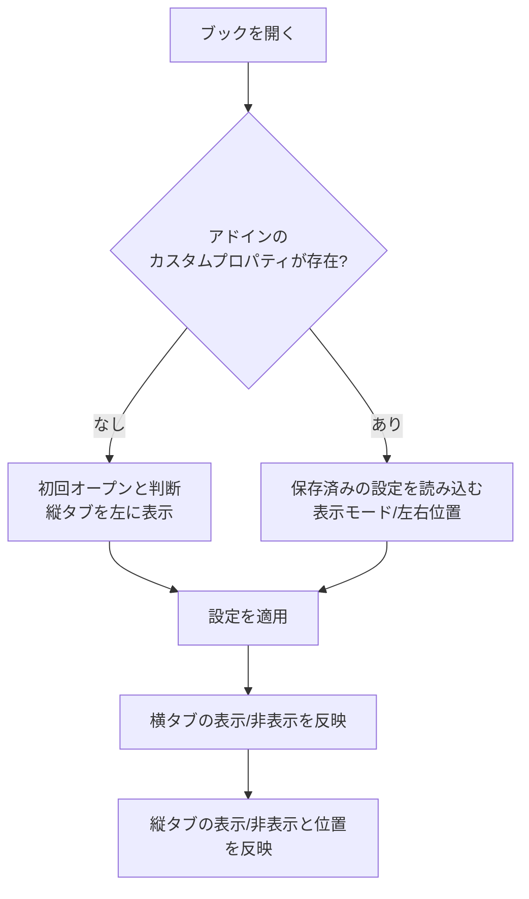
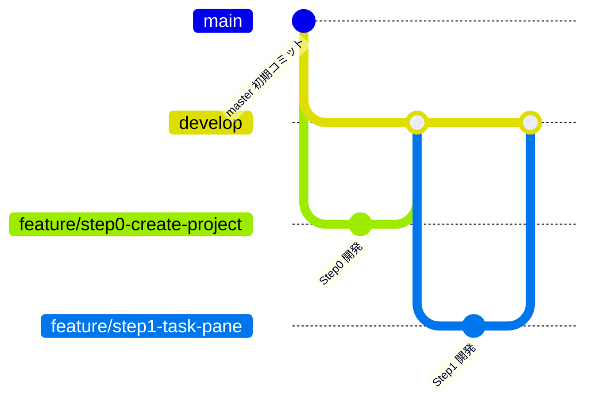

# Agents.md - 縦並びシートタブ Excelアドイン 開発方針

最終更新: 2026-10-19 (相談中。随時更新)

## 1. 目的

Excelのシートタブは標準で横並びだが、シート数が増えると操作しづらく見づらい。
そこで、シートタブを縦並びで表示するExcelアドインを開発する。

## 2. 確定事項

| 項目 | 決定内容 |
|---|---|
| 対象 | Windows版 Excel (Microsoft 365) のみ |
| 方式 | VSTO アドイン (独自GUI描画のため) |
| 機能 | 縦並びでも、横並びタブと全く同一の機能が実行できる |
| タブ色 | 横並びと全く同じ色分けができる |
| 見た目 | 縦並びでも、横並びと同じグラフィック描画の外観にする |
| 見た目の再現度 | 可能な限り完全同一を目標とする (方針は2.3) |
| 機能の範囲 | 横タブの全機能 (切替、追加、削除、名前変更、ドラッグ移動、Ctrl+ドラッグコピー、複数選択、右クリックメニュー、タブ色変更、非表示/再表示 など) |
| 対象シート | ワークシートとグラフシートは表示。非表示とVeryHiddenのシートは縦タブにも表示しない |
| 縦タブが多い場合 | 縦スクロールバーで対応 |
| 幅の保存タイミング | ブック保存時のみ記録。保存せず閉じた場合は変更前の幅のまま |
| ビット数 | 64bit (x64)。このPCのExcel (Microsoft 365, ビルド16.0.20430) と同じ |
| 開発環境 | Visual Studio Community 2026 (18.x)。.NET SDK 10.0.401 も導入済み |
| 縦タブの幅 | 初回は半角16文字分。ユーザーがドラッグで変更可能 |
| 幅の保存/復元 | ブック保存時に直前の幅を保存し、再オープン時に復元 |
| 設定変更の入口 | (1) リボンのボタン (2) タブ右クリックメニューの先頭に「タブ表示の設定」を追加。どちらも同じ設定画面を開く |
| 縦タブのUI形式 | カスタムタスクペイン (CustomTaskPane + UserControl)。内部は自前描画。左右ドッキングと幅変更はペイン機能を利用 |
| ワークロード | VS 2026に「Office/SharePoint開発」を導入済み |
| シート名の最大長 | 横タブと同一 (Excel仕様の31文字) |
| 長いシート名の表示 | 幅に収まらない分は末尾を「…」で省略し、ホバー時にフルネームをツールチップ表示 |
| 設定画面 | 表示モード (ラジオ3択: 横のみ/縦のみ/両方)、縦タブの位置 (ラジオ2択: 左/右)、OK/キャンセル |
| 複数ブック | ブック/ウィンドウごとに専用ペインを持ち、設定は完全に独立 |
| 初回表示位置 | ブックの初回オープン時は左側に縦タブを表示 |
| 表示位置の設定 | ユーザー設定で左/右を選択可能 |
| 設定の保存 | Excelのカスタムドキュメントプロパティにブック単位で保存し、オープン時に復元 |
| 初回判定 | 本アドインのカスタムプロパティがブックに無ければ初回オープンと判断 |
| タブ表示モード | 下記3パターンからユーザー設定で選択 |

### 2.1 タブ表示モード (ブック単位の設定)

| モード | 横タブ (標準) | 縦タブ (本アドイン) |
|---|---|---|
| A: 横のみ | 表示 | 非表示 |
| B: 縦のみ | 非表示 | 表示 |
| C: 両方 | 表示 | 表示 |

### 2.2 ブック保存設定 (カスタムドキュメントプロパティ)

| 設定項目 | 値 |
|---|---|
| 表示モード | A / B / C |
| 縦タブの位置 | 左 / 右 |
| 縦タブの幅 | 保存時の幅 (初回は半角16文字分) |

項目ごとに別のカスタムドキュメントプロパティとして保存する。

| プロパティ名 | 型 | 値 |
|---|---|---|
| `VTab.Mode` | 文字列 | `A` (横のみ) / `B` (縦のみ) / `C` (両方) |
| `VTab.Side` | 文字列 | `Left` / `Right` |
| `VTab.Width` | 数値 (整数) | ペイン内容部の幅。DPI非依存のピクセル値 (96dpi換算)。復元時は`DeviceDpi`で実ピクセルに戻す |

`VTab.Mode` 等のプロパティが存在しないブックは初回オープンと判断する。

### 2.3 見た目の再現方針

Excel標準タブの描画を取得するAPIは無いため、自前描画 (GDI+/WinForms等) で再現する。

- 実機のExcel標準タブをスクリーンショットで採寸し、寸法・色・フォント・余白を合わせる
- 再現対象の状態: 通常 / 選択中 / グループ選択 / マウスホバー / タブ色あり
- 再現対象の環境: Officeテーマ (カラフル/白/黒/ダークグレー)、DPI (100%-200%以上)、Windows 11の見た目
- 横タブとの差分は「縦に並ぶ」点のみとする (文字は横書きのまま)
- 完全同一が技術的に不可能な箇所は、その都度相談して許容差を決める

## 3. 処理フロー (ブックオープン時)

## 4. 実装方針 (相談で合意済み)

| 項目 | 方針 |
|---|---|
| VSTOのターゲット | .NET Framework 4.8 |
| 幅の換算 (半角16文字) | Excel標準フォントの半角文字幅x16+余白で換算し、実機で調整 |
| タスクペイン方式の制約 | ペイン幅の変更検知、ウィンドウとの紐付け、枠の見た目は、試作段階で確認 |

## 5. 未決定事項

- 幅の最小値/最大値
- 初回オープン時の既定の表示モード (現状は暫定でC: 両方)

## 6. 開発ステップ

リスクの高い技術要素を先に小さく検証し、見た目の完全再現は最後に回す。

| Step | 内容 | 完了条件 | 主なリスク |
|---|---|---|---|
| 0 | VSTOプロジェクト作成、ビルドしてExcelで読み込み | アドインがExcelに読み込まれる | VS 2026とVSTOの相性 |
| 1 | ウィンドウごとにカスタムタスクペインを出す (左右切替、幅変更の検知) | 複数ブックで各自のペインが出る | 最大の技術リスク。ペイン幅の検知やウィンドウとの紐付け |
| 2 | シート名一覧を縦に表示し、クリックで切替。非表示/VeryHiddenは除外、グラフシートは表示 | 一覧と実際のシートが一致する | シート増減や名前変更への追従 |
| 3 | カスタムドキュメントプロパティ(`VTab.*`)の読み書き、初回判定、保存時の幅記録 | 保存して開き直すと設定と幅が復元される | 保存イベントのタイミング |
| 4 | 表示モードA/B/Cと設定画面、リボンボタン | 3パターンが切り替わる | 横タブの表示切替がブック単位でできるか |
| 5 | 全操作の実装 (追加、削除、名前変更、ドラッグ移動、Ctrl+ドラッグコピー、複数選択、右クリックメニュー、タブ色変更、非表示/再表示、「タブ表示の設定」項目) | 横タブと同じ操作ができる | 右クリックメニューの差し込み、ドラッグ操作、保護ブック時の挙動 |
| 6 | 見た目の完全再現 (実機の採寸、各状態、テーマ、DPI、省略表示、ツールチップ) | 横タブと並べて比較して差が許容内 | 時間がかかる。許容差を相談 |
| 7 | 仕上げ (例外処理、重いブックでの確認、インストーラ、署名) | 配布可能 | 配布方法の決定 |

## 7. Gitブランチ運用

- `master`: 初期コミットのみ。リリース時などに使う
- `develop`: 統合ブランチ。各Stepの開発が完了したものだけをマージする
- `feature/stepN-内容`: Stepごとに`develop`から作成する。ステップ番号と内容が一目で分かる名前にする (文字化け防止のため英小文字のkebab-case)

| Step | ブランチ名 |
|---|---|
| 0 | `feature/step0-create-project` |
| 1 | `feature/step1-task-pane` |
| 2 | `feature/step2-sheet-list` |
| 3 | `feature/step3-persist-settings` |
| 4 | `feature/step4-display-mode` |
| 5 | `feature/step5-tab-operations` |
| 6 | `feature/step6-visual-fidelity` |
| 7 | `feature/step7-finishing` |

- 流れ: featureブランチで開発 -> 完了条件を確認 -> `develop`へマージ (`--no-ff`) -> 次のStepのfeatureブランチを`develop`から作成
- 各Stepの完了時に結果を報告し、マージと次Stepへの着手はその都度確認する
- コミットメッセージは日本語で書く

## 8. 開発メモ

### Step0 (プロジェクト作成) の結果

- VS 2026のExcel VSTOアドイン(C#)テンプレートの内容を元に、手作業でプロジェクトを作成した
  - `VerticalSheetTabs.sln` / `VerticalSheetTabs/VerticalSheetTabs.csproj` (.NET Framework 4.8、AnyCPU)
  - Resources/Settings は不要なため省略した
- ビルド: VS 2026付属のMSBuild (`MSBuild\Current\Bin\MSBuild.exe`) でビルド成功
- マニフェスト署名: 自己署名証明書 `VerticalSheetTabs_TemporaryKey.pfx` (パスワードなし) を使用。`.gitignore`済みのためリポジトリには含めない
  - 別PCで開発する場合は、VS 2026で「署名」タブから新しい証明書を作成し、`.csproj`の`ManifestCertificateThumbprint`を更新する
- 読み込み確認: ビルドでHKCUにアドインが登録され、Excelを通常起動すると`COMAddIns`に`VerticalSheetTabs`が`Connect=True`で表示された
  - COM自動化 (`New-Object -ComObject Excel.Application`) で起動したExcelでは、VSTOアドインは読み込まれなかった。動作確認はExcelの通常起動で行う

### Step1 (タスクペイン表示) の結果

実装: `PaneManager.cs` (ウィンドウごとにペインを管理)、`TabPaneControl.cs` (試作用の中身)、`ThisAddIn.cs` (イベント接続)。

| 確認項目 | 結果 |
|---|---|
| ウィンドウごとのペイン | OK。複数ブックを開くと、各ウィンドウに独立したペインが表示された |
| 左右のドッキング | OK。`DockPosition`で左/右の切替ができた。初期表示は左 |
| 幅変更の検知 | OK。ペインの端をドラッグすると、`UserControl.Resize`で新しい幅を検知できた |
| ブックを閉じたとき | OK。`WorkbookBeforeClose`でペインを削除し、他のウィンドウのペインは残った |
| 新規ブック作成 | OK。`WindowActivate`でペインが作られた |

分かったこと・制約:

- Excel 365はブックごとに別のトップレベルウィンドウ (SDI) になる。ペインの管理キーにはウィンドウハンドル (`Window.Hwnd`) を使えた
- ペインには、タイトルバー (タイトル、メニュー、閉じるボタン) が付く。タブ領域だけの見た目にはできない。「完全同一の見た目」の許容差として、Step6までに相談する
- ユーザーがペインの閉じるボタンで閉じた場合の扱い (再表示の方法) を、Step3/4で決める
- `CustomTaskPane.Width`に150を設定したとき、中身のコントロール幅は134pxだった。幅の単位とDPIの関係は、Step3で`VTab.Width`を決めるときに確認する
- `WorkbookBeforeClose`で保存確認がキャンセルされた場合は、ペインが消えたままになる可能性がある。Step2以降で対策する (`WindowActivate`での再作成など)
- 動作確認は、Excelを通常起動して、UI Automation (`System.Windows.Automation`) とキー送信で行った

### Step2 (シート名の縦一覧と切替) の結果

実装: `PaneManager.cs` (シート一覧の読み取りと同期、シートの切替)、`TabPaneControl.cs` (試作用の`ListBox`で一覧表示)。

| 確認項目 | 結果 |
|---|---|
| 一覧の内容 | OK。ワークシートとグラフシートを表示。非表示とVeryHiddenは除外 |
| シートの切替 | OK。一覧のクリックで、ワークシート、グラフシートとも切り替わった |
| 名前変更への追従 | OK |
| 追加・削除への追従 | OK |
| 並べ替え (移動) への追従 | OK |
| 非表示/再表示への追従 | OK。非表示にするとアクティブシートが別のシートに移り、一覧もそれに追従した |
| アクティブシートの強調 | OK。一覧の選択状態がアクティブシートと一致した |

方式:

- Excelには、シート名変更、並べ替え、非表示/再表示のイベントが無い。そのため、300ms間隔のタイマーで、シート名・表示状態・アクティブシートを読み直す
  - 一覧は、内容が変わったときだけ更新する (ちらつきやスクロール位置の消失を防ぐ)
  - `SheetActivate`イベントでも即時に同期する
- セル編集中などでExcelがビジー状態のときのCOM例外は握りつぶし、次回のタイマーで再試行する (実機での確認は未実施)

未確認・今後の課題:

- セル編集中のタイマー動作
- 保護されたブック、構造保護時の挙動 (Step5で確認)
- シートが非常に多いブックでの負荷 (Step7で確認)
- タブ色の取得 (Step6で実装)
- 試験用ボタン「Dock Left/Right」は、Step4で設定画面に置き換えるまで残す

確認時の注意: PowerShellからの画面キャプチャは`PrintWindow`でExcelのウィンドウだけを撮る。画面全体のコピーでは、他のウィンドウが写り込む。

### Step3 (設定の保存と復元) の結果

実装: `WorkbookSettings.cs` (プロパティの読み書き)、`PaneManager.cs` (読み込み、幅の適用、保存時の書き込み)、`ThisAddIn.cs` (`WorkbookBeforeSave`の接続)。

| 確認項目 | 結果 |
|---|---|
| 初回判定 | OK。`VTab.*`が無いブックでは初回と判断し、縦タブを左に表示した |
| 初回の幅 | OK。半角16文字分 (数字「0」16文字の幅 + 左右の余白) で表示された |
| 保存 | OK。ブックの保存時に`VTab.Mode`/`VTab.Side`/`VTab.Width`が書き込まれた (保存したxlsxの`docProps/custom.xml`で確認) |
| 復元 | OK。再オープンで、保存した左右位置と幅に復元された |
| 保存せず閉じた場合 | OK。ブックの保存時のみ記録するため、変更は残らない |

仕様の確定内容:

- `VTab.Width`は、ペイン内容部 (コントロール) の幅を、96dpi換算のピクセル値で保存する。ペインの枠 (実測16px) は復元時に加算する
- ペインの幅は、表示直後は確定しないため、250ms後に内容幅を測って適用する
- 書き込みの対象は、そのブックの1つのウィンドウの状態 (1ブックに複数ウィンドウがある場合は先頭のウィンドウ)
- 読み書きの失敗 (読み取り専用ブックなど) は握りつぶし、既定値で動作する
- 初回オープン時の既定の表示モードは、暫定で「C: 両方」とした (横タブを消さない安全側)。Step4で確認する

未確認・今後の課題:

- 100%以外のDPIでの幅の換算 (このPCは96dpiのみ。Step7で複数DPIを確認する)
- 1ブックに複数ウィンドウがある場合の保存内容
- OneDriveの自動保存時の書き込み (`WorkbookBeforeSave`が呼ばれるか)
- 幅の最小値/最大値 (復元時に極端な値が入っていた場合の補正)
- C# 7.3の制約: `ref`付きラムダなどは使えない (VS 2026のVSTOプロジェクトの既定の言語バージョン)
