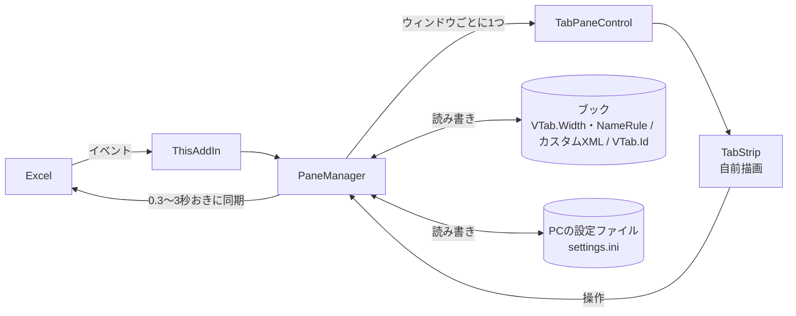
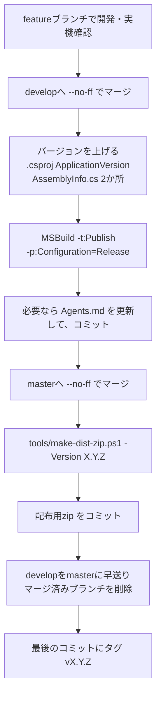

# 開発者向けの手引き (VerticalSheetTabs)

利用者向けの説明は [README.md](README.md) (配布用zipにも入ります)、現在の仕様、実装、守ること、リリースの決まりは [Agents.md](Agents.md) を参照してください。

初めてソースコードを読む人は、次の順に読むと、全体から細部へ進めます。

1. [全体像](#全体像): 何をするアドインで、どんな仕組みか。まず、ここだけ読めば足ります
2. [ソースファイルの構成](#ソースファイルの構成): どのファイルが、何を受け持つか
3. [設計図 (UML)](#設計図-uml): 図で、何ができるか > どんな部品か > どんなクラスか > どう動くか、の順に見る
4. [ビルド](#ビルド) 以降: 動かす、テストする、リリースする

## 全体像

Windows版 Excel のシートタブを、縦一覧で表示する VSTO アドインです (.NET Framework 4.8、C# 7.3)。縦タブは、Excel のタスクペインの中に、自前で描いています (GDI+)。



最初に押さえる、設計の決まり:

- **Excel のオブジェクトモデルを呼ぶのは `PaneManager`** です (ブックの読み書きの部品 `FolderStore`、`HistoryStore`、`WorkbookSettings` も、`PaneManager` から呼ばれて、渡されたブックを読み書きします)。`TabStrip` などの画面の部品は Excel を知らず、操作を「イベント」で `PaneManager` に伝え、表示は `PaneManager` から渡されます
- Excel には、シート名の変更、並べ替え、非表示のイベントが無いため、**0.3から3秒おきのタイマーで同期**します (`PaneManager`)
- **開いただけ、同期しただけでは、ブックを「変更あり」にしません**。ユーザーの操作のときだけ変更扱いにします
- 設定は、**PC** (`settings.ini`) と **ブック** (`VTab.Width`、`VTab.NameRule`、フォルダのXML) に分けて保存します
- フォルダの構造、履歴、シート名のルールは、**Excel に依存しないモデル**です (`FolderModel`、`SheetHistory`、`NameRule`。ブックへの読み書きは、別の部品 `FolderStore`、`HistoryStore` が受け持ちます)。そのため、Excel なしでテストできます (`NameRule`、`FolderModel`、`SafeXml`、壁紙の配置の計算 (`Wallpaper.Layout`) のテストがあります)

これらの理由と、細かい決まりは、[Agents.md](Agents.md) の3章と4章にあります。

## ソースファイルの構成

| ファイル | 役割 |
|---|---|
| `ThisAddIn.cs` | アドインの入口。Excelのイベント (ウィンドウを有効にした、シートを有効にした、ブックの保存前。バッジを使うときだけ、セルの変更、再計算、シートを離れた) を `PaneManager` につなぐ。すべてのイベント処理は、例外を握りつぶすガードで囲む |
| `PaneManager.cs` | ウィンドウごとのタスクペインの管理。0.3から3秒おきの同期 (シート名、表示状態、タブ色、選択)、シートの操作、フォルダの操作、設定の適用 |
| `TabPaneControl.cs` | ペインの中身 (`TabStrip`、「+」ボタン、右クリックメニュー) |
| `TabStrip.cs` | 縦タブの自前描画 (GDI+)。選択、ドラッグ、名前の変更、スクロール、フォルダの描画、壁紙と透過した行の描画 (行の本体だけを半透明で重ね、名前やバッジは `Defer` で不透明に描く) |
| `TabTheme.cs`、`DpiHelper.cs` | Officeテーマの配色、画面の拡大率 |
| `SheetHistory.cs` | 見たシートの履歴 (`SheetHistory`) とそのXML、ブックのXMLパートへの読み書き (`HistoryStore`) |
| `Wobble.cs`、`WobbleSounds.cs`、`Sounds\*.wav` | 揺れの動き、効果音 (アドインに埋め込む) |
| `DialogPlacer.cs` | Excelの「色の設定」画面を、クリックした位置に出す |
| `TabColorPalette.cs` | シート見出しの色のパレット (Excelと同じ構成) |
| `SafeXml.cs` | ブックから読むXML (カスタムXMLパート、ファイルのテーマ) の読み込み。DTD禁止、大きさの上限 |
| `FolderModel.cs`、`FolderStore.cs` | フォルダの構造、XMLの読み書き、Excelのシート順との突き合わせ (`Reconcile`)、シートの識別 |
| `NameRule.cs` | シート名のルール (`フォルダ名 \| シート名`) の解析、並びの整理、名前からのフォルダ構成 |
| `WorkbookSettings.cs` | 1つのウィンドウの設定。ブックのカスタムドキュメントプロパティ (`VTab.Width`、`VTab.NameRule`) の読み書きと、古い `VTab.*` の削除 |
| `PcSettings.cs` | PCの設定ファイル (`%LocalAppData%\VerticalSheetTabs\settings.ini`。表示モード、位置、壁紙、見た目、アニメーション、バッジ) の読み書き |
| `RowPlacement.cs` | 行の並べ方 (`RowLayout`: 吊り下げ方式 / 積み上げ方式) と、行の位置の計算 (画面に依存しない。テストでも使う) |
| `Wallpaper.cs` | 壁紙の設定 (`WallpaperOptions`)、画像の読み込み、配置の計算 (画面に依存しない。テストでも使う)、領域への描画 |
| `CommentPopup.cs` | メモ・コメントのバッジの表示 (一覧と内容の窓) |
| `SettingsBackground.cs` | 設定画面の「背景」タブの部品 (壁紙、表示方法、表示位置、透過率、文字の縁) |
| `SettingsForm.cs`、`RibbonController.cs`、`RibbonIcon.cs` | 設定画面、リボンのボタンと横タブのメニュー項目、アイコン |
| `AddInVersion.cs` | 表示用のバージョン、著作権、ライセンス |
| `VerticalSheetTabs.Tests\` | Excel を使わない部分 (`NameRule`、`FolderModel`、`SafeXml`、`Wallpaper` の配置の計算、`RowPlacement` の行の位置の計算) のテスト。ソースを参照で取り込む、フレームワーク不要のコンソールプログラム。`tools\run-tests.ps1` で実行 |
| `tools\dist\` | 配布用zipに入れる、証明書を信頼する / 取り消すスクリプトと、手順書の雛形 |
| `tools\make-dist-zip.ps1`、`tools\make-readme-pdf.ps1` | 配布用zipの作成、README.pdf の作成 |
| `.github\workflows\release.yml` | タグの push で、配布用zipを添付した GitHub リリースを作る |

## 設計図 (UML)

図は PlantUML で描き、SVG にして置きます (GitHub は PlantUML を表示しないため)。ソースは `docs/*.puml`、SVG は同じ名前で `docs/` にあります。

| 知りたいこと | 見る図 |
|---|---|
| 利用者が、何をできるか | [ユースケース図](#ユースケース図) |
| どんな部品でできていて、どうつながるか | [コンポーネント図](#コンポーネント図)、[インターフェースのつながり](#コンポーネント図-インターフェースのつながり) |
| どんなクラスがあるか | [クラス図](#クラス図) |
| どんなデータが、どこからどこへ流れ、どこに保存されるか | [データフロー図](#データフロー図) |
| 動き出しから終わりまでの基本の流れ | [シーケンス図: 基本の流れ](#基本の流れ) |
| シート、フォルダ、検索などの操作が、どう処理されるか | [シーケンス図: 縦タブの操作](#縦タブの操作) |
| 見た目、設定、バッジ、色、シート名のルール | [シーケンス図: 見た目・設定・状態の表示](#見た目設定状態の表示) |
| アニメーションの状態と、起動の判断 | [状態遷移図、アクティビティ図](#状態遷移図とアクティビティ図-アニメーション) |

目的から探すときは、次も使えます。

| 直したいこと | 先に見る図 |
|---|---|
| シートの選択、追加、移動、名前の変更 | シーケンス図「シートのクリックによる選択」「シートの操作」 |
| フォルダの動き | シーケンス図「フォルダの操作」「フォルダの出し入れ・移動・コピー」 |
| 縦タブが出ない、消える | シーケンス図「表示モードとペインの出し入れ」「ウィンドウとブックの終了処理」 |
| 保存したときの内容 | シーケンス図「ブックの保存」 |
| バッジ、進捗、メモ・コメント | シーケンス図「バッジの検出と進捗」「メモ・コメントのバッジのクリック」 |
| 揺れ、追加・削除、完了の動き | シーケンス図「アニメーション」、状態遷移図、アクティビティ図 |

### ユースケース図

利用者ができることを、仕様 (`Agents.md` の2章) にもとづいて、まとまりごとに示す。ソースは [docs/usecase.puml](docs/usecase.puml)。「シートを操作する」のすべては、Excelのオブジェクトモデルを通して行うため、Excelへの線は省いている。


### コンポーネント図

役割ごとのコンポーネントと、それを構成するモジュール (ソースファイル) を示す。矢印は「呼ぶ / 使う」。Excelのオブジェクトモデルを呼ぶのは、`PaneManager` が中心で、ブックを読み書きする `FolderStore`、`HistoryStore` (`SheetHistory.cs`)、`WorkbookSettings` も、`PaneManager` から渡されたブックを読み書きする (`TabStrip` などの画面の部品は、Excelに触れない)。


### コンポーネント図: インターフェースのつながり

中のモジュールは描かず、役割のコンポーネントの間の、インターフェースのつながりだけを示す。丸が「提供」、受け口が「利用」。ソースは [docs/component-interface.puml](docs/component-interface.puml)。


| 番号 | インターフェース | 提供 | 利用 | 中身 |
|---|---|---|---|---|
| I1 | Excelイベント | Excel | 入口 | ウィンドウの有効化、シートの有効化、ブックの保存前のイベント。バッジを使うときだけ、セルの変更、再計算、シートを離れたイベント (`ThisAddIn` が購読) |
| I2 | リボン拡張 | 入口 | Excel | `IRibbonExtensibility`。リボンのボタンと、横タブのメニュー項目の定義、押されたときの通知 |
| I3 | オブジェクトモデル | Excel | 制御 | ウィンドウ、ブック、シートの読み書き (COM)。呼ぶのは制御 (`PaneManager`)。ブックの読み書きの部品 (モデルの `FolderStore`、`HistoryStore`、設定の保持の `WorkbookSettings`) は、制御から渡されたブックを読み書きする |
| I4 | ペイン登録 | Excel | 制御 | `CustomTaskPanes`。ウィンドウごとに縦タブのペインを作る |
| I5 | ペイン管理 | 制御 | 入口 | `EnsurePane`、`EnsureAllPanes`、`ShowSettings`、`SaveSettings`、`SyncSheetOf`、`MarkBadgesDirty`、`Shutdown` |
| I6 | バッジ購読 | 入口 | 制御 | `BadgeEventsWanted` (`Action<bool>`)。バッジを使うウィンドウがあるときだけ、シートの変更・再計算のイベントを購読する |
| I7 | 表示の更新 | 画面 | 制御、設定画面 | 行、バッジ、選択、設定 (見た目、壁紙、揺れ、アニメーション) を渡す。設定画面のサンプルも、同じ描画を使う |
| I8 | 操作の要求 | 制御 | 画面 | 画面が起こすイベント (`*Requested`: 選択、移動、名前の変更、色、フォルダ、進捗、リンク、メモのバッジなど) を、制御が受ける |
| I9 | 値の問い合わせ | 制御 | 画面 | `Func` で画面が聞く。テーマの色 (`ThemeColorProvider`)、「その他の色」 (`MoreColorsProvider`)、履歴 (`HistoryProvider`)、セルの入力中か (`IsExcelEditing`) |
| I10 | 設定画面 | 設定画面 | 制御 | 現在の値を渡して表示し、OK で値を返す |
| I11 | 動きと音 | 動き・音 | 画面、設定画面、設定の保持 | `WobbleMotion.At` (揺れの動き)、`WobbleSounds.Play` (効果音)、`WobbleType` (種類の値) |
| I12 | モデルの操作 | モデル | 制御、設定画面 | フォルダの構造、XMLの読み書き、シート名のルール、履歴 |
| I13 | 設定の読み書き | 設定の保持 | 制御 | `PcSettings` (`settings.ini`)、`WorkbookSettings` (ブックの `VTab.*`) の読み書き |

### クラス図

主なクラスと、その関係を示す。メンバーは、関係の理解に要るものだけを載せている (すべてではない)。

**主なクラスと関係** ([class-structure.puml](docs/class-structure.puml))。`PaneManager` が、ウィンドウごとの管理情報 (`Entry`) を持ち、その中にペインの中身 (`TabPaneControl`、`TabStrip`) がある。画面は、イベントで操作を `PaneManager` に伝える。


**データ・モデル・設定** ([class-data.puml](docs/class-data.puml))。フォルダの構造 (`FolderModel`)、履歴、設定 (`WorkbookSettings`。実行中は、PCの設定もここに入る)、画面に渡すデータ (`StripRow`、`BadgeInfo` など)。


### データフロー図

データが、どこから来て、どこで処理され、どこに保存されるかを示す。四角は外部 (利用者、Excel、Officeテーマ)、楕円はプロセス、円筒はデータの保存先です。処理の順序は表さない (順序は、次のシーケンス図)。

**レベル0 (全体)** ([dfd-level0.puml](docs/dfd-level0.puml))。アドイン全体を1つのプロセスとして、外とのデータのやりとりだけを示す。


**レベル1 (プロセスの分解)** ([dfd-level1.puml](docs/dfd-level1.puml))。アドインを8つのプロセスに分け、保存先 (D1からD4) との出入りを示す。括弧内は、主に受け持つクラスやイベント。


| 番号 | プロセス | 受け持ち |
|---|---|---|
| 1 | シートの情報を同期する | Excelのシートの名前、表示状態、色、選択を、0.3から3秒おきに読む (`PaneManager`) |
| 2 | 縦タブを描き、操作を受ける | 画面の描画と入力 (`TabStrip`、`TabPaneControl`) |
| 3 | 操作をExcelに反映する | 画面の操作の要求を、Excelのシートの変更にする (`PaneManager`) |
| 4 | フォルダを管理する | フォルダの構造と、シート名のルール (`FolderModel`、`NameRule`) |
| 5 | 履歴を管理する | 見たシートの履歴 (`SheetHistory`) |
| 6 | バッジを検出する | 数式エラー、メモ、保護を調べ、進捗の印を読む (`PaneManager`) |
| 7 | 設定を管理する | 設定画面、PCの設定、ブックの設定 (`SettingsForm`、`PcSettings`、`WorkbookSettings`) |
| 8 | 保存時に書き込む | ブックの保存のとき、フォルダ構成、履歴、ブックの設定を書く (`WorkbookBeforeSave`) |

### シーケンス図

動きの流れを、時間の順に示す。ここまでの図 (部品、クラス) を見てから読むと、だれが、だれを呼ぶかが、つかみやすい。

#### 基本の流れ

アドインの一生 (起動、同期、選択、保存、終了) です。まず、この4つを読んでください。

**起動、ペインの作成、同期** ([sequence-startup.puml](docs/sequence-startup.puml))

Excel の起動から、ペインを作り、同期を始めるまで。


**シートのクリックによる選択** ([sequence-select.puml](docs/sequence-select.puml))

縦タブのシートをクリックしてから、Excel のシートが切り替わるまで。


**ブックの保存** ([sequence-save.puml](docs/sequence-save.puml))

ブックを保存するときに、設定、フォルダ、履歴を書き込む流れ。


**ウィンドウとブックの終了処理、アドインの停止** ([sequence-shutdown.puml](docs/sequence-shutdown.puml))

ブックやウィンドウを閉じたとき、アドインを止めるときの後始末。


#### 縦タブの操作

利用者が縦タブで行う操作が、どう処理されるかです。

**シートの操作 (+・挿入・名前の変更・移動とコピー・非表示と再表示)** ([sequence-sheetops.puml](docs/sequence-sheetops.puml))

「+」、挿入、名前の変更、移動・コピー、非表示と再表示。


**フォルダの操作 (開閉・作成・名前の変更・色・削除)** ([sequence-folder.puml](docs/sequence-folder.puml))

フォルダの作成、開閉、名前の変更、色、削除。


**フォルダの出し入れ・移動・コピー (ドラッグ)** ([sequence-folder-drop.puml](docs/sequence-folder-drop.puml))

ドラッグでの、フォルダへの出し入れ、フォルダの移動とコピー。


**シートの行をセルへドラッグしてリンクを作る** ([sequence-link.puml](docs/sequence-link.puml))

シートの行を Excel のセルにドロップして、ハイパーリンクを作る。


**検索** ([sequence-search.puml](docs/sequence-search.puml))

検索ボックスでの絞り込みと、移動。


**履歴 (記録、戻る・進む、一覧)** ([sequence-history.puml](docs/sequence-history.puml))

見たシートの記録、戻る・進む、一覧のメニュー。


**コピーアイコン** ([sequence-copyicon.puml](docs/sequence-copyicon.puml))

左ボタンを押したまま右ボタンも押して、名前をコピーする。


#### 見た目・設定・状態の表示

設定、色、バッジ、シート名のルールなど、見た目と状態に関わる流れです。

**表示モードとペインの出し入れ** ([sequence-mode.puml](docs/sequence-mode.puml))

表示モード (横のみ / 両方) と、ペインの出し入れ、「×」の扱い。


**設定画面** ([sequence-settings.puml](docs/sequence-settings.puml))

設定画面を開いてから、OK / キャンセルで反映するまで。


**シート見出しの色と「その他の色」** ([sequence-color.puml](docs/sequence-color.puml))

シート見出しの色の指定と、Excel の「色の設定」画面 (「その他の色」)。


**バッジの検出と進捗** ([sequence-badge.puml](docs/sequence-badge.puml))

バッジ (エラー、メモ、保護、進捗) の検出と、進捗の印の操作。


**メモ・コメントのバッジのクリック** ([sequence-comment.puml](docs/sequence-comment.puml))

メモ・コメントのバッジをクリックして、内容を読む。


**シート名のルール** ([sequence-namerule.puml](docs/sequence-namerule.puml))

シート名のルール (`A | B`) による、フォルダの構成と、名前の同期。


**アニメーション (揺れ・ゴースト・追加削除・完了)** ([sequence-animation.puml](docs/sequence-animation.puml))

揺れ、ゴースト、追加・削除、完了のはじける動き。


### 状態遷移図とアクティビティ図 (アニメーション)

アニメーションは、種類ごとに状態を持ち、起動するかどうかを、いくつもの条件で決める。シーケンス図「アニメーション」の補足として読む。

#### 状態遷移図

アニメーションは、種類ごとに独立した状態を持つ (`TabStrip`)。([state-animation.puml](docs/state-animation.puml))


#### アクティビティ図

行の増減、揺れ、完了のはじける動きを、起動するかどうか判断する流れ。([activity-animation.puml](docs/activity-animation.puml))


### 図の作り直し

構成や流れを変えたら、`docs/*.puml` を直し、`tools\make-diagrams.ps1` で、SVG を作り直します (Java、Graphviz、`tools\PlantUML\plantuml-bsd-*.jar` が要る。jar はリポジトリに含めない)。`docs/*.puml` のすべてを、SVG にします。

## 設計中の機能: 壁紙のトリミング (未実装)

壁紙の画像のうち、表示する範囲だけを選べるようにする設計。**まだ実装していない**。実装するときに、この節の内容を、Agents.md (仕様と実装) と README に移し、この節を削除する。

### 目的と結論

| 項目 | 内容 |
|---|---|
| 目的 | 画像の一部 (顔、ロゴなど) だけを壁紙にする。縦長の縦タブに、横長の画像の見せたい所を出す |
| 操作 | 設定画面の「背景」タブに「プレビュー画面」を置く。画像のプレビューの上に、トリミング枠を出し、枠をドラッグして、範囲を決める |
| 効き方 | 枠の中を切り出した画像を、これまでの壁紙の画像として扱う。**表示方法、表示位置、タイル、透過率、文字の縁は、切り出した画像に効く** (これらの動きは変えない) |
| 実現できるか | **できる**。壁紙の描画 (`Wallpaper.Render`) は、元の画像と設定から、領域の大きさの画像を作るだけ。元の画像の「どの範囲を使うか」を1つ足せばよい。`TabStrip` の描画と、行の位置の計算には、触れない |
| 保存 | PCの設定ファイルに、枠を1行 (`WallpaperCrop`) で書く。ブックには保存しない (壁紙そのものと同じ) |

### データ: `WallpaperCrop` (画面に依存しない)

枠は、**画像の幅と高さに対する割合** (0から1) で持つ。左、上、右、下の4つの数 (`L`、`T`、`R`、`B`)。

| 決まり | 内容 |
|---|---|
| トリミングなし (初期値) | `0,0,1,1`。`IsFull` |
| 割合で持つ理由 | 画面のプレビューの縮尺、長辺 2560 px への縮小 (`Wallpaper.Load`) に関係なく、同じ範囲を指せる。画像の画素数を、設定に持たなくてよい |
| 正規化 (`Normalize`) | 0から1に収め、幅も高さも `MinSide` (0.02) 以上にする。満たさない値は、トリミングなし (`Full`) にする。小数は、4桁に丸める (保存した値と、画面の値が、同じになる) |
| 不正な値 | 構造体の `default` (4つとも 0)、右が左以下、下が上以下は、不正。**不正な値は、`Normalize` も `ToPixels` も `IsFull` も、トリミングなしとして扱う** (初期化し忘れても、壁紙が消えない) |
| 画素の範囲 (`ToPixels(w, h)`) | `x0 = floor(L*w)`、`x1 = ceil(R*w)` のように、内側を切り捨てず、外側へ丸める。幅、高さは 1 以上。画像の外へ出さない |
| 文字列 | `L,T,R,B`。小数点は `.`、最大4桁 (`InvariantCulture`)。例 `0.1234,0.05,0.9,0.64`。読めない値、数が4つでない値は、トリミングなし |

`WallpaperOptions` に `Crop` を足す。`SameAs` にも含める (枠が変わると、`TabStrip` が、壁紙を描き直す)。`Clone` はそのままでよい (構造体)。

### 設定ファイル

| キー | 値 (初期値) |
|---|---|
| `WallpaperCrop` | `L,T,R,B` の割合 (`0,0,1,1`) |

- 読むとき: `PcSettings.ApplyTo` で、`WallpaperCrop` を読み、`Normalize` する
- 書くとき: `ToValues` に、`WallpaperCrop` を足す。設定画面のOKのとき、変更のあった値だけ書く決まりは、そのまま
- 壁紙のパス (`WallpaperPath`) が空のときも、枠の値は読み書きする (パスを消しても、設定ファイルでは、枠は `0,0,1,1` に戻して書く。下の「リセットの規則」)

### 壁紙への反映 (`Wallpaper.Render`)

```
src    = o.Crop.ToPixels(source.Width, source.Height)      // 使う範囲 (画素)
lay    = Layout(src.Width, src.Height, areaW, areaH, o)    // いまの配置の計算を、切り出した大きさで行う
描画   = DrawImage(source, 送り先 = (lay.X, lay.Y, lay.Width, lay.Height), 元 = src)
```

- 切り出した範囲のへりに、範囲の外側の画素の色がにじまないよう、`ImageAttributes` の `WrapMode.TileFlipXY` を付けて描く (トリミングがあるときだけ)
- `Layout` は、元の画像の幅と高さを引数に取る。**切り出した大きさを渡すだけ**で、関数自体は変えない (既存のテストも、そのまま通る)
- 「元のサイズ」は、切り出した範囲の画素を 1:1 で出す (長辺 2560 px 超の画像は、縮小したあとの画素)
- タイル: 見本の1枚 (`tile`) を、切り出した範囲から作る。枠がトリミングなしで、大きさも同じときだけ、元の画像をそのまま使う (いまと同じ)
- `TabStrip` は、元の画像 (`_wpSource`) をそのまま持つ。枠が変わっても、画像は読み直さない (`SameAs` の違いで、描き直すだけ)

### 設定画面の配置 (「背景」タブ)

```
[バナー: このタブの設定は、このPCのすべてのブックに共通です。]
[壁紙 (全幅)                                                  ]
[表示方法          ] [プレビュー画面 (説明文)        [リセット]]
[表示位置          ] [                                        ]
[フォルダ・シートの透過率] [   画像のプレビュー + トリミング枠   ]
```

- 左の列: 表示方法、表示位置、透過率の3つを縦に並べる。幅は、3つのグループの自然な幅と、透過率の説明文 (長いほう。積み上げ方式の文) の幅の最大にそろえる (説明文は、あとから入るため、グループの幅に含まれていない)
- 右の列: 「プレビュー画面」のグループ。幅は、残り全部。高さは、左の列と同じ
- 「プレビュー画面」のタイトルの直下の行に、説明文「壁紙として表示したい範囲を指定して下さい。」(灰色) と、右端の「リセット」ボタン。その下が、プレビュー (`CropPreview`)
- 設定画面は、いまより縦に約45 px 高くなる (タブの高さは、中身の最大から、自動で決まる)
- `BackgroundPanel.PairRow(width)` は、`BodyRow(width)` (左の列と右の列を並べた部品) に替える。`SettingsForm` の「背景」タブは、バナー、壁紙、`BodyRow` の3行にする

### 部品: `CropPreview` (`Control`)

- 役割: 画像のプレビューと、トリミング枠の表示と操作。外へは、`Image` (`SetImage(Bitmap)`。画像の持ち主になる)、`Crop` (`WallpaperCrop`)、`CropChanged` (枠が変わったとき)、`ResetCrop()` だけを出す
- **プレビューの大きさ**: 部品の中身から、余白 12 DIP (頂点の四角が、画像のへりでも、切れずに、つかめる広さ) を引いた範囲に収まる最大の大きさ。縦横比を保つ。小さい画像は、**拡大して**収める。画像の描画先の長方形 (`FitRect`) は、画面に依存しない関数で求める
- **描き方**: 二重バッファ。縮尺済みの画像を取っておき (大きさが変わったときだけ作り直す)、枠の外側に、黒の半透明 (不透明度 約60%) を重ねて暗くする。枠は、白と暗い色の二重の線 (どんな画像の上でも見える)。頂点に、白い四角 (一辺 9 DIP)。枠の中央に、縦と横の点線 (白と暗い色の2色)
- **操作**: 4つの頂点、4つの辺、枠の内側をつかめる。ポインターは、つかめる所で、形が変わる (斜め、縦横の矢印、四方向の矢印)。ドラッグ中は、部品が、マウスを捕まえる (外へ出ても、続ける)
- **つかむ範囲**: 頂点と辺は、枠の線から 8 DIP 以内。枠が小さいときは、枠の短い辺の 1/3 までに狭める (内側をつかめるように)。優先は、頂点、辺、内側の順
- **動かし方**: 縦横比は自由。枠は、画像の範囲から出ない。幅と高さの最小は、24 px (画面の画素。画像のプレビューが小さいときは、その半分)。内側のドラッグ (移動) は、大きさを変えず、画像の範囲に収める。トリミングなしの枠は、内側をつかんでも動かない (ポインターも変えない)
- **空の状態**: 画像が無いとき、読めないとき、ファイルが無いときは、案内の文字を中央に出す。枠は出さず、操作を受け付けない
- キーボード操作は、付けない (マウスだけ)
- **描画で例外を出さない**: `OnPaint` は、例外を握る (設定画面の部品に例外が出ると、赤い×が出て、設定画面が使えなくなる。ペインと同じ決まり)
- 枠が変わったら、`CropChanged` を上げる。`BackgroundPanel` は、「リセット」ボタンの有効 / 無効を更新する

これらの計算 (枠をつかむ位置の判定 `CropDrag.HitTest`、ドラッグ後の枠 `CropDrag.Drag`、画像の描画先 `CropPreviewMath.FitRect`) は、画面に依存しない関数にする (テストのため)。

### `BackgroundPanel` の変更

| 場所 | 変更 |
|---|---|
| 状態 | 設定画面を開いたときの壁紙のパスと枠 (`_initialPath`、`_initialCrop`)。プレビュー (`_preview`)、「リセット」ボタン |
| 開いたとき | 枠は、設定の値 (`Normalize` 済み)。**画像は、「背景」タブを初めて表示したときに読む** (設定画面は、いつも「基本」で開くため。大きい画像を読む時間を、背景タブを使わない人に、かけない)。OKを押すまでに、背景タブを開かなかったときは、読まずに、開いたときの枠を、そのまま返す |
| 「参照...」 | 選んだファイルを、`Wallpaper.Load` で読めるか確かめる (いまの処理)。**その画像を、そのままプレビューに渡す** (読み直さない)。前と違うファイルなら、枠をリセットする。同じファイルを選び直したときは、枠を保つ |
| 「解除」 | プレビューを空にして、枠をリセットする |
| 「リセット」 | 枠を、トリミングなしに戻す。画像が無い、または、枠がトリミングなしのときは、押せない |
| `Wallpaper` (取得) | `Crop`: プレビューに画像があれば、その枠。無ければ、パスが開いたときと同じなら `_initialCrop`、違うなら、トリミングなし |

### リセットの規則

| 操作 | 枠 |
|---|---|
| 設定画面を開いたとき | 設定ファイルの値 |
| 別のファイルを選んだとき | トリミングなし |
| 同じファイルを選び直したとき | そのまま |
| 「解除」 | トリミングなし |
| 「リセット」 | トリミングなし |
| 画像が読めない (ファイルが無い、壊れている) まま、OKを押したとき | 開いたときの値のまま (一時的にファイルが無くても、枠を失わない)。パスを変えたときは、トリミングなし |
| キャンセル | 何も書かない |

### 設定の反映

- OKのとき、`PaneManager` が、`form.Wallpaper` (`Crop` を含む) を、設定に入れ、ファイルへ書き、開いたウィンドウの `TabStrip.SetWallpaper` へ渡す。**`PaneManager` と `SettingsForm` のコンストラクターの引数は、変わらない** (`WallpaperOptions` が、枠を運ぶ)
- 画像のファイルが読み直されたとき (更新日時が変わったとき) も、枠 (割合) はそのまま

### テスト (`VerticalSheetTabs.Tests`。`WallpaperCrop.cs` を、リンクする)

| 対象 | 確かめること |
|---|---|
| `WallpaperCrop` | 文字列の読み書き (小数点 `.`、4桁、数が足りない、数でない、範囲外)、`Normalize` (範囲外、最小の幅、丸め)、`default` と不正な値がトリミングなし、`ToPixels` (外側へ丸める、画像の外へ出ない、1以上) |
| `CropDrag.HitTest` | 頂点、辺、内側、外。重なるときの優先 (頂点、辺、内側)。小さい枠で、内側をつかめる。トリミングなしの内側は、つかめない |
| `CropDrag.Drag` | 8つのつかみ方。画像の範囲から出ない。最小の大きさを割らない。頂点が、反対側を越えない。内側の移動が、大きさを変えず、範囲に収まる |
| `CropPreviewMath.FitRect` | 縦横比を保つ。縦長、横長、小さい画像の拡大。余白。中央。大きさが 0 のとき |
| `Wallpaper.Render` | 切り出した範囲だけが出る (画素の色)。へりに外側の色がにじまない。表示方法 (元のサイズ、縦横に合わせる)、タイルでも切り出した範囲が使われる。トリミングなしは、いまと同じ画素 |

### 問題点と対処 (設計のレビューの記録)

**1回目 (データ、既存との整合、描画、部品の作り)**

| 指摘 | 対処 |
|---|---|
| 構造体 `WallpaperCrop` の `default` が、4つとも 0 で、そのまま使うと、壁紙が消える | 不正な値は、トリミングなしとして扱う (データの表) |
| 枠は、ドラッグで、細かい小数になる。保存は4桁で、読み戻すと、値が違う (`SameAs` が、無駄に偽になり、設定ファイルの比較も、ずれる) | `Normalize` で、4桁に丸める。設定画面は、丸めた値を返す |
| 切り出した範囲のへりに、外側の画素の色がにじむ (補間のため) | `WrapMode.TileFlipXY` を付ける。テストで、画素を確かめる |
| 設定画面を開くたびに、大きい画像を、すぐ読む (最長で、0.数秒止まる) | 背景タブを初めて表示したときに読む |
| 頂点が画像のへりにあると、外側の半分が、部品から切れて、つかめない | 部品の余白を 12 DIP にする |
| 描画の例外で、設定画面に赤い×が出る | `OnPaint` は、例外を握る |
| 「リセット」の有効 / 無効を、いつ更新するかが、書いていない | `CropChanged` で更新する |
| 左の列の幅が、あとから入る説明文を含まないため、切れるおそれがある | 説明文の幅を、最大に含める |
| テストの内容が、書いていない | 「テスト」の節を足した |

**2回目 (操作の流れ、失敗したとき、作りやすさ、確認の方法)**

| 指摘 | 対処 |
|---|---|
| 切り出した範囲は、「縦横に合わせる (比率を保つ)」などで、領域の縦横比に合わせて、さらに切れる。ユーザーが選んだ枠と、縦タブの見え方が、違って見える | 仕様どおり (切り出した画像に、表示方法が効く)。README に、枠は「使う画像の範囲」で、表示方法が、その中をさらに切ることがあると、書く。縦横比を固定した枠は、今回は作らない (将来の候補) |
| 「背景タブを初めて表示したとき」に読む、の契機が、決まっていない | `CropPreview.VisibleChanged` (表示になり、まだ読んでいないとき) で、1回だけ読む。読めなかったときは、枠を、開いたときの値のまま保つ |
| 画像の持ち主が、決まっていない (読んだ画像を、だれが解放するか) | `CropPreview` が、`SetImage` で受け取り、置き換えるとき、と `Dispose` のときに、解放する。「参照...」は、確かめた画像を、解放せずに、渡す |
| 右の列の高さを、左の列に合わせる作りが、決まっていない | 2列の `TableLayoutPanel` (行の高さは自動)。左は、3つのグループを縦に積んだ部品。右の「プレビュー画面」は、`Dock = Fill`。右のグループの最小の大きさは、小さくする (左の高さが、行の高さを決める) |
| 実機で、プレビューの上のドラッグを、どう自動で確かめるか | 設定画面は、UI Automation で、部品を見つけられない (Agents.md 8.3)。`EnumChildWindows` で、右の列の大きい子ウィンドウを見つけ、その座標へ `mouse_event` (物理座標) で、ドラッグする。撮影は `PrintWindow` |
| 古い版の設定ファイルを、新しい版で読む / 新しい版の設定ファイルを、古い版で読む | キーが無ければ、トリミングなし。古い版は、知らないキーを無視する。設定画面のOKで書くのは、変更のあった値だけで、ほかのキーは残る (これまでの決まり) |
| 画像のファイルを、縦横比の違う別の画像に、置き換えたとき | 枠は、割合のまま、新しい画像に効く (範囲が、意図と違って見えることがある)。設定画面を開くと、プレビューで気づける。「リセット」で戻せる。READMEの制約に書く |
| 設定画面の高さが、約45 px 増える | 小さい画面での設定画面は、もともと未確認 (Agents.md の6章)。増える分を、6章に書く |

**3回目 (節全体を読み直した、食い違いの確認)**

| 指摘 | 対処 |
|---|---|
| 「壁紙への反映」の箇条書きの間に、空行があり、1つの表示にならない | 空行を消した |
| 「リセットの規則」と「設定ファイル」の記述 (パスを消したとき、枠は `0,0,1,1` で書く) が、一致しているか | 一致している (どちらも、解除は、トリミングなし) |
| 「テスト」の対象 (`CropPreviewMath.FitRect` など) が、「部品」の節の関数名と、一致しているか | 一致している |
| 実装の手順に、設定画面の見た目の確認 (単独の画面) が、入っているか | 入っている (6) |

### 文書の更新 (実装のとき)

- Agents.md: 2.1 の表 (`WallpaperCrop`)、2.5 の壁紙 (トリミング)、2.8 の「背景」タブ、3.1 のファイル表 (`WallpaperCrop.cs`、`CropPreview.cs`)、3.8 の壁紙、6章の制約
- README: 1.11、2章、8章の表と画像、9章の保存先、10章の制約
- 図: `class-structure.puml` (`CropPreview`、`WallpaperCrop` など)、`class-data.puml` (`WallpaperOptions.Crop`)
- 画像: `settings_background.png` (プレビュー画面が入る)、`settings_full.png`

### 実装の手順 (案)

1. `WallpaperCrop.cs` (`WallpaperCrop`、`CropDrag`、`CropPreviewMath`) と、そのテスト
2. `Wallpaper.cs` (`WallpaperOptions.Crop`、`Render`) と、`Render` のテスト
3. `PcSettings.cs` (`WallpaperCrop` の読み書き)
4. `CropPreview.cs`
5. `SettingsBackground.cs`、`SettingsForm.cs` (配置)
6. 設定画面を単独で描いて、見た目を確かめる
7. 実機の確認 (下)
8. 文書 (Agents.md、README、図、設定画面の画像) を更新する

### 実機の確認項目 (実装後)

- 設定画面: 壁紙あり / なしで開く、「参照...」で選ぶ、「解除」、頂点 4つ、辺 4つ、内側のドラッグ、「リセット」、OK、キャンセル、開き直したとき枠が残る
- 縦タブ: 枠の範囲が、壁紙になる (吊り下げ方式、積み上げ方式。透過率 0% と 60%。表示方法 4つ。タイル)
- 設定ファイル: `WallpaperCrop` が書かれる。キャンセルでは、書かれない
- 小さい画像、大きい画像 (長辺が 2560 を超える)、横長、縦長、png
- 壁紙のファイルが無い状態で、設定画面を開いて、OKを押す

## ビルド

- Visual Studio 2026 (「Office/SharePoint 開発」ワークロード) で、`VerticalSheetTabs.sln` を開く
- ブランチ運用とリリースの決まりは、Agents.md の8章を参照 (feature / fix ブランチ > `develop` > `master`、タグ `vX.Y.Z`)

```powershell
# コマンドラインでのビルド (Debug)
& "C:\Program Files\Microsoft Visual Studio\18\Community\MSBuild\Current\Bin\MSBuild.exe" VerticalSheetTabs.sln -v:minimal
```

- Debug ビルドは、ビルド時に、現在のユーザーの Excel に、アドインを登録する (VSTO の標準動作)。動作確認は、Excelを通常起動して行う (COM自動化で起動した Excel では、VSTOアドインは読み込まれない)
- C# 7.3 の制約がある (VSTOプロジェクトの既定の言語バージョン)

## リリースの手順



### インストーラを作る (ClickOnce)

```powershell
& "C:\Program Files\Microsoft Visual Studio\18\Community\MSBuild\Current\Bin\MSBuild.exe" `
    VerticalSheetTabs\VerticalSheetTabs.csproj -t:Publish -p:Configuration=Release -v:minimal
```

成果物は、`VerticalSheetTabs\bin\Release\app.publish\` に作られる (`bin\` は `.gitignore` 済み)。

| ファイル | 内容 |
|---|---|
| `setup.exe` | インストーラ (必要なランタイムを導入して、アドインを登録する) |
| `VerticalSheetTabs.vsto` | アドインの配置用マニフェスト |
| `Application Files\VerticalSheetTabs_X_Y_Z_0\` | アドイン本体 (DLL とマニフェスト) |

バージョンを上げるときは、次の3か所 (2ファイル) を更新する。

- `VerticalSheetTabs\VerticalSheetTabs.csproj` の `ApplicationVersion`
- `VerticalSheetTabs\Properties\AssemblyInfo.cs` の `AssemblyVersion` と `AssemblyFileVersion`

(設定画面のバージョン表示は、`AssemblyVersion` から読む。)

Release ビルドには、`PathMap` を設定してあり、DLL に、開発PCのフォルダのパスが入らない。公開時の警告 MSB3696 (VSTOランタイムを `setup.exe` に含めない) は、Windows 11 では問題ない。

### 配布用zipを作る

```powershell
powershell -File tools\make-dist-zip.ps1 -Version 1.6.0
```

- 公開済みのインストーラの DLL の版数が、指定した版数と同じことを確かめてから、`配布用zip\VerticalSheetTabs_vX.Y.Z.zip` を作り、古いzipを削除する
- zipの中身: `setup.exe`、`VerticalSheetTabs.vsto`、`Application Files\`、`VerticalSheetTabs.cer`、`証明書を信頼する.ps1`、`証明書の信頼を取り消す.ps1`、`はじめにお読みください.txt`、`README.md`、`README.pdf` (`README.md` から、`tools\make-readme-pdf.ps1` で作る。Edge のヘッドレス印刷。GIF は先頭の1コマの静止画)、`license\`。`.cer`、`証明書を信頼する.ps1`、`証明書の信頼を取り消す.ps1`、`はじめにお読みください.txt` は、いまの配布用zipから引き継ぐ。署名の秘密鍵 (`.pfx`) は、含めない

### GitHub への push と、リリースの自動作成

- タグ (`vX.Y.Z`) を push すると、`.github/workflows/release.yml` が動き、そのタグの配布用zipを添付した、GitHub のリリースが作られる。タグのコミットに、`配布用zip/VerticalSheetTabs_vX.Y.Z.zip` が含まれている必要がある
- **一度に4つ以上のタグを push すると、GitHub は、どのタグでも、ワークフローを起動しない。** タグは、1回に3つまでにする (最新のタグだけを push するのが、確実)
- 起動しなかったときは、Actions の「Release Artifact」を開き、「Run workflow」で、タグの名前 (例: `v1.1.71`) を入れて、手動で実行する

## 署名の証明書について

マニフェストは、自己署名の証明書 (`VerticalSheetTabs_TemporaryKey.pfx`、発行先 `CN=VerticalSheetTabs`) で署名している。この証明書は、リポジトリには含まれない (`.gitignore` 済み)。

- インストールするPCが、証明書を信頼していないと、インストール時に、「発行元を確認できません」という警告が出て、インストールできないことがある
- 他のPCに配るときは、証明書の公開部分 (`.cer`) を、そのPCの「信頼された発行元」と「信頼されたルート証明機関」に登録する (配布用zipの「証明書を信頼する.ps1」が行う)

```powershell
# 署名に使った証明書の公開部分を書き出す (署名のPCで実行)
$cert = Get-ChildItem Cert:\CurrentUser\My | Where-Object { $_.Subject -eq "CN=VerticalSheetTabs" } | Select-Object -First 1
Export-Certificate -Cert $cert -FilePath VerticalSheetTabs.cer
```

- 別のPCで開発するときは、Visual Studio の「署名」タブで新しい証明書を作り、`.csproj` の `ManifestCertificateThumbprint` を更新する (または、`.pfx` を、安全な方法で受け渡す)
- 正式に配布する場合は、コード署名証明書を購入して、`.csproj` の `ManifestCertificateThumbprint` と `ManifestKeyFile` を差し替える

## アンインストール (開発PC)

```powershell
& "C:\Program Files (x86)\Common Files\Microsoft Shared\VSTO\10.0\VSTOInstaller.exe" /Uninstall <.vsto の場所> /S
```

Debug ビルドが登録した開発用のアドインは、Excelの「ファイル > オプション > アドイン」の「COMアドイン」から確認できる。

## テスト

```powershell
powershell -File tools\run-tests.ps1
```

- Excel を使わない部分のテスト (`VerticalSheetTabs.Tests`)。失敗した数が終了コードになる。リリースの前に実行する
- Excel や画面に関わる部分は、下の自動確認か、手で確かめる

## 自動確認の注意 (PowerShell + UI Automation)

- Excelを通常起動して、`System.Windows.Automation`、`mouse_event` (絶対座標、`SetProcessDPIAware` 後)、`SendKeys` で操作する
- 自分が起動したExcelだけを終了する。ほかのExcelが動いているときは、中止する
- COM経由でExcelを操作したスクリプトは、`FinalReleaseComObject` とGCのあとでないと、Excelのプロセスが残る
- Windows PowerShell 5.1 に日本語を含むスクリプトは、UTF-8 BOM付きで保存する
- ペイン内の描画、配置のコードで例外を出さない (出すと、ペインにマウス入力が届かなくなる)
