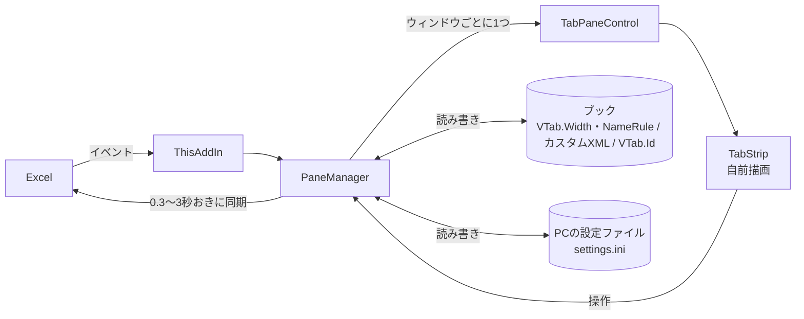

# 開発者向けの手引き (VerticalSheetTabs)

利用者向けの説明は [README.md](README.md) (配布用zipにも入ります)、現在の仕様、実装、守ること、リリースの決まりは [Agents.md](Agents.md) を参照してください。

## 構成

| ファイル | 役割 |
|---|---|
| `ThisAddIn.cs` | アドインの入口。Excelのイベント (ウィンドウ、ブックの保存、閉じる) を `PaneManager` につなぐ。すべてのイベント処理は、例外を握りつぶすガードで囲む |
| `PaneManager.cs` | ウィンドウごとのタスクペインの管理。0.3から3秒おきの同期 (シート名、表示状態、タブ色、選択)、シートの操作、フォルダの操作、設定の適用 |
| `TabPaneControl.cs` | ペインの中身 (`TabStrip`、「+」ボタン、右クリックメニュー) |
| `TabStrip.cs` | 縦タブの自前描画 (GDI+)。選択、ドラッグ、名前の変更、スクロール、フォルダの描画 |
| `TabTheme.cs`、`DpiHelper.cs` | Officeテーマの配色、画面の拡大率 |
| `SheetHistory.cs` | 見たシートの履歴とそのXML |
| `Wobble.cs`、`WobbleSounds.cs`、`Sounds\*.wav` | 揺れの動き、効果音 (アドインに埋め込む) |
| `DialogPlacer.cs` | Excelの「色の設定」画面を、クリックした位置に出す |
| `TabColorPalette.cs` | シート見出しの色のパレット (Excelと同じ構成) |
| `SafeXml.cs` | ブックから読むXML (カスタムXMLパート、ファイルのテーマ) の読み込み。DTD禁止、大きさの上限 |
| `FolderModel.cs`、`FolderStore.cs` | フォルダの構造、XMLの読み書き、Excelのシート順との突き合わせ (`Reconcile`)、シートの識別 |
| `NameRule.cs` | シート名のルール (`フォルダ名 \| シート名`) の解析、並びの整理、名前からのフォルダ構成 |
| `WorkbookSettings.cs` | 1つのウィンドウの設定。ブックのカスタムドキュメントプロパティ (`VTab.Width`、`VTab.NameRule`) の読み書きと、古い `VTab.*` の削除 |
| `PcSettings.cs` | PCの設定ファイル (`%LocalAppData%\VerticalSheetTabs\settings.ini`。表示モード、位置、見た目、アニメーション、バッジ) の読み書き |
| `SettingsForm.cs`、`RibbonController.cs`、`RibbonIcon.cs` | 設定画面、リボンのボタンと横タブのメニュー項目、アイコン |
| `AddInVersion.cs` | 表示用のバージョン、著作権、ライセンス |
| `VerticalSheetTabs.Tests\` | Excel を使わない部分 (`NameRule`、`FolderModel`、`SafeXml`) のテスト。ソースを参照で取り込む、フレームワーク不要のコンソールプログラム。`tools\run-tests.ps1` で実行 |
| `tools\dist\` | 配布用zipに入れる、証明書を信頼する / 取り消すスクリプトと、手順書の雛形 |
| `tools\make-dist-zip.ps1`、`tools\make-readme-pdf.ps1` | 配布用zipの作成、README.pdf の作成 |
| `.github\workflows
elease.yml` | タグの push で、配布用zipを添付した GitHub リリースを作る |



## ビルド

- Visual Studio 2026 (「Office/SharePoint 開発」ワークロード) で、`VerticalSheetTabs.sln` を開く
- ブランチ運用とリリースの決まりは、Agents.md の8章を参照 (feature / fix ブランチ > `develop` > `master`、タグ `vX.Y.Z`)

```powershell
# コマンドラインでのビルド (Debug)
& "C:\Program Files\Microsoft Visual Studio\18\Community\MSBuild\Current\Bin\MSBuild.exe" VerticalSheetTabs.sln -v:minimal
```

- Debug ビルドは、ビルド時に、現在のユーザーの Excel に、アドインを登録する (VSTO の標準動作)。動作確認は、Excelを通常起動して行う (COM自動化で起動した Excel では、VSTOアドインは読み込まれない)
- C# 7.3 の制約がある (VSTOプロジェクトの既定の言語バージョン)

## リリースの手順


### インストーラを作る (ClickOnce)

```powershell
& "C:\Program Files\Microsoft Visual Studio\18\Community\MSBuild\Current\Bin\MSBuild.exe" `
    VerticalSheetTabs\VerticalSheetTabs.csproj -t:Publish -p:Configuration=Release -v:minimal
```

成果物は、`VerticalSheetTabs\bin\Release\app.publish\` に作られる (`bin\` は `.gitignore` 済み)。

| ファイル | 内容 |
|---|---|
| `setup.exe` | インストーラ (必要なランタイムを導入して、アドインを登録する) |
| `VerticalSheetTabs.vsto` | アドインの配置用マニフェスト |
| `Application Files\VerticalSheetTabs_X_Y_Z_0\` | アドイン本体 (DLL とマニフェスト) |

バージョンを上げるときは、次の3か所 (2ファイル) を更新する。

- `VerticalSheetTabs\VerticalSheetTabs.csproj` の `ApplicationVersion`
- `VerticalSheetTabs\Properties\AssemblyInfo.cs` の `AssemblyVersion` と `AssemblyFileVersion`

(設定画面のバージョン表示は、`AssemblyVersion` から読む。)

Release ビルドには、`PathMap` を設定してあり、DLL に、開発PCのフォルダのパスが入らない。公開時の警告 MSB3696 (VSTOランタイムを `setup.exe` に含めない) は、Windows 11 では問題ない。

### 配布用zipを作る

```powershell
powershell -File tools\make-dist-zip.ps1 -Version 1.3.4
```

- 公開済みのインストーラの DLL の版数が、指定した版数と同じことを確かめてから、`配布用zip\VerticalSheetTabs_vX.Y.Z.zip` を作り、古いzipを削除する
- zipの中身: `setup.exe`、`VerticalSheetTabs.vsto`、`Application Files\`、`VerticalSheetTabs.cer`、`証明書を信頼する.ps1`、`証明書の信頼を取り消す.ps1`、`はじめにお読みください.txt`、`README.md`、`README.pdf` (`README.md` から、`tools\make-readme-pdf.ps1` で作る。Edge のヘッドレス印刷。GIF は先頭の1コマの静止画)、`license\`。`.cer`、`証明書を信頼する.ps1`、`証明書の信頼を取り消す.ps1`、`はじめにお読みください.txt` は、いまの配布用zipから引き継ぐ。署名の秘密鍵 (`.pfx`) は、含めない

### GitHub への push と、リリースの自動作成

- タグ (`vX.Y.Z`) を push すると、`.github/workflows/release.yml` が動き、そのタグの配布用zipを添付した、GitHub のリリースが作られる。タグのコミットに、`配布用zip/VerticalSheetTabs_vX.Y.Z.zip` が含まれている必要がある
- **一度に4つ以上のタグを push すると、GitHub は、どのタグでも、ワークフローを起動しない。** タグは、1回に3つまでにする (最新のタグだけを push するのが、確実)
- 起動しなかったときは、Actions の「Release Artifact」を開き、「Run workflow」で、タグの名前 (例: `v1.1.71`) を入れて、手動で実行する

## 署名の証明書について

マニフェストは、自己署名の証明書 (`VerticalSheetTabs_TemporaryKey.pfx`、発行先 `CN=VerticalSheetTabs`) で署名している。この証明書は、リポジトリには含まれない (`.gitignore` 済み)。

- インストールするPCが、証明書を信頼していないと、インストール時に、「発行元を確認できません」という警告が出て、インストールできないことがある
- 他のPCに配るときは、証明書の公開部分 (`.cer`) を、そのPCの「信頼された発行元」と「信頼されたルート証明機関」に登録する (配布用zipの「証明書を信頼する.ps1」が行う)

```powershell
# 署名に使った証明書の公開部分を書き出す (署名のPCで実行)
$cert = Get-ChildItem Cert:\CurrentUser\My | Where-Object { $_.Subject -eq "CN=VerticalSheetTabs" } | Select-Object -First 1
Export-Certificate -Cert $cert -FilePath VerticalSheetTabs.cer
```

- 別のPCで開発するときは、Visual Studio の「署名」タブで新しい証明書を作り、`.csproj` の `ManifestCertificateThumbprint` を更新する (または、`.pfx` を、安全な方法で受け渡す)
- 正式に配布する場合は、コード署名証明書を購入して、`.csproj` の `ManifestCertificateThumbprint` と `ManifestKeyFile` を差し替える

## アンインストール (開発PC)

```powershell
& "C:\Program Files (x86)\Common Files\Microsoft Shared\VSTO\10.0\VSTOInstaller.exe" /Uninstall <.vsto の場所> /S
```

Debug ビルドが登録した開発用のアドインは、Excelの「ファイル > オプション > アドイン」の「COMアドイン」から確認できる。

## テスト

```powershell
powershell -File tools\run-tests.ps1
```

- Excel を使わない部分のテスト (`VerticalSheetTabs.Tests`)。失敗した数が終了コードになる。リリースの前に実行する
- Excel や画面に関わる部分は、下の自動確認か、手で確かめる

## 自動確認の注意 (PowerShell + UI Automation)

- Excelを通常起動して、`System.Windows.Automation`、`mouse_event` (絶対座標、`SetProcessDPIAware` 後)、`SendKeys` で操作する
- 自分が起動したExcelだけを終了する。ほかのExcelが動いているときは、中止する
- COM経由でExcelを操作したスクリプトは、`FinalReleaseComObject` とGCのあとでないと、Excelのプロセスが残る
- Windows PowerShell 5.1 に日本語を含むスクリプトは、UTF-8 BOM付きで保存する
- ペイン内の描画、配置のコードで例外を出さない (出すと、ペインにマウス入力が届かなくなる)
