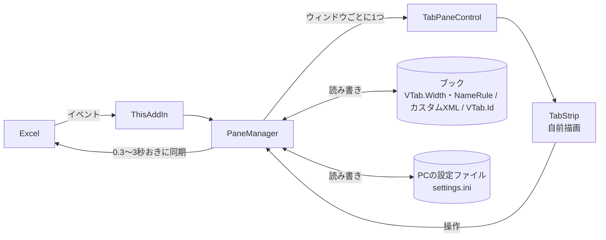
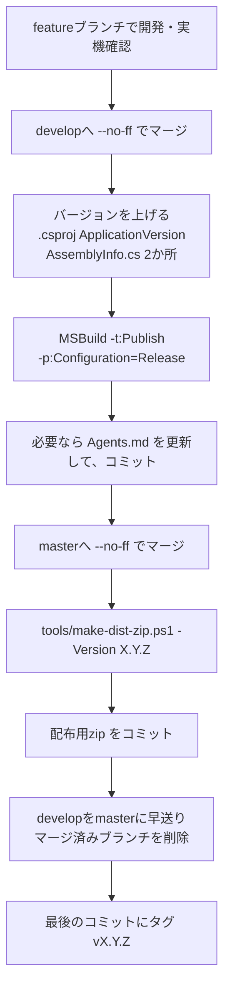

# 開発者向けの手引き (VerticalSheetTabs)

利用者向けの説明は [README.md](README.md) (配布用zipにも入ります)、現在の仕様、実装、守ること、リリースの決まりは [Agents.md](Agents.md) を参照してください。

初めてソースコードを読む人は、次の順に読むと、全体から細部へ進めます。

1. [全体像](#全体像): 何をするアドインで、どんな仕組みか。まず、ここだけ読めば足ります
2. [ソースファイルの構成](#ソースファイルの構成): どのファイルが、何を受け持つか
3. [設計図 (UML)](#設計図-uml): 図で、何ができるか > どんな部品か > どんなクラスか > どう動くか、の順に見る
4. [ビルド](#ビルド) 以降: 動かす、テストする、リリースする

## 全体像

Windows版 Excel のシートタブを、縦一覧で表示する VSTO アドインです (.NET Framework 4.8、C# 7.3)。縦タブは、Excel のタスクペインの中に、自前で描いています (GDI+)。



最初に押さえる、設計の決まり:

- **Excel のオブジェクトモデルを呼ぶのは `PaneManager`** です (ブックの読み書きの部品 `FolderStore`、`HistoryStore`、`WorkbookSettings` も、`PaneManager` から呼ばれて、渡されたブックを読み書きします)。`TabStrip` などの画面の部品は Excel を知らず、操作を「イベント」で `PaneManager` に伝え、表示は `PaneManager` から渡されます
- Excel には、シート名の変更、並べ替え、非表示のイベントが無いため、**0.3から3秒おきのタイマーで同期**します (`PaneManager`)
- **開いただけ、同期しただけでは、ブックを「変更あり」にしません**。ユーザーの操作のときだけ変更扱いにします
- 設定は、**PC** (`settings.ini`) と **ブック** (`VTab.Width`、`VTab.NameRule`、フォルダのXML) に分けて保存します
- フォルダの構造、履歴、シート名のルールは、**Excel に依存しないモデル**です (`FolderModel`、`SheetHistory`、`NameRule`。ブックへの読み書きは、別の部品 `FolderStore`、`HistoryStore` が受け持ちます)。そのため、Excel なしでテストできます (`NameRule`、`FolderModel`、`SafeXml`、壁紙の配置の計算 (`Wallpaper.Layout`) のテストがあります)

これらの理由と、細かい決まりは、[Agents.md](Agents.md) の3章と4章にあります。

## ソースファイルの構成

| ファイル | 役割 |
|---|---|
| `ThisAddIn.cs` | アドインの入口。Excelのイベント (ウィンドウを有効にした、シートを有効にした、ブックの保存前。バッジを使うときだけ、セルの変更、再計算、シートを離れた) を `PaneManager` につなぐ。すべてのイベント処理は、例外を握りつぶすガードで囲む |
| `PaneManager.cs` | ウィンドウごとのタスクペインの管理。0.3から3秒おきの同期 (シート名、表示状態、タブ色、選択)、シートの操作、フォルダの操作、設定の適用 |
| `TabPaneControl.cs` | ペインの中身 (`TabStrip`、「+」ボタン、右クリックメニュー) |
| `TabStrip.cs` | 縦タブの自前描画 (GDI+)。選択、ドラッグ、名前の変更、スクロール、フォルダの描画、壁紙と透過した行の描画 (行の本体だけを半透明で重ね、名前やバッジは `Defer` で不透明に描く) |
| `TabTheme.cs`、`DpiHelper.cs` | Officeテーマの配色、画面の拡大率 |
| `SheetHistory.cs` | 見たシートの履歴 (`SheetHistory`) とそのXML、ブックのXMLパートへの読み書き (`HistoryStore`) |
| `Wobble.cs`、`WobbleSounds.cs`、`Sounds\*.wav` | 揺れの動き、効果音 (アドインに埋め込む) |
| `DialogPlacer.cs` | Excelの「色の設定」画面を、クリックした位置に出す |
| `TabColorPalette.cs` | シート見出しの色のパレット (Excelと同じ構成) |
| `SafeXml.cs` | ブックから読むXML (カスタムXMLパート、ファイルのテーマ) の読み込み。DTD禁止、大きさの上限 |
| `FolderModel.cs`、`FolderStore.cs` | フォルダの構造、XMLの読み書き、Excelのシート順との突き合わせ (`Reconcile`)、シートの識別 |
| `NameRule.cs` | シート名のルール (`フォルダ名 \| シート名`) の解析、並びの整理、名前からのフォルダ構成 |
| `WorkbookSettings.cs` | 1つのウィンドウの設定。ブックのカスタムドキュメントプロパティ (`VTab.Width`、`VTab.NameRule`) の読み書きと、古い `VTab.*` の削除 |
| `PcSettings.cs` | PCの設定ファイル (`%LocalAppData%\VerticalSheetTabs\settings.ini`。表示モード、位置、壁紙、見た目、アニメーション、バッジ) の読み書き |
| `Wallpaper.cs` | 壁紙の設定 (`WallpaperOptions`)、画像の読み込み、配置の計算 (画面に依存しない。テストでも使う)、領域への描画 |
| `CommentPopup.cs` | メモ・コメントのバッジの表示 (一覧と内容の窓) |
| `SettingsBackground.cs` | 設定画面の「背景」タブの部品 (壁紙、表示方法、表示位置、透過率、文字の縁) |
| `SettingsForm.cs`、`RibbonController.cs`、`RibbonIcon.cs` | 設定画面、リボンのボタンと横タブのメニュー項目、アイコン |
| `AddInVersion.cs` | 表示用のバージョン、著作権、ライセンス |
| `VerticalSheetTabs.Tests\` | Excel を使わない部分 (`NameRule`、`FolderModel`、`SafeXml`、`Wallpaper` の配置の計算) のテスト。ソースを参照で取り込む、フレームワーク不要のコンソールプログラム。`tools\run-tests.ps1` で実行 |
| `tools\dist\` | 配布用zipに入れる、証明書を信頼する / 取り消すスクリプトと、手順書の雛形 |
| `tools\make-dist-zip.ps1`、`tools\make-readme-pdf.ps1` | 配布用zipの作成、README.pdf の作成 |
| `.github\workflows\release.yml` | タグの push で、配布用zipを添付した GitHub リリースを作る |

## 設計図 (UML)

図は PlantUML で描き、SVG にして置きます (GitHub は PlantUML を表示しないため)。ソースは `docs/*.puml`、SVG は同じ名前で `docs/` にあります。

| 知りたいこと | 見る図 |
|---|---|
| 利用者が、何をできるか | [ユースケース図](#ユースケース図) |
| どんな部品でできていて、どうつながるか | [コンポーネント図](#コンポーネント図)、[インターフェースのつながり](#コンポーネント図-インターフェースのつながり) |
| どんなクラスがあるか | [クラス図](#クラス図) |
| どんなデータが、どこからどこへ流れ、どこに保存されるか | [データフロー図](#データフロー図) |
| 動き出しから終わりまでの基本の流れ | [シーケンス図: 基本の流れ](#基本の流れ) |
| シート、フォルダ、検索などの操作が、どう処理されるか | [シーケンス図: 縦タブの操作](#縦タブの操作) |
| 見た目、設定、バッジ、色、シート名のルール | [シーケンス図: 見た目・設定・状態の表示](#見た目設定状態の表示) |
| アニメーションの状態と、起動の判断 | [状態遷移図、アクティビティ図](#状態遷移図とアクティビティ図-アニメーション) |

目的から探すときは、次も使えます。

| 直したいこと | 先に見る図 |
|---|---|
| シートの選択、追加、移動、名前の変更 | シーケンス図「シートのクリックによる選択」「シートの操作」 |
| フォルダの動き | シーケンス図「フォルダの操作」「フォルダの出し入れ・移動・コピー」 |
| 縦タブが出ない、消える | シーケンス図「表示モードとペインの出し入れ」「ウィンドウとブックの終了処理」 |
| 保存したときの内容 | シーケンス図「ブックの保存」 |
| バッジ、進捗、メモ・コメント | シーケンス図「バッジの検出と進捗」「メモ・コメントのバッジのクリック」 |
| 揺れ、追加・削除、完了の動き | シーケンス図「アニメーション」、状態遷移図、アクティビティ図 |

### ユースケース図

利用者ができることを、仕様 (`Agents.md` の2章) にもとづいて、まとまりごとに示す。ソースは [docs/usecase.puml](docs/usecase.puml)。「シートを操作する」のすべては、Excelのオブジェクトモデルを通して行うため、Excelへの線は省いている。


### コンポーネント図

役割ごとのコンポーネントと、それを構成するモジュール (ソースファイル) を示す。矢印は「呼ぶ / 使う」。Excelのオブジェクトモデルを呼ぶのは、`PaneManager` が中心で、ブックを読み書きする `FolderStore`、`HistoryStore` (`SheetHistory.cs`)、`WorkbookSettings` も、`PaneManager` から渡されたブックを読み書きする (`TabStrip` などの画面の部品は、Excelに触れない)。


### コンポーネント図: インターフェースのつながり

中のモジュールは描かず、役割のコンポーネントの間の、インターフェースのつながりだけを示す。丸が「提供」、受け口が「利用」。ソースは [docs/component-interface.puml](docs/component-interface.puml)。


| 番号 | インターフェース | 提供 | 利用 | 中身 |
|---|---|---|---|---|
| I1 | Excelイベント | Excel | 入口 | ウィンドウの有効化、シートの有効化、ブックの保存前のイベント。バッジを使うときだけ、セルの変更、再計算、シートを離れたイベント (`ThisAddIn` が購読) |
| I2 | リボン拡張 | 入口 | Excel | `IRibbonExtensibility`。リボンのボタンと、横タブのメニュー項目の定義、押されたときの通知 |
| I3 | オブジェクトモデル | Excel | 制御 | ウィンドウ、ブック、シートの読み書き (COM)。呼ぶのは制御 (`PaneManager`)。ブックの読み書きの部品 (モデルの `FolderStore`、`HistoryStore`、設定の保持の `WorkbookSettings`) は、制御から渡されたブックを読み書きする |
| I4 | ペイン登録 | Excel | 制御 | `CustomTaskPanes`。ウィンドウごとに縦タブのペインを作る |
| I5 | ペイン管理 | 制御 | 入口 | `EnsurePane`、`EnsureAllPanes`、`ShowSettings`、`SaveSettings`、`SyncSheetOf`、`MarkBadgesDirty`、`Shutdown` |
| I6 | バッジ購読 | 入口 | 制御 | `BadgeEventsWanted` (`Action<bool>`)。バッジを使うウィンドウがあるときだけ、シートの変更・再計算のイベントを購読する |
| I7 | 表示の更新 | 画面 | 制御、設定画面 | 行、バッジ、選択、設定 (見た目、壁紙、揺れ、アニメーション) を渡す。設定画面のサンプルも、同じ描画を使う |
| I8 | 操作の要求 | 制御 | 画面 | 画面が起こすイベント (`*Requested`: 選択、移動、名前の変更、色、フォルダ、進捗、リンク、メモのバッジなど) を、制御が受ける |
| I9 | 値の問い合わせ | 制御 | 画面 | `Func` で画面が聞く。テーマの色 (`ThemeColorProvider`)、「その他の色」 (`MoreColorsProvider`)、履歴 (`HistoryProvider`)、セルの入力中か (`IsExcelEditing`) |
| I10 | 設定画面 | 設定画面 | 制御 | 現在の値を渡して表示し、OK で値を返す |
| I11 | 動きと音 | 動き・音 | 画面、設定画面、設定の保持 | `WobbleMotion.At` (揺れの動き)、`WobbleSounds.Play` (効果音)、`WobbleType` (種類の値) |
| I12 | モデルの操作 | モデル | 制御、設定画面 | フォルダの構造、XMLの読み書き、シート名のルール、履歴 |
| I13 | 設定の読み書き | 設定の保持 | 制御 | `PcSettings` (`settings.ini`)、`WorkbookSettings` (ブックの `VTab.*`) の読み書き |

### クラス図

主なクラスと、その関係を示す。メンバーは、関係の理解に要るものだけを載せている (すべてではない)。

**主なクラスと関係** ([class-structure.puml](docs/class-structure.puml))。`PaneManager` が、ウィンドウごとの管理情報 (`Entry`) を持ち、その中にペインの中身 (`TabPaneControl`、`TabStrip`) がある。画面は、イベントで操作を `PaneManager` に伝える。


**データ・モデル・設定** ([class-data.puml](docs/class-data.puml))。フォルダの構造 (`FolderModel`)、履歴、設定 (`WorkbookSettings`。実行中は、PCの設定もここに入る)、画面に渡すデータ (`StripRow`、`BadgeInfo` など)。


### データフロー図

データが、どこから来て、どこで処理され、どこに保存されるかを示す。四角は外部 (利用者、Excel、Officeテーマ)、楕円はプロセス、円筒はデータの保存先です。処理の順序は表さない (順序は、次のシーケンス図)。

**レベル0 (全体)** ([dfd-level0.puml](docs/dfd-level0.puml))。アドイン全体を1つのプロセスとして、外とのデータのやりとりだけを示す。


**レベル1 (プロセスの分解)** ([dfd-level1.puml](docs/dfd-level1.puml))。アドインを8つのプロセスに分け、保存先 (D1からD4) との出入りを示す。括弧内は、主に受け持つクラスやイベント。


| 番号 | プロセス | 受け持ち |
|---|---|---|
| 1 | シートの情報を同期する | Excelのシートの名前、表示状態、色、選択を、0.3から3秒おきに読む (`PaneManager`) |
| 2 | 縦タブを描き、操作を受ける | 画面の描画と入力 (`TabStrip`、`TabPaneControl`) |
| 3 | 操作をExcelに反映する | 画面の操作の要求を、Excelのシートの変更にする (`PaneManager`) |
| 4 | フォルダを管理する | フォルダの構造と、シート名のルール (`FolderModel`、`NameRule`) |
| 5 | 履歴を管理する | 見たシートの履歴 (`SheetHistory`) |
| 6 | バッジを検出する | 数式エラー、メモ、保護を調べ、進捗の印を読む (`PaneManager`) |
| 7 | 設定を管理する | 設定画面、PCの設定、ブックの設定 (`SettingsForm`、`PcSettings`、`WorkbookSettings`) |
| 8 | 保存時に書き込む | ブックの保存のとき、フォルダ構成、履歴、ブックの設定を書く (`WorkbookBeforeSave`) |

### シーケンス図

動きの流れを、時間の順に示す。ここまでの図 (部品、クラス) を見てから読むと、だれが、だれを呼ぶかが、つかみやすい。

#### 基本の流れ

アドインの一生 (起動、同期、選択、保存、終了) です。まず、この4つを読んでください。

**起動、ペインの作成、同期** ([sequence-startup.puml](docs/sequence-startup.puml))

Excel の起動から、ペインを作り、同期を始めるまで。


**シートのクリックによる選択** ([sequence-select.puml](docs/sequence-select.puml))

縦タブのシートをクリックしてから、Excel のシートが切り替わるまで。


**ブックの保存** ([sequence-save.puml](docs/sequence-save.puml))

ブックを保存するときに、設定、フォルダ、履歴を書き込む流れ。


**ウィンドウとブックの終了処理、アドインの停止** ([sequence-shutdown.puml](docs/sequence-shutdown.puml))

ブックやウィンドウを閉じたとき、アドインを止めるときの後始末。


#### 縦タブの操作

利用者が縦タブで行う操作が、どう処理されるかです。

**シートの操作 (+・挿入・名前の変更・移動とコピー・非表示と再表示)** ([sequence-sheetops.puml](docs/sequence-sheetops.puml))

「+」、挿入、名前の変更、移動・コピー、非表示と再表示。


**フォルダの操作 (開閉・作成・名前の変更・色・削除)** ([sequence-folder.puml](docs/sequence-folder.puml))

フォルダの作成、開閉、名前の変更、色、削除。


**フォルダの出し入れ・移動・コピー (ドラッグ)** ([sequence-folder-drop.puml](docs/sequence-folder-drop.puml))

ドラッグでの、フォルダへの出し入れ、フォルダの移動とコピー。


**シートの行をセルへドラッグしてリンクを作る** ([sequence-link.puml](docs/sequence-link.puml))

シートの行を Excel のセルにドロップして、ハイパーリンクを作る。


**検索** ([sequence-search.puml](docs/sequence-search.puml))

検索ボックスでの絞り込みと、移動。


**履歴 (記録、戻る・進む、一覧)** ([sequence-history.puml](docs/sequence-history.puml))

見たシートの記録、戻る・進む、一覧のメニュー。


**コピーアイコン** ([sequence-copyicon.puml](docs/sequence-copyicon.puml))

左ボタンを押したまま右ボタンも押して、名前をコピーする。


#### 見た目・設定・状態の表示

設定、色、バッジ、シート名のルールなど、見た目と状態に関わる流れです。

**表示モードとペインの出し入れ** ([sequence-mode.puml](docs/sequence-mode.puml))

表示モード (横のみ / 両方) と、ペインの出し入れ、「×」の扱い。


**設定画面** ([sequence-settings.puml](docs/sequence-settings.puml))

設定画面を開いてから、OK / キャンセルで反映するまで。


**シート見出しの色と「その他の色」** ([sequence-color.puml](docs/sequence-color.puml))

シート見出しの色の指定と、Excel の「色の設定」画面 (「その他の色」)。


**バッジの検出と進捗** ([sequence-badge.puml](docs/sequence-badge.puml))

バッジ (エラー、メモ、保護、進捗) の検出と、進捗の印の操作。


**メモ・コメントのバッジのクリック** ([sequence-comment.puml](docs/sequence-comment.puml))

メモ・コメントのバッジをクリックして、内容を読む。


**シート名のルール** ([sequence-namerule.puml](docs/sequence-namerule.puml))

シート名のルール (`A | B`) による、フォルダの構成と、名前の同期。


**アニメーション (揺れ・ゴースト・追加削除・完了)** ([sequence-animation.puml](docs/sequence-animation.puml))

揺れ、ゴースト、追加・削除、完了のはじける動き。


### 状態遷移図とアクティビティ図 (アニメーション)

アニメーションは、種類ごとに状態を持ち、起動するかどうかを、いくつもの条件で決める。シーケンス図「アニメーション」の補足として読む。

#### 状態遷移図

アニメーションは、種類ごとに独立した状態を持つ (`TabStrip`)。([state-animation.puml](docs/state-animation.puml))


#### アクティビティ図

行の増減、揺れ、完了のはじける動きを、起動するかどうか判断する流れ。([activity-animation.puml](docs/activity-animation.puml))


### 図の作り直し

構成や流れを変えたら、`docs/*.puml` を直し、`tools\make-diagrams.ps1` で、SVG を作り直します (Java、Graphviz、`tools\PlantUML\plantuml-bsd-*.jar` が要る。jar はリポジトリに含めない)。`docs/*.puml` のすべてを、SVG にします。

## 設計中の機能: 積み上げ方式 (未実装)

縦タブの行の並べ方に、「積み上げ方式」を加える設計。**まだ実装していない**。実装するときに、この節の内容を、各文書 (Agents.md、README、図、この文書の他の節) へ移し、この節を消す。

### 目的と結論

| 項目 | 内容 |
|---|---|
| 設定名 | 「フォルダ＆シートの表示方法」(設定画面の「基本」タブ。PC共通) |
| 吊り下げ方式 (標準) | いまの方式。行は、上 (道具の行の下) から下へ並ぶ |
| 積み上げ方式 | 行は、下から上へ積み上がる。並びの順番は、同じ (上から A、B、C)。道具の行 (戻る、進む、検索) と「全開」「全閉」の帯も、下へ動かす。上から、**行、帯、道具の行、「+」** の順に並び、行は帯の直上から積み上がる |
| 実現できるか | **できる**。行の位置は、`TabStrip` の `RowRect`、`IndexFromPoint`、`_scrollY`、壁紙の領域 (`WallpaperRegion`)、追加・削除の動きの計算に集まっている。「行の原点」を1か所で変えれば、行の描画、クリック、バッジ、ツールチップ、ドラッグの挿入の印は、そのまま動く。Excel には触れず、ブックにも書かない (描画だけの変更) |

### 基本の考え方: 行の領域と、下詰めの余白

行を置く領域 (上端 `AreaTop`、下端 `AreaBottom`) を、方式ごとに決める。道具の行 (高さ `ToolPx`)、帯 (高さ `BandPx`。フォルダがあるときだけ)、「+」の行 (`RowPx`) は、方式ごとに置く場所を変える。

| | 吊り下げ方式 (いま) | 積み上げ方式 |
|---|---|---|
| 道具の行の上端 `ToolTop` | 0 | `ViewHeight - ToolPx` (「+」の直上) |
| 帯の上端 `BandTop` | `ToolPx` | `ToolTop - BandPx` (道具の行の直上) |
| 行の領域の上端 `AreaTop` | `HeaderPx` (`= ToolPx + BandPx`) | 0 |
| 行の領域の下端 `AreaBottom` | `ViewHeight` (「+」の直上) | `BandTop` (フォルダが無いときは `ToolTop`) |
| 「+」の行 | ペインの下端 | 同じ |

行の上端は、いまは `HeaderPx + index * RowPx - _scrollY`。積み上げ方式では、行が領域に収まるとき、全体を下へ詰める。

```
StackOffset = (積み上げ方式 かつ 見本でない) ? max(0, (AreaBottom - AreaTop) - 行数 * RowPx) : 0
行の上端    = AreaTop + StackOffset + index * RowPx - _scrollY
```

- 行が領域に収まらないときは、`StackOffset = 0` で、いまと同じ (スクロール)。つまり、収まる間だけ、下に詰まる
- 吊り下げ方式では `StackOffset = 0`。**いまの計算と同一**なので、既定の方式の動きは変わらない
- 見本 (`IsSample`、設定画面のサンプル) は、いつも吊り下げ方式。ただし、基本タブの「配置の見本」(下の「設定画面の配置」) は、`RowLayout` を指定して、どちらの方式でも描く

### 変える場所 (`TabStrip`)

| 場所 | 変更 |
|---|---|
| 行の領域 | `HeaderPx` (行の領域の上端として使っている所) を `AreaTop` に、`ViewHeight` (行の領域の下端として使っている所) を `AreaBottom` に置き換える。対象は、`AreaHeight`、`NeedScroll`、`UpdateScrollBar` (スクロールバーの位置)、`EnsureVisible`、`OnPaint` の切り抜き、行の描画のループの打ち切り、`WallpaperRegion`、`PrepareRowAnim` の見えているかの判定、`DrawRowAnim`、`DrawDoneAnim`、`ScrollNearEdge`、`InsertIndexAt`、`DrawFolderOutlines`、`DrawCopyIcon`。吊り下げ方式では、値がいまと同じなので、動きは変わらない |
| 道具の行 | `ToolBackRect`、`ToolForwardRect`、`ToolFolderRect`、`ToolBoxRect` の上端は、`(ToolPx - s) / 2` を `ToolTop + (ToolPx - s) / 2` にする。`ToolAt` の判定 (`p.Y >= ToolPx`)、`DrawToolRow`、`LayoutSearch` (検索の入力欄)、ツールチップの位置 (`ToolPx + Px(2)`)、履歴のメニューの位置も、`ToolTop` に合わせる |
| 帯 | `AllButtonRect` の上端 (`ToolPx + gap`) を `BandTop + gap` にする。`AllButtonAt`、`DrawAllButtons` も同じ |
| `RowRect(index)` | 上端に `StackOffset` を足す |
| `IndexFromPoint(p)` | `(p.Y - AreaTop - StackOffset + _scrollY) / RowPx`。**引く値が負のとき、整数の割り算は 0 へ丸まる**ため、先頭の行の上の余白が先頭の行に当たってしまう。`p.Y - AreaTop - StackOffset + _scrollY < 0` なら -1 を返す。`AreaBottom` 以下の点 (帯、道具の行、「+」) も -1 |
| `OnPaint` の先頭の行 (`first`)、`DrawDoneAnim` | `_scrollY / RowPx` から数えて、`break` する形なので、変更なし (余白があるときは `_scrollY` が 0) |
| スクロール | 下の「スクロールの基準」 |
| `WallpaperRegion()` | 下の「壁紙」 (積み上げ方式は、道具の行と帯の上に重ねない: 領域は `AreaTop` から `AreaBottom`) |
| `InsertIndexAt(p)` | 行の無い位置 (`index < 0`) は、いまは末尾 (`_rows.Count`)。積み上げ方式では、先頭の行より上の余白は **先頭 (0)**、`AreaBottom` 以下 (帯、道具の行、「+」) は末尾 |
| 追加・削除の動き | 下の「追加・削除の動き」 |
| 新しい `RowLayout` のプロパティ | 設定の反映口。切り替え時は、動きを止め、スクロールを下端にして、再描画 |

行の位置を使う他の処理 (バッジ、ツールチップ、コピーアイコン、名前の編集欄、ドラッグのゴースト、挿入の三角、フォルダの点線) は、すべて `RowRect` を通るので、変更しない。

### スクロールの基準 (下端)

- 積み上げ方式では、一覧が長くなったとき、**下端からの距離**を保つ (`_fromBottom`)。行が増減しても、下の行 (「+」に近い行) の位置が動かない。`_scrollY = 全体の高さ - 領域の高さ - _fromBottom`
- `_fromBottom` は、ユーザーがスクロールしたとき (`SetScroll`、バーの操作) に更新する。初期値は 0 (一番下)
- 更新するのは、`UpdateScrollBar` (ウィンドウの大きさの変更、行数の変更)、`SetSheets`、`ApplyFilter`。吊り下げ方式は、いままで通り `_scrollY` (上からの距離) を保つ
- アクティブなシートが変わったときの `EnsureVisible` は、そのまま使える

### 壁紙

壁紙は、行の無い領域に出す。積み上げ方式では、行の無い領域は **行の上** になる。

| 条件 | 吊り下げ方式 (いま) | 積み上げ方式 |
|---|---|---|
| 透過率 0% | 最後の行の直下から「+」の直上まで | ペインの上端 (`AreaTop`) から、**最初の行の上端まで** |
| 透過率 > 0% | 最初の行の上端 (`HeaderPx`) から「+」の直上まで | 同じ (`AreaTop` から `AreaBottom` まで) |

`WallpaperRegion()` を、方式で分ける。壁紙は、行といっしょにスクロールしない (これも同じ)。

### 追加・削除の動き

いまの動きは、「増減した行より**下**の行が、ずれる」前提の式 (`RowAnimDy`、`CountBelow`)。積み上げ方式は、下が動かず、「増減した行より**上**の行」が動くので、式を分ける。吊り下げ方式の式は、触らない。

| | 吊り下げ方式 (いま) | 積み上げ方式 |
|---|---|---|
| 追加 (最初の位置のずれ) | 追加行より下の行が、追加行の数だけ、上にいる (`-RowPx * 下の数`) | 追加行より上の行が、追加行の数だけ、下にいる (`+RowPx * 上の行から見て、後ろの追加行の数`) |
| 削除 | 削除行より下の行が、上にいる (`CountBelow`) | 削除行より上の行が、削除行の数だけ、上にいる (`-RowPx * 後ろの削除行の数`) |
| 削除した行の絵 | `HeaderPx + (At + j) * RowPx - _scrollY - _raShift` | **消える前の位置**。準備のとき (`PrepareRowAnim`) に、最初の行の上端 (`OldFirstTop`) を控え、`OldFirstTop + (At + j) * RowPx` に描く |
| 一覧が短くなって、スクロールが戻る | `_raShift` で補う | 不要 (下端からの距離を保つので、下の行は動かない) |

- 「増減した行より上の行の数」は、増減の位置の並び (`_raAddedAt`、`_raGhostAt`) に、`CountBelow` を使って二分探索で求める (いまと同じ性能。行数の上限なし)
- 別の案: 全行について、「動く前の上端 - 動いたあとの上端」を求める方法 (FLIP)。両方式を1つの式にできるが、いまの方式の動きを作り直すことになり、確認が増える。**採らない** (吊り下げ方式を変えないため)

### 設定と反映

| 場所 | 変更 |
|---|---|
| `WorkbookSettings` | 列挙 `RowLayout { Hanging, Stacked }` と、プロパティ `RowLayout` (初期値 `Hanging`) |
| `PcSettings` | キー `RowLayout` = `Hanging` / `Stacked` (Hanging)。読み書き、変更のあった値だけ書く、は他のキーと同じ |
| `SettingsForm` | 「基本」タブを左右2列にし、右列に、グループ「フォルダ＆シートの表示方法」を置く (下の「設定画面の配置」)。選択肢は「吊り下げ方式 (標準)」「積み上げ方式」のラジオボタン2つで、それぞれの下に見本を置く。「横タブのみ」のときは、グループ全体が無効 (値は保つ) |
| `PaneManager` | ペインを作るとき、設定画面のOKのとき (開いたウィンドウだけ、すぐ反映。ほかは開き直したとき) に、`TabStrip.RowLayout` へ渡す |
| ブックのデータ | **変更なし** (ブックには保存しない。PC共通の設定) |

### 設定画面の配置 (「基本」タブ)

実際の設定画面 (v1.5.4、視覚スタイル有効) を組み替えた画像で、ユーザーが確かめて決めた配置。

- **2列**: 左列は、上段に「表示モード」と「縦タブの位置」(横並び)、下段に「縦タブの初回幅」。右列は、グループ「フォルダ＆シートの表示方法」を、タブの高さいっぱいに置く
- **そろえ方**: 「縦タブの位置」の枠の右辺は、「縦タブの初回幅」の枠の右辺にそろえる (左列を1つの表にして、枠の幅を表に合わせる)。右列の枠の上辺は、「表示モード」「縦タブの位置」の上辺にそろえる。右列の枠の下辺は、基本タブの表示範囲に収める (高さは固定せず、タブの高さに合わせて、枠と見本の高さを決める。拡大率が違っても切れない)
- **「縦タブの初回幅」**: タイトルの直下 (「文字数」の直上) に、説明「新しいブックを初めて開いたときの縦タブ幅の設定です。」(灰色) を置く。v1.5.4 の、グループの下の説明文 (文字数と px の範囲、保存したブックの扱い) は**削除する**。そのため、px の下限 (半角12文字分の実際の幅) の表示は、未決 (画面に出すか、出さないか)
- **見本**: ラジオボタンの下に、2つを左右に並べる。縦タブ本体 (`TabStrip`) の描画を使う「配置の見本」(下)。行は、フォルダ１ (開いている。中にシート１、シート２ (選択中))、シート３。道具の行の検索欄は「検索」。方式の違い: 吊り下げ方式は、上から 道具の行、帯 (全開、全閉)、行、下端に「+」。積み上げ方式は、行が下へ寄り、その下に 帯、道具の行、「+」
- **見本の描き方**: `TabStrip` に、見本用の動作 (配置の見本: `IsSample` の一種) を足す。道具の行、帯 (フォルダが1つ以上のときの見た目)、「+」を持ち、`RowLayout` を指定できる。行は固定で、クリックなどは受け付けない。実際の見た目と、必ず一致する。イメージ画像 (簡易描画) との違いは、文字の細部だけ
- **段階**: 4章の問題 9 の対処は、「見本を2つ並べる」に決めた

### 部品の切り出し (テストのため)

行の位置の計算 (`StackOffset`、行の上端、点から行の番号、下端からのスクロール、壁紙の領域の上下) を、画面に依存しない静的クラス `RowPlacement` (新しいファイル `RowPlacement.cs`) に切り出し、テストプロジェクトにもリンクする (`Wallpaper.cs` と同じ)。`TabStrip` は、ここを呼ぶ。境界 (行がちょうど収まる、1行、0行、負の割り算) を、機械で確かめられる。

### 問題点と対処

| # | 問題 | 影響 | 対処の案 |
|---|---|---|---|
| 1 | **フォルダを開閉すると、押した行が動く。** 積み上げ方式は、下が固定のため、フォルダを開くと、そのフォルダの行が、開いた行の数だけ上へ逃げる (吊り下げ方式は、押した行が動かない) | 続けて閉じる操作で、ポインターを合わせ直す必要がある | 方式の性質として受け入れる。実機で使い勝手を見て、必要なら、動きを滑らかにする (行が滑って上がる) ことを、あとで検討する |
| 2 | 道具の行と帯を、下へ動かす (上から、行、帯、道具の行、「+」)。行が少ないとき、行の上に空きができる | 検索の結果が、検索欄の直上に出て、近い (問題が減る)。一方、道具の行が「+」に隣り合うため、押し間違いの恐れがある | 採用する。道具の行と「+」の間は、行の区切りの線で分かれている (間隔は、実機で見て決める) |
| 3 | 検索で絞り込んだ結果も、同じ規則で下に積まれる (検索欄の直上) | ↑↓ の選択が見やすい | 例外を作らない |
| 3a | 道具の行の戻る、進むの長押しメニュー、ツールチップは、いまは下向きに出る | 積み上げ方式では、下の「+」に重なる | 積み上げ方式では、上向きに出す (`ToolStripDropDownDirection.AboveRight`、ツールチップは、道具の行の上) |
| 3b | `HeaderPx`、`ViewHeight` の置き換えが、30 か所以上 | 見落とすと、積み上げ方式で、行の領域がずれる | 機械的に、`grep` で全部を洗い出す。置き換えのあと、`HeaderPx` / `ViewHeight` が残っている所は、道具の行や帯の寸法としての使用だけにする。吊り下げ方式は、値が同じなので、画像の比較 (実機の撮影) で、差が無いことを確かめる |
| 3c | フォルダが無い (帯が無い) ブックで、最初のフォルダを作ると、帯が出て、行の領域が帯の高さだけ縮む | 積み上げ方式では、帯が行の下に出るので、行の位置が帯の高さだけ上へ動く | 吊り下げ方式でも、行が帯の高さだけ下へ動く。同じ性質として受け入れる |
| 4 | ドラッグの挿入位置: 行より上の余白は先頭、下の余白は無い (「+」の行) | 余白へ落としたときの結果が、方式で逆になる | `InsertIndexAt` で、方式ごとに決める (上の余白 = 先頭)。余白に落としたときの三角は、先頭の行の上に出す |
| 5 | `IndexFromPoint` の負の割り算 | 先頭の行の上の余白をクリックすると、先頭の行を選んでしまう | 範囲の判定を、割り算の前に行う (`RowPlacement` のテストで確かめる) |
| 6 | スクロールの基準が、方式で違う (上からの距離 / 下からの距離) | 切り替え、ウィンドウの高さの変更、行数の変更で、見ている位置が飛ぶ恐れ | 積み上げ方式は、下端からの距離を保つ。切り替えたときは、下端に合わせる |
| 7 | 追加・削除の動きの式が、2種類になる | 計算を間違えると、行が飛ぶ | 吊り下げ方式の式は変えない。積み上げ方式の式を、境界 (先頭、末尾、複数、スクロール中) で、実機の連続撮影で確かめる (`an2.ps1` と同じ方法) |
| 8 | 壁紙の領域が、方式で逆になる (行の下 / 行の上) | 透過率 0% のとき、壁紙が見える場所が違う | `WallpaperRegion` で分ける。README の壁紙の説明 (「最後の行の直下から」) を、方式で書き分ける |
| 9 | 設定画面で、2つの方式の違いが分かりにくい | 選ぶ前に、結果が見えない | `TabStrip` の描画を使う見本を、ラジオボタンの下に2つ並べる (決定。上の「設定画面の配置」)。工数は中 |
| 10 | 行がちょうど収まる境界で、スクロールバーが出入りして、行の幅が変わる | 境界で、行が左右に揺れる | いまと同じ挙動 (吊り下げ方式にもある)。積み上げ方式でも、同じ |
| 11 | 1000枚のブック | 計算は、行数に比例しない (1回の掛け算と引き算) | 影響なし |
| 12 | 多くの確認が、実機で要る (描画、クリック、ドラッグ、動き、壁紙) | 確認の漏れ | 下の確認項目を、実装後、master へのマージ前に実施する |
| 13 | ドキュメントの変更が、広い (Agents.md、README と画像、図) | 更新漏れ | 実装のとき、`tools\check-images.ps1` で画像を洗い出し、下の「文書の更新」を、リリース前に実施する |

### 実機の確認項目 (実装後)

1. 方式の切り替え (設定画面のOK、開き直し)。吊り下げ方式は、これまでと同じ
2. 積み上げ方式: 1枚目が「+」の直上、「+」で追加すると、上の行が1行ぶん上へ動き、追加の行が下に入る (A、B、C の順で確かめる)
3. 途中への挿入 (アクティブなシートの次)、フォルダへの追加、削除 (末尾、途中、複数)、動きの連続撮影
4. フォルダの開閉、全開、全閉、色、同一色、フォルダの点線 (境界の描画)
5. ドラッグ (シート、フォルダ、複数、Ctrl コピー)、余白への落とし方 (行の上の余白)、セルへ落としてリンク
6. 検索 (絞り込み、↑↓、Enter)、履歴 (戻る、進む、長押しのメニューの向き)、名前の変更 (F2)、バッジ (メモのクリック)、コピーアイコン
6a. 積み上げ方式の道具の行 (検索の入力欄、フォルダ切り替え)、「全開」「全閉」の帯 (フォルダを作ると、帯が出る)、「+」との間隔、ツールチップ
7. 行が増えて領域を超えたときのスクロール、スクロール位置 (下端基準)、ウィンドウの高さの変更、多数のシート (80枚、1000枚)
8. 壁紙 (透過率 0%、60%)、タイル、文字の縁、追加・削除の動きとの組み合わせ
9. 拡大率 (125% のほか、100%、150% が分かれば)、暗い配色
10. 設定画面の基本タブ: 2列の配置 (枠の右辺・上辺のそろい、下辺が切れない)、見本2つ (実際の描画との一致)、「横タブのみ」でグループ全体が無効、初回幅の説明の位置 (旧説明文が無いこと)

### 文書の更新 (実装のとき)

| 文書 | 変更 |
|---|---|
| Agents.md | 2.1 の設定の表 (`RowLayout`)、2.5 (表示方法、壁紙の領域)、2.8 (基本タブの行)、3.1 (`RowPlacement.cs`)、3.8 (追加・削除の動き、`OldFirstTop`)、6章 (制約) |
| README.md | 設定の表、1章の説明 (壁紙の領域の書き分け)、設定画面の画像 (`settings_basic`、`settings_full`)、「積み上げ方式」の画像 1枚 (新規。実機で撮る)、変更点 |
| DEVELOPMENT.md | ファイルの構成の表 (`RowPlacement.cs`)、この節を消す、図の説明 |
| 図 (`docs\*.puml`) | `class-data` (`RowLayout`、`WorkbookSettings` の項目)、`sequence-animation` (下の行のずれの説明に、積み上げ方式を足す)、`activity-animation` (削除した行の絵の位置)、`class-structure` (`RowPlacement`)。`tools\make-diagrams.ps1` で作り直す |
| テスト | `RowPlacement` のテストを足す (`VerticalSheetTabs.Tests`) |

### 実装の手順 (案)

1. `RowPlacement.cs` とそのテスト (計算だけ。画面に触れない)
2. `TabStrip`: `RowLayout`、`RowRect`、`IndexFromPoint`、スクロールの基準、壁紙の領域、`InsertIndexAt`
3. `TabStrip`: 追加・削除の動き (積み上げ方式の式、`OldFirstTop`)
4. 設定: `WorkbookSettings`、`PcSettings`、`SettingsForm` (基本タブの2列化、初回幅の説明の移動、見本)、`PaneManager`
5. 実機の確認 (上の項目)、文書と画像、`check-images.ps1`

## ビルド

- Visual Studio 2026 (「Office/SharePoint 開発」ワークロード) で、`VerticalSheetTabs.sln` を開く
- ブランチ運用とリリースの決まりは、Agents.md の8章を参照 (feature / fix ブランチ > `develop` > `master`、タグ `vX.Y.Z`)

```powershell
# コマンドラインでのビルド (Debug)
& "C:\Program Files\Microsoft Visual Studio\18\Community\MSBuild\Current\Bin\MSBuild.exe" VerticalSheetTabs.sln -v:minimal
```

- Debug ビルドは、ビルド時に、現在のユーザーの Excel に、アドインを登録する (VSTO の標準動作)。動作確認は、Excelを通常起動して行う (COM自動化で起動した Excel では、VSTOアドインは読み込まれない)
- C# 7.3 の制約がある (VSTOプロジェクトの既定の言語バージョン)

## リリースの手順



### インストーラを作る (ClickOnce)

```powershell
& "C:\Program Files\Microsoft Visual Studio\18\Community\MSBuild\Current\Bin\MSBuild.exe" `
    VerticalSheetTabs\VerticalSheetTabs.csproj -t:Publish -p:Configuration=Release -v:minimal
```

成果物は、`VerticalSheetTabs\bin\Release\app.publish\` に作られる (`bin\` は `.gitignore` 済み)。

| ファイル | 内容 |
|---|---|
| `setup.exe` | インストーラ (必要なランタイムを導入して、アドインを登録する) |
| `VerticalSheetTabs.vsto` | アドインの配置用マニフェスト |
| `Application Files\VerticalSheetTabs_X_Y_Z_0\` | アドイン本体 (DLL とマニフェスト) |

バージョンを上げるときは、次の3か所 (2ファイル) を更新する。

- `VerticalSheetTabs\VerticalSheetTabs.csproj` の `ApplicationVersion`
- `VerticalSheetTabs\Properties\AssemblyInfo.cs` の `AssemblyVersion` と `AssemblyFileVersion`

(設定画面のバージョン表示は、`AssemblyVersion` から読む。)

Release ビルドには、`PathMap` を設定してあり、DLL に、開発PCのフォルダのパスが入らない。公開時の警告 MSB3696 (VSTOランタイムを `setup.exe` に含めない) は、Windows 11 では問題ない。

### 配布用zipを作る

```powershell
powershell -File tools\make-dist-zip.ps1 -Version 1.5.4
```

- 公開済みのインストーラの DLL の版数が、指定した版数と同じことを確かめてから、`配布用zip\VerticalSheetTabs_vX.Y.Z.zip` を作り、古いzipを削除する
- zipの中身: `setup.exe`、`VerticalSheetTabs.vsto`、`Application Files\`、`VerticalSheetTabs.cer`、`証明書を信頼する.ps1`、`証明書の信頼を取り消す.ps1`、`はじめにお読みください.txt`、`README.md`、`README.pdf` (`README.md` から、`tools\make-readme-pdf.ps1` で作る。Edge のヘッドレス印刷。GIF は先頭の1コマの静止画)、`license\`。`.cer`、`証明書を信頼する.ps1`、`証明書の信頼を取り消す.ps1`、`はじめにお読みください.txt` は、いまの配布用zipから引き継ぐ。署名の秘密鍵 (`.pfx`) は、含めない

### GitHub への push と、リリースの自動作成

- タグ (`vX.Y.Z`) を push すると、`.github/workflows/release.yml` が動き、そのタグの配布用zipを添付した、GitHub のリリースが作られる。タグのコミットに、`配布用zip/VerticalSheetTabs_vX.Y.Z.zip` が含まれている必要がある
- **一度に4つ以上のタグを push すると、GitHub は、どのタグでも、ワークフローを起動しない。** タグは、1回に3つまでにする (最新のタグだけを push するのが、確実)
- 起動しなかったときは、Actions の「Release Artifact」を開き、「Run workflow」で、タグの名前 (例: `v1.1.71`) を入れて、手動で実行する

## 署名の証明書について

マニフェストは、自己署名の証明書 (`VerticalSheetTabs_TemporaryKey.pfx`、発行先 `CN=VerticalSheetTabs`) で署名している。この証明書は、リポジトリには含まれない (`.gitignore` 済み)。

- インストールするPCが、証明書を信頼していないと、インストール時に、「発行元を確認できません」という警告が出て、インストールできないことがある
- 他のPCに配るときは、証明書の公開部分 (`.cer`) を、そのPCの「信頼された発行元」と「信頼されたルート証明機関」に登録する (配布用zipの「証明書を信頼する.ps1」が行う)

```powershell
# 署名に使った証明書の公開部分を書き出す (署名のPCで実行)
$cert = Get-ChildItem Cert:\CurrentUser\My | Where-Object { $_.Subject -eq "CN=VerticalSheetTabs" } | Select-Object -First 1
Export-Certificate -Cert $cert -FilePath VerticalSheetTabs.cer
```

- 別のPCで開発するときは、Visual Studio の「署名」タブで新しい証明書を作り、`.csproj` の `ManifestCertificateThumbprint` を更新する (または、`.pfx` を、安全な方法で受け渡す)
- 正式に配布する場合は、コード署名証明書を購入して、`.csproj` の `ManifestCertificateThumbprint` と `ManifestKeyFile` を差し替える

## アンインストール (開発PC)

```powershell
& "C:\Program Files (x86)\Common Files\Microsoft Shared\VSTO\10.0\VSTOInstaller.exe" /Uninstall <.vsto の場所> /S
```

Debug ビルドが登録した開発用のアドインは、Excelの「ファイル > オプション > アドイン」の「COMアドイン」から確認できる。

## テスト

```powershell
powershell -File tools\run-tests.ps1
```

- Excel を使わない部分のテスト (`VerticalSheetTabs.Tests`)。失敗した数が終了コードになる。リリースの前に実行する
- Excel や画面に関わる部分は、下の自動確認か、手で確かめる

## 自動確認の注意 (PowerShell + UI Automation)

- Excelを通常起動して、`System.Windows.Automation`、`mouse_event` (絶対座標、`SetProcessDPIAware` 後)、`SendKeys` で操作する
- 自分が起動したExcelだけを終了する。ほかのExcelが動いているときは、中止する
- COM経由でExcelを操作したスクリプトは、`FinalReleaseComObject` とGCのあとでないと、Excelのプロセスが残る
- Windows PowerShell 5.1 に日本語を含むスクリプトは、UTF-8 BOM付きで保存する
- ペイン内の描画、配置のコードで例外を出さない (出すと、ペインにマウス入力が届かなくなる)
