# 縦並びシートタブ (VerticalSheetTabs)

**シートが100枚あっても、迷わない。** Excelのシートタブを、画面の横に**縦一覧**で並べる、Excel (Windows版、Microsoft 365) 用のアドインです。

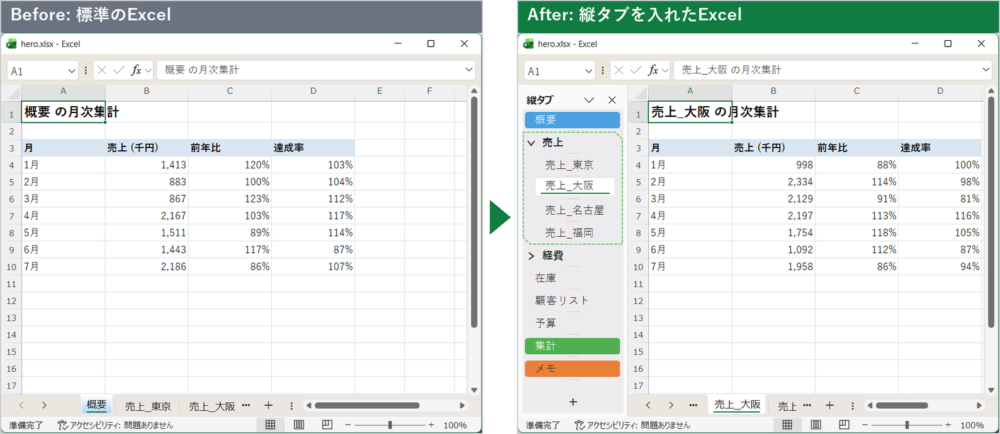

> 左が標準のExcel。横タブは `概要 | 売上_東京 | 売上_大阪 …` と、3枚ぶんしか見えません。
> 右がアドインを入れたExcel。12枚のシートが一目で見渡せ、「売上」「経費」のフォルダで整理され、シート見出しの色も、そのまま見えます。

- **一覧できる** … シート名がずらりと縦に並ぶ。もう、横スクロールの矢印を何度も押さなくていい
- **整理できる** … シートを**フォルダ**にまとめられる。並びは、Excelのシートの並びにも反映。縦タブの上端の「全開」「全閉」で、フォルダをまとめて開閉
- **いつもの操作** … クリック、ドラッグ、Ctrl+ドラッグでコピー、右クリックメニュー、シート見出しの色まで、横タブと同じ
- **選べる見た目** … 8つの選択デザインと、5つのアクティブシートの印。ガラスのような透け感の選択表示も。選んだシートや、開閉したフォルダが、ぷるっと揺れるアニメーションも (初期値は、なし。[動く様子を見る](#18-シートがぷるっと動く-アニメーション))
- **ブックごとに設定** … 縦タブを使うブックだけ、使える。設定は、ブックと一緒に保存される

開発の経緯、仕様、検証結果は、ソースのリポジトリの `Agents.md` に、ビルドやインストーラの作成 (開発者向け) は、`DEVELOPMENT.md` にまとめています。

## 目次

1. [使うとこう変わる (画面で見る Before / After)](#1-使うとこう変わる-画面で見る-before--after)
2. [できること (機能一覧)](#2-できること-機能一覧)
3. [インストール](#3-インストール)
4. [基本の使い方](#4-基本の使い方)
5. [シートの操作](#5-シートの操作)
6. [フォルダ](#6-フォルダ)
7. [シート名のルール](#7-シート名のルール)
8. [設定画面](#8-設定画面)
9. [設定の保存と、他の環境での扱い](#9-設定の保存と他の環境での扱い)
10. [既知の制約](#10-既知の制約)
11. [アンインストール](#11-アンインストール)
12. [動作環境、ライセンス](#12-動作環境ライセンス)

## 1. 使うとこう変わる (画面で見る Before / After)

### 1.1 リボンに「タブ表示の設定」ボタンが加わる

インストールすると、Excelのリボン「**表示**」タブに、**「縦タブ」グループ**と**「タブ表示の設定」ボタン**が加わります。ここが、すべての入口です。

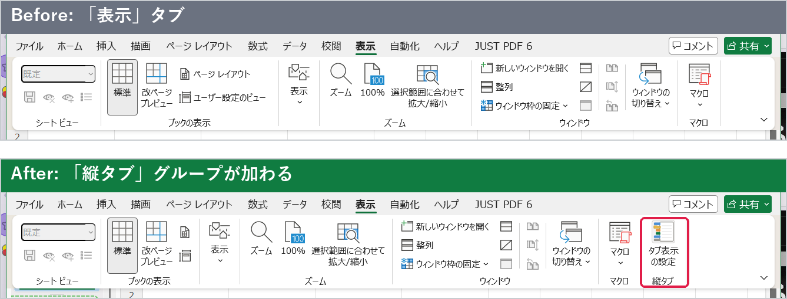

> 横タブ (標準のシートタブ) を右クリックしたメニューの先頭にも、「タブ表示の設定」が加わります。

### 1.2 「タブ表示の設定」で、何が決められるか

ボタンを押すと、設定画面が開きます。**開いているブックにだけ**効く設定で、ブックを保存すると、設定も一緒に保存されます。

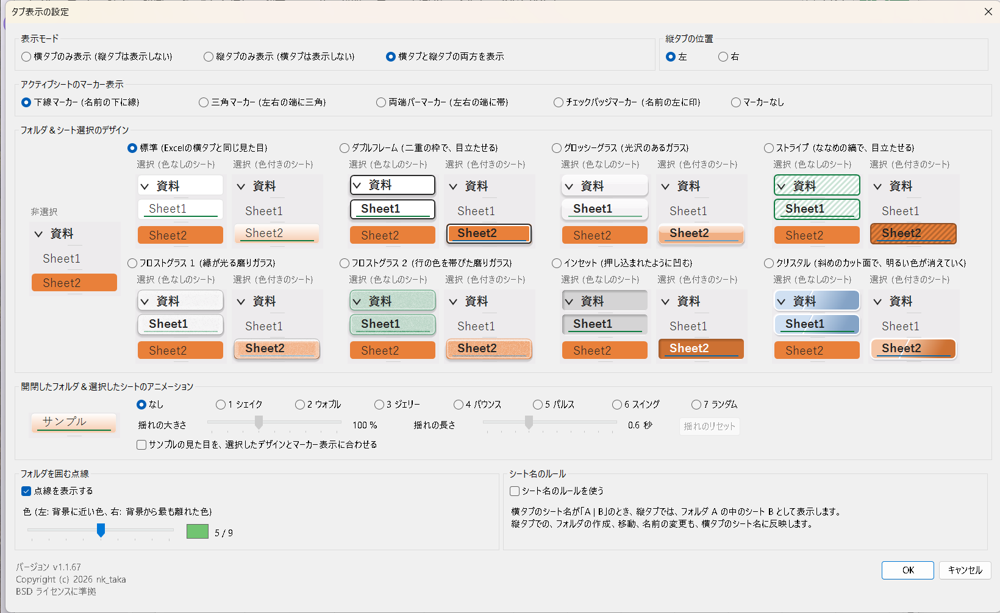

| 設定 | 決められること |
|---|---|
| **表示モード** | 横タブだけ / 縦タブだけ / 両方 ([1.3](#13-表示モードで画面がこう変わる)) |
| **縦タブの位置** | 画面の左 / 右 |
| **アクティブシートのマーカー表示** | 今開いているシートの印。下線 / 三角 / 両端バー / チェックバッジ / なし ([1.5](#15-選択中のフォルダとシートの見た目を選ぶ)) |
| **フォルダ＆シート選択のデザイン** | 選択中のフォルダとシートの見た目を、8種類から。**サンプルが、その場で見える** ([1.5](#15-選択中のフォルダとシートの見た目を選ぶ)) |
| **開閉したフォルダ＆選択したシートのアニメーション** | シートを選ぶと、そのシートが揺れる。フォルダを開閉すると、そのフォルダも同じように揺れる (開いたときは、中のシートも一斉に揺れる)。6種類の動き (シェイク / ウォブル / ジェリー / バウンス / パルス / スイング) とランダム、揺れの大きさと長さを選べる (初期値は、なし。[1.8](#18-シートがぷるっと動く-アニメーション)、[8章](#8-設定画面)) |
| **フォルダを囲む点線** | 開いたフォルダを囲む点線の、表示 / 非表示と、色の濃さ (9段階) |
| **シート名のルール** | 「フォルダ名 \| シート名」の名前で、フォルダを自動で作る ([1.6](#16-シート名だけでフォルダを共有する-シート名のルール)) |

### 1.3 表示モードで画面がこう変わる

はじめてブックを開いたときは、いつもの**横タブだけ**です。何も壊しません。設定画面で、表示モードを選ぶと、画面が切り替わります。

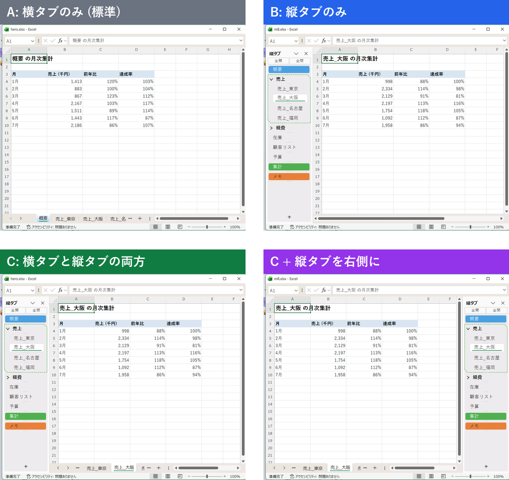

| 表示モード | 画面の変化 |
|---|---|
| **A: 横タブのみ** (初期値) | 標準のExcelのまま。縦タブは出ません |
| **B: 縦タブのみ** | 横タブが消え、シートの領域が広がります。シート名は縦タブで操作します |
| **C: 両方** | 横タブも、縦タブも使えます。慣れるまでは、これが安心です |
| **縦タブを右側に** | 縦タブの位置を「右」にすると、右端にペインが移ります |

### 1.4 フォルダ: シートを、フォルダで片づける

シートが増えたら、フォルダにまとめましょう。シートの右クリックメニューの「**新しいフォルダ**」を選ぶだけです。

| シートの右クリックメニュー | フォルダの右クリックメニュー |
|---|---|
| 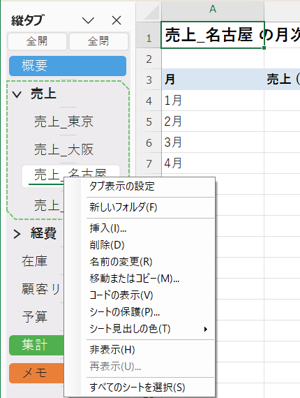 | 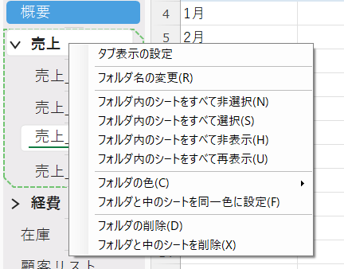 |

- フォルダの `>` / `∨` を押すと、**開閉**できます。閉じると、中のシートは縦タブから隠れます
- フォルダは**ドラッグで移動**できます。中のシートも、一緒に動きます。Ctrl+ドラッグで、フォルダごとコピーできます
- シートをフォルダの中へ、外へ、**ドラッグするだけ**で、出し入れできます
- フォルダにも**色**が付けられます。「中の全てを常にフォルダと同一色に設定」をONにすると、フォルダの色が、中のシートにも広がり、新しく入ったシートにも、自動で付きます
- 「フォルダ内のシートをすべて選択」で、フォルダ内のシートを、グループ選択。そのまま、まとめて保護、移動、コピーができます
- フォルダの順序は、Excelのシートの並びにも反映されます (横タブでも、同じ順に並びます)
- フォルダが**1つでもある**と、縦タブの上端に「**全開**」「**全閉**」のボタンが出ます。押すと、すべてのフォルダが、まとめて開く / 閉じます。フォルダが無くなると、ボタンも消えます

### 1.5 選択中のフォルダとシートの見た目を選ぶ

選択中の行の見た目を、**8種類**から選べます (ブックごとの設定。初期値は「標準」)。

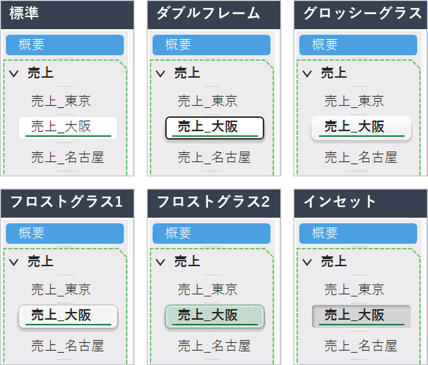

| 選択デザイン | 特長 |
|---|---|
| **標準** | Excelの横タブと同じ見た目 (白い塗り。下線マーカーのときは、アクティブなシートに緑の下線) |
| **ダブルフレーム** | 暗い外枠と白い内枠の二重の枠と、影。くっきり目立つ |
| **グロッシーグラス** | 上半分に反射の帯がある、光沢のあるガラス |
| **フロストグラス1** | 縁が内側から光る、磨りガラス |
| **フロストグラス2** | 行の色を帯びた、磨りガラス |
| **インセット** | 押し込まれたように凹んで見える |
| **ストライプ** | ななめの縞と、緑の枠 (色付きの行は、その色の濃い枠。縞は、明るい色の行では暗い縞、暗い色の行では白い縞) |
| **クリスタル** | 斜めのカットで、明るい面と濃い面に分かれ、明るい色が右へ消えていく。柔らかい影つき |

さらに、**今、内容が表示されているシート (アクティブなシート)** の印も、5種類から選べます。どの選択デザインとも組み合わせられます。

> 三角や帯の色は、その行の色の**反対色**で、白い縁取りとぼかしが付くので、暗い背景でも、色付きの行でも、見失いません。マーカーの色が、その行の色に近くて見分けにくいときは、見分けやすい色に自動で調整されます。マーカーが付くのは、アクティブなシートだけです (フォルダと、グループ選択のほかのシートには付きません)。

設定画面のこの部分で、サンプルを見ながら選べます (サンプルをクリックしても選べます)。

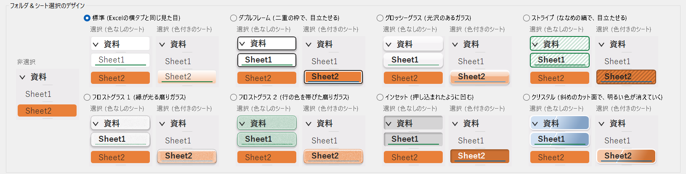

### 1.6 シート名だけで、フォルダを共有する (シート名のルール)

「**フォルダ名 | シート名**」の形で、横タブにシート名を付けると、縦タブでは、**自動で、フォルダの中のシート**として表示されます。縦タブを使わない人と共有するブックでも、**シート名だけで、フォルダの構成が伝わります**。

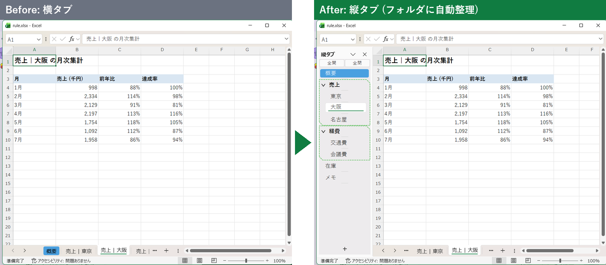

- 縦タブでフォルダを作る、シートを出し入れする、名前を変える、といった操作は、横タブのシート名にも、自動で反映されます
- 横タブで「売上 | 福岡」というシートを作ると、「売上」フォルダの並びに、自動で移動します
- 設定画面の「シート名のルールを使う」で、ブックごとに、有効にします (初期値は、使わない)

### 1.7 シート見出しの色も、Excelと同じ

右クリック > 「**シート見出しの色**」は、Excelの横タブと同じパレットです。グループ選択して色を付ければ、まとめて変わります。「その他の色」は、Excelの「色の設定」画面が開きます。

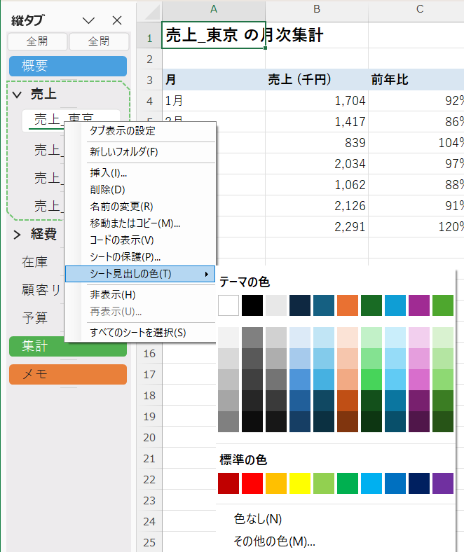

### 1.8 シートが、ぷるっと動く (アニメーション)

縦タブの1行をクリックしたとき、**その行が、ぷるっと動いて「ここだよ」と答えてくれたら**、シートを切り替えるのが、少し楽しくなりませんか。

このアドインには、そんな**遊び心のアニメーション**があります。シートを選ぶたび、フォルダを開け閉めするたびに、その行が、小さく揺れて、すっと元の位置に収まります。揺れは、時間とともに小さくなるので、うるさくありません。

#### 6つの動きと、ランダム

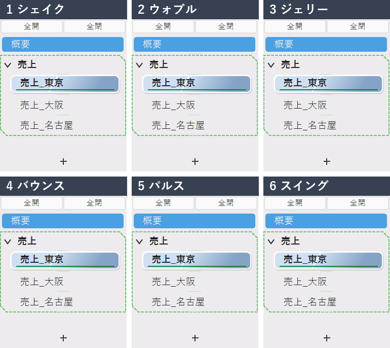

| 動き | どう動くか |
|---|---|
| **1 シェイク** | 左右に、ぶるっと揺れる |
| **2 ウォブル** | 中心を軸に、くるっと回って揺れる |
| **3 ジェリー** | ゼリーのように、縦横に伸び縮みする |
| **4 バウンス** | ぽんっと、跳ねる |
| **5 パルス** | ふくらんで、戻る。鼓動のよう |
| **6 スイング** | 左上を支点に、振り子のように揺れる |
| **7 ランダム** | シートを選ぶたびに、1から6のどれかが出る。次は何が出るか、お楽しみ |

#### 実際のExcelでは、こう動く

次の動画は、実際のExcelで、縦タブのシートを、次々にクリックしたところです (動きは「ランダム」、見た目は「クリスタル」)。クリックするたびに、選んだ行が、違う動きで、ぷるっと答えます。

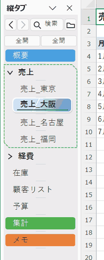

#### フォルダも、いっしょに揺れる

フォルダを**開いた**ときは、フォルダと、**中のシートが、一斉に**揺れます。**閉じた**ときは、フォルダが、ぷるっと揺れて、しまわれます。縦タブの上端の「**全開**」「**全閉**」を押すと、すべてのフォルダが、いっせいに揺れます。

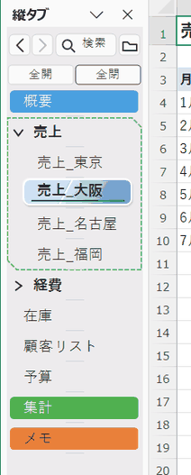

> 開いたときに揺れるのは、縦タブの表示範囲に見えているシートだけです。スクロールで隠れているシートは、揺れません。

#### 自分好みに、整える

動き、**揺れの大きさ** (40から200%)、**揺れの長さ** (0.3から1.2秒) は、「タブ表示の設定」で選べます。サンプルのシートが、選んだ動きを、繰り返し見せてくれるので、見ながら決められます。「揺れのリセット」で、初期値 (100%、0.6秒) に戻ります。

- 初期値は、**なし** (揺れません)。使いたいブックで、動きを選んでください。設定は、ブックごとに、ブックと一緒に保存されます
- 「サンプルの見た目を、選択したデザインとマーカー表示に合わせる」にチェックを入れると、サンプルが、いま選んでいる選択デザインとマーカーで動きます。実際の縦タブの見た目で、動きを確かめられます
- 動きを「なし」にすれば、いつでも、静かな縦タブに戻せます

### 1.9 使い方のまとめ

| やりたいこと | 操作 |
|---|---|
| 縦タブを出す | リボン「表示」 > 「縦タブ」 > 「タブ表示の設定」 > 表示モードを選ぶ > OK |
| シートを切り替える | 縦タブのシート名をクリック (↑ / ↓ キーでも可) |
| シートを追加する | 縦タブの下端の「+」 (アクティブなシートの次に入る) |
| シート名を変える | シート名をダブルクリック、または F2 |
| シートを並べ替える | ドラッグ (挿入位置に三角形が出る)。Ctrl+ドラッグでコピー |
| 複数のシートを選ぶ | Ctrl+クリック、Shift+クリック |
| シートをフォルダに入れる | 選んで、右クリック > 「新しいフォルダ」。または、既存のフォルダへドラッグ |
| フォルダを開閉する | 行の先頭の `>` / `∨` |
| 全フォルダを開閉する | 縦タブの上端の「全開」「全閉」ボタン (フォルダが1つ以上あるとき)、または、フォルダの右クリック > 「全てのフォルダを閉じる / 開く」 |
| 見た目を変える | 「タブ表示の設定」の「選択デザイン」「マーカー」 |
| 横タブに戻す | 縦タブの「×」、または、表示モードを「横タブのみ」に |

詳しい操作は、[4章](#4-基本の使い方)から[8章](#8-設定画面)にあります。

## 2. できること (機能一覧)

| 分類 | 機能 |
|---|---|
| 縦タブの表示 | シートを縦に並べて表示 / 左右どちらにも配置 / ペインの幅をドラッグで変更 (保存される) / シートが多いときは縦スクロール / 長い名前は「…」で省略、ポインターを乗せると全体を表示 |
| 表示モード | 横タブのみ / 縦タブのみ / 両方 (ブックごとに選択) |
| 見た目 | Excelの横タブと同じ色、形、シート見出しの色。選択中のフォルダとシートの見た目は、設定画面で、「標準」(Excelの横タブと同じ。白い塗りと薄い枠、アクティブなシートに緑の下線)、「ダブルフレーム」、「グロッシーグラス」(上半分に反射の帯がある、光沢のあるガラスを重ねる)、「フロストグラス１」(縁が内側から光る磨りガラスを、行の上に重ねる)、「フロストグラス２」(行の色 (色なしの行は緑) を帯びた磨りガラスを重ねる)、「インセット」(押し込まれたように凹んで見える)、「ストライプ」(ななめの縞と枠)、「クリスタル」(斜めのカット面と、消えていく明るい色) から選べる (初期値は、標準)。ガラスの選択肢では、行の色や区切り線が、ガラス越しに透けて見える。ダブルフレームでは、選択中の行は、(色付きは、元の色のまま) 影が付き、暗い外枠と白い内枠の二重の枠で囲まれ、文字が太字になる。シートの内容が表示されている、アクティブなシートの印 (マーカー) は、設定画面の「アクティブシートのマーカー表示」で、下線マーカー (名前の下に線)、三角マーカー (左右の端に小さな三角)、両端バーマーカー (左右の端に太い帯)、チェックバッジマーカー (名前の左に丸いチェック)、マーカーなし から選べ (初期値は、下線マーカー)、どの選択デザインとも組み合わせて表示される (フォルダと、グループの、ほかのシートには付かない)。三角は、その行の色の反対色 (色相環で、最も色差が大きい色) で、白い縁取りとぼかしが付き、暗い背景や暗い色の行でも見える。マーカーの色が、行の色に近いときは、色差が大きくなるように、自動で調整される。Officeテーマ (カラフル、白、黒、ダークグレー) と画面の拡大率に対応 |
| シートの操作 | 切り替え / 追加 (+) / 挿入 / 削除 / 名前の変更 / 移動 / コピー / 非表示 / 再表示 / シートの保護 / コードの表示 / シート見出しの色 |
| 複数選択 | Ctrl+クリック、Shift+クリックで、グループ選択。グループのまま、移動、コピー、色の変更、非表示、削除 |
| フォルダ | シートを1段のフォルダに分類 / 開閉 / 名前、色 / ドラッグで移動、コピー / フォルダごとの一括操作 / 縦タブの上端の「全開」「全閉」ボタン (フォルダが1つ以上あるとき)。並びは、横タブにも反映 |
| シート名のルール | 横タブのシート名「A &#124; B」を、縦タブでは、フォルダ A の中のシート B として表示 (使う/使わないを選択) |
| アニメーション | シートを選んだとき、フォルダを開閉したときに、その行が揺れる。6種類の動きとランダム、揺れの大きさ、長さ (ブックごとに選択。初期値は、なし) |
| 設定画面 | 表示モード、縦タブの位置、アクティブシートのマーカー表示、フォルダ＆シート選択のデザイン、アニメーション、フォルダを囲む点線 (表示/非表示、色の濃さ)、シート名のルール |
| 設定の保存 | ブックごとに保存して、次に開いたときに復元。ブックごとに独立 |

横タブのシートの右クリックメニューにも、先頭に「タブ表示の設定」が加わります。

## 3. インストール

配布用zipの場合の手順です (同じ内容が、zip内の `はじめにお読みください.txt` にもあります)。

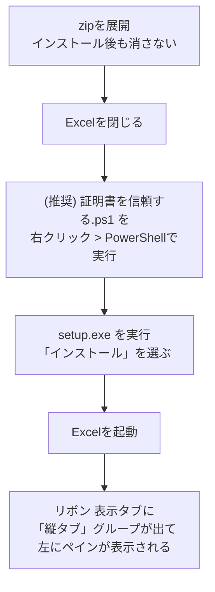

1. zip を、任意の場所に展開します。**展開したフォルダは、インストール後も消さないでください** (アドインの登録が、このフォルダの `VerticalSheetTabs.vsto` を指します)
2. Excel を閉じます
3. (推奨) 「証明書を信頼する.ps1」を右クリックして「PowerShell で実行」します。アドインの署名の証明書 (公開部分のみ) を、現在のユーザーの信頼済みの証明書として登録します。登録しないと、手順4で、「発行元を確認できません」という警告が出ます
   - PowerShell の実行がブロックされるときは、次を実行します: `powershell -ExecutionPolicy Bypass -File ".\証明書を信頼する.ps1"`
4. `setup.exe` を実行し、確認画面で「インストール」を選びます
5. Excel を起動します

新しい版に更新するときは、新しい zip の `setup.exe` を、もう一度実行します (上書きされます。自動更新はしません)。

## 4. 基本の使い方

### 4.1 はじめて開いたとき

- **横タブだけ**が表示されます (表示モード「横タブのみ」)。縦タブは、表示されません
- 縦タブを使うときは、リボンの「表示」タブの「タブ表示の設定」(または、横タブの右クリックメニューの先頭の「タブ表示の設定」) で、表示モードを「縦タブのみ」か「両方」にします。縦タブは、左に表示されます
- 縦タブの幅は、初めて表示したとき、半角12文字分です。ペインの端をドラッグすると、幅を変えられます

### 4.2 表示モードと位置を変える

リボンの「表示」タブ > 「縦タブ」グループ > **タブ表示の設定** を押します (横タブ、縦タブを右クリックしたメニューの先頭の「タブ表示の設定」でも開きます)。

| 表示モード | 横タブ | 縦タブ |
|---|---|---|
| 横タブのみ表示 | 表示 | 非表示 |
| 縦タブのみ表示 | 非表示 | 表示 |
| 横タブと縦タブの両方を表示 | 表示 | 表示 |

縦タブの位置は、左または右を選べます。

> 縦タブの上の「×」(閉じるボタン) を押すと、「横タブのみ」に戻ります。縦タブを出し直すときは、設定画面でモードを選びます。

### 4.3 保存について

設定 (表示モード、位置、幅など) は、**ブックを保存したときに**、そのブックへ書き込まれます。保存せずに閉じると、変更は残りません。フォルダの開閉、色、名前の変更も同じです (変更すると、ブックは「変更あり」になります)。

## 5. シートの操作

縦タブの操作は、Excelの横タブと同じです。

### 5.1 マウス操作

| 操作 | 動作 |
|---|---|
| クリック | そのシートに切り替える |
| Ctrl+クリック | シートを、グループ選択に追加 / 解除する |
| Shift+クリック | アクティブなシートから、クリックしたシートまでを選択する |
| ダブルクリック | シート名を、その場で編集する (Enterで確定、Escで取り消し) |
| ドラッグ | シートを移動する。持ち上げた行が、半透明の「ゴースト」になってポインターについてきて、元の位置には、薄い行が残る。挿入位置には三角形が出る。離すと、ゴーストが挿入位置にすっと収まる。選択中のシートは、まとめて動く (ゴーストに個数が付く)。1枚のシートを移動して離すと、そのシートがアクティブになる。アニメーションの設定があれば、移動したシートは、すべて、落ちた位置で揺れる |
| Ctrl+ドラッグ | シートをコピーする (ゴーストに「+」が付き、元の位置は、そのまま) |
| 右クリック | メニューを開く (下の表) |
| ホイール | シートが多いとき、スクロールする |
| 下端の「+」 | 新しいシートを、アクティブなシートの次に追加する (アクティブなシートがフォルダの中なら、そのフォルダの中に入る。選択しているシートが、すべて閉じたフォルダの中にあるときは、いちばん下に追加する) |

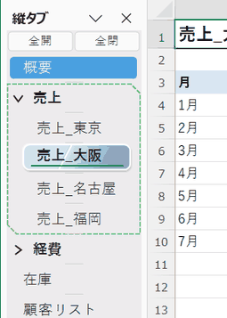

### 5.2 キー操作

| キー | 動作 |
|---|---|
| ↑ / ↓ | 前 / 次のシートに切り替える |
| F2 | シート名 (フォルダが1つだけ選択されているときは、フォルダ名) を編集する |
| Delete | シートを削除する。フォルダを選択しているときは、フォルダと中のシートを削除する (確認あり) |
| Ctrl+S / F12 | 上書き保存 / 名前を付けて保存 (縦タブにフォーカスがあるときも使えます) |

### 5.3 シートの右クリックメニュー

| 項目 | 内容 |
|---|---|
| タブ表示の設定 | 設定画面を開く |
| 新しいフォルダ | 選択中のシートを入れた、新しいフォルダを作る ([6章](#6-フォルダ)) |
| 挿入 | アクティブなシートの前に、新しいシートを入れる。フォルダの中のシートで選ぶと、そのフォルダの中に入る |
| 削除 | シートを削除する (Excel標準の確認) |
| 名前の変更 | シート名を編集する |
| 移動またはコピー | Excel標準のダイアログを開く |
| コードの表示 | VBAエディターを開く |
| シートの保護 | シートを保護する (保護中は「シート保護の解除」) |
| シート見出しの色 | Excelと同じパレットで、シートの色を付ける。「その他の色」は、Excelの横タブと同じ「色の設定」画面 (標準の色の六角形と、ユーザー設定) が開く |
| 非表示 / 再表示 | シートを隠す / 隠したシートを出す |
| すべてのシートを選択 | 全シートをグループ選択する |
| シートのグループ解除 | グループ選択を解除する (グループ選択中だけ) |

- 非表示のシートは、縦タブにも表示されません (ワークシート、グラフシートは表示されます)
- グループ選択中は、色の変更、非表示、削除などが、選択中のすべてのシートに適用されます (Excelと同じ)
- ブックの構造が保護されているときは、挿入、削除、名前の変更、移動、コピー、非表示、再表示、「+」は使えません

### 5.4 セルの入力中に、シートを切り替えたとき

セルに入力している途中で、縦タブのシートをクリックすると、横タブのときと同じく、そこまでの入力が確定されてから、シートが切り替わります。

## 6. フォルダ

シートを**フォルダ**にまとめて、縦タブを見やすくします。フォルダは1段だけです (フォルダの中に、フォルダは作れません)。

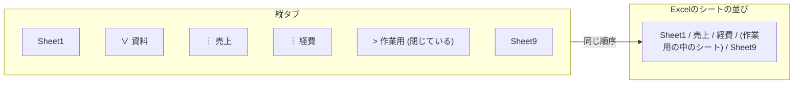

**フォルダの中のシートは、Excelのシートの並びの中でも連続して並びます**。縦タブでフォルダを動かすと、横タブの並びも変わります。

### 6.1 フォルダを作る

1. 縦タブで、フォルダに入れたいシートを選びます (複数も可)
2. 右クリック > **新しいフォルダ**
3. 名前を入力して Enter (「フォルダ1」などの仮の名前が付いています)

### 6.2 フォルダの操作

| 操作 | 動作 |
|---|---|
| 行の先頭の `>` / `∨` をクリック | 開く / 閉じる (閉じると、中のシートは縦タブから隠れます。横タブは変わりません) |
| フォルダの行をクリック | フォルダを選択 / 選択解除する (中のシートの選択は変わりません) |
| ダブルクリック、F2 | フォルダ名を編集する |
| ドラッグ | フォルダを、中のシートごと移動する。Ctrl+ドラッグで、コピーする (名前は「フォルダ名 (2)」) |
| シートをフォルダの上にドラッグ | フォルダの中に入れる (フォルダを開いてから、中のシートの間に落とします) |
| シートをフォルダの外にドラッグ | フォルダから出す。フォルダの最後のシートの下に落としても、出せます |
| Delete | 選択中のフォルダと、中のシートを削除する (確認あり) |

### 6.3 フォルダの右クリックメニュー

| 項目 | 内容 |
|---|---|
| タブ表示の設定 | 設定画面を開く |
| フォルダ名の変更 | 名前を編集する |
| フォルダ内のシートをすべて非選択 | フォルダ内のシートを、選択から外す |
| フォルダ内のシートをすべて選択 | フォルダ内のシートを、グループ選択する (そのあと、シートの右クリックメニューの「シートの保護」、「移動またはコピー」で、まとめて操作できます) |
| フォルダ内のシートをすべて非表示 / 再表示 | まとめて隠す / 出す |
| フォルダの色 | フォルダの行の色を付ける。中のシートの色は変わらない (「中の全てを常にフォルダと同一色に設定」がONのフォルダでは、中のシートにも、同じ色が付く)。「その他の色」は、Excelの「色の設定」画面が開く |
| 中の全てを常にフォルダと同一色に設定 | 選ぶたびに、ON / OFF が切り替わる。ONにすると、そのときに中のすべてのシートへ、フォルダの色を付ける。ONのフォルダは、行の右端にチェックマークが付き、**そのあとも、フォルダの色を変えると中のシートの色も変わり、新しく入ったシートにも、自動で、フォルダの色が付く**。OFFに戻しても、シートの色は元に戻らない |
| フォルダの削除 | フォルダだけ削除する (中のシートは、フォルダの外に残ります) |
| フォルダと中のシートを削除 | フォルダと、中のシートを削除する (確認あり) |
| 全てのフォルダを閉じる / 全てのフォルダを開く | 縦タブにある**すべてのフォルダ**を、まとめて閉じる / 開く (選択しているフォルダに関係なく、すべてが対象) |

### 6.4 開いたフォルダの点線

開いたフォルダは、中のシートと一緒に、点線で囲まれます (右上と左下の角が欠けた形です)。点線の表示 / 非表示と、色の濃さは、設定画面で変えられます。

### 6.5 「全開」「全閉」ボタン

フォルダが**1つ以上**あるとき、縦タブの上端 (ペインのタイトルバーの下) に、「全開」「全閉」の2つのボタンが出ます。「全開」を押すと、すべてのフォルダが開き、「全閉」を押すと、すべてのフォルダが閉じます (フォルダの右クリックメニューの「全てのフォルダを開く / 閉じる」と同じです)。フォルダがすべて無くなると、ボタンは消えます。シートが多くてスクロールするときも、ボタンは上に残り、シートの行だけが動きます。

## 7. シート名のルール

横タブしか使わない人や、他の人とブックを共有する人でも、**シート名だけでフォルダの構成を共有できる**機能です。設定画面で「シート名のルールを使う」にチェックしたブックだけで、有効になります (初期値は、使わない)。

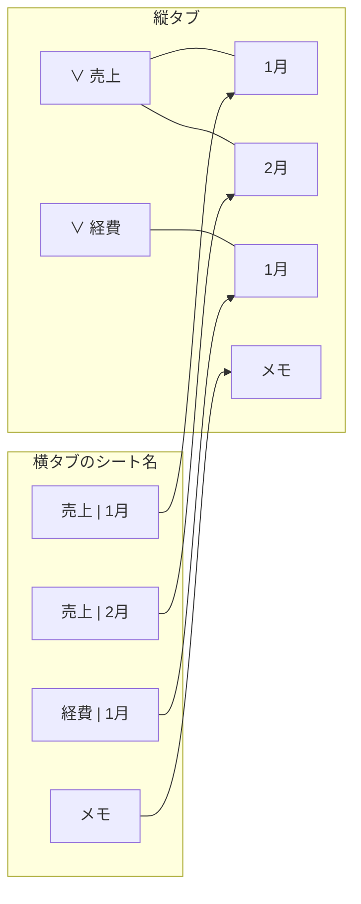

### 7.1 ルール

- 区切りは、**半角スペース、縦棒、半角スペース (` | `)** です。シート名「A | B」は、縦タブでは、フォルダ「A」の中の、シート「B」になります
- 区切りの前後のどちらかが空のとき (例: 「A | 」) は、ルールの対象外です。区切りが2つ以上あるときは、最初の区切りで分けます
- 横タブで、シート名を「A | D」に変えると、そのシートは、左側にある「A | 」で始まるシートのうち、最も近いものの右側に、自動で移動します
- 縦タブでの操作は、横タブのシート名に反映されます

| 縦タブの操作 | 横タブのシート名 |
|---|---|
| フォルダ「N」を、シート「M」から作る | 「N &#124; M」 |
| シートをフォルダに入れる / 出す | 「フォルダ名 &#124; シート名」 / 「シート名」 |
| フォルダ名を変える | 中のシートすべてが、「新しい名前 &#124; シート名」 |
| シート名を変える | 「フォルダ名 &#124; 新しい名前」 |
| フォルダだけを削除する | 中のシートは、「シート名」だけに戻る |
| フォルダの中で「+」「挿入」 | 「フォルダ名 &#124; Sheet4」など |

### 7.2 制限

- フォルダ名とシート名の長さの合計は、**28文字まで**です (Excelのシート名の上限31文字から、区切りの3文字を除いた長さ)。入力ボックスは、この長さまでしか入力できません
- フォルダ名、シート名に、` | ` を含む名前は付けられません (警告が出て、入力が中断されます)
- 長さの超過や、名前の重複で、操作に必要な名前を付けられないときは、メッセージを出して、何も変えません

### 7.3 使い始めるとき、やめるとき

- 「使わない」から「使う」に切り替えると、すでにあるフォルダの中のシートに、「フォルダ名 | シート名」の名前が付きます。名前を付けられないシートがあるとき (長さ、重複) は、メッセージを出して、ルールは使わない状態のままです
- 「使う」から「使わない」に戻しても、シート名はそのままです

## 8. 設定画面

リボンの「表示」タブ > 「縦タブ」 > **タブ表示の設定**、または、右クリックメニューの先頭の「タブ表示の設定」で開きます。変更は、**開いているブックにだけ**適用されます。

| グループ | 項目 | 内容 |
|---|---|---|
| 表示モード | 横タブのみ / 縦タブのみ / 両方 | 横タブ、縦タブの表示を選ぶ |
| 縦タブの位置 | 左 / 右 | 縦タブのペインを置く側 (「横タブのみ」のときは選べません) |
| アクティブシートのマーカー表示 | 下線マーカー / 三角マーカー / 両端バーマーカー / チェックバッジマーカー (名前の左に丸いチェック) / マーカーなし (横に並ぶ) | アクティブなシートの印。選んだマーカーは、下の選択デザインのサンプルにも、すぐ反映される。初期値は、下線マーカー |
| フォルダ＆シート選択のデザイン | 標準 / ダブルフレーム / グロッシーグラス / ストライプ / フロストグラス１ / フロストグラス２ / インセット / クリスタル | 選択中のフォルダとシートの見た目。8つの選択肢が、横4 x 縦2 に並ぶ。左端に、非選択のサンプルが1つ (2段の中央)、各選択肢には、選択 (色なしのシート) と選択 (色付きのシート) のサンプルが出る (サンプルをクリックしても選べる)。初期値は、標準 |
| 開閉したフォルダ＆選択したシートのアニメーション | なし / 1 シェイク / 2 ウォブル / 3 ジェリー / 4 バウンス / 5 パルス / 6 スイング / 7 ランダム (横に並ぶ) | シートを選んだとき、そのシートが、フォルダを開閉したとき、そのフォルダが揺れる (フォルダを開いたときは、中の見えているシートも一斉に揺れる)。7 ランダムは、そのたびに、1から6のどれかを選ぶ。初期値は、なし |
| | 揺れの大きさ (40から200%)、揺れの長さ (0.3から1.2秒) のスライダー | 初期値は、100%、0.6秒。右の「揺れのリセット」ボタンで、初期値に戻る (「なし」のときは、スライダーとボタンは使えません) |
| | サンプル | 左端に、揺れるシートが1つ。選んだ動きを、繰り返し見せる (ランダムのときは、毎回、違う動き) |
| | サンプルの見た目を、選択したデザインとマーカー表示に合わせる | チェックを入れると、サンプルが、いま選んでいる選択デザインとマーカー表示で描かれる (入れないときは、標準と下線マーカー)。この状態は、保存されません |
| フォルダを囲む点線 | 点線を表示する | 開いたフォルダの点線の ON / OFF |
| | 色 (1から9) | 点線の色。右にいくほど、縦タブの背景から離れた、はっきりした色 |
| シート名のルール | 使う | [7章](#7-シート名のルール)。「フォルダを囲む点線」の右に、並んでいます |

画面の左下に、バージョン、著作権、ライセンスが表示されます。

## 9. 設定の保存と、他の環境での扱い

### 9.1 保存される場所

設定は、ブックの中に保存されます。ブックを他の人に渡すと、設定ごと渡ります。

| 内容 | 保存先 |
|---|---|
| 表示モード、位置、幅、点線、シート名のルール | ブックの「カスタムドキュメントプロパティ」 (`VTab.Mode`、`VTab.Side`、`VTab.Width`、`VTab.Outline`、`VTab.OutlineLevel`、`VTab.NameRule`、`VTab.SelectStyle`、`VTab.ActiveMarker`、`VTab.Wobble`、`VTab.WobbleAmp`、`VTab.WobbleDur`) |
| フォルダの構成 (名前、色、開閉、中のシート) | ブックの「カスタムXMLパート」 |
| フォルダ内のシートの識別 | 各ワークシートの隠しカスタムプロパティ `VTab.Id` |

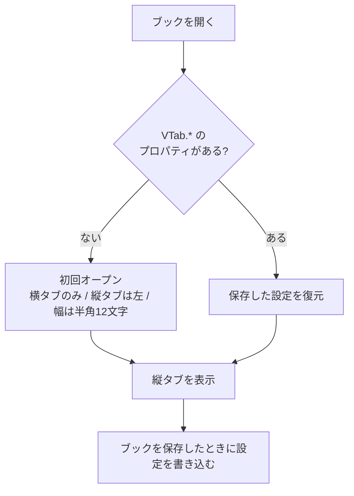

### 9.2 このアドインがない Excel で開いたとき

- ブックの内容 (シート、セル) には、影響ありません。設定は無視されます
- フォルダの構成も無視されますが、**シートの並びは、フォルダの順のまま**です
- 「縦タブのみ」で保存したブックは、横タブが表示されません (10章)。「ファイル > オプション > 詳細設定 > このブックで作業するための表示設定 > シート見出しを表示する」にチェックを入れると、元に戻ります

## 10. 既知の制約

| 項目 | 内容 |
|---|---|
| タブの外見 | 縦に積むため、タブの幅は、ペインの幅いっぱい、文字は左寄せ、区切り線は横向きです。文字の描画は、Excelの横タブより、わずかに細く見えます |
| ペインの枠 | ペインの上に、タイトルバー (「縦タブ」、メニュー、閉じるボタン) が付きます。Excelの仕様で、消せません |
| 「縦のみ」で保存したブック | アドインがない Excel では、横タブが表示されません (9.2) |
| Office のテーマの切り替え | Excelを起動し直すと、縦タブに反映されます (実行中の切り替えには、追従しません) |
| 暗い配色、100% 以外の拡大率 | 配色の値は実機から測っていますが、暗い配色 (ダークグレー、黒) の縦タブの表示と、125% 以外の拡大率は、実機で確認していません |
| 閉じたフォルダ | 閉じたフォルダの中へは、ドラッグで入れられません (開いてから落とします) |
| グラフシートとフォルダ | グラフシートは、名前でフォルダに結びつけています。Excel側で名前を変えると、フォルダから外れます |
| 横タブからの「挿入」 | Excel標準の横タブの右クリックからの「挿入」では、シート名のルールを使っていても、フォルダの中には入りません (縦タブの「挿入」を使ってください) |
| 縦タブにフォーカスがあるとき | Ctrl+S、F12 は使えますが、Ctrl+Z、Ctrl+P など、他のExcelのショートカットは、使えません。シートのセルをクリックしてから使ってください |
| 多数のシート | 1000枚のブックでも動作します (縦タブの更新の処理は、1回あたり約30ミリ秒です)。フォルダのあるブックは、シート名の並びが変わるたびに、全シートの識別を読み直しますが、1000枚でも、約20ミリ秒です |
| 配布 | 自己署名の証明書です。他のPCにインストールするときは、証明書を信頼する必要があります (3章) |

不具合や要望は、状況 (ブックを開いた方法、拡大率、Excelのバージョン、操作の順序) を添えて、連絡してください。

## 11. アンインストール

- Windows の「設定 > アプリ > インストールされているアプリ」から、「VerticalSheetTabs」を削除します
- 証明書を登録した場合は、「certmgr.msc」の「信頼された発行元」と「信頼されたルート証明機関」から、「VerticalSheetTabs」を削除できます
- ブックに保存された設定 (`VTab.*`、フォルダの構成) は、残ります。ブックのデータには影響しません

## 12. 動作環境、ライセンス

### 動作環境

- Windows、Microsoft 365 の Excel (64bit で確認)
- .NET Framework 4.8 (Windows 11 には標準で入っています)、Visual Studio 2010 Tools for Office Runtime (インストーラが導入します)

### ライセンス

このソフトウェアは、BSD 3条項ライセンスに準拠します。Copyright (c) 2026 nk_taka。

- 条文は、[license](license) フォルダにあります: [LICENSE.txt](license/LICENSE.txt) (英文。正本)、[LICENSE.ja.txt](license/LICENSE.ja.txt) (日本語訳。参考)
- 「タブ表示の設定」の画面の左下にも、バージョン、著作権、ライセンスを表示しています
