# 縦並びシートタブ (VerticalSheetTabs)

**シートが100枚あっても、迷わない。** Excelのシートタブを、画面の横に**縦一覧**で並べる、Excel (Windows版、Microsoft 365) 用の無料のアドインです。

> 左が標準のExcel。横タブは `概要 | 売上_東京 | 売上_大阪 …` と、3枚ぶんしか見えません。
> 右がアドインを入れたExcel。12枚のシートが一目で見渡せ、「売上」「経費」のフォルダで整理され、シート見出しの色も、そのまま見えます。

## こんな困りごとはありませんか

- 横タブの矢印を何度も押して、目的のシートを探している
- 月次、拠点別、帳票ごとにシートが増え、どれが何のシートか分からなくなる
- シートの名前を覚えていても、横タブの中で見つけられない
- 「完了したシート」と「作業中のシート」を、見た目で区別したい

横タブは、シートが数枚のときのための作りです。本アドインは、**シートが20枚を超えるブック**を扱う方 (経理、営業の集計、設計書、帳票の束など) に、特に向いています。

## 30秒で分かること

1. **一覧できる** … シート名が縦にずらりと並ぶ。横スクロールは要りません。
2. **すぐ探せる** … 縦タブの上端の検索ボックスに文字を打つと、シート名やフォルダ名を絞り込みます。見たシートは、**戻る・進む**でたどれます。
3. **フォルダで整理できる** … シートをフォルダにまとめ、「全開」「全閉」でまとめて開閉します。
4. **いつもの操作のまま** … クリック、ドラッグ、Ctrl+ドラッグでコピー、右クリックメニュー、シート見出しの色まで、横タブと同じです。覚え直しは要りません。

## v1.3.2 での変更点

- 設定画面を開くとき、PCの設定ファイルを読み直します。ほかのExcelで変えた設定が、古い値で上書きされることがなくなりました。
- 2つのExcelが同時に設定を書き込んでも、一時ファイルがぶつからないようにしました。
- 非表示のウィンドウには、縦タブを作りません (表示されたときに作ります)。
- ブックの中のXML (フォルダ、履歴、テーマ) を読むときの安全性を高めました。
- セルの入力中にシートを選んだときのキー送信を、より安全な方法に変えました。

## v1.3.1 での変更点

- 数式エラーのバッジを出すとき、エラーのセルが多数散らばったシートで、Excel が長く止まることがあったのを直しました。使用範囲が200万セルを超えるシートでは、数式エラーのバッジを出しません。
- バッジを使わないときは、セルの変更や再計算で、アドインが Excel に触れないようにしました (マクロの動作への影響を減らしました)。
- セルの入力が長く続いたときなどに、未保存のフォルダの操作や、縦タブの「×」の状態が消えることがあったのを直しました。
- フォルダの情報が壊れていたときに、保存で消えないようにしました。

## v1.3.0 での変更点

- **設定は、PCごとになりました。** 表示モード、縦タブの位置、見た目、アニメーション、バッジの設定は、このPCのすべてのブックに共通です (ブックには、保存しません)。ブックに残るのは、縦タブの幅、シート名のルール、フォルダの構成などです。
- **「縦タブのみ」は、なくなりました。** アドインは、横タブの表示を変えません。表示モードは、「横タブのみ」と「横タブと縦タブの両方」の2つで、初期値は**両方**です。横タブを隠したブックでは、縦タブも出ません。
- **見た目の設定は、初期値に戻ります。** 古い版でブックに書いた設定は、引き継ぎません。設定画面で、選び直してください。「縦タブのみ」で保存したブックは、開くと、横タブが戻ります。
- 縦タブの「×」は、そのウィンドウだけ、縦タブを消します (PCの設定は、変わりません)。

## 安心して試せます

- **ブックを汚しません。** 開いただけでは、ブックを「変更あり」にしません。横タブの表示も、変えません。
- **いつでも元に戻せます。** 縦タブの「×」を押すか、表示モードを「横タブのみ」に戻すか、アプリを削除するだけです ([アンインストール](#12-アンインストール))。
- **無料で、ソースも公開しています。** BSD 3条項ライセンスです。
- **対象は、Windows版のExcel (Microsoft 365) です。** Mac版は、対応していません。会社のPCでは、アドインのインストールに、情報システム部門の許可が必要な場合があります。

## 試すには

zip を展開して、`setup.exe` を実行し、Excelを起動するだけです (数分で終わります)。リボンの「表示」タブに「縦タブ」グループが出たら、開いたブックの左側に、縦タブが並びます (見た目などは、「タブ表示の設定」で変えられます)。詳しい手順は、[3. インストール](#3-インストール)にあります。

## ほかにもできること

- **状態が見える** … 行の右端の**バッジ**で、数式エラー、メモ、保護を。**進捗の印** (未着手・作業中・完了) で、シートごとの作業の進み具合を ([詳しく](#19-探すたどる状態を見る-検索履歴バッジ進捗))
- **選べる見た目** … 8つの選択デザインと、5つのアクティブシートの印。ガラスのような透け感の選択表示も
- **ぷるっと動く** … 選んだシートや、開閉したフォルダが、揺れるアニメーションも (初期値は、なし。[動く様子を見る](#18-シートがぷるっと動く-アニメーション))
- **設定は、PCごと** … 見た目や表示モードの設定は、このPCのすべてのブックに共通です (シート名のルールだけは、ブックごと)

現在の仕様と実装の説明は、ソースのリポジトリの `Agents.md` に、ビルドやインストーラの作成 (開発者向け) は、`DEVELOPMENT.md` にまとめています。

## 目次

1. [使うとこう変わる (画面で見る Before / After)](#1-使うとこう変わる-画面で見る-before--after)
2. [できること (機能一覧)](#2-できること-機能一覧)
3. [インストール](#3-インストール)
4. [基本の使い方](#4-基本の使い方)
5. [シートの操作](#5-シートの操作)
6. [フォルダ](#6-フォルダ)
7. [シート名のルール](#7-シート名のルール)
8. [設定画面](#8-設定画面)
9. [設定の保存と、他の環境での扱い](#9-設定の保存と他の環境での扱い)
10. [既知の制約](#10-既知の制約)
11. [困ったときは](#11-困ったときは)
12. [アンインストール](#12-アンインストール)
13. [動作環境、ライセンス](#13-動作環境ライセンス)

## 1. 使うとこう変わる (画面で見る Before / After)

### 1.1 リボンに「タブ表示の設定」ボタンが加わる

インストールすると、Excelのリボン「**表示**」タブに、**「縦タブ」グループ**と**「タブ表示の設定」ボタン**が加わります。ここが、すべての入口です。

> 横タブ (標準のシートタブ) を右クリックしたメニューの先頭にも、「タブ表示の設定」が加わります。

### 1.2 「タブ表示の設定」で、何が決められるか

ボタンを押すと、設定画面が開きます。設定は、**基本 / デザイン / アニメーション / バッジ / このブック** の5つのタブに分かれています (開くと、いつも「基本」のタブが出ます)。最初の4つのタブは、**このPCのすべてのブックに共通**で、OKを押したときに、PCに保存されます。「このブック」のタブだけが、開いているブックに保存されます。

| タブ | 設定 | 決められること |
|---|---|---|
| 基本 | **表示モード** | 横タブのみ / 横タブと縦タブの両方 ([1.3](#13-表示モードで画面がこう変わる)) |
| 基本 | **縦タブの位置** | 画面の左 / 右 |
| このブック | **シート名のルール** | 「フォルダ名 \| シート名」の名前で、フォルダを自動で作る。このタブだけ、ブックごと ([1.6](#16-シート名だけでフォルダを共有する-シート名のルール)) |
| デザイン | **アクティブシートのマーカー表示** | 今開いているシートの印。下線 / 三角 / 両端バー / チェックバッジ / なし ([1.5](#15-選択中のフォルダとシートの見た目を選ぶ)) |
| デザイン | **フォルダ＆シート選択のデザイン** | 選択中のフォルダとシートの見た目を、8種類から。**サンプルが、その場で見える** ([1.5](#15-選択中のフォルダとシートの見た目を選ぶ)) |
| デザイン | **フォルダを囲む点線** | 開いたフォルダを囲む点線の、表示 / 非表示と、色の濃さ (9段階) |
| アニメーション | **開閉したフォルダ＆選択したシートのアニメーション** | シートを選ぶと、そのシートが揺れる。フォルダを開閉したり、選択 / 解除したりすると、そのフォルダも同じように揺れる (開いたときは、中のシートも一斉に揺れる)。6種類の動き (シェイク / ウォブル / ジェリー / バウンス / パルス / スイング) とランダム、揺れの大きさと長さ、効果音を選べる (初期値は、なし。[1.8](#18-シートがぷるっと動く-アニメーション)、[8章](#8-設定画面)) |
| アニメーション | **追加・削除・完了のアニメーション** | フォルダ・シートの追加、削除の動きと、進捗を「完了」にしたときの、印のはじける動きの、オン / オフ ([1.9](#19-探すたどる状態を見る-検索履歴バッジ進捗)) |
| バッジ | **表示するバッジ** | 行の右端に出す印。数式エラー / メモ・コメント / シートの保護 / 進捗 ([1.9](#19-探すたどる状態を見る-検索履歴バッジ進捗)) |

### 1.3 表示モードで画面がこう変わる

表示モードは、このPCで1つです。初期値は**両方**で、横タブも、縦タブも使えます。横タブは、いつもの Excel のままで、アドインは、横タブの表示を変えません。

| 表示モード | 画面の変化 |
|---|---|
| **両方** (初期値) | 横タブも、縦タブも使えます |
| **横タブのみ** | 標準のExcelのまま。縦タブは出ません。縦タブの「×」を押すと、そのウィンドウだけ、この状態になります |
| **縦タブを右側に** | 縦タブの位置を「右」にすると、右端にペインが移ります |

横タブを隠しているブック (「ファイル > オプション > 詳細設定 > シート見出しを表示する」をオフにしたブック) では、縦タブは出ません。横タブを表示すると、縦タブも出ます。

### 1.4 フォルダ: シートを、フォルダで片づける

シートが増えたら、フォルダにまとめましょう。シートの右クリックメニューの「**新しいフォルダ**」を選ぶだけです。

| シートの右クリックメニュー | フォルダの右クリックメニュー |
|---|---|
|  |  |

- フォルダの `>` / `∨` を押すと、**開閉**できます。閉じると、中のシートは縦タブから隠れます
- フォルダは**ドラッグで移動**できます。中のシートも、一緒に動きます。Ctrl+ドラッグで、フォルダごとコピーできます
- シートをフォルダの中へ、外へ、**ドラッグするだけ**で、出し入れできます
- フォルダにも**色**が付けられます。「フォルダと中のシートを同一色に設定」をONにすると、フォルダの色が、中のシートにも広がり、新しく入ったシートにも、自動で付きます。ONのフォルダには、行の右端に、**傾いたペンキ缶と青いしずく**の印が付きます ([1.9](#19-探すたどる状態を見る-検索履歴バッジ進捗)の画像にも写っています)。この印を**クリック**すると、「フォルダの色」のパレットが出て、**ダブルクリック**すると、「その他の色」の「色の設定」画面が出ます
- 「フォルダ内のシートをすべて選択」で、フォルダ内のシートを、グループ選択。そのまま、まとめて保護、移動、コピーができます
- フォルダの順序は、Excelのシートの並びにも反映されます (横タブでも、同じ順に並びます)
- フォルダが**1つでもある**と、縦タブの上端に「**全開**」「**全閉**」のボタンが出ます。押すと、すべてのフォルダが、まとめて開く / 閉じます。フォルダが無くなると、ボタンも消えます

### 1.5 選択中のフォルダとシートの見た目を選ぶ

選択中の行の見た目を、**8種類**から選べます (PC共通の設定。初期値は「標準」)。

| 選択デザイン | 特長 |
|---|---|
| **標準** | Excelの横タブと同じ見た目 (白い塗り。下線マーカーのときは、アクティブなシートに緑の下線) |
| **ダブルフレーム** | 暗い外枠と白い内枠の二重の枠と、影。くっきり目立つ |
| **グロッシーグラス** | 上半分に反射の帯がある、光沢のあるガラス |
| **フロストグラス1** | 縁が内側から光る、磨りガラス |
| **フロストグラス2** | 行の色を帯びた、磨りガラス |
| **インセット** | 押し込まれたように凹んで見える |
| **ストライプ** | ななめの縞と、緑の枠 (色付きの行は、その色の濃い枠。縞は、明るい色の行では暗い縞、暗い色の行では白い縞) |
| **クリスタル** | 斜めのカットで、明るい面と濃い面に分かれ、明るい色が右へ消えていく。柔らかい影つき |

さらに、**今、内容が表示されているシート (アクティブなシート)** の印も、5種類から選べます。どの選択デザインとも組み合わせられます。

> 三角や帯の色は、その行の色の**反対色**で、白い縁取りとぼかしが付くので、暗い背景でも、色付きの行でも、見失いません。マーカーの色が、その行の色に近くて見分けにくいときは、見分けやすい色に自動で調整されます。マーカーが付くのは、アクティブなシートだけです (フォルダと、グループ選択のほかのシートには付きません)。

設定画面の「デザイン」タブで、サンプルを見ながら選べます (サンプルをクリックしても選べます)。

### 1.6 シート名だけで、フォルダを共有する (シート名のルール)

「**フォルダ名 | シート名**」の形で、横タブにシート名を付けると、縦タブでは、**自動で、フォルダの中のシート**として表示されます。縦タブを使わない人と共有するブックでも、**シート名だけで、フォルダの構成が伝わります**。

- 縦タブでフォルダを作る、シートを出し入れする、名前を変える、といった操作は、横タブのシート名にも、自動で反映されます
- 横タブで「売上 | 福岡」というシートを作ると、「売上」フォルダの並びに、自動で移動します
- 設定画面の「このブック」タブの「シート名のルールを使う」で、ブックごとに、有効にします (初期値は、使わない)

### 1.7 シート見出しの色も、Excelと同じ

右クリック > 「**シート見出しの色**」は、Excelの横タブと同じパレットです。グループ選択して色を付ければ、まとめて変わります。「その他の色」は、Excelの「色の設定」画面が開きます (クリックした位置に出ます)。

### 1.8 シートが、ぷるっと動く (アニメーション)

縦タブの1行をクリックしたとき、**その行が、ぷるっと動いて「ここだよ」と答えてくれたら**、シートを切り替えるのが、少し楽しくなりませんか。

このアドインには、そんな**遊び心のアニメーション**があります。シートを選ぶたび、フォルダを開け閉めするたびに、その行が、小さく揺れて、すっと元の位置に収まります。揺れは、時間とともに小さくなるので、うるさくありません。

#### 6つの動きと、ランダム

| 動き | どう動くか |
|---|---|
| **1 シェイク** | 左右に、ぶるっと揺れる |
| **2 ウォブル** | 中心を軸に、くるっと回って揺れる |
| **3 ジェリー** | ゼリーのように、縦横に伸び縮みする |
| **4 バウンス** | ぽんっと、跳ねる |
| **5 パルス** | ふくらんで、戻る。鼓動のよう |
| **6 スイング** | 左上を支点に、振り子のように揺れる |
| **7 ランダム** | シートを選ぶたびに、1から6のどれかが出る。次は何が出るか、お楽しみ |

#### 実際のExcelでは、こう動く

次の動画は、実際のExcelで、縦タブのシートを、次々にクリックしたところです (動きは「ランダム」、見た目は「クリスタル」)。クリックするたびに、選んだ行が、違う動きで、ぷるっと答えます。

#### フォルダも、いっしょに揺れる

フォルダを**開いた**ときは、フォルダと、**中のシートが、一斉に**揺れます。**閉じた**ときは、フォルダが、ぷるっと揺れて、しまわれます。縦タブの上端の「**全開**」「**全閉**」を押すと、すべてのフォルダが、いっせいに揺れます。

> 開いたときに揺れるのは、縦タブの表示範囲に見えているシートだけです。スクロールで隠れているシートは、揺れません。

フォルダを**選んだとき**と、**選びを外したとき**も、そのフォルダが、ぷるっと揺れます。Ctrl+クリックなどで、複数のフォルダの選択を、一度に変えたときは、変わったフォルダが、いっせいに揺れます。

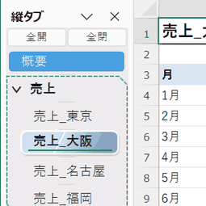

#### 自分好みに、整える

動き、**揺れの大きさ** (40から200%)、**揺れの長さ** (0.3から1.2秒) は、「タブ表示の設定」の「アニメーション」タブで選べます。サンプルのシートが、選んだ動きを、繰り返し見せてくれるので、見ながら決められます。「揺れのリセット」で、初期値 (100%、0.6秒) に戻ります。

#### 効果音もつけられる

動きに合った、短い効果音も、揺れに合わせて鳴らせます。シェイクは「カラカラ」、ウォブルは「ヨロヨロ」、ジェリーは「プルン」、バウンスは「ポヨン」、パルスは「ピ、コン」、スイングは「ビヨワーン」。ランダムのときは、選ばれた動きの音が鳴ります。音を使うかどうかと、音量は、「タブ表示の設定」で選びます。設定画面の「アニメーション」タブを開いている間は、サンプルが揺れるたびに (約2秒ごとに)、効果音も鳴るので、ゆっくり試し聞きができます。

- 音が鳴っている途中で、別のシートを選んだときは、前の音に、後の音が**重なって**鳴ります (同時に8つまで)。音の最後は、約0.2秒かけて、なめらかに消えます
- 効果音の初期値は、**鳴らさない** (オフ) です。職場などで、急に音が出ることはありません
- 音は、アドインに内蔵されています。別のファイルは、必要ありません

#### 自分好みに、整える (続き)

- 初期値は、**なし** (揺れません)。使いたいブックで、動きを選んでください。設定は、PC共通です
- 「サンプルの見た目を、選択したデザインとマーカー表示に合わせる」にチェックを入れると、サンプルが、いま選んでいる選択デザインとマーカーで動きます。実際の縦タブの見た目で、動きを確かめられます
- 動きを「なし」にすれば、いつでも、静かな縦タブに戻せます

### 1.9 探す、たどる、状態を見る (検索、履歴、バッジ、進捗)

シートが増えても、迷わないための機能です。どれも、縦タブの中で、完結します。

#### 検索ボックスと、戻る・進む

縦タブの上端に、**◀ (戻る)**、**▶ (進む)**、**検索ボックス**、**フォルダの切り替え** が並びます。入力するたびに、シート名が絞り込まれ、一致した文字が黄色に光ります。フォルダのアイコンを ON にすると、フォルダ名で絞り込みます。◀ を右クリック (または長押し) すると、**最近見たシート**の一覧が出て、選んだシートへ移動できます。

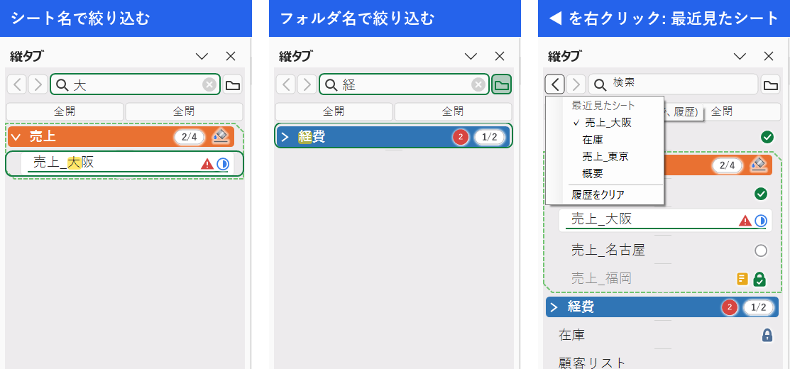

#### バッジと進捗の印

「タブ表示の設定」の「**表示するバッジ**」で選んだ印が、行の右端に出ます。数式エラー (赤い三角)、メモ (黄色)、シートの保護 (南京錠)、そして、シートごとの**進捗** (空の丸 = 未着手、半分の丸 = 作業中、緑の丸にチェック = 完了、緑のロックにチェック = 完了で保護済み) です。フォルダの行には、「完了したシート / 進捗のあるシートの数」が出ます (閉じたフォルダには、バッジの付くシートの数も出ます)。

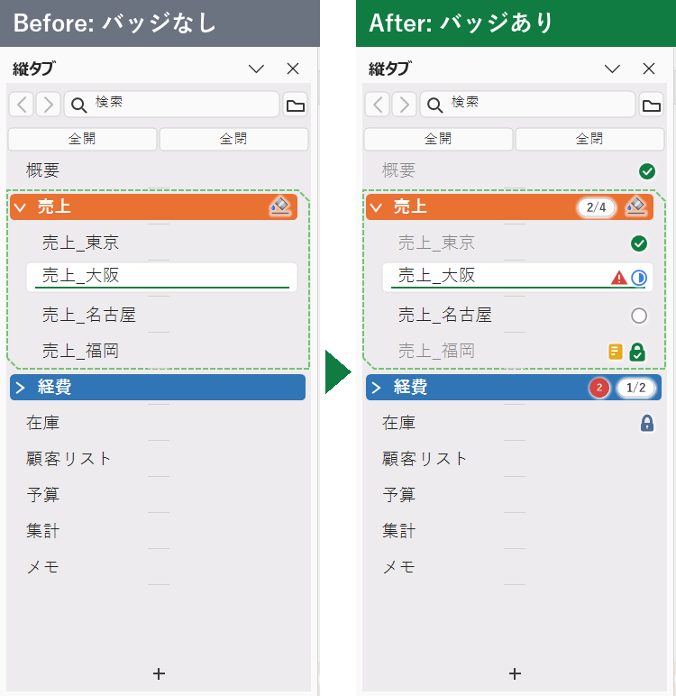

進捗は、**印をクリック**すると、順に進みます (なし → 未着手 → 作業中 → 完了)。右クリックの「**進捗**」からも、選べます。

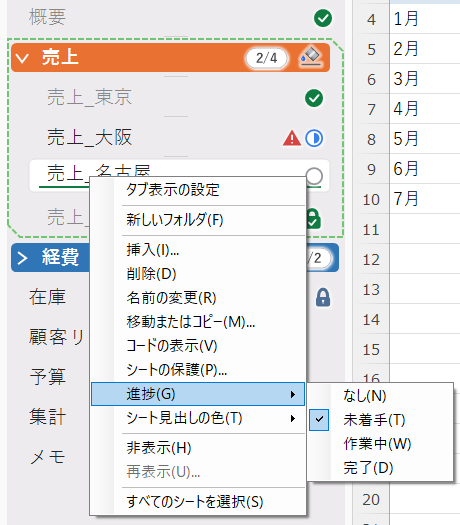

「完了」にした瞬間は、印がぽんとはじけます。

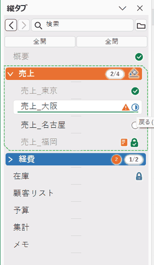

#### シートやフォルダの、追加・削除の動き

「追加・削除・完了のアニメーション」(初期値は、オン) で、シートを増やしたり、消したりしたときの縦タブの動きが付きます。素早く操作したい人は、オフにできます。

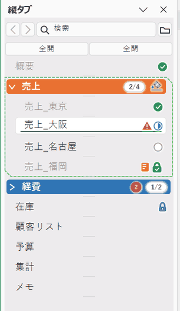

### 1.10 使い方のまとめ

| やりたいこと | 操作 |
|---|---|
| 縦タブを出す / 隠す | 初期値は、出ます。「×」で、そのウィンドウだけ隠せます。出し直すのは、リボン「表示」 > 「縦タブ」 > 「タブ表示の設定」 > 表示モード「横タブと縦タブの両方」 > OK |
| シートを切り替える | 縦タブのシート名をクリック (↑ / ↓ キーでも可) |
| シートを追加する | 縦タブの下端の「+」 (アクティブなシートの次に入る) |
| シート名を変える | シート名をダブルクリック、または F2 |
| シート名をコピーする | 行を左ボタンで押したまま、右ボタンも押して、両方を離す (横タブと同じシート名。フォルダの行は、フォルダ名) |
| シートを並べ替える | ドラッグ (挿入位置に三角形が出る)。Ctrl+ドラッグでコピー |
| 複数のシートを選ぶ | Ctrl+クリック、Shift+クリック |
| シートをフォルダに入れる | 選んで、右クリック > 「新しいフォルダ」。または、既存のフォルダへドラッグ |
| フォルダを開閉する | 行の先頭の `>` / `∨` |
| 全フォルダを開閉する | 縦タブの上端の「全開」「全閉」ボタン (フォルダが1つ以上あるとき) |
| シートを探す | 縦タブの上端の検索ボックスに入力 (Ctrl+F)。◀ ▶ で、見たシートをたどる |
| 進捗を付ける | 行の右端の印をクリック、または、右クリック > 「進捗」 (「表示するバッジ」で「進捗」を入れたとき) |
| 見た目を変える | 「タブ表示の設定」の「デザイン」タブ (選択デザイン、マーカー、点線) |
| 縦タブを消す | 縦タブの「×」 (そのウィンドウだけ)、または、表示モードを「横タブのみ」に (PC共通) |

詳しい操作は、[4章](#4-基本の使い方)から[8章](#8-設定画面)にあります。

## 2. できること (機能一覧)

| 分類 | 機能 |
|---|---|
| 縦タブの表示 | シートを縦に並べて表示 / 左右どちらにも配置 / ペインの幅をドラッグで変更 (保存される) / シートが多いときは縦スクロール / 長い名前は「…」で省略、ポインターを乗せると全体を表示 |
| 表示モード | 横タブのみ / 両方 (PC共通。初期値は両方)。横タブを隠したブックでは、縦タブも出ない |
| 見た目 | Excelの横タブと同じ色、形、シート見出しの色。選択中のフォルダとシートの見た目は、設定画面で、「標準」(Excelの横タブと同じ。白い塗りと薄い枠、アクティブなシートに緑の下線)、「ダブルフレーム」、「グロッシーグラス」(上半分に反射の帯がある、光沢のあるガラスを重ねる)、「フロストグラス１」(縁が内側から光る磨りガラスを、行の上に重ねる)、「フロストグラス２」(行の色 (色なしの行は緑) を帯びた磨りガラスを重ねる)、「インセット」(押し込まれたように凹んで見える)、「ストライプ」(ななめの縞と枠)、「クリスタル」(斜めのカット面と、消えていく明るい色) から選べる (初期値は、標準)。ガラスの選択肢では、行の色や区切り線が、ガラス越しに透けて見える。ダブルフレームでは、選択中の行は、(色付きは、元の色のまま) 影が付き、暗い外枠と白い内枠の二重の枠で囲まれ、文字が太字になる。シートの内容が表示されている、アクティブなシートの印 (マーカー) は、設定画面の「アクティブシートのマーカー表示」で、下線マーカー (名前の下に線)、三角マーカー (左右の端に小さな三角)、両端バーマーカー (左右の端に太い帯)、チェックバッジマーカー (名前の左に丸いチェック)、マーカーなし から選べ (初期値は、下線マーカー)、どの選択デザインとも組み合わせて表示される (フォルダと、グループの、ほかのシートには付かない)。三角は、その行の色の反対色 (色相環で、最も色差が大きい色) で、白い縁取りとぼかしが付き、暗い背景や暗い色の行でも見える。マーカーの色が、行の色に近いときは、色差が大きくなるように、自動で調整される。Officeテーマ (カラフル、白、黒、ダークグレー) と画面の拡大率に対応 |
| シートの操作 | 切り替え / 追加 (+) / 挿入 / 削除 / 名前の変更 / シート名のコピー (左右ボタンの同時押し) / 移動 / コピー / 非表示 / 再表示 / シートの保護 / コードの表示 / シート見出しの色 |
| 複数選択 | Ctrl+クリック、Shift+クリックで、グループ選択。グループのまま、移動、コピー、色の変更、非表示、削除 |
| フォルダ | シートを1段のフォルダに分類 / 開閉 / 名前、色 / ドラッグで移動、コピー / フォルダごとの一括操作 / 縦タブの上端の「全開」「全閉」ボタン (フォルダが1つ以上あるとき)。並びは、横タブにも反映 |
| シート名のルール | 横タブのシート名「A &#124; B」を、縦タブでは、フォルダ A の中のシート B として表示 (使う/使わないを選択) |
| 検索、履歴 | 縦タブの上端の検索ボックスで、シート名 / フォルダ名を絞り込み / ◀ ▶ で、見たシートをたどる (最大20枚、ブックに保存) / 最近見たシートの一覧 (最大10枚) |
| バッジ、進捗 | 行の右端に、数式エラー、メモ、保護、進捗 (未着手 / 作業中 / 完了。完了 + 保護の印も) を表示。閉じたフォルダには、中のシートの数を表示 (PC共通。初期値は、出さない) |
| アニメーション | シートを選んだとき、フォルダを開閉・選択 / 解除したときに、その行が揺れる (6種類の動きとランダム、揺れの大きさ、長さ、効果音。初期値は、なし) / ドラッグ中の半透明のゴースト / シート、フォルダの追加、削除の動き (初期値は、オン) / 進捗を完了にしたときの、はじける動き (初期値は、オン) |
| 設定画面 | 5つのタブに分かれる。基本: 表示モード、縦タブの位置。デザイン: アクティブシートのマーカー表示、フォルダ＆シート選択のデザイン、フォルダを囲む点線 (表示/非表示、色の濃さ)。アニメーション: 開閉したフォルダ＆選択したシートのアニメーション (効果音を含む)、追加・削除・完了のアニメーション。バッジ: 表示するバッジ。このブック: シート名のルール |
| 設定の保存 | 見た目、表示モードなどは、PCに保存 (このPCのすべてのブックに共通)。縦タブの幅、シート名のルール、フォルダの構成は、ブックに保存 |

横タブのシートの右クリックメニューにも、先頭に「タブ表示の設定」が加わります。

## 3. インストール

配布用zipの場合の手順です (同じ内容が、zip内の `はじめにお読みください.txt` にもあります)。

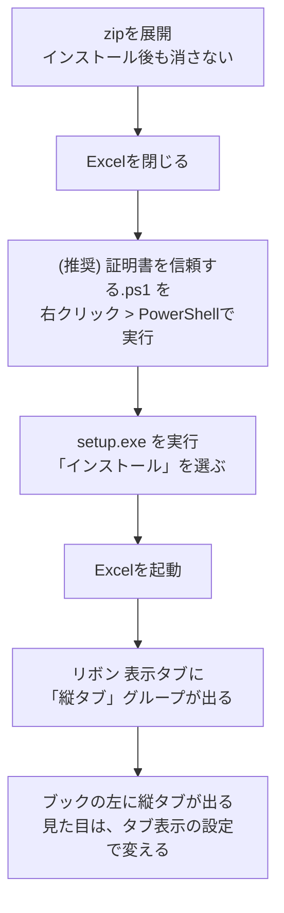

1. zip を、任意の場所に展開します。**展開したフォルダは、インストール後も消さないでください** (アドインの登録が、このフォルダの `VerticalSheetTabs.vsto` を指します)
2. Excel を閉じます
3. (推奨) 「証明書を信頼する.ps1」を右クリックして「PowerShell で実行」します。アドインの署名の証明書 (公開部分のみ) を、現在のユーザーの信頼済みの証明書として登録します。登録しないと、手順4で、「発行元を確認できません」という警告が出ます
   - PowerShell の実行がブロックされるときは、次を実行します: `powershell -ExecutionPolicy Bypass -File ".\証明書を信頼する.ps1"`
4. `setup.exe` を実行し、確認画面で「インストール」を選びます
5. Excel を起動します。リボンの「表示」タブに「縦タブ」グループが出ていれば、インストールできています
6. ブックを開くと、左側に縦タブが出ます ([4.1](#41-はじめて開いたとき))

新しい版に更新するときは、新しい zip の `setup.exe` を、もう一度実行します (上書きされます。自動更新はしません)。

## 4. 基本の使い方

### 4.1 はじめて開いたとき

- 横タブと**縦タブの両方**が表示されます (表示モード「両方」)。縦タブは、左に表示されます
- 横タブを隠しているブックでは、縦タブは出ません (ブックの作成者の意思として、そのままにします)
- 縦タブの幅は、初めて表示したとき、半角12文字分です。ペインの端をドラッグすると、幅を変えられます (幅は、ブックに保存されます)

### 4.2 表示モードと位置を変える

リボンの「表示」タブ > 「縦タブ」グループ > **タブ表示の設定** を押し、「**基本**」タブで選びます (横タブ、縦タブを右クリックしたメニューの先頭の「タブ表示の設定」でも開きます)。

| 表示モード | 横タブ | 縦タブ |
|---|---|---|
| 横タブのみ表示 | (変えない) | 非表示 |
| 横タブと縦タブの両方を表示 | (変えない) | 表示 |

縦タブの位置は、左または右を選べます。

> 縦タブの上の「×」(閉じるボタン) を押すと、**そのウィンドウだけ**、縦タブが消えます。PCの設定は、変わりません (あとで開いたブックには、縦タブが出ます)。出し直すときは、設定画面で、表示モードを「横タブと縦タブの両方を表示」にして、OKを押します。
>
> 縦タブをドラッグして、反対側へ動かすことはできますが、その位置は、保存されません。位置を決めておくときは、設定画面で選びます。

### 4.3 保存について

見た目や表示モードなどの設定は、設定画面で**OKを押したときに**、このPCに保存されます (ブックの保存とは関係ありません)。

縦タブの幅と、シート名のルールは、**ブックを保存したときに**、そのブックへ書き込まれます。保存せずに閉じると、変更は残りません。フォルダの開閉、色、名前の変更も同じです (変更すると、ブックは「変更あり」になります)。

## 5. シートの操作

縦タブの操作は、Excelの横タブと同じです。

### 5.1 マウス操作

| 操作 | 動作 |
|---|---|
| クリック | そのシートに切り替える |
| Ctrl+クリック | シートを、グループ選択に追加 / 解除する |
| Shift+クリック | アクティブなシートから、クリックしたシートまでを選択する |
| ダブルクリック | シート名を、その場で編集する (Enterで確定、Escで取り消し) |
| ドラッグ | シートを移動する。持ち上げた行が、半透明の「ゴースト」になってポインターについてきて、元の位置には、薄い行が残る。挿入位置には三角形が出る。離すと、ゴーストが挿入位置にすっと収まる。選択中のシートは、まとめて動く (ゴーストに個数が付く)。1枚のシートを移動して離すと、そのシートがアクティブになる。アニメーションの設定があれば、移動したシートは、すべて、落ちた位置で揺れる |
| Ctrl+ドラッグ | シートをコピーする (ゴーストに「+」が付き、元の位置は、そのまま) |
| 右クリック | メニューを開く (下の表) |
| ホイール | シートが多いとき、スクロールする |
| 左ボタンを押したまま、右ボタンも押す | ポインターに重ねて、**コピーアイコン**を出す。両方のボタンを離すと、すぐコピーする。シートの選択、アクティブなシートは、変わらない。右クリックのメニューは出ない |
| (両方を離したとき) | シート名を、クリップボードにコピーする (フォルダの行では、フォルダ名)。コピーされる名前は、**横タブのシート名と同じ**で、シート名のルールを使うブックでは、「売上 \| 東京」のように、フォルダ名のついた名前になる。シートは、切り替わらない |
| 下端の「+」 | 新しいシートを、アクティブなシートの次に追加する (アクティブなシートがフォルダの中なら、そのフォルダの中に入る。選択しているシートが、すべて閉じたフォルダの中にあるときは、いちばん下に追加する) |

- **コピーアイコン**: 行を左ボタンで押したまま、右ボタンも押すと、ポインターに重なって、小さなアイコンが出ます。そのまま両方のボタンを離すと、名前をコピーして、アイコンが緑のチェックに変わり (約1秒)、そのあと消えます。離す前に、ポインターをその行から出すと、コピーをやめます (アイコンも消えます)。行にポインターを戻しても、アイコンは出ず、離してもコピーしません。ポインターが行から出たとき、ほかのボタンを押したとき (アイコンの上以外) も、消えます。

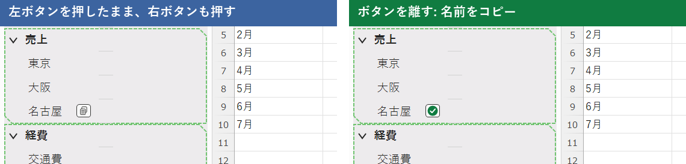

### 5.2 キー操作

| キー | 動作 |
|---|---|
| ↑ / ↓ | 前 / 次のシートに切り替える |
| F2 | シート名 (フォルダが1つだけ選択されているときは、フォルダ名) を編集する |
| Delete | シートを削除する。フォルダを選択しているときは、フォルダと中のシートを削除する (確認あり) |
| Ctrl+S / F12 | 上書き保存 / 名前を付けて保存 (縦タブにフォーカスがあるときも使えます) |

### 5.3 シートの右クリックメニュー

| 項目 | 内容 |
|---|---|
| タブ表示の設定 | 設定画面を開く |
| 新しいフォルダ | 選択中のシートを入れた、新しいフォルダを作る ([6章](#6-フォルダ)) |
| 挿入 | アクティブなシートの前に、新しいシートを入れる。フォルダの中のシートで選ぶと、そのフォルダの中に入る |
| 削除 | シートを削除する (Excel標準の確認) |
| 名前の変更 | シート名を編集する |
| 移動またはコピー | Excel標準のダイアログを開く |
| コードの表示 | VBAエディターを開く |
| シートの保護 | シートを保護する (保護中は「シート保護の解除」) |
| シート見出しの色 | Excelと同じパレットで、シートの色を付ける。「その他の色」は、Excelの横タブと同じ「色の設定」画面 (標準の色の六角形と、ユーザー設定) が開く |
| 非表示 / 再表示 | シートを隠す / 隠したシートを出す |
| すべてのシートを選択 | 全シートをグループ選択する |
| シートのグループ解除 | グループ選択を解除する (グループ選択中だけ) |

- 非表示のシートは、縦タブにも表示されません (ワークシート、グラフシートは表示されます)
- グループ選択中は、色の変更、非表示、削除などが、選択中のすべてのシートに適用されます (Excelと同じ)
- ブックの構造が保護されているときは、挿入、削除、名前の変更、移動、コピー、非表示、再表示、「+」は使えません

### 5.4 セルの入力中に、シートを切り替えたとき

セルに入力している途中で、縦タブのシートをクリックすると、横タブのときと同じく、そこまでの入力が確定されてから、シートが切り替わります。

### 5.5 検索ボックスと、戻る・進む

(画像は、[1.9](#19-探すたどる状態を見る-検索履歴バッジ進捗)にあります。)

縦タブの上端に、左から **◀ (戻る)**、**▶ (進む)**、**検索ボックス**、**フォルダの切り替え** が並びます。

| 操作 | 動作 |
|---|---|
| 検索ボックスに入力 | 入力するたびに、シート名を絞り込みます (部分一致。大文字小文字、全角半角は区別しません)。一致した文字は黄色に光り、一致したシートを含むフォルダは、開いた形で出ます (閉じたフォルダの中のシートも探します) |
| ↑ ↓ / Enter / Esc | 候補を選ぶ / そのシートへ移動 / 検索を終わる |
| フォルダのアイコン | ONにすると、フォルダ名を検索します。一致したフォルダだけが出て、開くと、中のシートがすべて出ます |
| Ctrl+F | 縦タブにフォーカスがあるときだけ、検索ボックスに移ります (Excelの検索は、そのままです)。縦タブにフォーカスがあるとき、文字キーを押すと、その文字が検索ボックスに入ります |
| ◀ ▶ のクリック | 見たシートを、ブラウザの戻る / 進むのように、たどります |
| ◀ の長押し、◀ ▶ の右クリック | 「最近見たシート」(最大10枚) の一覧を出し、選んだシートへ移動します。一覧のいちばん下の「履歴をクリア」で、履歴をすべて消せます。閉じたフォルダの中のシートは、フォルダを開いて、移動します |

- 履歴は、ブックに保存されます (最大20枚。保存したときに書き込まれます)。シート名を変えても追従し、削除したシートは、履歴から消えます
- 検索中は、ドラッグでの移動はできません
- 日本語入力では、最初の1文字を、縦タブへ直接打っても届かないことがあります。Ctrl+F か、検索ボックスのクリックのあとに、入力してください

### 5.6 行のバッジ (数式エラー、メモ、保護)

「タブ表示の設定」の「**表示するバッジ**」で、シートの状態を、行の右端の小さな印で知らせます。**初期値は、どれも出しません** (PC共通の設定)。

| バッジ | 意味 |
|---|---|
| 赤い三角の「!」 | そのシートに、数式エラー (#REF!、#DIV/0!、#NAME? など) があります |
| 黄色のメモ | そのシートに、メモ、コメントがあります |
| 青灰色の南京錠 | そのシートが、保護されています |
| 丸い数字 | 閉じたフォルダの中の、バッジが付くシートの数です (エラーがあれば赤、メモだけなら黄色) |

- 印に、ポインターを乗せると、「数式エラーが 3 か所」などと出ます
- アクティブなシートの三角、両端バーのマーカーとは、重ならないように、その内側に出ます
- ガラスの選択デザイン (グロッシーグラス、フロストグラス１、２) では、選択中の行のバッジは、ガラス越しに、やわらかく見えます
- 行の右端に並ぶ印には、白い縁取りとぼかしが付き、暗い行や、色付きの行の上でも、見失いません
- 選んだバッジだけを調べます。何も選ばないときは、何も調べません。アクティブなシートのメモと保護は、常に読み直します。セルを変更したり、再計算されたりすると、少し待ってから (約0.5秒)、そのシートを調べ直します。ほかのシートも、約10秒ごとに、順に調べ直します

### 5.7 シートの追加・削除のアニメーション

「タブ表示の設定」の「アニメーション」タブの「**追加・削除・完了のアニメーション**」で、「フォルダ・シートの追加・削除を、動きで見せる」を入れると、フォルダやシートを増やしたり、消したりしたときの縦タブの動きが付きます。素早く操作したい人は、オフにできます (**初期値は、オン**。PC共通の設定)。

| 操作 | 動き (約0.4秒) |
|---|---|
| シートを追加する | 新しい行が、ぽんと現れて、少し弾んで落ち着きます。下の行は、下がって席をあけます |
| シートを削除する | 行が縮んで、薄れて消え、色の粒が飛び散ります。下の行は、上へつまります |
| フォルダを作る、コピーする | フォルダの行が、ぽんと現れます。フォルダに入るシートは、横へすべって、字下げが付きます |
| フォルダを削除する | フォルダの行が縮んで消えます。中のシートは、横へすべって、字下げがなくなります (「フォルダと中のシートを削除」では、まとめて縮んで消えます) |

- 縦タブの「+」、Excelの横タブ、マクロなど、どの方法でも、動きます。動きの長さは、固定で、音は付きません (動きは、[1.9](#19-探すたどる状態を見る-検索履歴バッジ進捗)の画像で見られます)
- 一度に何枚追加、削除しても動きます。動くのは、画面に見えている行だけで、スクロールで隠れている行は、動かずに追加、削除されます
- 名前の変更、シート名のルールを使っているとき、検索の絞り込み中は、動きません

### 5.8 進捗の印 (未着手・作業中・完了)

「タブ表示の設定」の「**表示するバッジ**」で、「進捗」を入れると、シートごとの進捗を、行の**右端** (すべてのバッジの、いちばん右) の印で示せます (初期値は、オフ)。

| 印 | 意味 |
|---|---|
| 空の丸 (灰色) | 未着手 |
| 半分塗った丸 (青) | 作業中 |
| 緑の丸にチェック | 完了 (シートの名前が、少し薄くなります) |
| 緑のロックにチェック | 完了で、シートが保護されています (保護のバッジの、ロックは出ません) |
| 「1/3」の丸薬 (フォルダ) | 完了したシート / 進捗のあるシートの数。すべて完了すると、緑にチェック |

- **付け方**: シートを右クリックして、「進捗」から選びます (選択中のシートすべてに付きます)。また、**印をクリック**すると、そのシートだけ、順に進みます (なし → 未着手 → 作業中 → 完了)。**「完了」の印をクリック**すると、Excelの「シートの保護」のダイアログが出て、保護を有効にすると、印が「完了 + ロック」(緑のロックにチェック) になります。その印をクリックしても、保護は解除されません (保護の解除は、右クリックのメニューか、リボンの「シート保護の解除」から行います)。「なし」に戻すときは、右クリックの「進捗」から選びます
- **完了にすると**、印がぽんと膨らんで、はじけます (約0.5秒、音なし)。「追加・削除・完了のアニメーション」の「進捗を『完了』にしたとき、印をはじけさせる」で、オフにできます (初期値は、オン)
- 進捗は、シートに保存されます (ブックを保存したときに、残ります)

## 6. フォルダ

シートを**フォルダ**にまとめて、縦タブを見やすくします。フォルダは1段だけです (フォルダの中に、フォルダは作れません)。

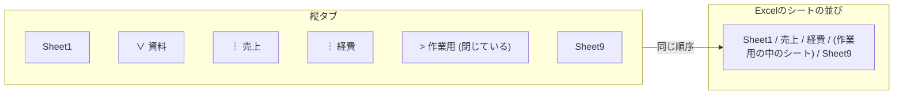

**フォルダの中のシートは、Excelのシートの並びの中でも連続して並びます**。縦タブでフォルダを動かすと、横タブの並びも変わります。

### 6.1 フォルダを作る

1. 縦タブで、フォルダに入れたいシートを選びます (複数も可)
2. 右クリック > **新しいフォルダ**
3. 名前を入力して Enter (「フォルダ1」などの仮の名前が付いています)

### 6.2 フォルダの操作

| 操作 | 動作 |
|---|---|
| 行の先頭の `>` / `∨` をクリック | 開く / 閉じる (閉じると、中のシートは縦タブから隠れます。横タブは変わりません) |
| フォルダの行をクリック | フォルダを選択 / 選択解除する (中のシートの選択は変わりません)。アニメーションの設定があれば、そのフォルダが揺れる |
| ダブルクリック、F2 | フォルダ名を編集する |
| ドラッグ | フォルダを、中のシートごと移動する。Ctrl+ドラッグで、コピーする (名前は「フォルダ名 (2)」) |
| シートをフォルダの上にドラッグ | フォルダの中に入れる (フォルダを開いてから、中のシートの間に落とします) |
| シートをフォルダの外にドラッグ | フォルダから出す。フォルダの最後のシートの下に落としても、出せます |
| Delete | 選択中のフォルダと、中のシートを削除する (確認あり) |
| 行の右端のペンキ缶の印をクリック | 「フォルダの色」のパレットを出す (「フォルダと中のシートを同一色に設定」がONのフォルダだけに、印があります) |
| ペンキ缶の印をダブルクリック | 「その他の色」の「色の設定」画面を出す (クリックした位置に出ます) |

### 6.3 フォルダの右クリックメニュー

| 項目 | 内容 |
|---|---|
| タブ表示の設定 | 設定画面を開く |
| フォルダ名の変更 | 名前を編集する |
| フォルダ内のシートをすべて非選択 | フォルダ内のシートを、選択から外す |
| フォルダ内のシートをすべて選択 | フォルダ内のシートを、グループ選択する (そのあと、シートの右クリックメニューの「シートの保護」、「移動またはコピー」で、まとめて操作できます) |
| フォルダ内のシートをすべて非表示 / 再表示 | まとめて隠す / 出す |
| フォルダの色 | フォルダの行の色を付ける。中のシートの色は変わらない (「フォルダと中のシートを同一色に設定」がONのフォルダでは、中のシートにも、同じ色が付く)。「その他の色」は、Excelの「色の設定」画面が開く |
| フォルダと中のシートを同一色に設定 | 選ぶたびに、ON / OFF が切り替わる。ONにすると、そのときに中のすべてのシートへ、フォルダの色を付ける。ONのフォルダは、行の右端に、傾いたペンキ缶と青いしずくの印が付き、**そのあとも、フォルダの色を変えると中のシートの色も変わり、新しく入ったシートにも、自動で、フォルダの色が付く**。OFFに戻しても、シートの色は元に戻らない。印をクリックすると「フォルダの色」のパレット、ダブルクリックすると「その他の色」の「色の設定」画面が出る (選択中のフォルダの印なら、選択中のフォルダすべてに、それ以外は、そのフォルダに付く) |
| フォルダの削除 | フォルダだけ削除する (中のシートは、フォルダの外に残ります) |
| フォルダと中のシートを削除 | フォルダと、中のシートを削除する (確認あり) |

すべてのフォルダを、まとめて開く / 閉じるときは、縦タブの上端の「全開」「全閉」のボタンを使います ([6.5](#65-全開全閉ボタン))。

### 6.4 開いたフォルダの点線

開いたフォルダは、中のシートと一緒に、点線で囲まれます (右上と左下の角が欠けた形です)。点線の表示 / 非表示と、色の濃さは、設定画面の「デザイン」タブで変えられます。

### 6.5 「全開」「全閉」ボタン

フォルダが**1つ以上**あるとき、縦タブの上端 (ペインのタイトルバーの下) に、「全開」「全閉」の2つのボタンが出ます。「全開」を押すと、すべてのフォルダが開き、「全閉」を押すと、すべてのフォルダが閉じます (選択しているフォルダに関係なく、すべてが対象です)。フォルダがすべて無くなると、ボタンは消えます。シートが多くてスクロールするときも、ボタンは上に残り、シートの行だけが動きます。

## 7. シート名のルール

横タブしか使わない人や、他の人とブックを共有する人でも、**シート名だけでフォルダの構成を共有できる**機能です。設定画面で「シート名のルールを使う」にチェックしたブックだけで、有効になります (初期値は、使わない)。

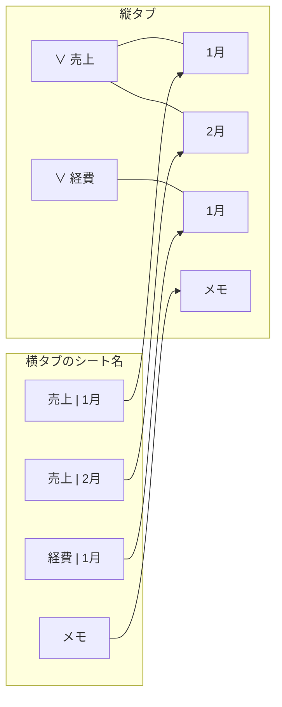

### 7.1 ルール

- 区切りは、**半角スペース、縦棒、半角スペース (` | `)** です。シート名「A | B」は、縦タブでは、フォルダ「A」の中の、シート「B」になります
- 区切りの前後のどちらかが空のとき (例: 「A | 」) は、ルールの対象外です。区切りが2つ以上あるときは、最初の区切りで分けます
- 横タブで、シート名を「A | D」に変えると、そのシートは、左側にある「A | 」で始まるシートのうち、最も近いものの右側に、自動で移動します
- 縦タブでの操作は、横タブのシート名に反映されます

| 縦タブの操作 | 横タブのシート名 |
|---|---|
| フォルダ「N」を、シート「M」から作る | 「N &#124; M」 |
| シートをフォルダに入れる / 出す | 「フォルダ名 &#124; シート名」 / 「シート名」 |
| フォルダ名を変える | 中のシートすべてが、「新しい名前 &#124; シート名」 |
| シート名を変える | 「フォルダ名 &#124; 新しい名前」 |
| フォルダだけを削除する | 中のシートは、「シート名」だけに戻る |
| フォルダの中で「+」「挿入」 | 「フォルダ名 &#124; Sheet4」など |

### 7.2 制限

- フォルダ名とシート名の長さの合計は、**28文字まで**です (Excelのシート名の上限31文字から、区切りの3文字を除いた長さ)。入力ボックスは、この長さまでしか入力できません
- フォルダ名、シート名に、` | ` を含む名前は付けられません (警告が出て、入力が中断されます)
- 長さの超過や、名前の重複で、操作に必要な名前を付けられないときは、メッセージを出して、何も変えません

### 7.3 使い始めるとき、やめるとき

- 「使わない」から「使う」に切り替えると、すでにあるフォルダの中のシートに、「フォルダ名 | シート名」の名前が付きます。名前を付けられないシートがあるとき (長さ、重複) は、メッセージを出して、ルールは使わない状態のままです
- 「使う」から「使わない」に戻しても、シート名はそのままです

## 8. 設定画面

リボンの「表示」タブ > 「縦タブ」 > **タブ表示の設定**、または、右クリックメニューの先頭の「タブ表示の設定」で開きます。変更は、**開いているブックにだけ**適用されます。

設定は、**基本 / デザイン / アニメーション / バッジ / このブック** の5つのタブに分かれています。画面は、いつも「基本」のタブで開きます。OK とキャンセルは、どのタブを見ているときも、すべてのタブの設定に効きます。

- 最初の4つのタブは、**このPCのすべてのブックに共通**です。タブの先頭に、そう書いてあります。OKを押すと、PCに保存され、画面を開いた**ウィンドウだけ**すぐ変わります。ほかのウィンドウは、ブックを開き直したときに変わります。
- 「このブック」のタブだけ、開いているブックに保存されます (ブックの保存のときに書き込まれます)。
- 表示モードの初期の選択は、そのウィンドウの**実際の状態**です (「×」で縦タブを消したウィンドウでは、「横タブのみ」が選ばれています)。
- 開いているブックの横タブが隠されているときは、「基本」のタブに、「このブックは、横タブが非表示のため、縦タブは表示されません。」と出ます。

| タブ | グループ | 項目 | 内容 |
|---|---|---|---|
| 基本 | 表示モード | 横タブのみ / 横タブと縦タブの両方 | 縦タブの表示を選ぶ (横タブは、変えません) |
| 基本 | 縦タブの位置 | 左 / 右 | 縦タブのペインを置く側 (「横タブのみ」のときは選べません) |
| このブック | シート名のルール | 使う | [7章](#7-シート名のルール)。このブックだけの設定 |
| デザイン | アクティブシートのマーカー表示 | 下線マーカー / 三角マーカー / 両端バーマーカー / チェックバッジマーカー (名前の左に丸いチェック) / マーカーなし (横に並ぶ) | アクティブなシートの印。選んだマーカーは、下の選択デザインのサンプルにも、すぐ反映される。初期値は、下線マーカー |
| デザイン | フォルダ＆シート選択のデザイン | 標準 / ダブルフレーム / グロッシーグラス / ストライプ / フロストグラス１ / フロストグラス２ / インセット / クリスタル | 選択中のフォルダとシートの見た目。8つの選択肢が、横4 x 縦2 に並ぶ。左端に、非選択のサンプルが1つ (2段の中央)、各選択肢には、選択 (色なしのシート) と選択 (色付きのシート) のサンプルが出る (サンプルをクリックしても選べる)。初期値は、標準 |
| デザイン | フォルダを囲む点線 | 点線を表示する | 開いたフォルダの点線の ON / OFF |
| | | 色 (1から9) | 点線の色。右にいくほど、縦タブの背景から離れた、はっきりした色 |
| アニメーション | 開閉したフォルダ＆選択したシートのアニメーション | なし / 1 シェイク / 2 ウォブル / 3 ジェリー / 4 バウンス / 5 パルス / 6 スイング / 7 ランダム (横に並ぶ) | シートを選んだとき、そのシートが、フォルダを開閉したときや、選択 / 解除したとき、そのフォルダが揺れる (フォルダを開いたときは、中の見えているシートも一斉に揺れる)。7 ランダムは、そのたびに、1から6のどれかを選ぶ。初期値は、なし |
| | | 揺れの大きさ (40から200%)、揺れの長さ (0.3から1.2秒) のスライダー | 初期値は、100%、0.6秒。右の「揺れのリセット」ボタンで、初期値に戻る (「なし」のときは、スライダーとボタンは使えません) |
| | | サンプル | 左端に、揺れるシートが1つ。選んだ動きを、繰り返し見せる (ランダムのときは、毎回、違う動き) |
| | | 効果音を鳴らす、音量 (0から100%) | 揺れの動きに合った効果音を、揺れが始まるときに鳴らす。初期値は、鳴らさない (オフ)、音量は、60%。PC共通。「アニメーション」タブを開いている間は、サンプルが揺れるたびに (約2.2秒ごと)、音も鳴り、試し聞きできる (「なし」のときは、使えません) |
| | | サンプルの見た目を、選択したデザインとマーカー表示に合わせる | チェックを入れると、サンプルが、いま選んでいる選択デザインとマーカー表示 (「デザイン」タブ) で描かれる (入れないときは、標準と下線マーカー)。この状態は、PC共通です |
| アニメーション | 追加・削除・完了のアニメーション | フォルダ・シートの追加・削除を、動きで見せる / 進捗を「完了」にしたとき、印をはじけさせる | 縦タブの追加、削除の動きと、完了の印の動きを、それぞれ、オン / オフする。初期値は、どちらも、オン |
| バッジ | 表示するバッジ | 数式エラー / メモ・コメント / シートの保護 / 進捗 (未着手・作業中・完了) | 行の右端に出す印を、チェックで選ぶ (初期値は、どれも出さない)。各チェックの左に、その印と同じ図柄が出る。選んだ印は、選択デザインのサンプルにも、すぐ出る。閉じたフォルダには、中のシートの数を出す |

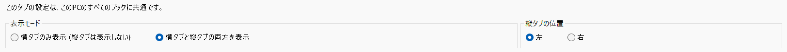

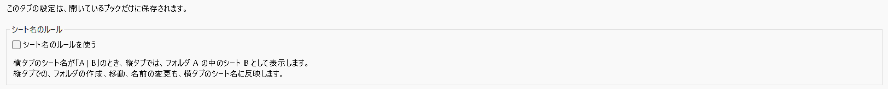

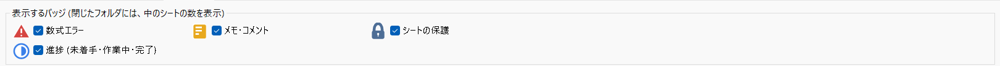

画面の左下に、バージョン、著作権、ライセンスが表示されます。

## 9. 設定の保存と、他の環境での扱い

### 9.1 保存される場所

見た目や表示モードの設定は、**PC**に保存されます。ブックを他の人に渡しても、見た目は、渡りません (相手のPCの設定で表示されます)。フォルダの構成や、縦タブの幅などは、ブックに保存されます。

| 内容 | 保存先 |
|---|---|
| 表示モード、位置、点線、見た目、バッジ、アニメーション | このPCの設定ファイル `%LocalAppData%\VerticalSheetTabs\settings.ini`。設定画面でOKを押して、値を変えたときに作られます。消すと、初期値に戻ります |
| 縦タブの幅、シート名のルール | ブックの「カスタムドキュメントプロパティ」 (`VTab.Width`、`VTab.NameRule`) |
| フォルダの構成 (名前、色、開閉、中のシート) | ブックの「カスタムXMLパート」 |
| フォルダ内のシートの識別 | 各ワークシートの隠しカスタムプロパティ `VTab.Id` |
| シートの進捗 | 各ワークシートの隠しカスタムプロパティ `VTab.Progress` (`todo` / `doing` / `done`) |
| 見たシートの履歴 | ブックの「カスタムXMLパート」 (フォルダの構成とは、別のパート) |

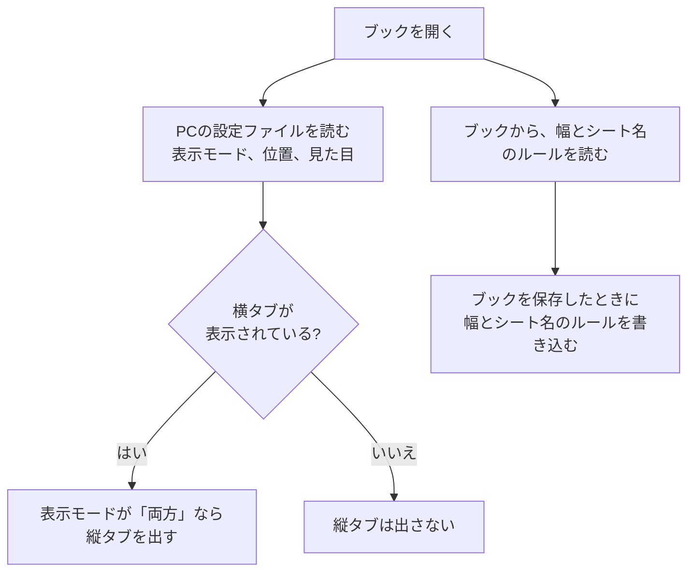

古い版 (v1.2.x まで) が、ブックに書いていた設定 (`VTab.Mode`、`VTab.Side`、`VTab.SelectStyle` など) は、読み込まず、ブックを保存したときに、削除します。「縦タブのみ」で保存したブックは、開いたとき、横タブを表示に戻します (ブックは「変更あり」になりません)。

### 9.2 このアドインがない Excel で開いたとき

- ブックの内容 (シート、セル) には、影響ありません。設定は無視されます
- フォルダの構成も無視されますが、**シートの並びは、フォルダの順のまま**です
- v1.2.x までに「縦タブのみ」で保存したブックは、アドインがない Excel では、横タブが表示されません (10章)。このアドインで開いて、保存し直すと、横タブが戻ります。または、「ファイル > オプション > 詳細設定 > このブックで作業するための表示設定 > シート見出しを表示する」にチェックを入れてください

## 10. 既知の制約

| 項目 | 内容 |
|---|---|
| タブの外見 | 縦に積むため、タブの幅は、ペインの幅いっぱい、文字は左寄せ、区切り線は横向きです。文字の描画は、Excelの横タブより、わずかに細く見えます |
| ペインの枠 | ペインの上に、タイトルバー (「縦タブ」、メニュー、閉じるボタン) が付きます。Excelの仕様で、消せません |
| v1.2.x までに「縦のみ」で保存したブック | アドインがない Excel では、横タブが表示されません (9.2)。このアドインで開いて、保存し直すと、直ります |
| 縦タブの位置 | ドラッグで反対側へ動かしても、保存されません。設定画面で選んでください |
| 同じブックの複数のウィンドウ | 設定画面を開いたウィンドウだけ、すぐ変わります。ほかのウィンドウは、開き直したときに変わります |
| Office のテーマの切り替え | Excelを起動し直すと、縦タブに反映されます (実行中の切り替えには、追従しません) |
| 暗い配色、100% 以外の拡大率 | 配色の値は実機から測っていますが、暗い配色 (ダークグレー、黒) の縦タブの表示と、125% 以外の拡大率は、実機で確認していません |
| 閉じたフォルダ | 閉じたフォルダの中へは、ドラッグで入れられません (開いてから落とします) |
| グラフシートとフォルダ | グラフシートは、名前でフォルダに結びつけています。Excel側で名前を変えると、フォルダから外れます (履歴からも外れます) |
| 横タブからの「挿入」 | Excel標準の横タブの右クリックからの「挿入」では、シート名のルールを使っていても、フォルダの中には入りません (縦タブの「挿入」を使ってください) |
| 縦タブにフォーカスがあるとき | Ctrl+S、F12 は使えますが、Ctrl+Z、Ctrl+P など、他のExcelのショートカットは、使えません。シートのセルをクリックしてから使ってください |
| 多数のシート | 1000枚のブックでも動作します (縦タブの更新の処理は、1回あたり約30ミリ秒です。「+」で追加したシートは、約0.05から0.08秒で縦タブに出ます)。フォルダのあるブックは、シート名の並びが変わるたびに、全シートの識別を読み直しますが、1000枚でも、約20ミリ秒です |
| Excelのダイアログが開いている間 | 保存確認、「名前を付けて保存」、セルの書式設定など、Excelのダイアログが開いている間は、縦タブの表示は、更新されません (閉じると、すぐ更新されます) |
| バッジの更新 | マクロなどで、メモや保護を、プログラムから変えたときは、そのシートを離れるか、約10秒後に、バッジが更新されます。値だけのエラー (数式でない `#N/A` など) は、数えません |
| 進捗 | ワークシートだけに付けられます (グラフシートには付けられません)。シートをコピーしても、進捗は、コピーされません |
| 日本語入力と検索 | 縦タブへ、文字を直接打つと、日本語入力の最初の1文字は、検索ボックスに届かないことがあります (Ctrl+F か、検索ボックスのクリックのあとに、入力してください) |
| 配布 | 自己署名の証明書です。他のPCにインストールするときは、証明書を信頼する必要があります (3章) |

不具合や要望は、状況 (ブックを開いた方法、拡大率、Excelのバージョン、操作の順序) を添えて、連絡してください。

## 11. 困ったときは

| 困ったこと | 確かめること |
|---|---|
| 縦タブが出ない | 次を確かめます。(1) 「タブ表示の設定」の「基本」タブの表示モードが、「横タブと縦タブの両方を表示」か。(2) 「×」で閉じたウィンドウは、設定画面で「横タブと縦タブの両方を表示」を選んでOKを押すと、出ます。(3) 横タブを隠したブックでは、縦タブも出ません (「ファイル > オプション > 詳細設定 > シート見出しを表示する」にチェックを入れると、出ます) |
| リボンに「縦タブ」グループが無い | アドインが読み込まれていません。Excelの「ファイル > オプション > アドイン」で、下の「管理」を「COM アドイン」にして「設定」を押し、「縦並びシートタブ」にチェックを入れます。一覧に無いときや、チェックがすぐ外れるときは、「管理」を「使用できないアイテム」にして、「VerticalSheetTabs」を有効にしてから、Excelを起動し直します。それでも出ないときは、インストールをやり直してください ([3章](#3-インストール)) |
| 開き直すと、フォルダの開閉が元に戻る | フォルダの構成は、ブックを保存したときに書き込まれます。変えたあとは、ブックを保存してください ([4.3](#43-保存について))。見た目の設定は、設定画面でOKを押したときに、PCに保存されます |
| 見た目の設定が、初期値に戻った (v1.3.0 に更新した) | v1.3.0 から、見た目の設定は、PCに保存されます。古い版でブックに書いた設定は、引き継ぎません。設定画面で、選び直してください |
| 開いただけなのに、閉じるときに保存を聞かれる | このアドインは、開いただけではブックを変更しません。ブックに、`NOW()` や `RAND()` などの揮発性の関数や、外部へのリンクがあると、Excel自身が、保存を聞くことがあります |
| フォルダが2つに分かれた、シートがフォルダから外れた | 横タブで、フォルダの中のシートの間に、フォルダの外のシートを移動すると、フォルダが分かれ、長いほうがフォルダとして残ります。縦タブで、ドラッグして直してください。グラフシートは、Excel側で名前を変えると、フォルダから外れます ([10章](#10-既知の制約)) |
| アドインのない Excel で開いたら、横タブが無い | v1.2.x までに「縦タブのみ」で保存したブックです。このアドインで開いて、保存し直すと、直ります。または「ファイル > オプション > 詳細設定 > このブックで作業するための表示設定 > シート見出しを表示する」にチェックを入れてください ([9.2](#92-このアドインがない-excel-で開いたとき)) |
| 縦タブをクリックしたあと、Ctrl+Z などが効かない | 縦タブにフォーカスがあるときは、Ctrl+S と F12 だけが使えます。シートのセルをクリックしてから使ってください |
| 揺れや音が気になる | 「タブ表示の設定」の「アニメーション」タブで、動きを「なし」に、効果音のチェックを外します。追加・削除の動きも、同じタブで切れます |
| インストールで「発行元を確認できません」と出る | 自己署名の証明書のためです。先に「証明書を信頼する.ps1」を実行してから、`setup.exe` を実行してください ([3章](#3-インストール)) |

## 12. アンインストール

- Windows の「設定 > アプリ > インストールされているアプリ」から、「VerticalSheetTabs」を削除します
- 証明書を登録した場合は、「certmgr.msc」の「信頼された発行元」と「信頼されたルート証明機関」から、「VerticalSheetTabs」を削除できます
- ブックに保存された設定 (`VTab.Width`、`VTab.NameRule`、フォルダの構成) は、残ります。ブックのデータには影響しません
- PCの設定ファイル (`%LocalAppData%\VerticalSheetTabs\settings.ini`) は、残ります。不要なら、フォルダごと削除してください

## 13. 動作環境、ライセンス

### 動作環境

- Windows、Microsoft 365 の Excel (64bit で確認)
- .NET Framework 4.8 (Windows 11 には標準で入っています)、Visual Studio 2010 Tools for Office Runtime (インストーラが導入します)

### ライセンス

このソフトウェアは、BSD 3条項ライセンスに準拠します。Copyright (c) 2026 nk_taka。

- 条文は、[license](license) フォルダにあります: [LICENSE.txt](license/LICENSE.txt) (英文。正本)、[LICENSE.ja.txt](license/LICENSE.ja.txt) (日本語訳。参考)
- 「タブ表示の設定」の画面の左下にも、バージョン、著作権、ライセンスを表示しています
